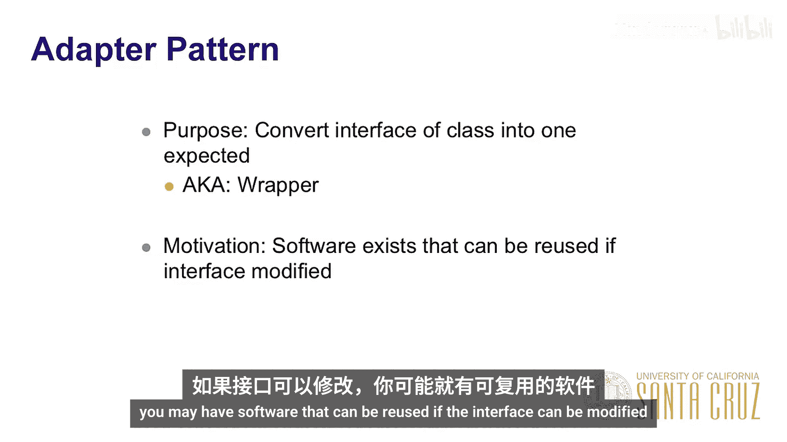
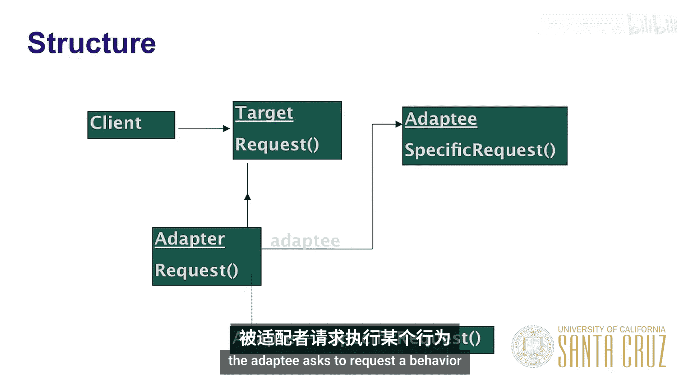
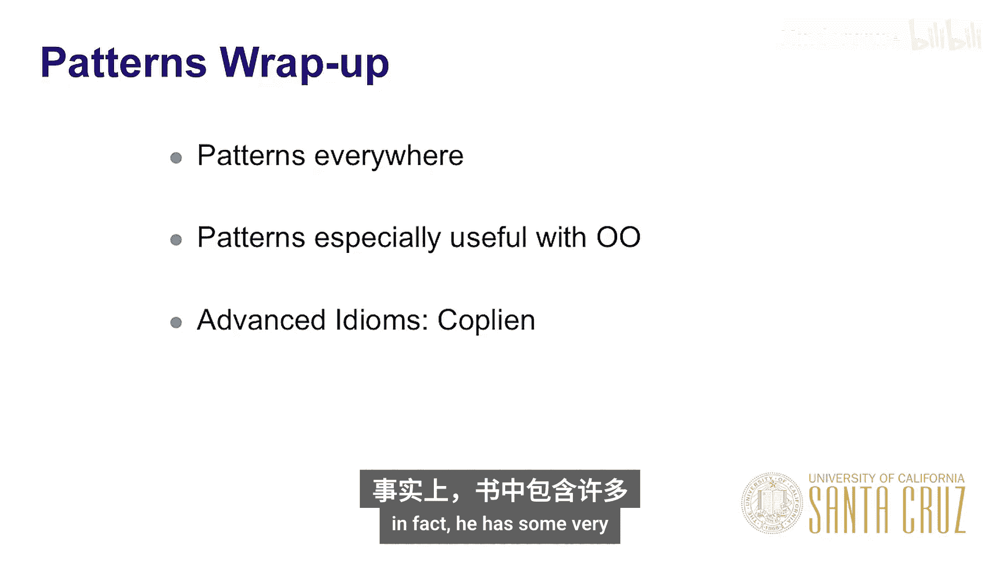
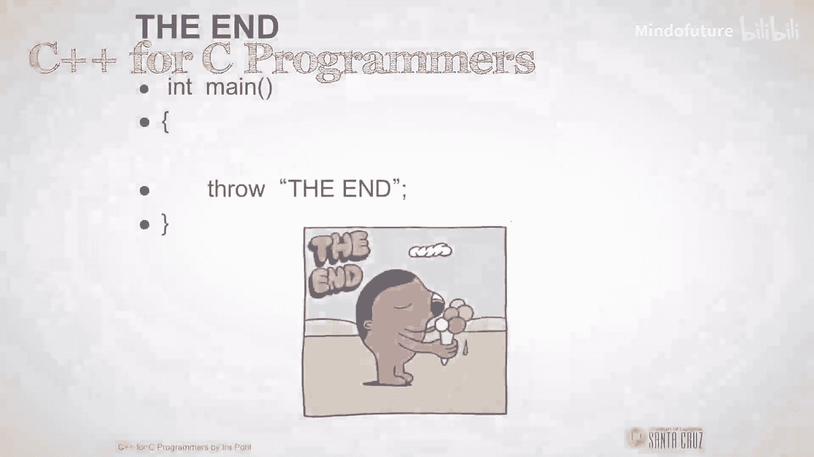
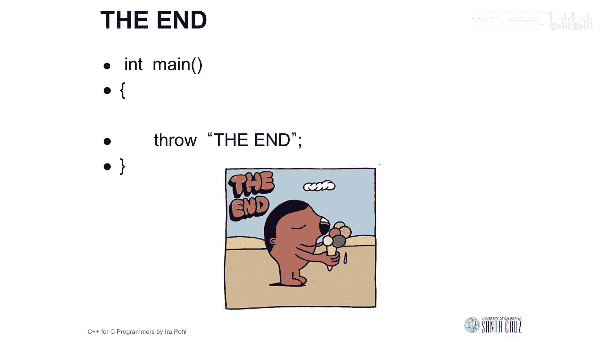

# 【加州大学】C++编程-｜-C-Plus-Plus-B-p57-P57_4-16-适配器模式_04_06_04--BV1KseJzqEbZ_p57-

Let's go back to one of the earlier ideas， adapter pattern。

Where do we see that in C+ plus just to give you again？

A little flavor of the importance of design patterns。 This is sort of your next step up。

You need to be able to idiomaticically use C++。But C++ is not going to be that helpful unless you know how to write。

Bigger pieces of code。Design patterns are the next stage if you haven't explored them before。

 to mastery of this style of programming。So you want to convert an interface of a class。

Into another one。It's also called a rapper class。You may have software that can be reused if the interface can be modified。

 that could be a motivation。

Here's some UL it shows。How the adapter might work。There's a target， a request， a specific request。

 the adaptee asked to request。

A behavior。Their collaborations， clients call operations on the adapter object。

 the adapter calls the adaptee to carry out the operations。In STL， we actually again。

 just like with the iterator pattern。We have an adapter pattern， where's the adapter pattern？

Notnotably in how we declare stacks。If you can recall an STL。A stack is a container type。

 but it's not actually。Its own piece of code。It actually adapted from code that has other characteristics and those characteristics。

 required characteristics。Must support the stack operation。

 So vector is one of the containers that readily support a stack。

And this notion of a facade or an adapter， facade is another way to say this says。

 rather than have the full generality of vector， I'm going to constrain it and make it look like a stack。

What does the stack need to do it needs to execute a push operation。

 how does a vector let you do that vector has a pushback operation so provided that kind of ability exists。

 then we can do the adaptation。So if you've used stack as an adapter class。

You should understand this。Bigger picture。 the importance， again， of。Design patterns。

Where they can be used， why they're helpful， why they took off， why they should be。

In your repertoire。And just as a short quiz， can a double ended Q be adapted to a stack。

 Can a list be adapted to a stack。Can a map be adapted to a stack。 So recall， stack is not。

Its own code。 It's really a wrapper around some other。

Thing in the standard library or in your library that supports a given set of operations。

The answer is De and L both have the ability to support push and pop， but Ma does not。Okay。

Patterns are everywhere。There are tons of patterns ever since the gang of four wrote their book。

 which had， I don't know， something like 40 patterns。

You can find in repositories hundreds of patterns， maybe by now thousands of patterns。

So patterns are everywhere。Professional programmers。

Love to discover new ones some of them catch on one of my grad students no longer quite successful。

Professional。Invented。Or was one of the。Along with me in this PhD work。

 Daniel Edison invented smart pointers， which is again a pattern that can be used in lots of places and indeed is included in some of the standard libraries in C++ patterns are everywhere。

They're especially useful with object orientation andre not constrained to object orientation。

 but object orientation with all those elements where you have helper functions。

 you have classes and collaborator classes， this is where you build bigger architecture。

 so this was clearly instrumental。And pushing the whole。A。Methodology。

Where people just routinely picked up pattern methodology。And in C+ plus explicitly。

 one of the places that I think there's a great discussion。

And a concrete discussion of design patterns is a book by Coian。

 It's called Advanced idioms using C plus plus。 It's a classic。It goes back， I think， to the 1990s。

 but it's still incredibly valuable。 In fact， he has some very。

Excellent concrete code， for example， wrapper。Rpper code shows exactly why these ideas are so powerful。

Well。Here we are。AtThe end of the course， I hope you've gotten the benefits for the course that you expected。

And look forward to hearing from you and seeing you again。

