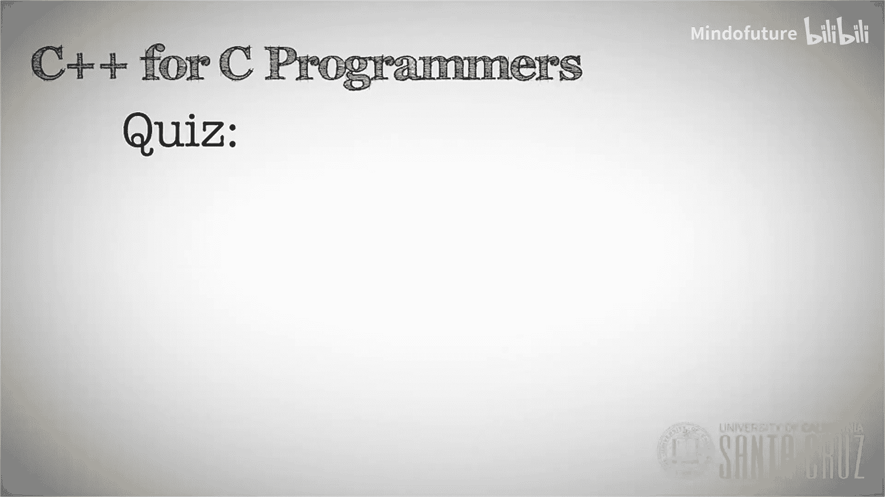
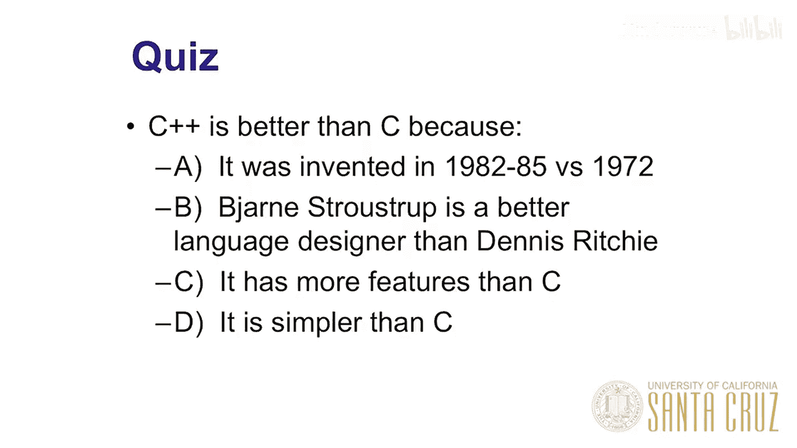
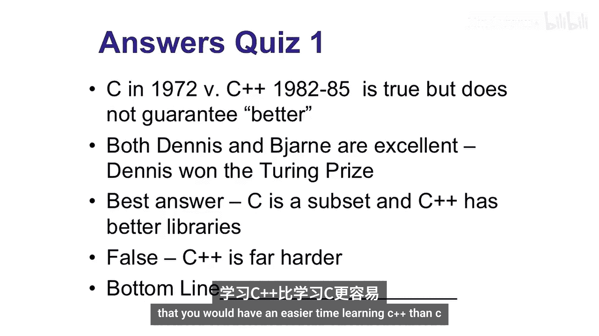
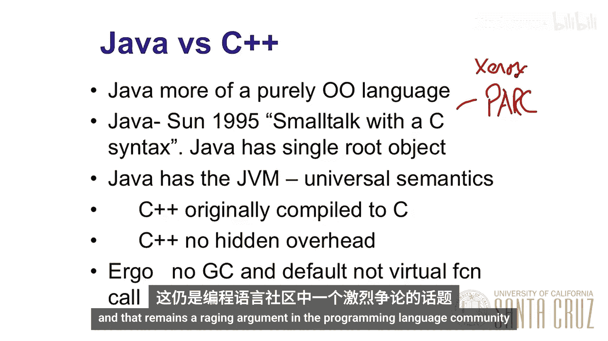

# 001：概述与课程组织 🚀

在本节课中，我们将学习C++编程课程的整体安排，并探讨C++语言的基本概念及其与C语言的关系。我是加州大学圣克鲁兹分校的Ira Pohl教授，将在接下来的几周里担任你们的C++课程讲师。

## 课程组织与目标

本课程分为两个为期四周的模块。

第一个模块将带您学习C++的基础知识。今天，我们将从“C++作为更好的C”这一概念开始，并尝试理解“更好”的含义。课程结束后，我将布置第一份作业，要求您将发布的一些C代码转换为C++代码，您可以在今天的讨论后立即开始。

接下来的两周将涉及图论程序。我将解释这些算法，一个是**最短路径算法**，另一个是**最小生成树算法**。本课程期望学员已具备至少一年的C语言（或同等语言）编程经验，大致相当于计算机科学专业大一大二的水平。这意味着您需要理解基本的数据结构（如列表和栈），并具备算法学习的基础，包括我们即将实现的一些内容。因此，对许多学员来说，这可能是在重温学生时代已学过的知识。但在前四周结束时，如果您已经掌握了C语言，您应该能在专业水平上熟练使用C++。

为了完成课程学习，我们将在一些录播段落的末尾设置测验，最后还会有一个期末考试。

## 何为“更好”？

“一个事物比另一个事物更好”意味着什么？这并非一个简单的概念。

我们可以从多个角度思考这个问题。例如，在棒球史上，Willie Mays和Mickey Mantle谁更优秀？在纽约的酒吧里，人们曾整日争论不休。同样，在烹饪中，黄油和人造黄油在特定情境下可以互换，但哪个更好？这取决于标准：热量、健康因素（如胆固醇含量）、风味或维生素含量。答案因上下文而异，并不简单。

现在，让我们回到我们的主题：C++。

## C与C++的渊源

本课程假设您已具备至少一年的C语言（或同等语言）编程经验，并且能力合格。C语言有着深厚的历史。

传统的C语言由Dennis Ritchie发明。他与Ken Thompson一起工作，共同发明了Unix操作系统，并因此获得了计算机科学界的最高荣誉——图灵奖。这个始于1972年贝尔实验室的双人项目，最初用一种称为B的语言编写操作系统，而B语言又源自BCPL等，可追溯至1968年由国际计算机科学家团体发明的算法语言标准——Algol。Algol可能是编程语言历史上最具影响力的单一语言。

Dennis和Ken为他们的特定项目创造了C语言，我们称这类语言为**系统实现语言**。它最初并非为广泛使用而设计，更像是个人语言。他们的指导原则之一是“尽可能少打字”，因此语言极其简洁，包含许多奇怪的运算符，这些运算符符合他们当时使用的PDP小型微处理器的操作系统和架构。

这个项目非常成功，人们希望扩展它。随后，Brian Kernighan和Ritchie编写了《The C Programming Language》（即K&R C），这成为了我们专业领域最具影响力的书籍之一。相当原始的K&R C类型安全性较低，在80年代演变为ANSI C。随着C语言，尤其是专业用途的扩展，标准化委员会成立并进行了重大改进。1985年左右出现的ANSI C至今仍被广泛使用。后来，委员会继续工作，推出了更新的标准。但可以说，工业界的大部分C语言工作仍基于1985年的标准，该标准记载于许多学员可能拥有的《K&R C》第二版中。

## 为何转向C++？

既然C语言如此成功和重要，为何还要转向C++？

C++语言由Bjarne Stroustrup创造，他当时也在贝尔实验室。Stroustrup来自丹麦的面向对象编程传统，他最初在一种由挪威计算机科学家开发的称为Simula 67的语言中学习编程，并认为那是更好的方法论。但这在贝尔实验室并不受支持；在贝尔实验室工作，你需要使用C语言。不过，扩展C语言是被允许的，因此存在许多**预处理器**，它们将其他编程范式中的思想添加到C语言中。例如，有一种包含大量并发概念的C语言变体。

Bjarne遵循这一传统，发明了一种最初称为“带类的C”的语言。他通过预处理器将其添加进来，并且像C语言一样取得了巨大成功。因此，它脱离了其根源——即充满活力的贝尔实验室和AT&T的基础研究环境。贝尔实验室决定将其作为工业产品进行支持，允许Bjarne Stroustrup发布和支持C++ 1.0版本。那是在1985年。随后，C++语言像C语言一样发展，得到了工业界的支持和ANSI标准委员会的修改、构建和改进。到1996年出现主要ANSI标准时，C++已发展得相当庞大。

## C与C++的核心区别

以下是C与C++的一些核心区别：
*   **规模与范式**：C语言小巧，主要是一种**系统实现语言**。C++则庞大，堪称编程的“瑞士军刀”，为各种场合提供工具。
*   **编程范式支持**：C语言支持**命令式编程**（即经典编程，通过编写小函数来划分程序模块）。C++除了支持命令式编程，还支持两种非常重要的编程范式：
    *   **面向对象编程**（可类比Simula）。
    *   **泛型编程**，这将是本课程重点强调的内容。您可能对泛型编程经验不多，而这正是接下来几周学习材料的主要益处之一。

## C++比C更好吗？

现在，请根据您目前对C和C++（可能还知之甚少）的了解思考一下：是什么让C++比C更好？毕竟，这是我们的第一个主题。

以下是几个选项：
A. 它发明得更晚（大约晚10年）。
B. Bjarne Stroustrup是比Dennis Ritchie更好的语言设计师（两人都来自贝尔实验室）。
C. C++比C拥有更多特性。
D. C++更简单。

您的选择是什么？

实际上，编程语言领域并非总是“后来者更好”。例如，Algol 60或Algol 68就被一些人认为是有史以来设计最优雅的语言之一。Dennis和Bjarne都是优秀的计算机科学家（Dennis主要因Unix获得了图灵奖）。我期待的、也是我认为的最佳答案，是一种语义上的答案：**C是C++的一个子集，C++包含更多内容并拥有更好的库**。如果您认为“更多就是更好”，这将是普遍论点。当然，并非所有人都这么认为。而且C++绝不是说更简单，C++要难得多，即使是C++的支持者也不会声称学习C++比学习C更容易。

## C++与Java的对比

一个更有趣的比较是C++与Java。Java出现在1995年，由Sun公司发明。Sun公司的人员对另一种古老的语言Smalltalk有深厚感情。Smalltalk是帕洛阿尔托研究中心（Xerox PARC）发明的一种语言，该中心非常著名，是个人电脑、图形用户界面等诸多概念的灵感来源。因此，作为一种纯粹的面向对象语言，Smalltalk启发了Java。Java也采用了类C的语法（这与Smalltalk不同）。

然而，C++继承了来自C语言系统实现语言的、固有的**命令式**方法论，偏向底层。而Java旨在纯粹面向对象且高层。其发明者（主要是Sun公司的James Gosling）认为他们可以做得更好。Java拥有JVM（虚拟机），并提供统一的语义。其经典口号是“一次编写，到处运行”，这在工业界是好事，可以大幅降低开发成本，无需为每个平台单独定制。C++最初编译为C代码，因此C++是非常高效的**系统实现语言**。它有不同的编译器，依赖于平台，并且实际上根据平台略有不同的语义，因此可以针对平台进行调优。所以，C++经常是平台上最高效的高级语言，并希望保持这一优势，因此没有隐藏的开销。

Java的一个好处是**垃圾回收**，您无需管理内存，内存泄漏问题基本消失。而在C++中，您必须具备复杂的内存和内存管理概念，但不会在运行时产生性能损耗。因此，Java和C++之间形成了非常有趣的对比，并且这仍然是编程语言社区中一个激烈的争论话题。

## 总结

本节课中，我们一起学习了C++编程课程的整体结构，探讨了“更好”这一概念的相对性，回顾了C语言的历史及其与C++的渊源，并分析了C++与C、Java在核心特性和设计哲学上的主要区别。理解这些背景和差异，将为我们后续深入学习C++的具体特性打下坚实的基础。