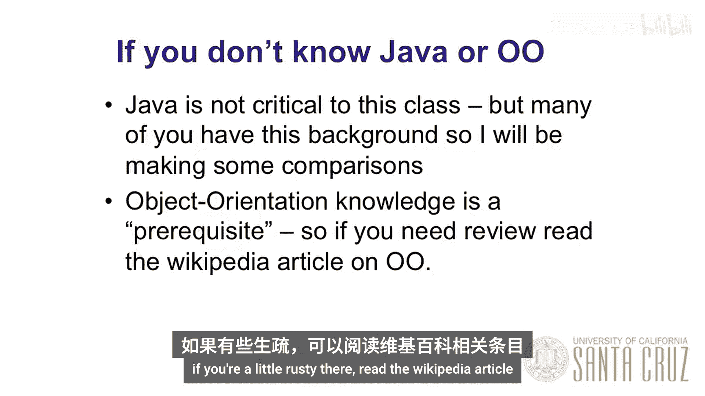
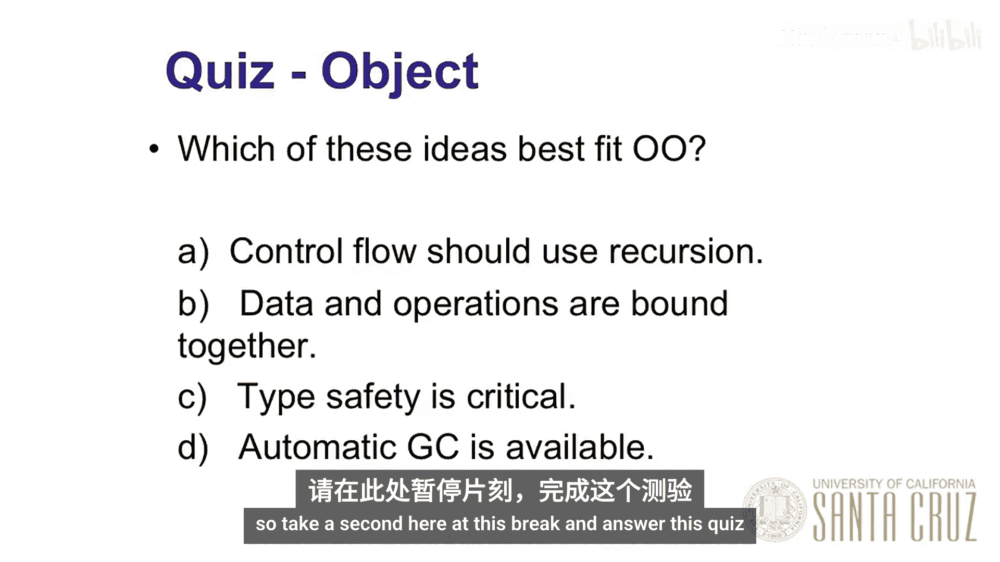
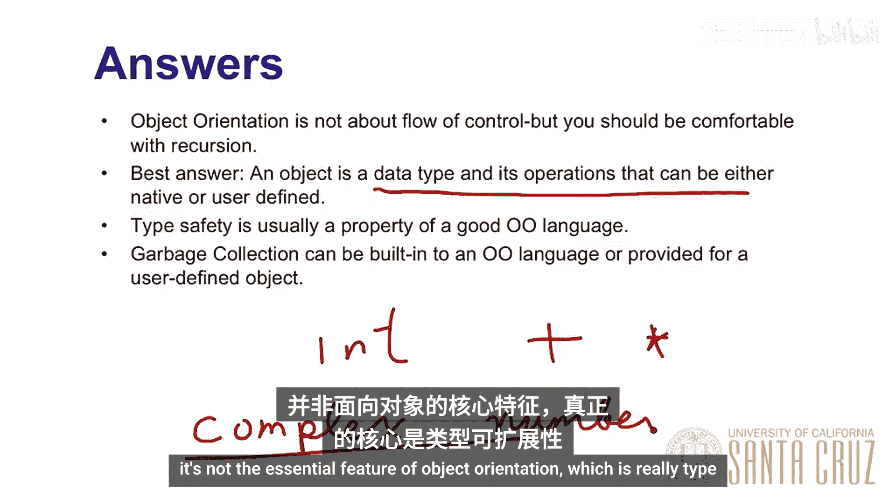

# 002：面向对象基础与核心概念 🧠

在本节课中，我们将学习面向对象编程（OO）的基础知识，并探讨其在C++中的核心概念。我们将重点理解面向对象的本质，以及它如何帮助我们构建更强大、更灵活的软件。

---

上一节我们介绍了课程的基本要求，本节中我们来看看面向对象编程的核心思想。我期望你了解一些面向对象的基础知识，但不必精通Java。虽然有些学员具备Java背景，这对学习C++是有益的，因为C++中的许多面向对象特性与Java非常相似。

然而，你必须保持谨慎，因为某些看似相同的特性在C++中具有重要的差异。在学习C++版本时，即使语法结构看起来相似，你也必须确保理解C++构造的运行时语义。

面向对象知识是我期望你掌握的。如果你对此有些生疏，可以阅读维基百科的相关文章，它提供了关于面向对象基础的详细解释。

---

以下是面向对象编程的核心思想：

*   **数据与操作绑定**：对象是一种数据类型，其数据与操作紧密绑定在一起。
*   **类型可扩展性**：面向对象语言允许你自然地扩展类型系统，创建新的数据类型。
*   **软件构建方法**：面向对象是我们在C++社区中用于开发软件的关键方法之一。

---

现在，让我们通过一个小测验来巩固理解。根据你对面向对象的了解，以下哪个想法最符合其本质？

1.  面向对象意味着使用递归。
2.  面向对象意味着数据与操作绑定在一起。
3.  面向对象意味着类型安全至关重要。
4.  面向对象意味着自动垃圾回收可用。

请花一点时间思考并选择你的答案。

---

我们来讨论一下答案。面向对象与控制流无关，但你应该对使用递归感到自如。第二个答案是我认为的最佳答案：**对象是一种数据类型，并且与其操作绑定在一起**。

考虑基础语言中的数据类型，例如整数（`int`）。在基础语言中，你有像加法（`+`）和乘法（`*`）这样的操作。在像C++这样的面向对象语言中，你有一组基本的内置类型，而使其强大的关键特性是**类型可扩展性**。这允许你自然地使用新类型进行编程。

以C++为例，标准库中没有内置的复数类型。但是，通过标准库，你可以获得一个复数类型（`std::complex`）。一旦这个复数类型被正确构建并包含在语言中，它就能支持像加法和乘法这样的自然操作。物理学家或工程师等使用复数的社区成员可以非常有效地常规使用这个复数包。

一个面向对象的类型也可以是一个窗口系统。你可以让某人编写一个窗口类，然后定义窗口上的自然操作，例如放大、缩小、置于后台、添加文本模式或菜单等。这是一种构建软件的良好方式。

在编程语言历史上，当人们试图创建通用语言时，他们常常陷入两难：要么使语言过于庞大而难以管理或学习，要么效率低下，要么无法涵盖所有有用的功能。早期的通用语言尝试，如IBM在20世纪60年代中期发明的PL/1，虽然是非常出色的语言和系统，但基本上是失败的。这随后催生了面向对象语言，以及早期的数据抽象语言（如Modula和Ada），它们也非常成功，并与面向对象有许多共同之处。

这些语言让你拥有一个**连贯的内核**。在C++中，这个连贯的内核是C语言。在Simula 67中，这个内核是Algol 60。你可以成为C语言或Algol 60的熟练程序员，然后轻松地将语言扩展到新的领域，例如复数运算。这就是面向对象的含义。

类型安全通常是许多语言（包括非面向对象语言）的良好特性，但它并不定义面向对象。同样，垃圾回收可以内置在面向对象语言中，它非常有用，也存在于Lisp、Common Lisp和Scheme等语言中，但它不是面向对象的必要条件。面向对象的本质特性实际上是**类型可扩展性**。

---

本节课中我们一起学习了面向对象编程的核心概念。我们明确了面向对象的本质在于**将数据与操作绑定在一起**，并通过**类型可扩展性**来构建强大且灵活的软件。理解这些基础对于后续深入学习C++的面向对象特性至关重要。