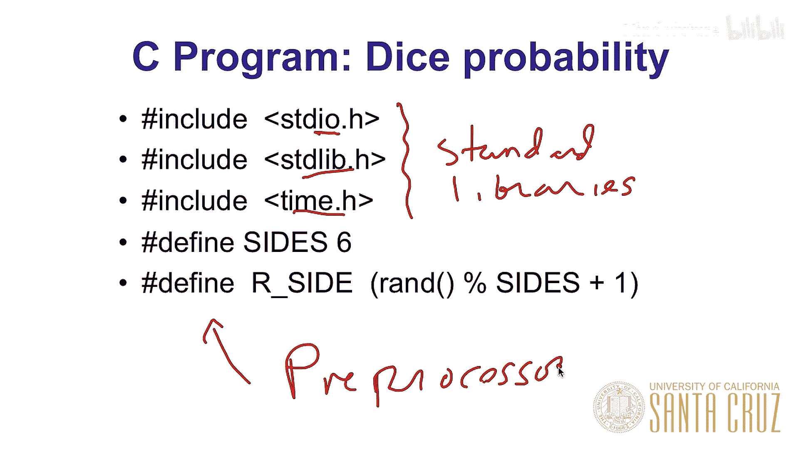
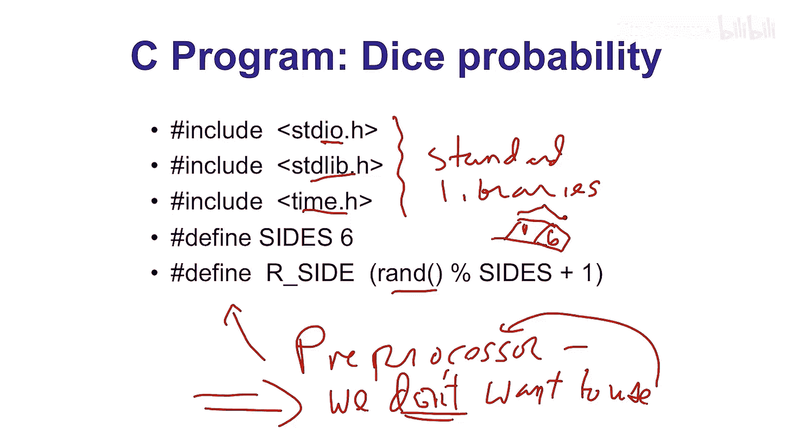
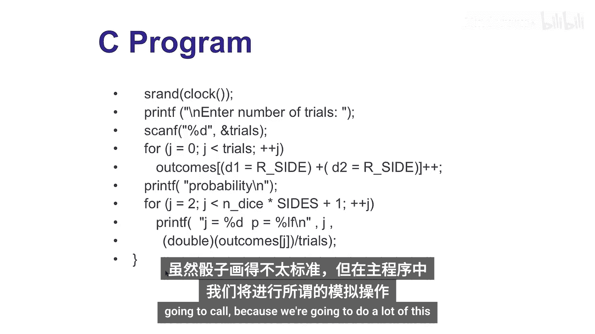
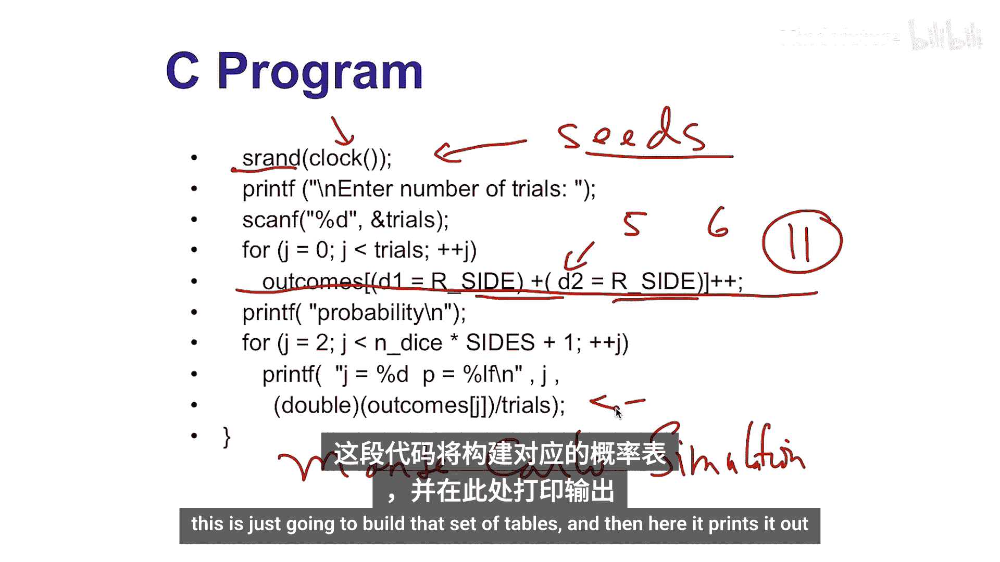
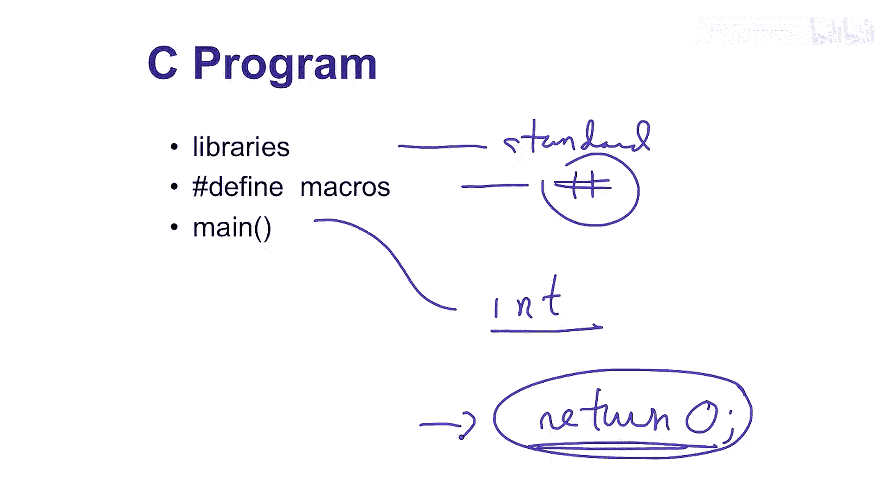

# 003：将C程序转换为C++ 🎲

在本节课中，我们将学习如何将一个用C语言编写的掷骰子概率模拟程序，转换为一个功能相同的C++程序。我们将从分析一个典型的C程序结构开始，逐步了解C++的改进之处，并最终完成转换。

## 概述：C程序结构分析

上一节我们介绍了课程目标。本节中，我们来看看我们将要转换的C程序示例。这是一个模拟掷两个骰子并统计各点数出现概率的程序，类似于赌场游戏“Craps”的概率计算。

以下是该C程序的核心组成部分：



*   **预处理指令**：程序开头使用 `#include` 引入了必要的标准库，如输入输出库 `<stdio.h>` 和随机数库 `<stdlib.h>`。
*   **宏定义**：使用 `#define` 定义了常量，例如骰子的面数 `SIDES` 和模拟次数 `TRIALS`。
*   **主函数**：程序入口是 `main()` 函数，它返回一个 `int` 类型值。通常，返回0表示程序正常结束。
*   **随机数生成**：程序使用 `srand()` 函数，以系统时间 `time(NULL)` 为种子初始化随机数生成器，确保每次运行结果不同。然后使用 `rand() % SIDES + 1` 来模拟掷出1到6的点数。
*   **模拟与统计**：通过循环进行大量（`TRIALS`次）试验，将两个骰子的点数相加，并在数组 `outcomes` 中累加对应点数的出现次数。
*   **结果输出**：最后，程序遍历 `outcomes` 数组，打印出每个点数及其出现的频率。

## C++的改进理念



我们已经了解了C程序的基本结构。接下来，本节中我们来看看C++语言引入的一些核心改进理念，这些理念将指导我们的转换工作。



C++社区对优秀程序员有明确的期望，即遵循社区标准和最佳实践。其中一个重要方向是**减少对预处理器的依赖**。在C++中，我们倾向于使用语言本身提供的更安全、更强大的特性来替代C中的宏和某些预处理指令。

## 从C到C++的关键转换步骤

上一节我们介绍了C++的改进理念。本节中，我们来看看具体的转换步骤，将我们的掷骰子程序“现代化”为C++风格。

以下是转换过程中需要关注的主要方面：

*   **头文件**：将C风格的头文件（如 `<stdio.h>`）转换为C++风格（如 `<cstdio>`）。更常见的是，直接使用C++特有的流库 `<iostream>` 来替代C的输入输出函数。
*   **常量定义**：使用C++的 `const` 或 `constexpr` 关键字来定义常量，取代 `#define` 宏。这提供了类型安全和作用域。
*   **随机数生成**：C++11引入了更强大、更易用的 `<random>` 库来替代C的 `rand()` 和 `srand()`。我们可以使用 `std::uniform_int_distribution` 来生成指定范围内的整数。
*   **输入输出**：使用 `std::cout` 和 `std::cin` 替代 `printf()` 和 `scanf()`，它们更安全，且支持自定义类型的输出。
*   **主函数返回**：虽然在C++中 `main` 函数隐式返回0也是允许的，但显式地写出 `return 0;` 是更清晰、更符合良好风格的作法。

## 核心概念示例

让我们用公式或代码来描述上述转换中的两个核心概念。

**1. 常量定义（C宏 vs C++ const）**
```c
// C 风格 (宏)
#define SIDES 6
#define TRIALS 10000

// C++ 风格 (类型安全常量)
const int sides = 6;
constexpr int trials = 10000; // C++11, 编译期常量
```



**2. 随机数生成（C rand() vs C++ <random>）**
```cpp
// C++ 风格 (更均匀的分布)
#include <random>
std::random_device rd; // 非确定性随机数种子
std::mt19937 gen(rd()); // 梅森旋转算法引擎
std::uniform_int_distribution<> dis(1, 6); // 生成1到6的均匀分布整数

int dice_roll = dis(gen); // 掷一次骰子
```

## 总结



本节课中，我们一起学习了如何将一个C语言程序转换为C++程序。我们分析了典型C程序的结构，理解了C++旨在减少预处理器使用、增强类型安全和提供更现代库的设计理念。通过将头文件、常量定义、随机数生成和输入输出等部分转换为C++风格，我们不仅使程序更符合现代C++标准，也使其更安全、更易于维护。记住，采用社区认可的最佳实践是成为一名优秀C++程序员的重要一步。