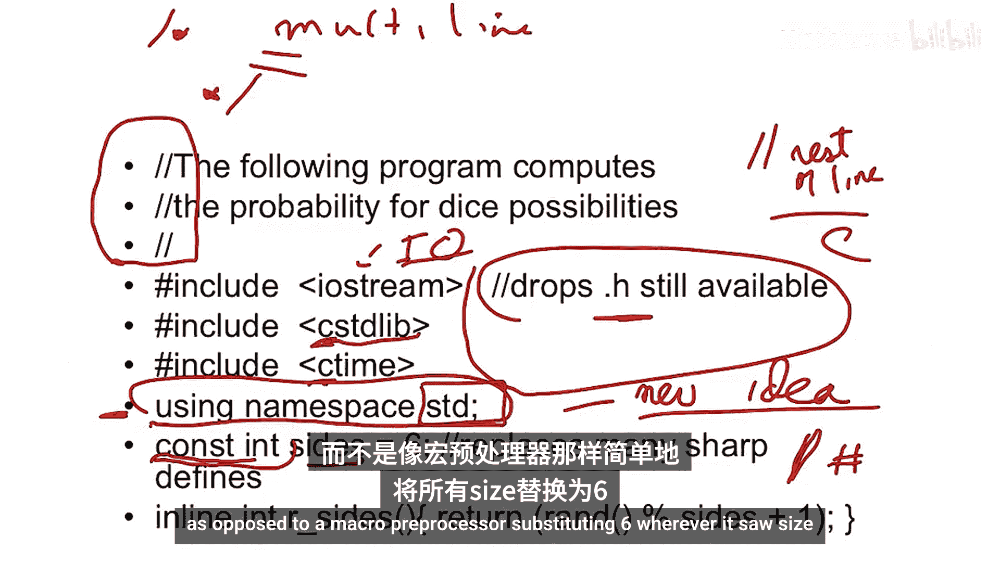
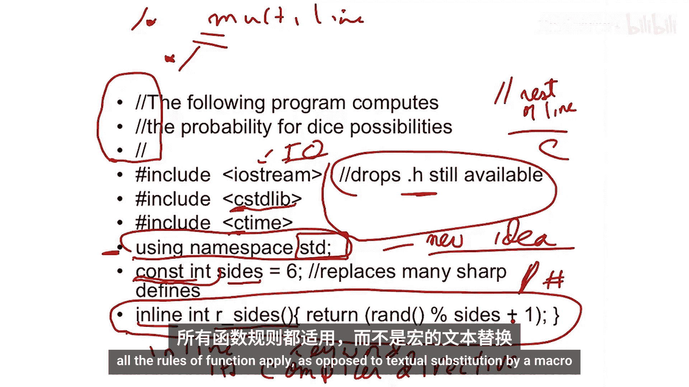

# 004：使用C++代码

在本节课中，我们将学习如何编写第一个C++程序，并了解C++语言的一些基础特性，包括注释、标准库、命名空间和常量定义。我们将对比C语言中的传统做法，理解C++如何通过语言规则来增强代码的安全性和可读性。

## 注释风格

上一节我们介绍了编程的基本概念，本节中我们来看看C++中的注释风格。C++引入了行尾注释，这与C语言最初的多行注释风格有所不同。

以下是关于C++注释的说明：
*   C++社区通常使用行尾注释（`//`），这种注释方式更为灵活和安全。
*   虽然现代C标准也支持这种注释风格，但它最初是C++的新特性。
*   在使用GNU等编译器时，C和C++的特性界限可能模糊，但本教程主要讨论经典的C与C++区别。

## 标准库与头文件

在C++中，我们使用标准库的方式与C语言有所不同。

以下是C++标准库的使用要点：
*   C++标准库通常不包含 `.h` 后缀。例如，输入输出包是 `iostream`，而不是 `iostream.h`。
*   C++可以完全使用C语言的库。如果需要使用经典的C库，可以在库名前加 `c` 来引入。例如，C的数学库在C++中写作 `cmath`。

## 命名空间

命名空间是C++引入的一个重要概念，用于提供代码的封装和上下文。

以下是关于命名空间的解释：
*   命名空间是一种封装机制。例如，IBM公司可以将其软件封装在名为 `IBM` 的命名空间中。
*   标准库的命名空间是 `std`。
*   在同一个程序开发中，可以混合使用多个命名空间，例如同时使用Oracle库、IBM库和标准库。

`using` 指令是一个便利性声明，它告诉程序我们将使用 `std` 命名空间，这样在代码中就不必每次都显式地写出 `std::` 前缀。

## 常量定义

C++使用语言关键字来定义常量，取代了C语言中通过预处理器进行文本替换的宏定义。

以下是常量定义的对比：
*   在C语言中，我们使用宏定义：`#define SIZE 6`
*   在C++中，我们使用常量声明：`const int size = 6;`

**公式/代码表示：**
```cpp
// C风格宏定义
#define SIZE 6

// C++风格常量定义
const int size = 6;
```

使用 `const` 关键字定义常量具有类型信息，编译器可以根据语言规则进行检查。而宏定义只是简单的文本替换，独立于语言规则，更容易导致错误。



## 内联函数

对于简短的代码片段，C++使用内联函数来替代C语言中的宏函数。

以下是内联函数的说明：
*   `inline` 是C++的一个新关键字，它是一个编译器指令。
*   它用于建议编译器将函数调用处用函数体代码直接替换，以避免函数调用的开销（如栈操作、机器指令执行时间）。

**公式/代码表示：**
```cpp
// C++内联函数
inline int area_sq(int s) {
    return s * s;
}
```

与宏函数相比，内联函数遵循所有的函数规则，由编译器进行处理，因此更加安全可靠。

## 总结



本节课中我们一起学习了C++代码的基础写法。我们了解了C++特有的行尾注释风格，认识了不带头文件后缀的标准库引用方式，理解了命名空间如何帮助组织代码，并掌握了使用 `const` 定义常量和 `inline` 定义内联函数来取代C语言中对应的宏定义，这些特性都使得C++程序在类型安全和可维护性上更胜一筹。