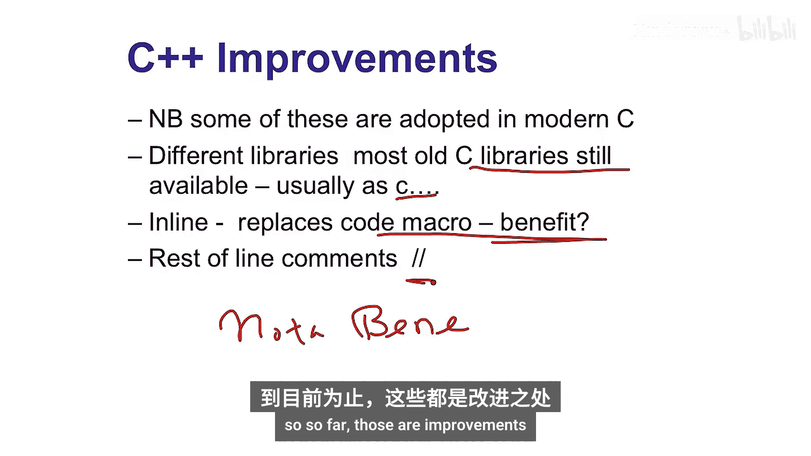
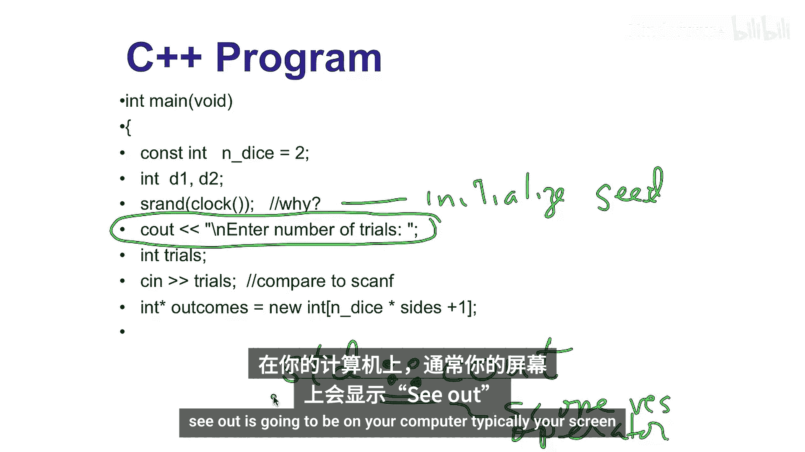
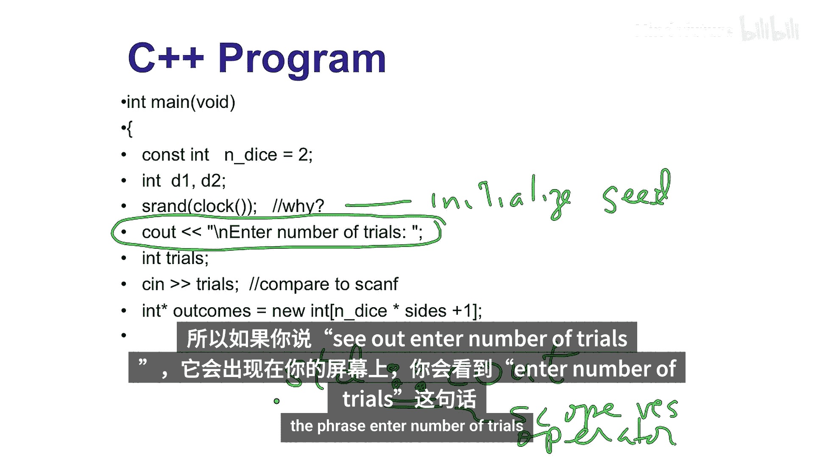
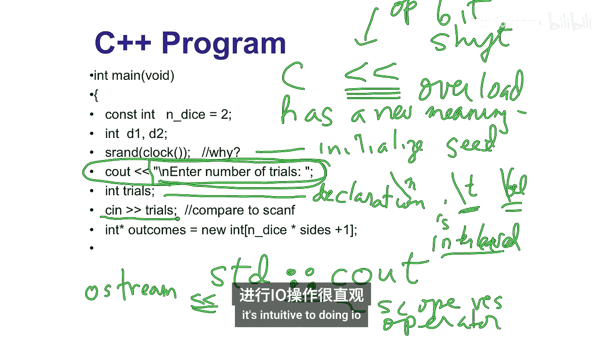
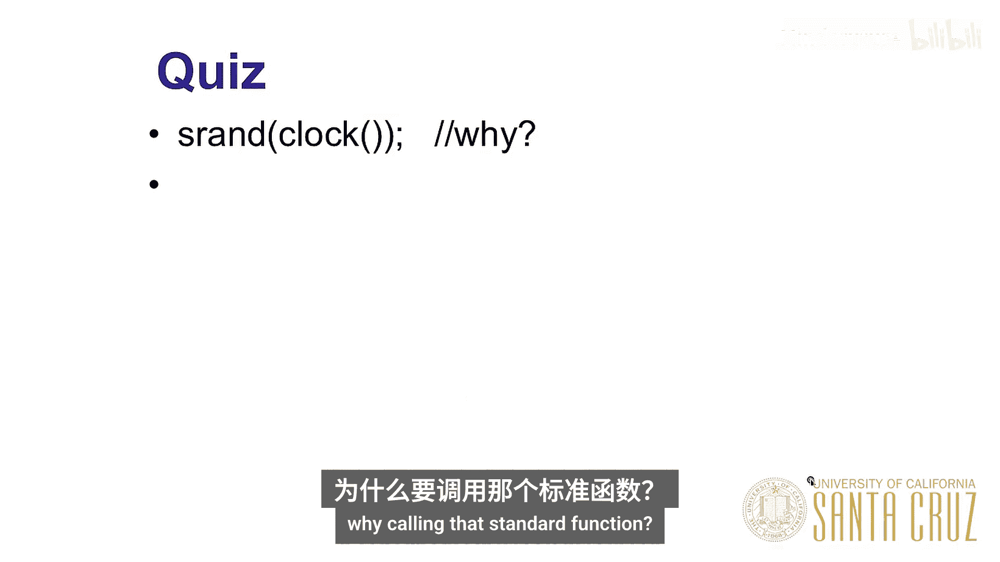
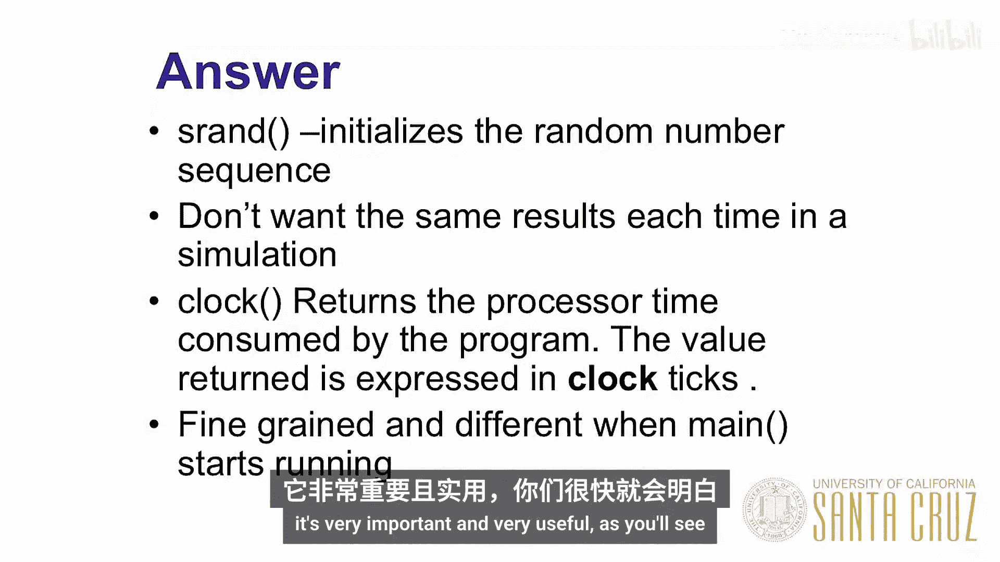

# 005：C++的改进

在本节课中，我们将学习C++语言相对于C语言的一些核心改进。我们将探讨这些改进如何使代码更安全、更易读、更易维护，并通过一个具体的程序示例来展示这些改进的实际应用。

## C++的改进概述

上一节我们介绍了C++的背景，本节中我们来看看C++语言本身的一些具体改进。这些改进旨在解决C语言中的一些常见问题，并提供更强大的编程工具。



以下是C++引入的一些关键改进：

*   **向后兼容性**：几乎所有旧的C语言库在C++中仍然可用，通常带有 `c` 前缀（例如 `cstdio`）。
*   **内联函数**：`inline` 关键字用于替换代码宏（`#define`）。宏是程序中常见的错误来源，内联函数提供了类型安全且更可靠的替代方案。
*   **单行注释**：C++引入了以 `//` 开头的单行注释，作为对C语言 `/* */` 块注释的补充。
*   **灵活的变量声明**：变量声明不必局限于代码块的开头，可以在首次使用前任何位置声明，这提高了代码的可读性。
*   **输入/输出流**：C++提供了 `cin` 和 `cout` 流对象，用于替代C语言的 `scanf` 和 `printf` 函数。它们更类型安全、更直观。
*   **命名空间**：`namespace` 和 `using` 指令帮助管理不同库中的标识符，避免命名冲突。
*   **运算符重载**：允许为运算符（如 `<<` 和 `>>`）赋予新的含义，使其能用于自定义类型（如I/O流）。

## 程序示例分析

现在，让我们通过一个具体的程序来观察这些改进。这个程序看起来与C程序有些相似。

```cpp
srand(time(0));
```





这段代码用于初始化随机数生成器。`srand` 函数使用当前时间（通过 `time(0)` 获取）作为种子，以确保每次程序运行时都能获得不同的随机数序列。

接下来，我们看到一个重要的改进。程序使用 `cout` 进行输出，而不是C语言中的 `printf`。

```cpp
cout << "Enter number of trials: \n";
```

`cout` 代表标准输出流，通常指向你的屏幕。`<<` 是输出运算符。字符串 `"Enter number of trials: \n"` 会被发送到屏幕上显示。`\n` 是换行符，与C语言中相同。

这里有一个关键概念：**运算符重载**。在C语言中，`<<` 是位左移运算符。但在C++中，当 `<<` 的左操作数是一个输出流（如 `cout`）时，它的含义被**重载**为“插入”或“输出”操作。编译器能根据操作数的类型（这里是字符串）自动选择正确的行为来打印它。稍后我们给它整数或浮点数时，它同样知道如何打印。

另一个新特性是变量声明的位置。

```cpp
int trials;
cin >> trials;
```

变量 `trials` 的声明与输入语句 `cin >> trials;` 交织在一起，而不是必须放在代码块的最开始。这提高了代码的清晰度。

输入语句 `cin >> trials;` 可以类比C语言的 `scanf`。它表示从标准输入（通常是键盘）读取数据。用户将在键盘上输入模拟所需的试验次数。这种方案更易于使用，它是类型安全的、方便的、易于理解的，并且符合直觉。

## 小测验与总结





让我们做一个简单的小测验。我们已经提到过，为什么需要调用 `srand` 函数？

`srand` 用于初始化随机数生成器。在模拟中，我们不希望每次运行都得到相同的结果。`time(0)` 返回一个基于系统时钟的大无符号整数，它非常精细，并且程序每次开始运行时都不同，因此适合作为随机种子。

在本课程中，我将展示许多不同的模拟程序，因此期望你能对这种蒙特卡洛处理方式有相当的熟悉度。这种方法非常重要，并且非常有用。



**本节课总结**：在本节课中，我们一起学习了C++语言相对于C语言的多项重要改进。我们了解了内联函数、灵活的变量声明、更安全的I/O流（`cin`/`cout`）、命名空间以及运算符重载等概念。通过分析一个具体的程序，我们看到了这些改进如何使代码更简洁、更安全、更易于编写和理解。掌握这些基础改进是有效使用C++进行编程的关键第一步。