# 007：C++优于C

在本节课中，我们将探讨C++相较于C语言的主要优势。我们将了解C++如何通过增强类型安全、提供丰富的库、减少预处理器依赖以及引入面向对象编程等特性，来改进编程实践。对于有C语言背景的程序员来说，这些改进是自然而易于掌握的。

## 更强的类型安全 🛡️

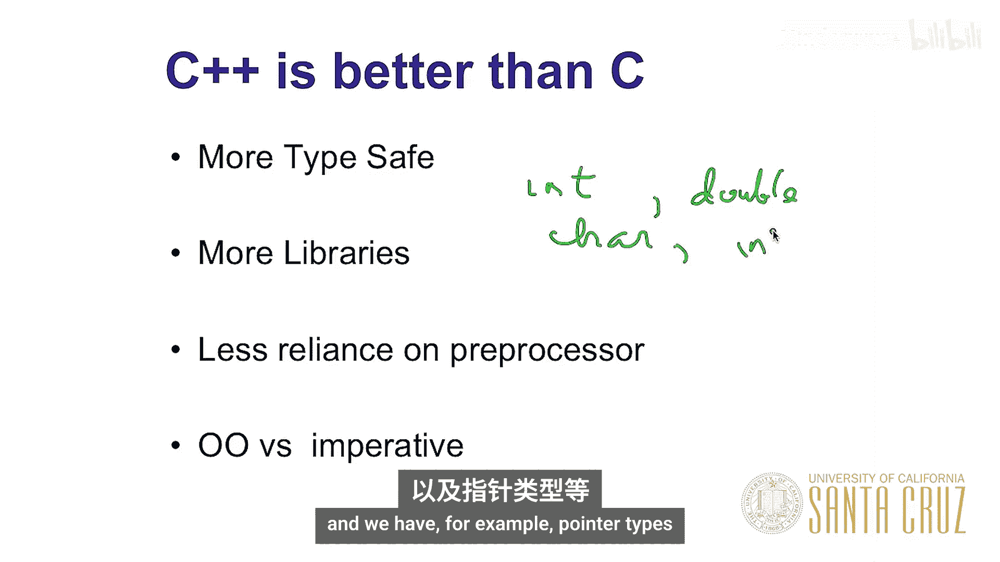

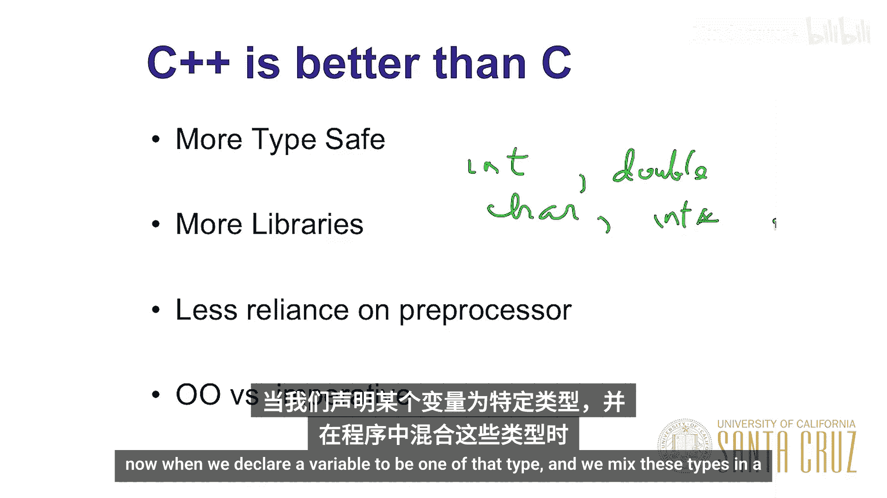

上一节我们介绍了C++的整体优势，本节中我们来看看其核心改进之一：类型安全。类型是编程语言的基石，定义了语言操作的数据域。在C++中，类型系统更为严格，这有助于编译器在编译时捕获更多错误，从而提高代码的可靠性。

在C语言中，由于历史原因和追求底层效率，类型规则相对宽松。例如，不同平台上的`int`类型大小可能不同。C++则致力于提供更一致和安全的类型系统，减少了因类型混淆（如将`double`错误解释为指针）而导致的潜在错误。

**示例：类型声明**
```cpp
int count;          // 整型变量
double price;       // 双精度浮点变量
char initial;       // 字符变量
int* pointer;       // 整型指针变量
```

## 丰富的标准库 📚

C++提供了比C语言更广泛、更强大的标准库。这些经过充分测试的库组件保证了正确性，并提供了即时的代码复用能力。代码复用是软件开发中提升效率的关键手段。

后续课程中，我们将重点介绍**标准模板库**，它是C++语言的一个重要补充，极大地扩展了编程能力。

## 减少预处理器使用 ⚙️

在C++中，预处理器的主要用途是包含库文件。而像`#define`定义全局常量或宏的做法，在C++社区中已不再被视为良好实践。

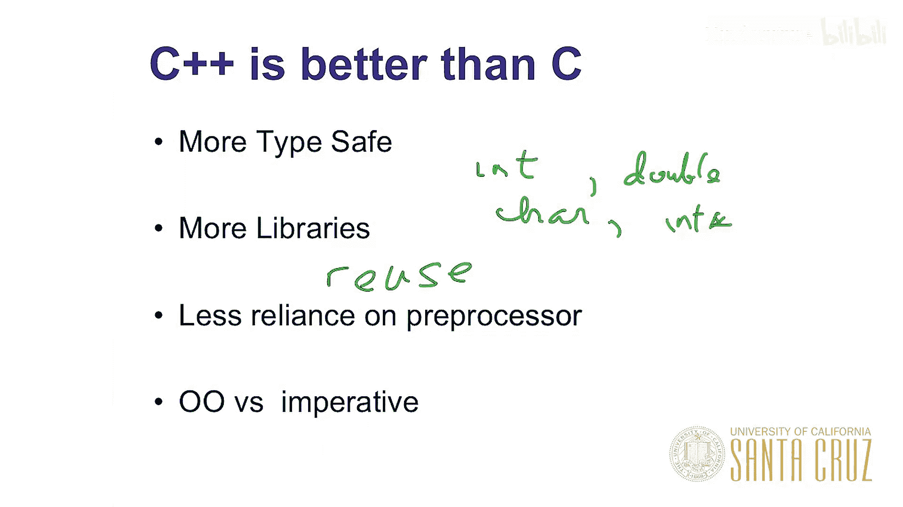

预处理器进行的是文本替换，不遵守语言本身的上下文规则，这比使用语言内置的、能被编译器检查的等效功能更容易引入错误。因此，C++通过语言特性（如`const`和`inline`）来减少对预处理器的依赖，这是一项重要改进。

## 支持面向对象编程 🧩

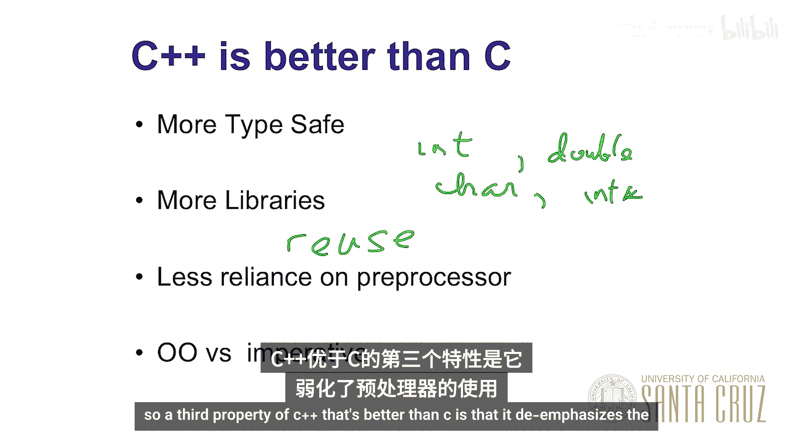

C语言并非为面向对象编程而设计，它是一种小型且支持命令式编程的语言，这在当时是合理的。然而，在开发跨领域的大型软件时，人们发现**面向对象范式**对于使用同一核心语言开发大规模软件至关重要。

C++在C语言的基础上增加了对面向对象编程的支持，这使得它能够更好地应对现代大型软件项目的挑战。

## 已接触到的C++改进特性 ✨

到目前为止，我们在程序中已经使用了一些C++的改进特性。

### `inline` 与 `const`

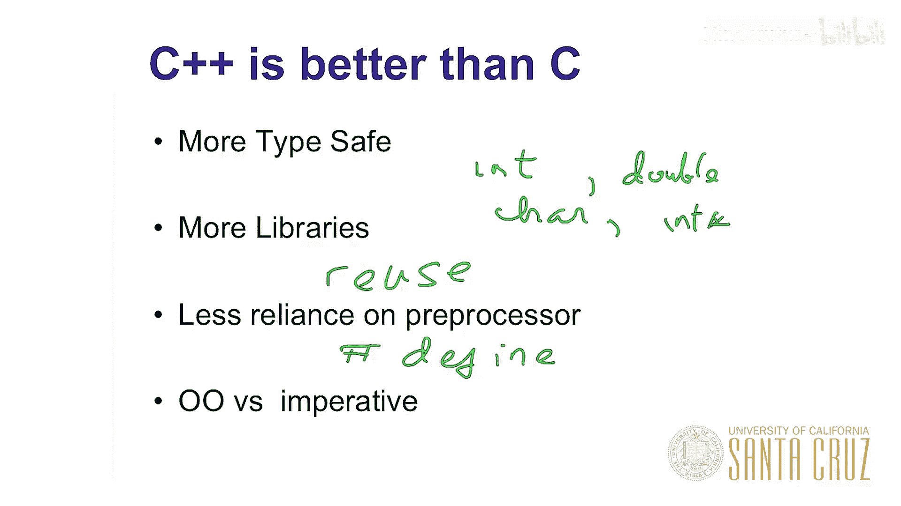

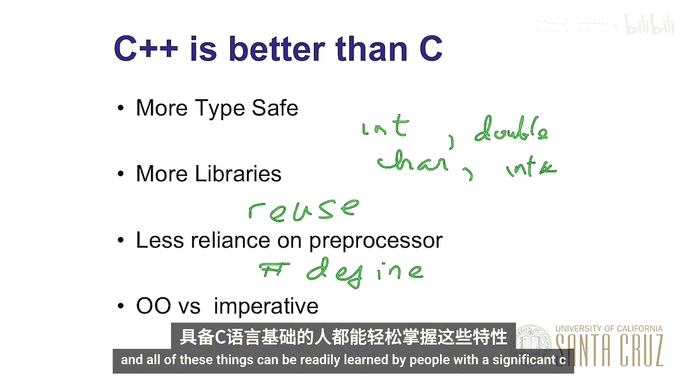

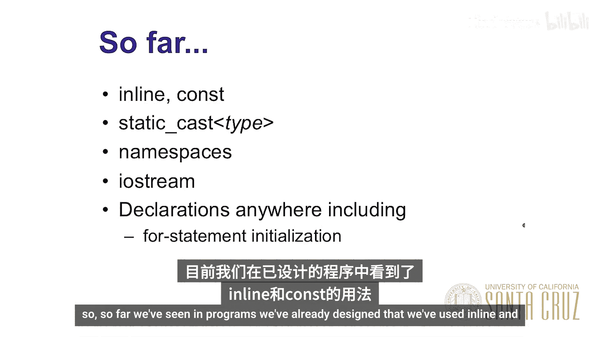

`inline`和`const`关键字取代了预处理器宏`#define`。
*   `inline`修饰函数，提示编译器在保持函数语义的同时，尝试避免函数调用开销。
*   `const`修饰类型，C++将其深度集成到类型系统中，以便编译器帮助检查常量的正确性。通过明确哪些变量是不可修改的，来支持程序的正确性。

### 安全的类型转换

C++提供了更安全的类型转换操作符。

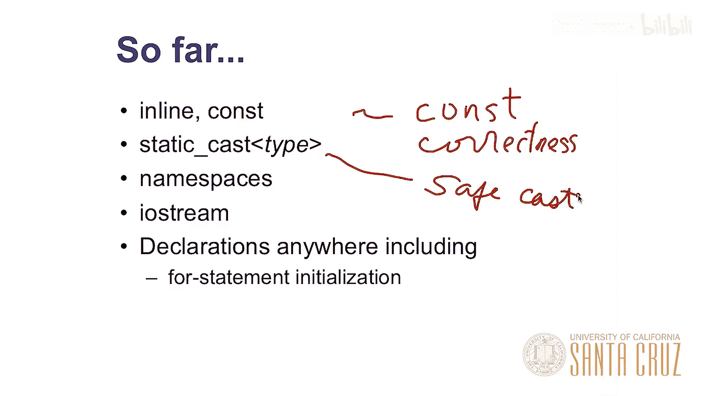

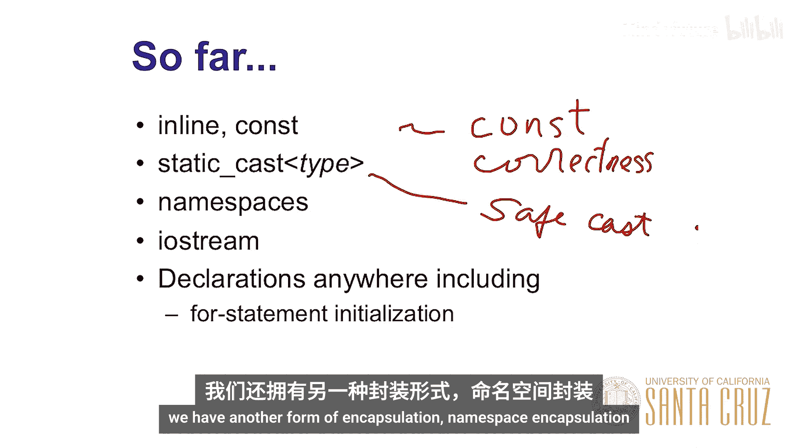

**示例：静态转换**
```cpp
double d = 3.14;
int i = static_cast<int>(d); // 明确的类型转换
```

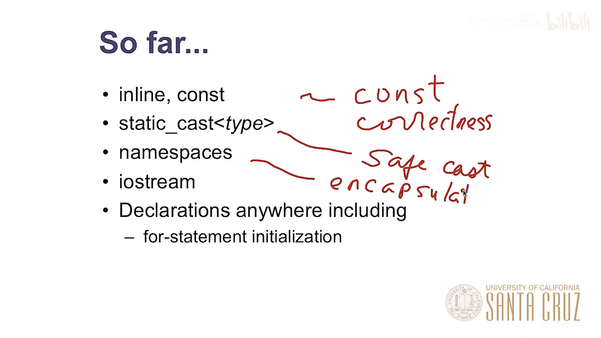

### 命名空间封装

在编程方法论的发展中，每一代语言设计都提供了更强的封装工具。封装意味着可以以自包含的方式构建、测试和调试代码块，然后将其作为模块集成到更大的系统中。有效的隔离能带来更好的设计和更少的错误，这对于编写可能多达上亿行代码的现代系统至关重要。

### 流式输入输出

C++的`iostream`库提供了便捷且类型安全的输入输出方式，避免了C语言中`printf`和`scanf`需要匹配特定格式字符串的麻烦。

**示例：流式IO**
```cpp
#include <iostream>
int main() {
    int age;
    std::cout << "Enter your age: ";
    std::cin >> age;
    std::cout << "You are " << age << " years old." << std::endl;
    return 0;
}
```

### 变量声明位置灵活

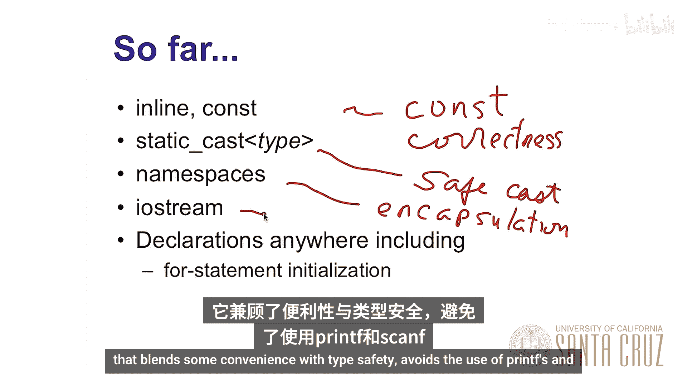

C++允许在程序的任何位置声明变量（例如在`for`循环内）。这样做的好处是**局部化**，让变量在靠近其使用的地方定义，提高了代码的可读性和可维护性。

**示例：`for`循环中的变量声明**
```cpp
for (int i = 0; i < 10; ++i) { // i的作用域仅限于此循环
    std::cout << i << std::endl;
}
```

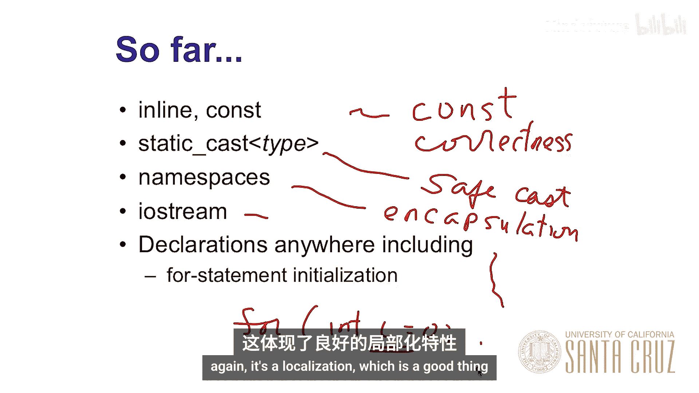

## 小测验与解析 ❓

以下是关于`const`的一个小测验，请思考答案。

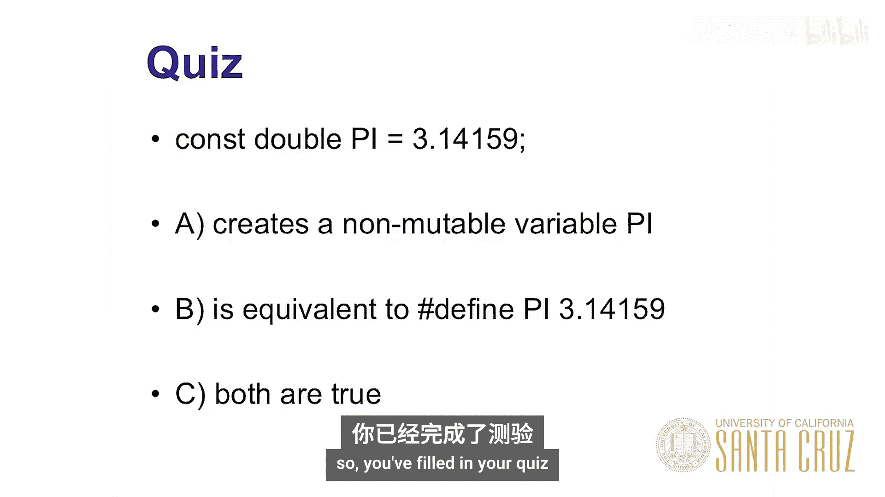

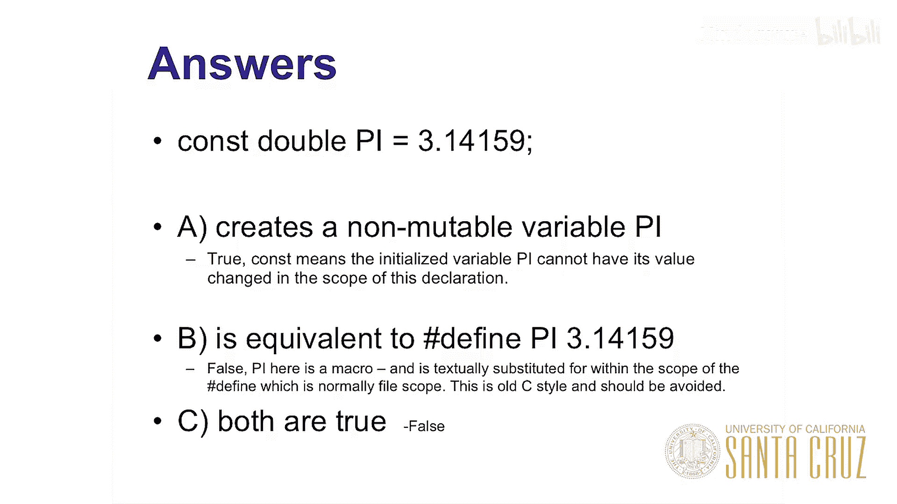

**问题：**
`const double pi = 3.14159;`
1.  这条语句是否创建了一个不可变的变量`pi`？（真/假）
2.  它是否等价于预处理器指令`#define PI 3.14159`？（真/假）
3.  以上两个陈述是否都为真？（真/假）

**解析：**

1.  **真**。`const double pi = 3.14159;`是一个声明。它创建了一个类型为`double`的变量`pi`，但在其作用域内，其值不能被改变，因此是安全且不可变的。
2.  **假**。它并不完全等价。`#define`创建的是一个宏，会在整个文件范围内进行文本替换。如果代码中在其他 unintended 的上下文里出现了`PI`，它也会被替换，这可能导致错误。而`const`变量的作用域由声明它的位置（如函数内、类内、命名空间内）决定，受语言规则保护。
3.  **假**。因为第二个陈述为假，所以并非两者都为真。

## 总结 📝

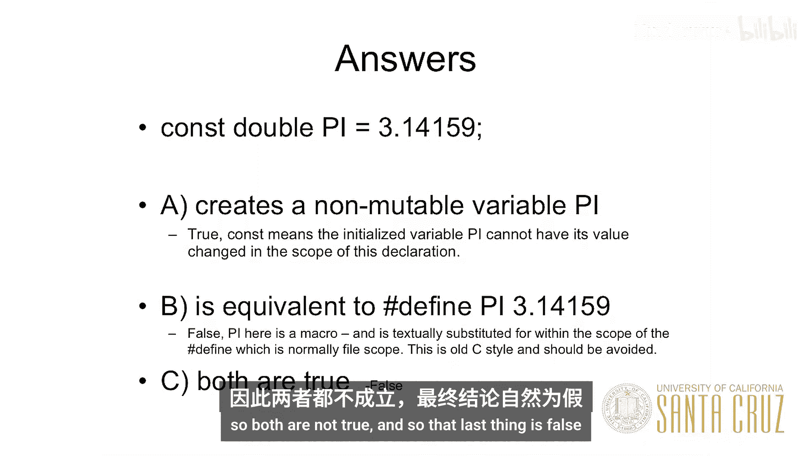

本节课中，我们一起学习了C++相较于C语言的主要优势。我们了解到C++通过**更强的类型安全**、**丰富的标准库**、**减少预处理器依赖**以及**引入面向对象编程**等特性，显著改进了软件开发的体验和质量。对于C程序员而言，迁移到C++并利用这些改进是非常自然的过程。在接下来的课程中，我们将深入探索这些特性，特别是强大的标准模板库。