# 008：C++交换函数 📚

在本节课中，我们将学习一个在编程中非常基础且重要的概念：如何编写一个交换两个变量值的函数。我们将从C语言的传统实现方法开始，理解其原理，并初步了解C++将如何提供更便捷的解决方案。

## C语言中的交换函数 🔄

上一节我们介绍了函数参数传递的基本概念。本节中我们来看看一个具体的例子：交换两个变量的值。在C语言中，由于它是“按值调用”的语言，函数内部对参数的修改不会影响外部的原始变量。因此，我们需要使用指针来模拟“按引用调用”的效果。

以下是实现交换功能的关键步骤：

1.  **函数参数使用指针**：函数接收两个指向整数的指针（`int*`），这样我们就能操作原始内存地址中的数据。
2.  **使用解引用操作符**：在函数内部，通过星号（`*`）操作符来访问或修改指针所指向地址中的值。
3.  **借助临时变量**：需要一个临时变量来暂存其中一个值，以完成交换过程。

核心的交换逻辑可以用以下代码表示：
```c
void swap_int(int* i, int* j) {
    int temp = *i; // 将i指向地址中的值存入temp
    *i = *j;       // 将j指向地址中的值赋给i指向的地址
    *j = temp;     // 将temp的值赋给j指向的地址
}
```

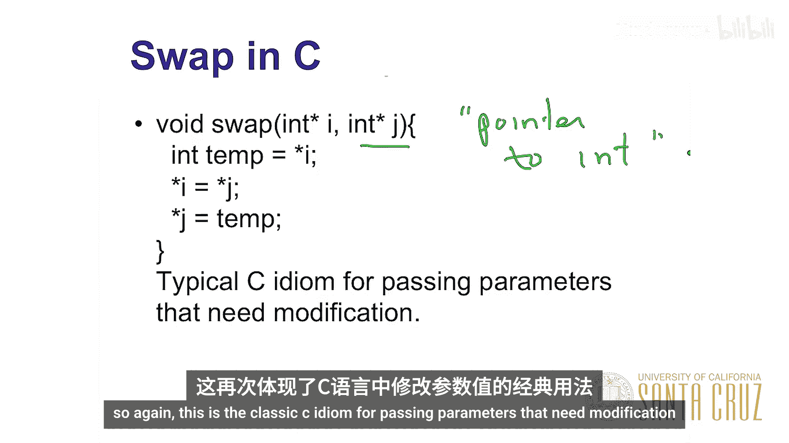

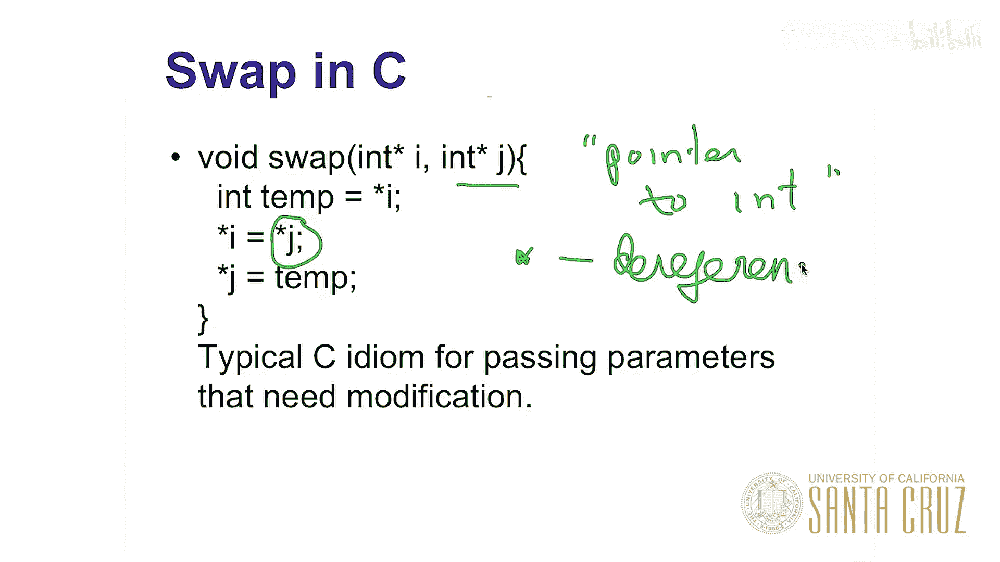

这个过程可以形象地理解为：我们有两个“信箱”（内存地址），`i`和`j`分别知道这两个信箱的位置。交换时，我们先把`i`信箱里的信件（值）暂时放到一个`temp`袋子里，然后把`j`信箱里的信件放到`i`信箱里，最后再把`temp`袋子里的信件放到`j`信箱里。

## C语言实现的局限性 ⚠️

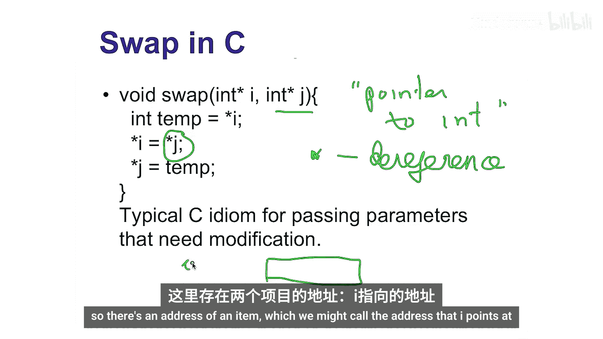

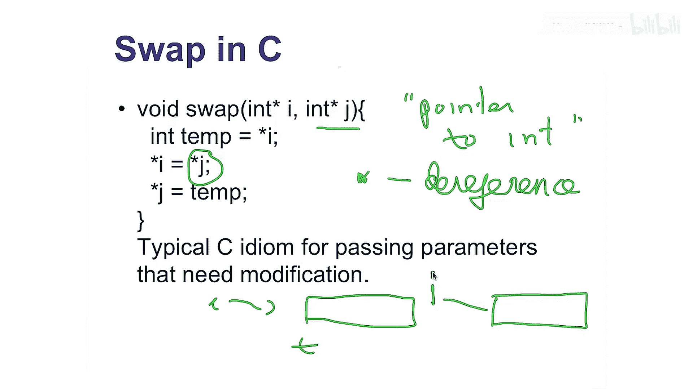

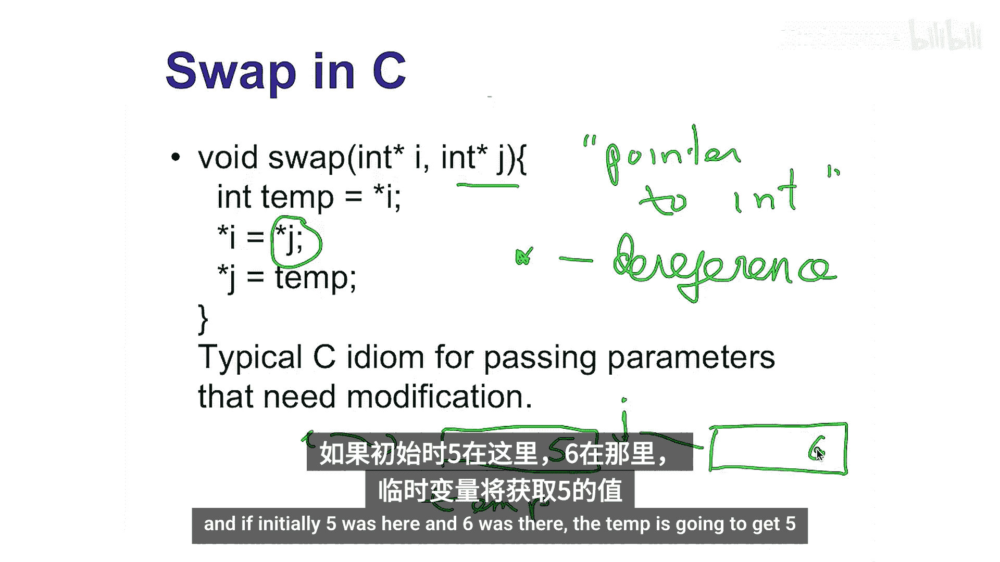

现在，如果我们想交换两个`double`类型的变量呢？在C语言中，我们必须为不同类型的变量编写不同的交换函数。

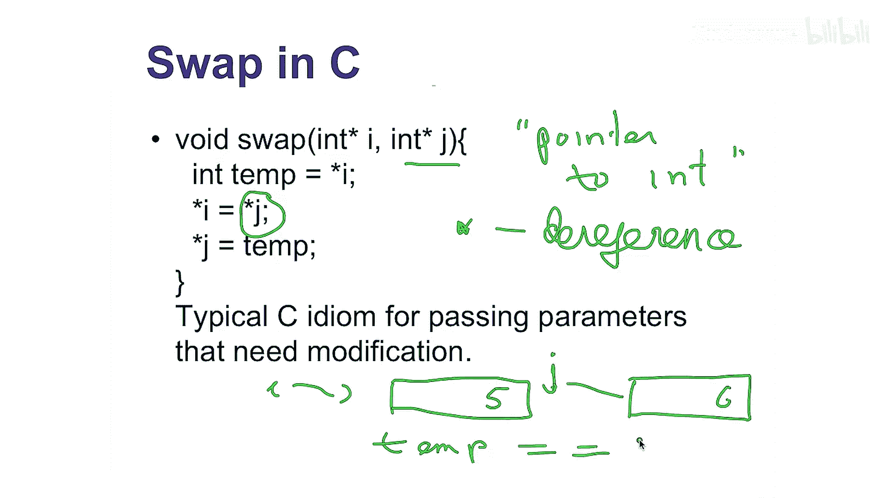

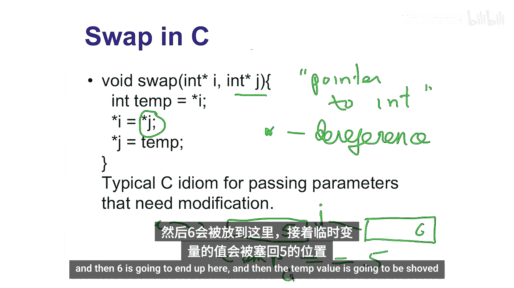

以下是C语言处理此问题的方式：

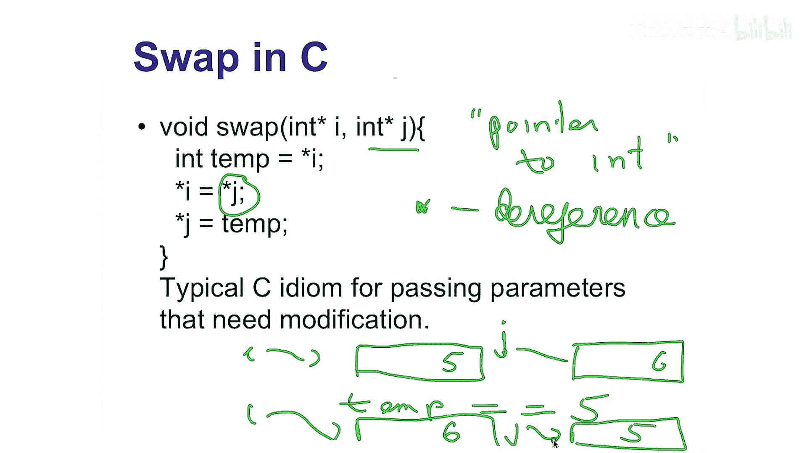

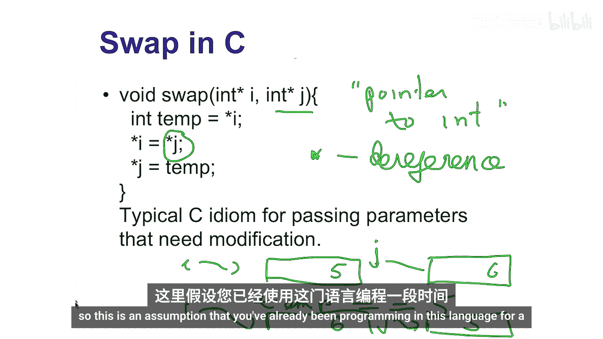

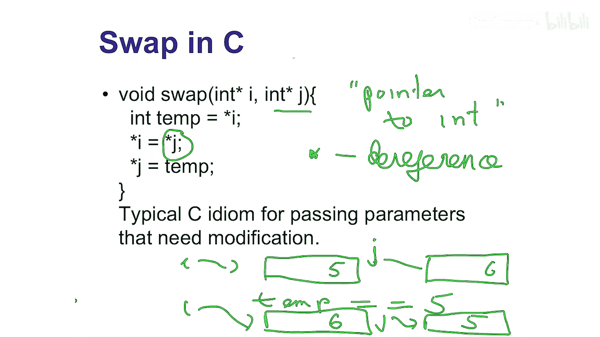

1.  **必须创建新函数**：由于C语言要求函数名在作用域内必须唯一，我们不能简单地重载`swap`函数名。
2.  **修改类型声明**：新函数（例如`swap_double`）的参数和内部临时变量的类型需要从`int`改为`double`。
3.  **调用时仍需使用地址**：在调用`swap_double`时，同样需要使用地址操作符（`&`）来传递变量的地址。

对应的函数实现如下：
```c
void swap_double(double* i, double* j) {
    double temp = *i;
    *i = *j;
    *j = temp;
}
```

这意味着，对于每种需要交换的数据类型，我们都需要重复编写逻辑几乎完全相同的代码，这不利于代码的复用和维护。

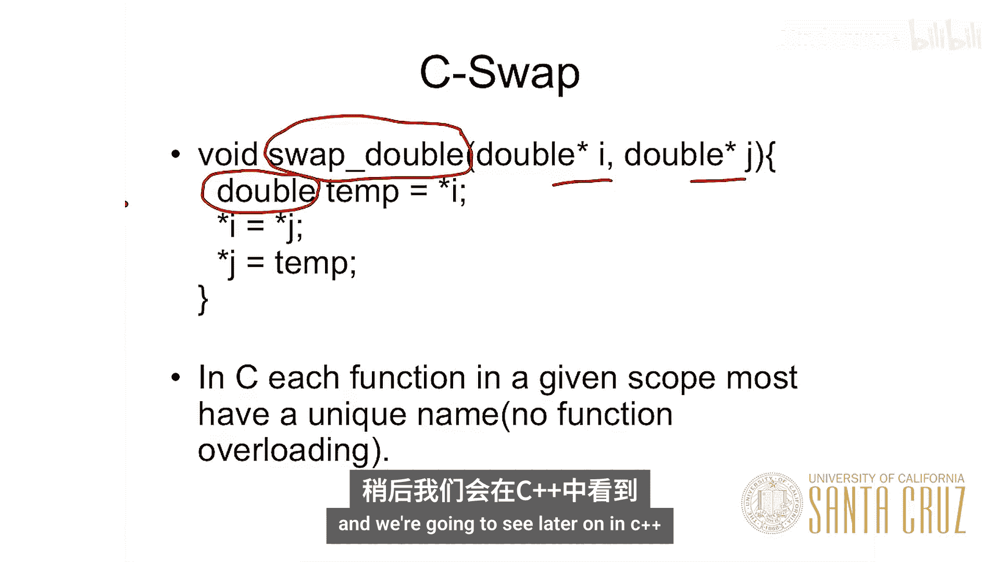

## 在程序中使用交换函数 💻

让我们看看如何在主程序中调用这些交换函数。理解调用方式对于掌握指针概念至关重要。

以下是调用`swap_int`函数的示例代码：
```c
int m = 5, n = 10;
printf("Before swap: m = %d, n = %d\n", m, n);
swap_int(&m, &n); // 传递m和n的地址
printf("After swap: m = %d, n = %d\n", m, n);
```
在这段代码中：
*   `&m`和`&n`分别获取了变量`m`和`n`的内存地址。
*   将这两个地址传递给`swap_int`函数。
*   函数通过指针修改了`m`和`n`所在地址的内容，从而实现了值的交换。
*   输出结果将从“5, 10”变为“10, 5”。

对于`double`类型，调用方式类似，但需要使用`%lf`等正确的格式说明符进行输入输出。

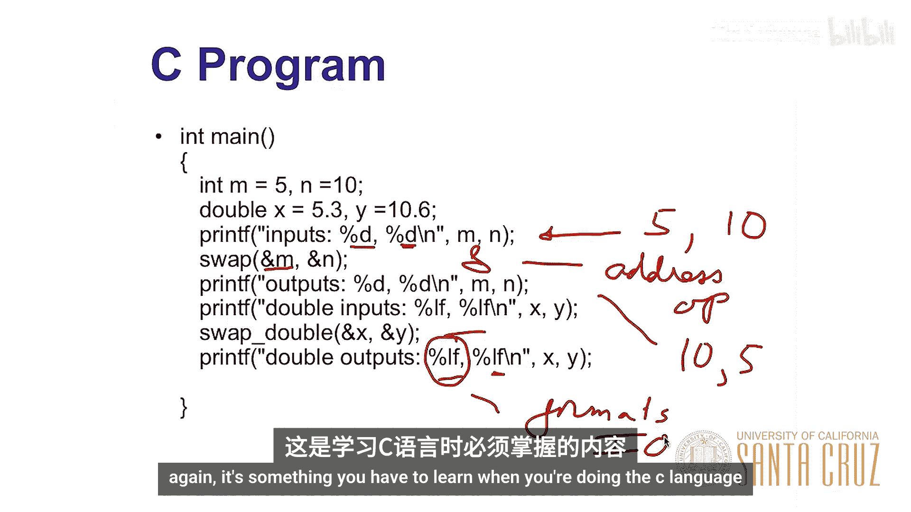

## 本节总结 📝

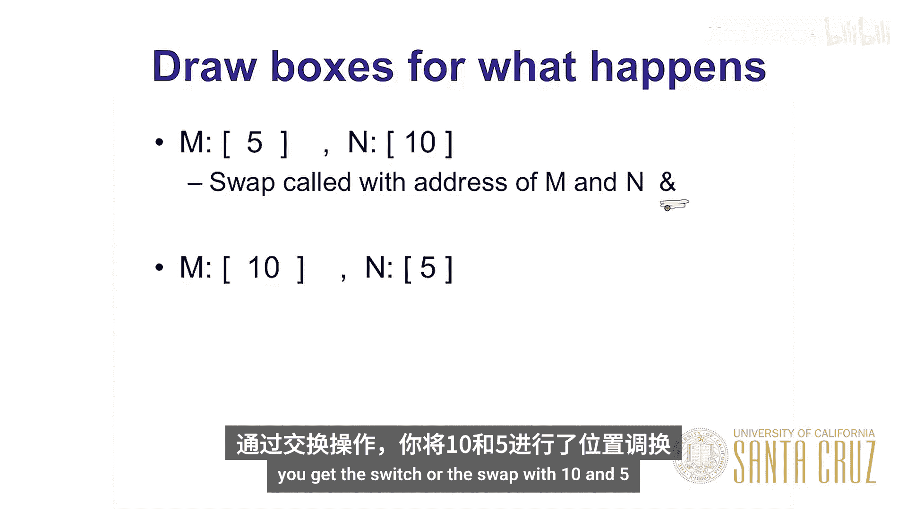

本节课中我们一起学习了在C语言中实现变量交换的标准方法。我们了解到，由于C语言严格的“按值调用”语义，要修改函数外部的变量，必须通过传递指针（即变量的地址）来间接操作。我们分析了交换函数的实现步骤，并指出了这种方法的局限性：**每增加一种需要交换的数据类型，就必须编写一个几乎完全相同的新函数**，这导致了代码冗余。

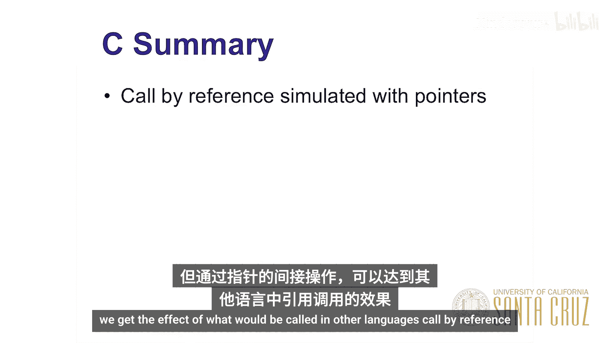

这为我们下一节学习C++中的解决方案做好了铺垫。在C++中，我们将看到如何利用更强大的特性，只编写一个交换函数就能处理多种数据类型，从而大大提高代码的复用性和简洁性。