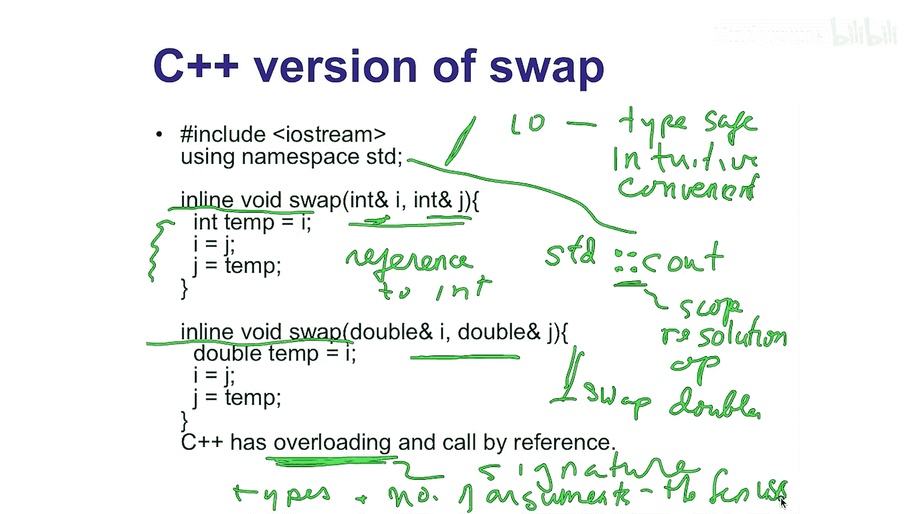
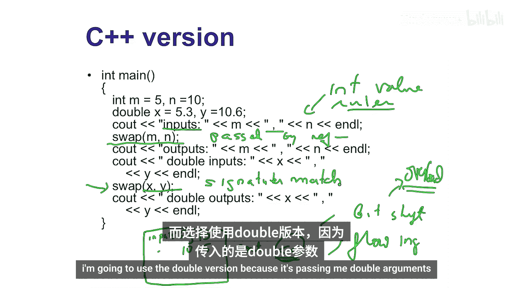
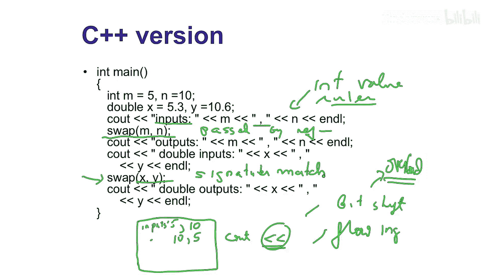
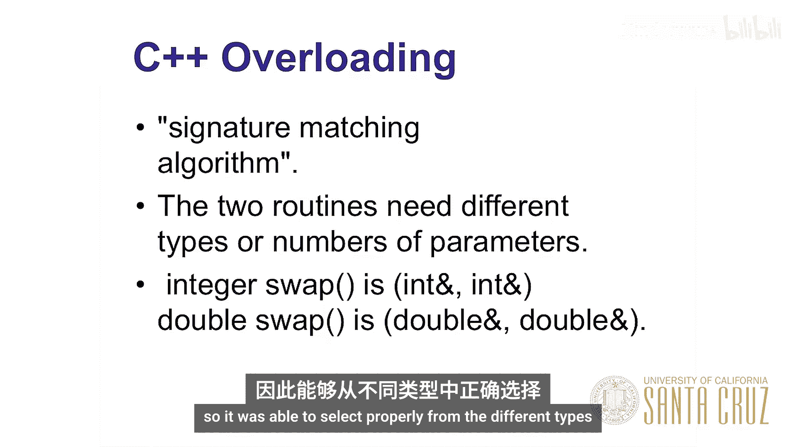
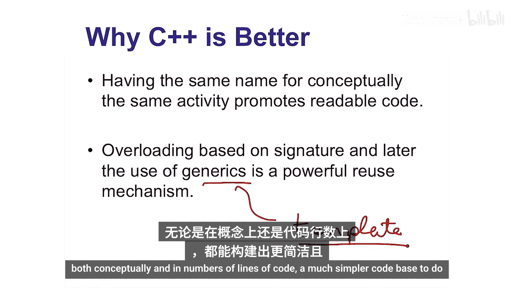
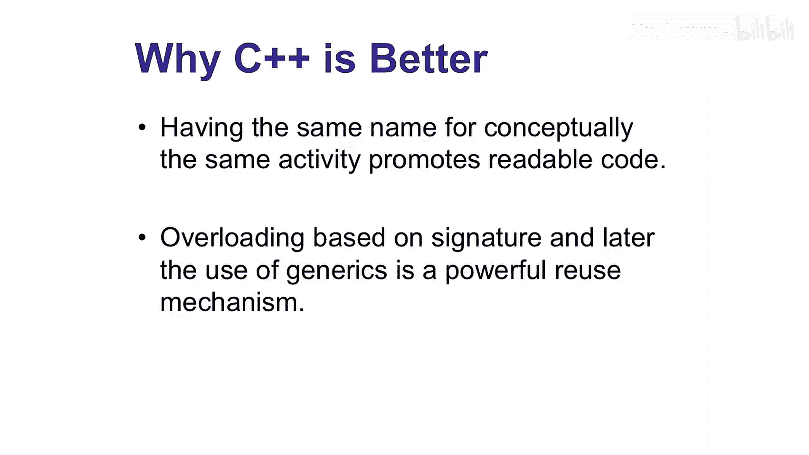
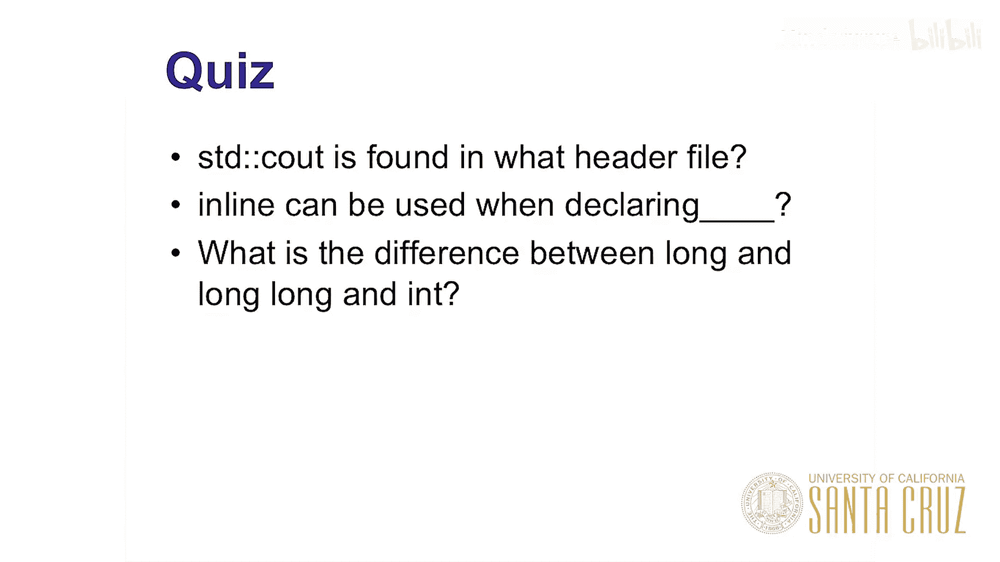
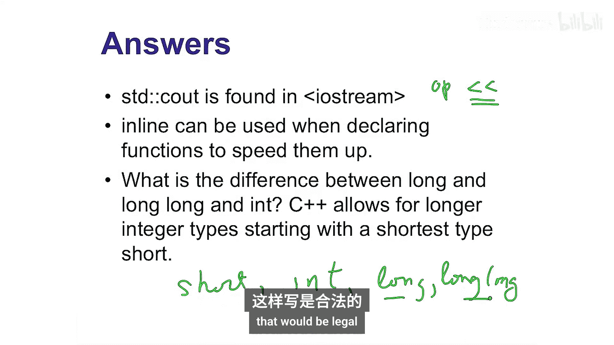

# 009：C++中的交换函数与函数重载 🚀

在本节课中，我们将学习C++中实现交换函数的更优方法，并与C语言版本进行对比。我们将重点介绍C++的引用传递、函数重载以及类型安全的I/O操作，这些特性使得代码更简洁、高效且易于阅读。

---

上一节我们回顾了C语言中通过指针实现交换函数的方法。本节中，我们来看看C++如何通过其内置特性更优雅地解决这个问题。

C++直接支持引用传递机制，它是对值传递的补充。因此，我们无需像在C语言中那样“人工”创建引用传递。观察C++版本，我们会发现几个有趣的特点。

首先，在C++版本中，我们将使用C++的I/O库。这个I/O库是类型安全且便捷的。类型安全意味着编译器能检查类型，避免错误；便捷性体现在其直观的语法上。

我们还会使用`namespace`来限定作用域。这里使用了`std`命名空间，因为像`cout`这样的对象定义在其中。`std::`被称为作用域解析运算符，这是C语言中没有的新特性，它用于处理更复杂的名称。通过`using namespace std;`语句，我们无需在每个标识符前都加上`std::`前缀，编译器会自动查找。

以下是C++版本交换函数的核心代码示例：

```cpp
inline void swap(int &i, int &j) {
    int temp = i;
    i = j;
    j = temp;
}
```

代码分析：
1.  **`inline`**：这是一个新特性，用于告知编译器尝试将函数内联，以提高执行效率。
2.  **引用传递**：参数`int &i`应理解为“对`i`的引用”，而非“`i`的值”。对于`j`也是如此。当参数以引用方式传递时，函数内部直接操作原始变量，无需创建副本。因此，函数内对内容的任何修改在函数返回后都会保留。这避免了值传递中创建本地副本的开销，对于处理大型数据结构时提升效率尤为重要。
3.  **简化操作**：我们无需使用解引用（`*`）和取地址（`&`）运算符，代码看起来更简洁。交换后，变量的值确实会被改变。



---

接下来，一个更有趣的特性是，在C++中我们不需要为不同类型的交换函数起不同的名字。C++支持**函数重载**。

这意味着在同一个作用域内，可以存在多个同名函数。那么，编译器如何区分它们而不产生歧义呢？像Algol 60或C这样的早期语言不允许同名函数，会报语法错误。

C++通过**签名匹配**机制来解决。编译器提供了一种自动区分不同函数的方法。例如，如果我要交换两个`double`类型，就使用接收`double`参数的`swap`函数；如果要交换`int`类型，则使用另一个。只要能够通过参数类型或数量进行区分即可。

这种区分依据被称为函数的**签名**。因此，重载的本质就是**通过签名进行区分**。函数的签名由其参数的**类型**和**数量**决定。

---

让我们看看这是如何工作的。以下是C++版本的`main`函数示例：

```cpp
#include <iostream>
using namespace std;



int main() {
    int m = 5, n = 10;
    double x = 5.5, y = 10.5;

    cout << "inputs: " << m << ", " << n << endl;
    swap(m, n);
    cout << "outputs: " << m << ", " << n << endl;

    cout << "inputs: " << x << ", " << y << endl;
    swap(x, y);
    cout << "outputs: " << x << ", " << y << endl;

    return 0;
}
```



代码执行流程分析：
1.  **输出**：使用`cout`进行输出。可以将其想象成数据“流向”屏幕。首先输出字符串`"inputs: "`，然后是变量`m`的值`5`，接着是字符串`", "`，最后是变量`n`的值`10`。
2.  **类型安全I/O**：与C语言的`printf`不同，C++的I/O流了解数据的类型，并会应用该类型的默认格式化规则。你无需指定`%d`或`%f`等格式符，这简化了操作并避免了格式不匹配的错误。
3.  **调用`swap`**：这里只是简单地传入变量`m`和`n`，但它们是**通过引用传递**的。因此，函数内部直接操作原始变量`m`和`n`的内容。之后再次打印时，会看到输出变为`10, 5`。
4.  **重载解析**：当调用`swap(x, y)`时，由于`x`和`y`是`double`类型，编译器通过签名匹配算法，自动选择接收`double&`参数的`swap`版本，没有任何歧义。

这减少了对命名空间的“污染”，我们无需为一堆功能相似但操作类型不同的函数起不同的名字。如果“交换”这个操作在概念上是相同的，只是处理的数据类型不同，我们可以保留相同的函数名，这使得代码更易读、更易处理。



---

在C++中，通过重载和签名匹配算法的神奇之处，我们实现了编译器自动选择合适函数的能力。为了避免歧义，两个同名函数必须具有不同的参数类型或不同的参数数量。在本例中，参数类型不同，因此编译器能够正确选择。

---





### 总结 📝



本节课中我们一起学习了C++中实现交换函数的优势。

1.  **引用传递**：通过`&`符号实现，避免了指针的繁琐语法和值传递的拷贝开销，使代码更简洁高效。
2.  **函数重载**：允许同一作用域内存在多个同名函数，通过**函数签名**（参数类型和数量）进行区分。这为概念相同的操作使用相同的名字，极大地**提升了代码的可读性**。可读性是编写优秀代码最重要的标志之一。
3.  **类型安全I/O**：使用`cout`进行输出，编译器自动处理类型，无需格式符，更安全便捷。
4.  **`inline`关键字**：建议编译器将函数内联，适用于小型函数以提升效率，但需注意可能引起的代码膨胀。
5.  **命名空间**：使用`namespace`和`using`声明来管理标识符，避免命名冲突。

为概念相同的活动使用相同的名称（即重载）能促进代码可读性。可读性是优秀代码的绝对标志。在未来，结合基于签名的重载以及**泛型编程**（我们将深入讨论的概念，与C++中强大的**模板**特性相关），将使代码复用更强大，产生概念上更简单、代码行数更少、功能却更强大的代码库。

---

### 小测验 ✏️

1.  标准作用域解析运算符`std::cout`定义在哪个头文件中？
2.  `inline`关键字可以在声明什么时使用？
3.  类型`long`、`long long`和`int`之间有什么区别？



**答案提示：**
1.  `std::cout`定义在`<iostream>`头文件中，同时定义的还有移位运算符`<<`的重载语义。
2.  `inline`可用于声明函数，是一种提升速度的优化建议。但请注意，编译器不一定会内联复杂函数，并且过度内联可能导致代码膨胀。通常只建议对非常小的函数使用。
3.  C++允许比早期标准C更长的整数类型。基本要求是：在类型链中，每种更“长”的类型（如`long`之于`int`，`long long`之于`long`）其长度至少与前者相同。因此，在某些编译器实现中，`long`和`long long`的长度可能相同，这是符合标准的。