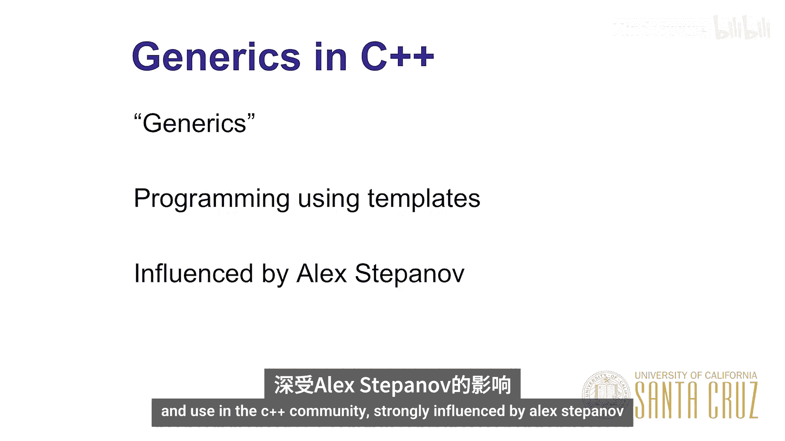
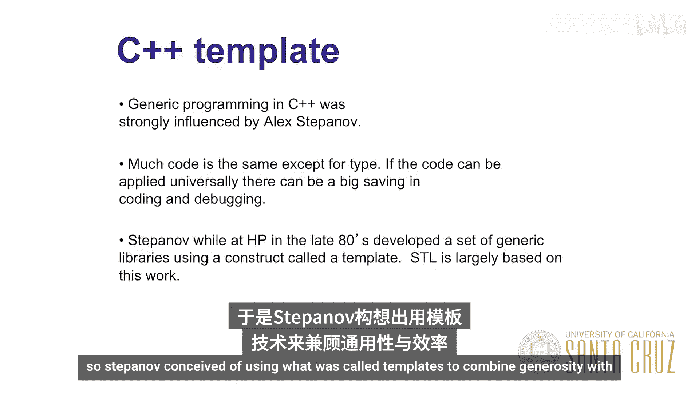
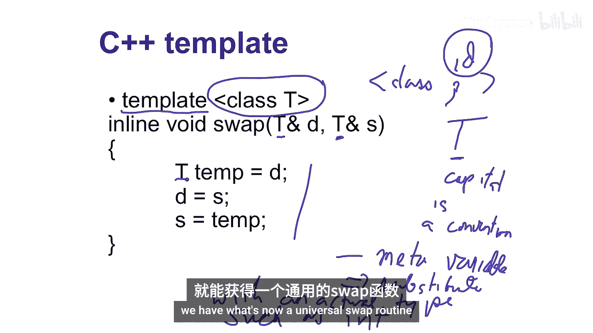
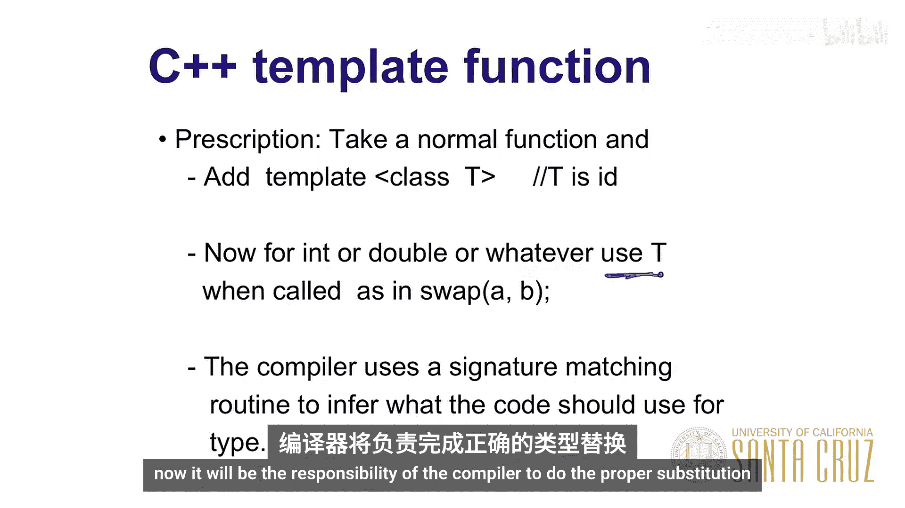
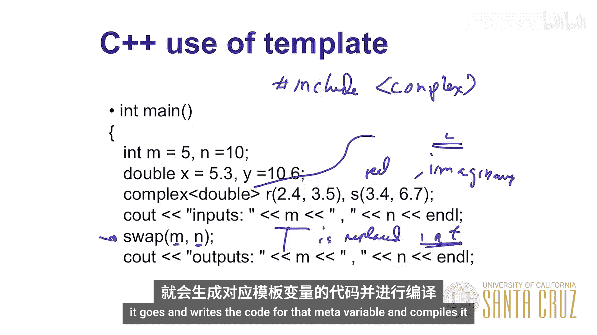
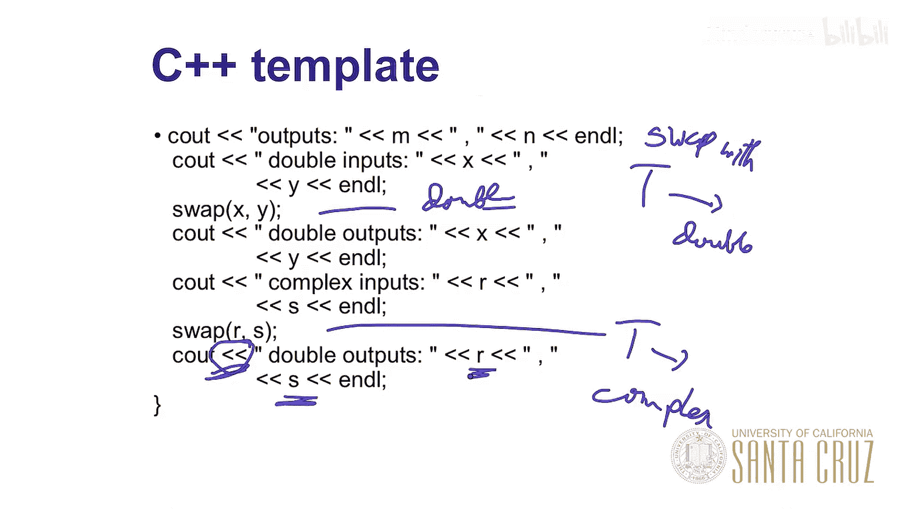
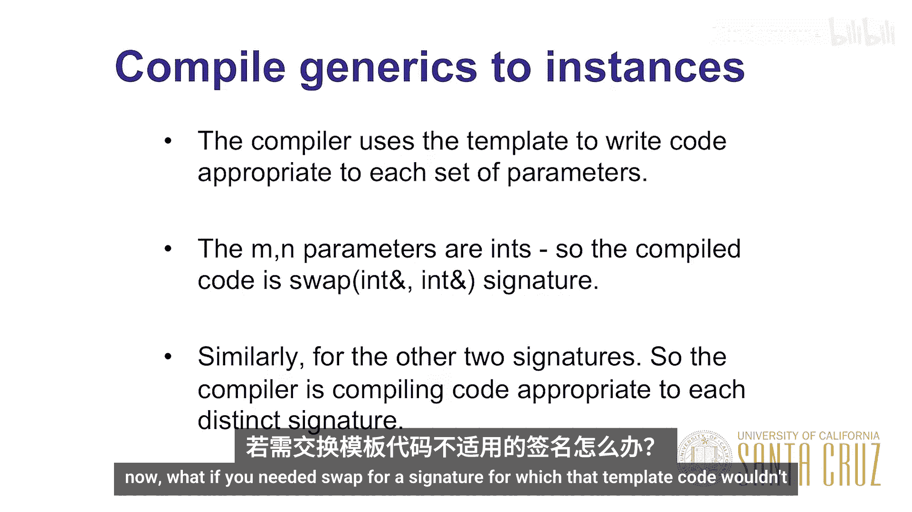
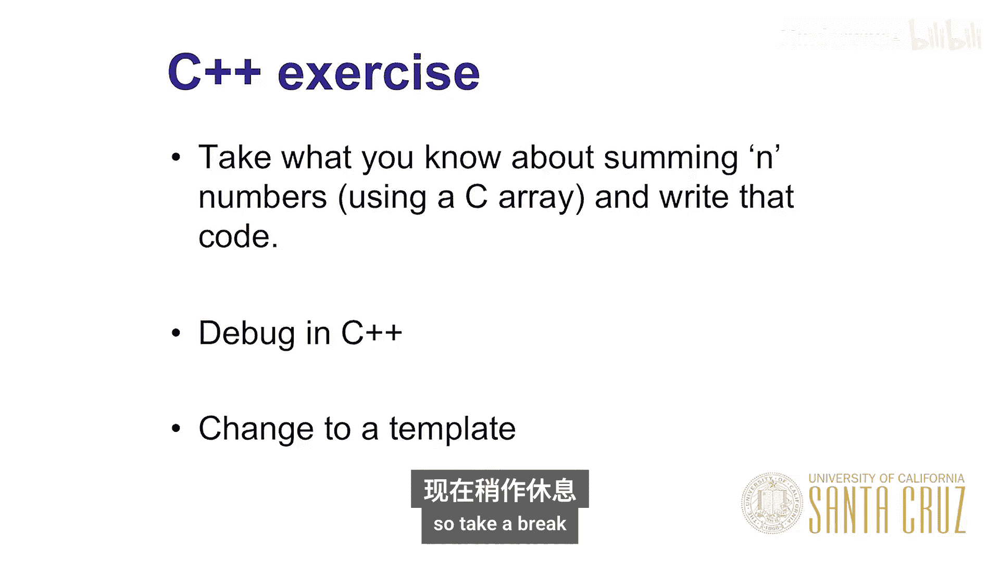
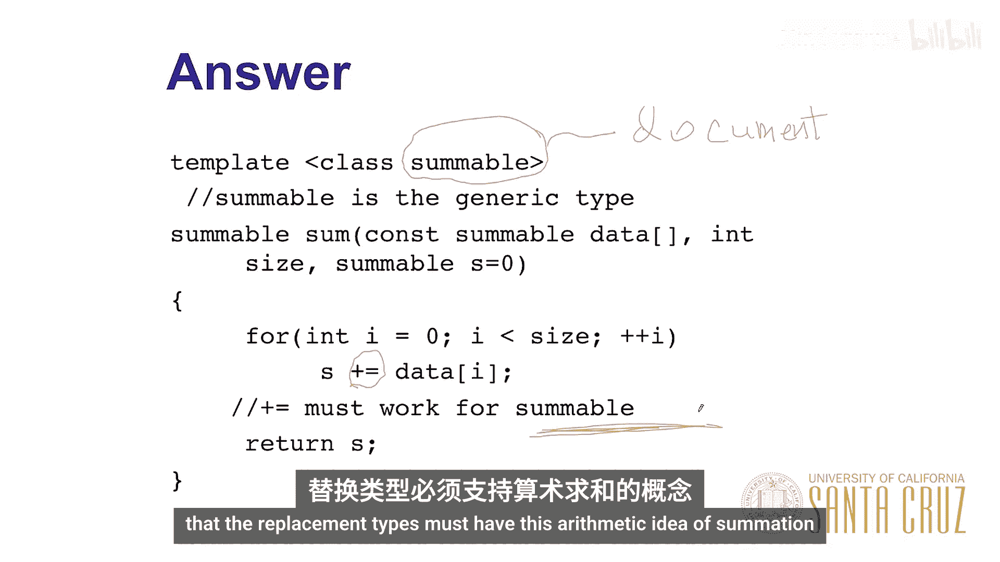

# 010：泛型编程入门

## 概述



在本节课中，我们将要学习C++中一个强大的特性——泛型编程。通过使用模板，我们可以编写出能够处理多种数据类型的通用代码，从而极大地提高代码的复用性和开发效率。

## 从具体到通用：泛型编程的思想

上一节我们介绍了函数重载等概念，本节中我们来看看如何通过泛型编程来进一步提升代码的通用性。

泛型编程的核心思想是编写不依赖于特定数据类型的代码。在日常生活中，我们也有类似的概念。例如，一个“煎鱼”的食谱，其基本步骤（加热油、放入食材、控制时间）适用于多种鱼类（鳟鱼、鲈鱼等），而不仅仅是某一种特定的鱼。我们只需要一个通用的“煎鱼”食谱，而不是为每种鱼都写一个单独的食谱。

在编程领域，早期的语言（如Lisp）通过牺牲类型安全和运行效率来获得这种通用性。而C++的设计目标之一，就是在保持高效率的同时，实现代码的通用性。这一思想深受Alex Stepanov的影响，他作为逻辑学家，致力于寻找最通用的规则，并将其应用于编程语言设计中。

## C++模板：实现泛型的工具

为了实现泛型编程，C++引入了**模板**这一机制。模板允许我们定义函数或类时，使用一个占位符（通常称为类型参数）来代替具体的类型。

以下是定义一个通用交换函数模板的语法：

```cpp
template <class T>
inline void swap(T& x, T& y) {
    T temp = x;
    x = y;
    y = temp;
}
```



让我们分解一下这个定义：
*   `template <class T>`：这行代码声明了一个模板，其中`T`是一个类型参数（或称为“元变量”）。按照惯例，我们通常使用大写字母（如`T`、`T1`、`T2`）来表示类型参数。
*   函数体内部的代码与之前针对`int`类型编写的`swap`函数完全一样，只是将具体的`int`类型替换成了通用的类型参数`T`。

通过添加这一行模板声明，我们就获得了一个可以交换任意类型数据的通用函数。编译器会在编译时，根据实际调用时传入的参数类型，自动将`T`替换成具体的类型（如`int`、`double`等），并生成对应的机器代码。这个过程称为**模板实例化**。

## 模板的使用与实例化



现在，让我们看看如何在主函数中使用这个泛型的`swap`函数。

```cpp
#include <iostream>
#include <complex>



int main() {
    int i1 = 1, i2 = 2;
    double d1 = 3.14, d2 = 2.71;
    std::complex<double> c1(1.0, 2.0), c2(3.0, 4.0); // 复数也是模板类

    swap(i1, i2);   // 编译器实例化 swap<int>
    swap(d1, d2);   // 编译器实例化 swap<double>
    swap(c1, c2);   // 编译器实例化 swap<std::complex<double>>

    std::cout << i1 << ", " << i2 << std::endl;
    std::cout << d1 << ", " << d2 << std::endl;
    std::cout << c1 << ", " << c2 << std::endl;

    return 0;
}
```

以下是代码执行时编译器的工作流程：
1.  当编译器看到`swap(i1, i2)`时，它识别出参数类型是`int`。于是，它将模板中的`T`全部替换为`int`，生成一个专用于`int`的`swap`函数并编译。
2.  同理，对于`swap(d1, d2)`，生成`swap<double>`。
3.  对于`swap(c1, c2)`，生成`swap<std::complex<double>>`。

虽然这可能会导致生成多份函数代码（代码膨胀），但这正是我们原本需要手动完成的工作。模板自动化了这个过程，并且保证了类型安全，减少了人为错误。

## 模板的约束与特化

泛型并不意味着“万能”。模板代码对其所操作的类型是有隐含要求的。

以我们即将看到的求和函数为例，它的模板参数名被有意地命名为`Summable`，而不仅仅是`T`：

```cpp
template <class Summable>
Summable sum(const Summable data[], int size) {
    Summable total = 0;
    for (int i = 0; i < size; ++i) {
        total += data[i]; // 关键操作：要求类型支持 +=
    }
    return total;
}
```



这个名称`Summable`是一种文档提示，它告诉我们：能够替换这个类型参数的数据类型，必须支持`+=`操作符。如果用一个不支持`+=`操作的类型（例如某个没有重载该操作符的自定义字符串类）来实例化这个模板，编译器会报错。

然而，更需要注意的情况是：如果某个类型恰好定义了`+=`操作，但这个操作的含义并非数学意义上的“求和”（例如，它可能是字符串连接），那么代码虽然能编译运行，却会产生非预期的结果。因此，理解模板代码对类型的隐含语义要求至关重要。



有时，对于某些特定的类型，通用的模板实现可能并不合适。这时，我们可以使用**模板特化**。例如，如果针对`std::string`类型的`swap`需要特殊的拷贝语义，我们可以专门为它写一个非模板的、具体的函数：

```cpp
void swap(std::string& a, std::string& b) {
    // 特殊的字符串交换实现
}
```



当调用`swap`并传入字符串时，编译器会优先选择这个更具体的、非模板的版本，而不是从通用模板生成一个。这实际上是函数重载规则的一部分。

## 实践练习：将具体函数泛化



为了巩固对模板的理解，我们来进行一个实践。以下是创建一个泛型函数的推荐步骤：

1.  **编写具体函数**：首先，为一个你熟悉的、确定可用的具体类型（例如`double`）编写一个能正确运行的函数。
2.  **添加模板声明**：在函数定义前添加`template <class T>`。
3.  **替换类型**：将函数签名和函数体中所有该具体类型出现的地方，替换为类型参数`T`。

现在，请尝试完成以下练习：
> 编写一个函数，用于计算一个C风格数组中所有元素的和。先为`double`类型实现，测试无误后，将其改造成一个通用的模板函数，并确保它能用于`int`等其他类型。



## 总结

本节课中我们一起学习了C++泛型编程的基础知识。我们了解到：
*   泛型编程旨在编写不依赖特定类型的通用代码，以提高复用性。
*   C++通过**模板**机制实现泛型，使用`template <class T>`语法定义。
*   编译器在编译时根据实际使用的类型进行**模板实例化**，生成具体的代码。
*   模板代码对其操作的类型有隐含的语义要求，需要开发者注意。
*   可以通过**模板特化**为特定类型提供定制化的实现。
*   将具体函数改造为模板函数是一个简单的过程：添加模板声明，并用类型参数替换具体类型。

掌握泛型编程是迈向编写强大、灵活且可复用C++代码的关键一步。