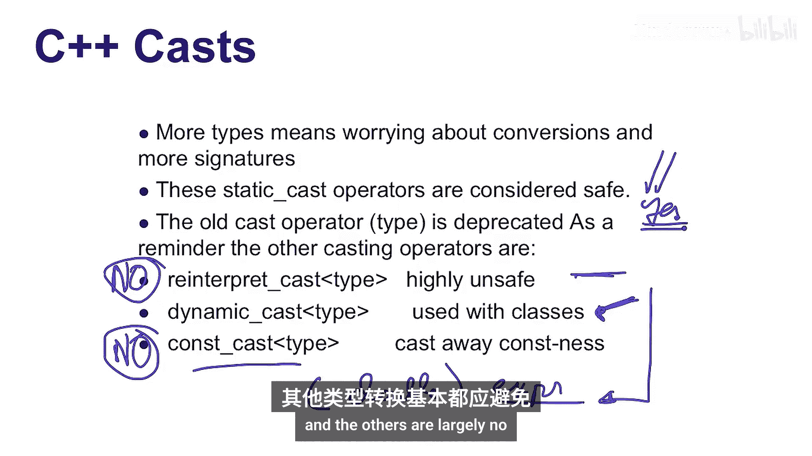

# 012：多个模板参数


## 概述

在本节课中，我们将要学习C++模板的一个进阶特性：使用多个模板参数。我们将探讨其适用场景、潜在风险，并通过一个具体的例子来理解如何安全地使用它。

---

## 模板参数的限制与警告

上一节我们介绍了单参数模板的基本用法。本节中我们来看看当模板拥有多个参数时的情况。

目前我们接触的模板都只有一个元参数，但实际上模板参数的数量并没有限制。不过请记住，大多数情况下，单参数模板就能满足需求。一旦开始使用多参数模板，你可能会陷入**可怕的复杂性**之中。在大多数情况下，这是不必要的复杂性，并且可能导致一些难以预料的、相当危险的操作。尽管如此，在某些特定场景下，多参数模板确实有用，因此了解其使用方法和时机是必要的。

再次警告：请务必小心。你必须真正理解何时需要多个模板参数。通常这些是元参数，但让我们看一个可能合理的应用场景。

## 一个合理的多参数模板示例：复制函数

以下是一个使用两个模板参数的代码示例。它是一个复制例程，目的是将源数据复制到目标数据中。

我们不一定希望源类型和目标类型必须相同。如果只使用一个模板参数 `T`，那就意味着复制操作必须是同类型的，例如整型数组复制到整型数组。让我们注意这段代码的几个关键点：

首先，在函数签名中，源参数被声明为 `const`。这体现了**常量正确性**，我们向用户、读者和编译器表明：不要修改源数据。显然，目标数组不受此限制，因为我们希望目标数组获得源数组的副本。

其次，我们有一个变量 `size` 来指定要复制的元素数量。目前看来，为它设置一个默认值可能并不实用，因为很难找到一个能适用于大多数情况的“标准默认值”（比如设为100就很不寻常）。

最后，也是这里最关键的一点，我们使用了**安全转换**。在我看来，正是这一点使得这个例程变得合理。

```cpp
template <typename T1, typename T2>
void copy(const T1 source[], T2 destination[], int size) {
    for (int i = 0; i < size; ++i) {
        destination[i] = static_cast<T2>(source[i]); // 安全转换
    }
}
```

如果类型 `T1` 的对象无法安全地转换为类型 `T2`，那么这段代码在运行时将会出错。或者，编译器会识别出不存在安全转换的机会，从而提供一个编译时错误。无论如何，代码都无法正常工作，并且会以一种易于检测的方式失败。

在代码能够工作的情况下，我们知道我们有一种安全的方法将源内容“重塑”为目标内容。例如，将整型数据转换为双精度浮点型数据，或者反过来，在这里都是完全合理的。这两种转换，一种称为**提升**（将整型域的数据转为双精度型），另一种称为**降级**，但两者都是常规且易于理解的，可以由安全转换例程处理，并且很大程度上是可移植的。程序应该能在任何计算机系统上运行。

这就是一个多模板参数的不算不合理的用法。

## 关于类型转换的深入讨论

这引出了关于**类型转换**的问题。类型安全是C++世界相对于C世界的一大改进。C世界在类型上非常松散，例如你可以写 `(double) some_expression`。无论这个表达式是什么，C编译器都会强制将其解释为 `double` 类型，而不管这种转换是否可移植。

C++的编程范围更广，包括面向对象编程。在面向对象社区中，某些类型和类型层次结构（称为多态类型、继承结构）提供了其他种类易于理解的转换机会。在C++世界中，我们面临着更丰富的转换可能性，因此必须更加小心。

C++定义了四种基本类型的转换：

以下是四种C++转换操作符的简要说明：

1.  **`static_cast`**：用于安全的、明确定义的转换，如数值类型转换和具有继承关系的指针/引用向下转换。
2.  **`reinterpret_cast`**：用于低级的、依赖于实现的重新解释，如将指针转换为整数，或在不同类型的指针间转换。**高度不安全**。
3.  **`const_cast`**：用于添加或移除 `const` 和 `volatile` 属性。
4.  **`dynamic_cast`**：用于在具有多态性的类层次结构中进行安全的向下转换或交叉转换，会在运行时检查转换是否有效。

安全转换类型是 `static_cast`。而高度不安全的是 `reinterpret_cast`，这大致对应了C语言中那种强制转换的思路。但它提醒你一个事实：这通常是由于某些原因（很可能是一种“黑客”行为）而进行的。在我看来，这是你不应该做的事情。如果我作为你的经理，这会是一个“禁止”项。你必须说服我你有充分的理由使用 `reinterpret_cast`，而我对此会**极其不情愿**。

同样，在大多数情况下，`const_cast` 对我来说也是一个“禁止”项。你可以通过它移除常量性。有时你可能希望将声明为常量的东西变得可修改，但在我看来，你混淆了两个特性：你最初为什么要把它设为常量呢？你实际上在说：“哦，让那个东西大部分时间是常量，我不希望π值突然改变，但可能有时我想调整它。”这不是我的思维方式。

所以，再次强调，对于其他几种转换，你基本上应该将它们从你的技能库中剔除。安全转换是可以的。旧式C风格转换虽然在许多编译器中仍然可用，但已被**弃用**。弃用意味着不要使用它，编译器编写者实际上有权禁止它的使用。

还有一些特殊情况，涉及类层次结构的 `dynamic_cast`，当你进行一些非常复杂的面向对象编程时，这可能是有必要的。但同样，我不是它的粉丝。

因此，我的建议是：安全转换（`static_cast`），**可以**。其他类型，**基本不行**。

---

## 总结



本节课中我们一起学习了C++中多模板参数的使用。我们了解到，虽然模板可以接受多个参数，但这通常会引入不必要的复杂性，应谨慎使用。我们通过一个**类型安全的数组复制函数**示例，看到了合理使用双模板参数的场景，其核心在于利用 `static_cast` 进行安全类型转换。最后，我们回顾并强调了C++中四种类型转换操作符的区别，重申了坚持使用安全转换（`static_cast`）以保障代码健壮性和可维护性的最佳实践。