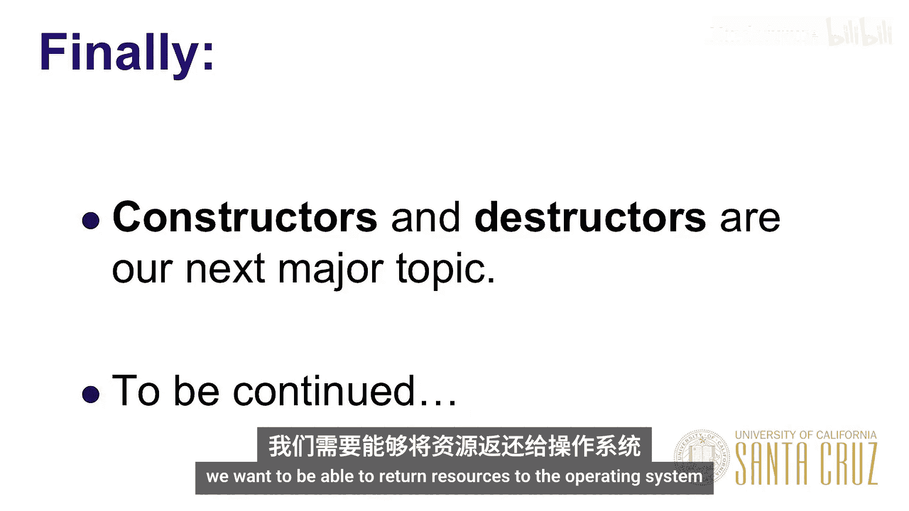

# 020：C++中的点类


## 概述

在本节课中，我们将学习如何在C++中创建一个名为`Point`（点）的用户自定义类型。我们将重点介绍类的概念、访问控制（`public`和`private`）、成员函数、运算符重载以及构造函数。目标是让这个新类型的使用方式尽可能接近C++内置的原始类型（如`int`、`double`），使其直观且高效。

---

## 从C到C++：使用`class`关键字

上一节我们介绍了在C语言中创建新类型的局限性。本节中，我们来看看C++如何通过`class`关键字更好地实现这一点。

首先，我们选择使用新的关键字`class`来定义`Point`类型。在C++中，类名自动成为类型名，我们不再需要C语言中`typedef`那样的技巧。

接下来，你会看到一个不同之处：访问控制关键字。这个关键字可以是以下三个之一：`public`、`private`、`protected`。目前，我们暂时忽略`protected`，它是继承机制的一部分，我们改天再讨论。对于大多数编程任务，你真正需要了解的是`public`和`private`。

这体现了编程中的一个“90%规则”：掌握一些简单的核心理念，就能解决90%的问题。你应该专注于学习这些广泛适用的基础知识，剩下的10%可以在需要时再学习。

*   **`public`**：声明在此区域的内容对所有代码可见。例如，`public: double x, y;`意味着世界上任何人都可以查看和修改`x`和`y`。
*   **`private`**：与`public`相反，它限制访问，只有这个类自身的作用域内的代码（如类的成员函数）才能访问。我喜欢将`private`部分称为“黑盒原则”。隐藏在这里的是内部的私有内容。

这就像一个iPhone：制造商只希望授权专家处理其内部构造（黑盒）。普通用户看到的是表面的几个控制按钮（公共功能）。他们不需要知道内部运行着什么处理器或操作系统，只需要知道如何使用电话、地图或查看电影评论的应用程序。这是一个重要的设计原则：尽可能隐藏非专家或普通用户不需要知道的细节，只向他们提供公共的控制接口。

---

## 类的结构与成员函数

这里，我们正在尝试创建一个新的用户自定义对象。使用面向对象技术时，我们需要理解其一些关键要素。

面向对象技术的首要原则是让你新的数据对象看起来自然，与现有的编程语言数据类型（如`int`、`float`）兼容。我们遵循的原则之一就是数据隐藏。因此，我们在`private`区域隐藏数据的内部表示。

为了保证效率，请注意：在面向对象术语中，成员函数有时被称为“方法”。当成员函数在类定义内部实现时，它会自动成为**内联函数**，这意味着它非常高效。

例如，`getX()`函数返回`x`的值，这实际上并不涉及真正的函数调用开销，它只是直接获取与该`Point`实例关联的变量`x`的内部值。

同样，`setX()`函数（也称为**更改器方法**，因为它可以改变隐藏表示的值）也是高效的。在代码中调用成员函数`setX`的地方，编译器可能会将其替换为简单的赋值操作。

如果你想回顾面向对象的概念，可以参考维基百科等资料。遵循这个模板：使用`public`来定义你希望对象具有的行为，使用`private`来隐藏内部表示。这样，通过提供一组丰富且自然的类函数，你就能在常规编程中轻松使用`Point`类型。

以下是`Point`类的基本结构示例：

```cpp
class Point {
private:
    double x, y; // 私有数据成员，隐藏内部表示

public:
    // 成员函数（方法）
    double getX() const { return x; } // 访问器方法，高效内联
    void setX(double newX) { x = newX; } // 更改器方法，高效内联
    // ... 其他成员函数
};
```

---

## 运算符重载：让类型更自然

我们继续探讨面向对象范式，看看C++允许我们做什么。C++是最强大的面向对象语言之一（实际上它是多范式语言），它允许**运算符重载**，这是许多其他面向对象语言（甚至一些基于C的语言）所不具备的特性。这使我们能够将运算符的语义扩展到我们新的对象上，从而让新数据类型与旧数据类型之间的交互方式符合直觉。

这里我们有一个叫`Point`的对象。在高中数学中，点是一个数学对象。在解析几何中，你可以将两个点相加得到第三个点，方法是将它们的X和Y坐标分别相加。这是一个很自然的操作，对应的运算符是二元加法运算符`+`。

你只应在有现成语义的情况下重载运算符，这通常意味着对象是数学对象。你不想为一个普通的“小部件”重载`+`，因为没人知道两个小部件相加是什么意思。但在数学领域，`+`有非常明确的含义。如果我需要在编程中频繁处理点，我就会希望使用算术和数学符号（包括这些运算符）。

我们期望的语义正是你从高中数学中能想象到的。同时，我们也想重载输出运算符`<<`，这非常重要。请仔细研究这一点，因为这是一个关键惯用法：每当你创建了一个新的数据类型或对象，你通常都需要重载它。这是一种社区期望。如果你是这个新对象的设计者，并要把它交给团队中的其他人，他们会期望IO操作（输入输出）能对它生效。你需要定义这些IO语义。

这里的语义是：我们打印一个左括号`(`，打印点的`x`值，打印一个逗号`,`，打印点的`y`值，然后打印一个右括号`)`。因此，在屏幕上对某个点执行此操作，我们可能会看到`(3, 4)`，这代表X-Y平面中坐标为`(3, 4)`的点。

关键之处在于查看函数签名。返回类型是`ostream&`（输出流引用）。运算符重载是一个二元运算符（左移运算符`<<`）。尽管在C++中我们习惯将其视为IO操作，但其本质是位左移运算符。然而，当第一个参数是`ostream`（输出流）时（正如我们这里所做的），第二个参数是我们的`Point`对象，编译器使用的签名匹配算法就会选择这个重载版本。如果我们没有提供可用的定义，尝试这样做会导致编译错误；但如果我们提供了合适的定义（即用于`ostream`和`Point`），我们就会看到这里定义的行为。

至关重要的是，`ostream`是通过**引用**传递的，并且返回值也是`ostream`的引用。这避免了任何拷贝操作，是高效的。我们返回这个流引用是因为在典型的IO操作中，我们希望链式使用这个运算符。例如：`cout << "a = " << a << "， b = " << b << endl;`。这个表达式从左到右求值，每个`<<`操作都返回流本身，以便进行下一个操作。

另外，`Point`参数也使用**常量引用**传递（`const Point& p`）。这是因为`Point`对象可能非常复杂，通过引用传递可以避免昂贵的拷贝操作，而`const`表明这个函数不会修改传入的`Point`对象。

这是一个非常重要的惯用法，理解后你可以将其应用到任何你创建的新类中。记住，你返回`out`是为了支持链式调用。

在`main`函数中测试时，我们声明两个点并输出它们。然后计算两个点的和并输出。由于运算符`+`的优先级高于`<<`，表达式`cout << a + b << endl;`会先计算`a + b`，然后将结果输出。你应该在家尝试这个代码，添加其他运算符，运行并扩展它，这是真正掌握它的唯一方法。

---

## 构造函数：对象的创建

当我们去构建一个对象时，面向对象编程需要对象构造。内置对象（如原生类型`double`、固定数组）都是由编译器构建的。但掌握C++的一个重要部分是获得编写代码、编写类、编写成员函数的技能，以便你能构建对象。

构建对象的关键是一个特殊的方法，它有一个特殊的名字：**构造函数**。这很直观，构造（constructor）用于构建（construction）。

当你想要构建一个对象时，你需要某种东西来构建它。编译器知道如何构建原生对象，但对于这些新对象（你将要使用的领域特定对象或小部件，即你在扩展语言到新领域），编译器需要你提供构建指令。

关键思想是：**构造函数的名称与类名相同**。所有其他方法必须有不同的名字，如`getX`和`setX`。但当你在类内部看到一个函数，其名称就是类名时，你就知道它是一个构造函数。

构造函数可以有多个，接受不同的参数列表。其中有几种特殊的构造函数类型。

标准的特殊构造函数称为**默认构造函数**。之所以叫默认构造函数，是因为它定义了在你不提供任何参数时如何构建对象。例如，一个不接受任何参数的`Point`构造函数，可能会将点初始化为X-Y平面中两条轴的交点，即特殊点`(0, 0)`。这是直观的，对于原生类型，如果你不初始化它们，编译器也经常将它们初始化为零。这里你必须提供适当的语义，否则实例的秘密数据成员`x`和`y`可能不会被初始化。

我展示了两种不同的方式来实现这个语义。第二种方式使用了一个特殊的关键字：`this`。这被称为**自引用指针**。自指涉在逻辑或计算机科学中有时会令人困惑。为了让成员函数（方法）访问它自己的成员，它需要某种特殊机制。要么`x`和`y`在该类内部是已知的，要么可以通过这个特殊的`this`指针自指涉地指向它们。这个指针对于任何创建的对象都是始终存在的，我们将会看到它的重要性。

这只是构造函数的一个初步了解。还有一个类似的特殊方法叫做**析构函数**，用于销毁对象。因此，任何时候我们想要创建东西，我们也希望能够销毁它们，将资源返还给操作系统。这对于保持环境清洁、仔细管理我们的环境非常重要。这是一个主要话题，对于跟随教材学习的同学，阅读第5章非常重要。

---

## 总结



本节课中，我们一起学习了如何在C++中创建和使用`Point`类。我们了解了`class`关键字、`public`和`private`访问控制对数据封装的重要性，以及如何通过成员函数（访问器和更改器）安全地操作数据。我们重点探讨了运算符重载，特别是重载`+`和`<<`运算符，这使我们自定义的类型能像内置类型一样自然、直观地使用。最后，我们介绍了构造函数的概念，它是创建和初始化对象的特殊方法，是对象生命周期的起点。通过遵循这些原则，我们可以创建出高效、易用且符合C++社区期望的用户自定义类型。