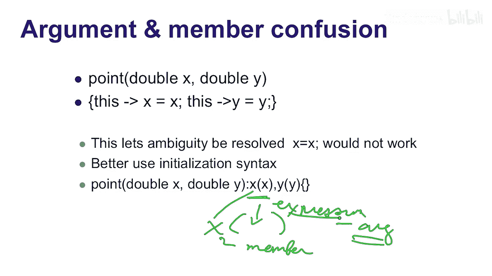

# 022：点及其构造函数


在本节课中，我们将学习如何为`Point`类编写构造函数，特别是默认构造函数。我们将探讨构造函数的签名、初始化列表的语法、`this`指针的用法，以及为什么初始化优于赋值。通过本课，你将掌握创建和初始化对象的核心方法。

## 返回Point对象

让我们回到`Point`对象，并再次审视其构造函数逻辑。我们将学习如何编写默认构造函数。

## 构造函数方法

在面向对象编程中，构建新对象的关键是编写称为构造函数方法的特殊方法。在构造方法中，默认构造函数始终非常重要。默认构造函数是其签名为空的构造函数。

请注意，构造函数总是与类名相同，这是判断其为构造函数的方式。

```cpp
class Point {
public:
    Point(); // 默认构造函数
};
```

## 带默认参数的构造函数

这里有一个空的签名。请注意，这里看起来有两个参数`x`和`y`，但实际上这两个参数都有默认值。因此，这个签名本身涵盖了很多情况，它是一个非常有用的缩写，因为它覆盖了以下情况：无参数调用`Point`、一个参数调用`Point`和两个参数调用`Point`。

在无参数的情况下，创建的`Point`对象内部表示`x`等于0，`y`等于0。

```cpp
Point p; // x=0, y=0
```

如果有一个参数的`Point`对象`Q`，它将调用此构造函数，这意味着数据值`x`为传入值，`y`为默认值0。

```cpp
Point q(10); // x=10, y=0
```

如果是两个参数的情况，数据点`x`和`y`将分别为传入的两个值。

```cpp
Point r(12, 2); // x=12, y=2
```

## 其他重要构造函数

我们将看到并更多地讨论构造函数，还有其他非常重要的构造函数。几乎在构建新对象时，都必须使用默认构造函数，但也需要构建像拷贝构造函数这样的构造函数，并且经常有一个参数的构造函数，这些构造函数也可用于转换可能性，甚至可能称它们为转换构造函数。所有这些都非常关键，在创建像`Point`这样的新对象时，应始终考虑。

## 初始化列表语法

另一个关键点是你以前可能没有见过的初始化列表语法的使用。请注意，在这个构造函数的实际语义中，代码体是空的，看起来没有执行任何操作，但事实并非如此，因为初始化发生了。

因此，不是在这里面进行赋值，你可以进行这些赋值，我们将在本段后面的讲座中展示，你将能够使用自引用指针`this`，能够说出类似`this->x = x`的话。

但你不能总是这样做，因为存在特殊情况，例如隐藏表示是不可变的，可能是一个常量值，你不能赋值给常量值。因此，你不能使用这里的赋值语义，而必须使用初始化语义。因此，理解初始化语义在何处更可取以及在何处必须使用非常重要。我们将继续讨论这个问题。

再次记住，`this`指针是自引用的，我们已经讨论过这一点，有一个关键字`this`具有特殊含义，我们将在下一张幻灯片中看到所有这些。

## 三种不同的构造函数

我们现在为`Point`定义了三种不同的构造函数。其中两种，实际上所有三种都可以用来定义默认构造函数。但最后一种是最佳使用C++的方式。

以下是三种方式的对比：

第一种，我们只是使用普通赋值。

```cpp
Point() {
    x = 0;
    y = 0;
}
```

第二种，我们使用`this`指针。`this`指针获取成员，并对成员进行赋值。

```cpp
Point(double x, double y) {
    this->x = x;
    this->y = y;
}
```

第三种，我们使用初始化列表。初始化列表意味着这些值是初始化，而不是赋值，而前两种是赋值。事实证明，使用这最后一种最佳方式，我们可以做更多的事情。

## 初始化优于赋值

因此，这是我的首选。例如，如果我们有一个`Widget`，其中一个需要初始化的隐藏成员是`const`类型。我们有一个`const int`，称之为`special`，它隐藏在`private`中。使用第一种或第二种构造风格将是非法的，因为这涉及赋值。赋值意味着我们正在改变存储在此项中的值。但这是初始化。

初始化，就像原生类型一样，如果我们有一个`const int special`，并为其赋值5，这意味着在该声明的整个范围内，它都将是5。我们告诉编译器它不能被修改，这有助于我们并防止我们编写有错误的代码。

对于对象也是如此，记住，在构建对象时，我们希望复制原生语言中的所有内容，并且我们可能还希望有能力拥有`const`成员，这意味着我们必须有能力进行初始化。

## 初始化语义的适用范围

正如我所说，初始化优于赋值。并且只有在构造函数中，才允许使用初始化语法？这是有道理的，构造函数的职责就是构建对象并初始化它。

任何时候我们调用`Point p, q, r;`，都会调用签名为空的构造函数。当然，你必须编写那个默认构造函数，它们都会调用默认构造函数。你只能选择其中一种，不能编写所有三种，因为会产生歧义。它们会调用构造函数，即签名为空的构造函数。

## 多种初始化方式

仅仅拥有一个空构造函数并不能提供所有机会。拥有多种初始化对象的方式，多种方式，也是有用的。

让我们看看用这个签名初始化`Point`。这表示参数列表中有两个`double`类型。参数名将是`x`，或者说参数名是`x`。但`x`将被赋值给成员。所以这是参数`x`，而这是成员`x`。用于消除歧义。

否则，我可以说`Point(double a, double b)`，那么我就不需要消除歧义，我可以说`x = a; y = b;`。因为我知道那是方法范围内唯一的东西，那么`x`就必须是自引用的`x`。但是一旦我有一个参数，该参数名优先于自引用名，消除歧义的方法是通过使用指针表示法和`this`指针。

因此，记住这一点非常重要，有时使用`this`指针是不可避免的。

## 总结

总结一下，`this`指针可以解决歧义，因为`x = x`不会起作用，它只会将参数`x`赋值给参数`x`，而自引用对象的`x`部分不会发生任何变化。但更好的方法是使用初始化语法。

```cpp
Point(double x, double y) : x(x), y(y) {}
```

更好的原因是，我们没有相同的歧义问题。在初始化语法中，`x`和`y`是明确的。在初始化语法中，这必须是一个成员，而这必须是一个表达式，可以是参数。因此，这自动提供了消除歧义的功能，我们不必，可以避免使用`this`。它们在语义上是等价的。




本节课中，我们一起学习了如何为`Point`类编写构造函数，重点探讨了默认构造函数、带默认参数的构造函数以及初始化列表的语法。我们了解了`this`指针在消除歧义中的作用，并强调了初始化优于赋值的原因。掌握这些概念对于编写健壮且高效的C++代码至关重要。