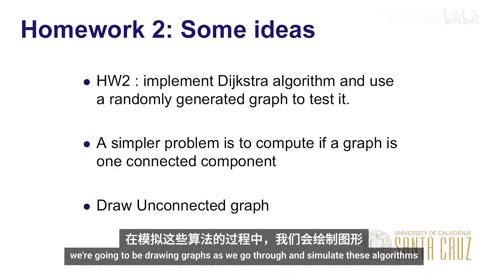
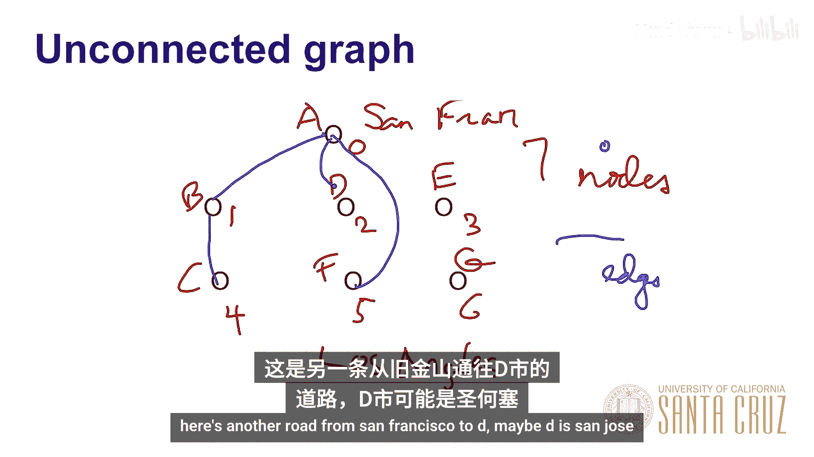
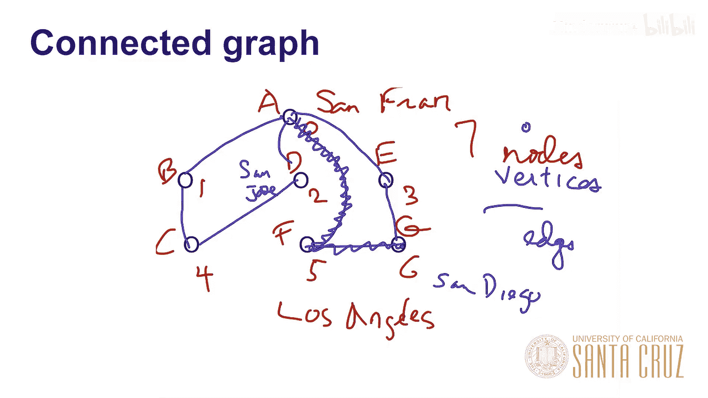
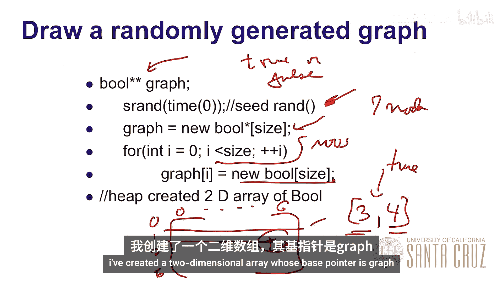
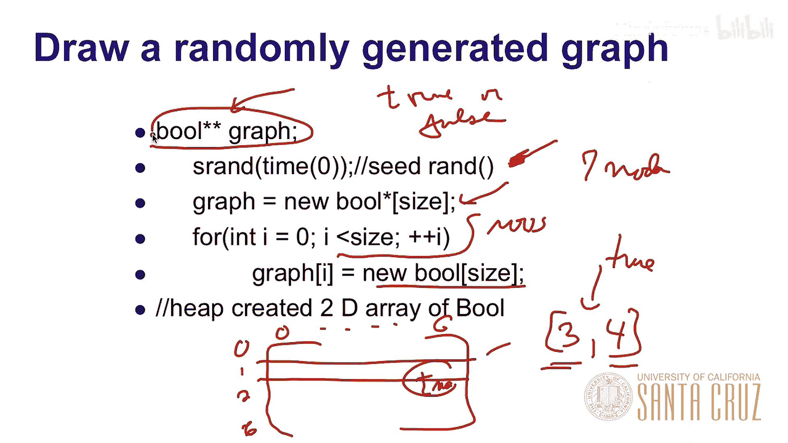
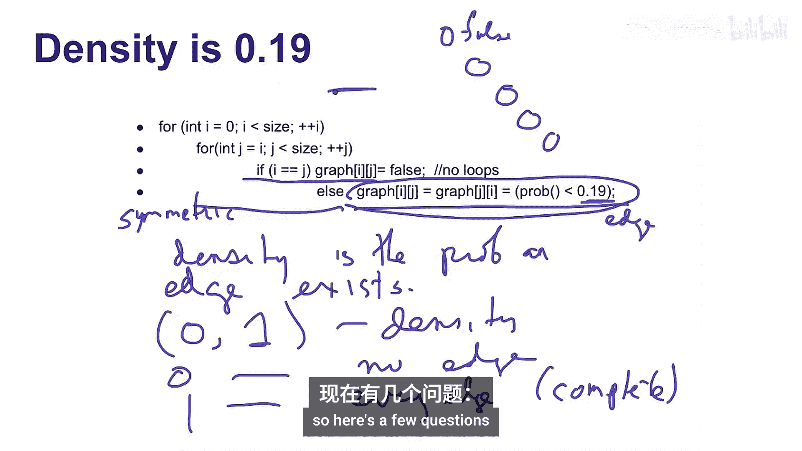
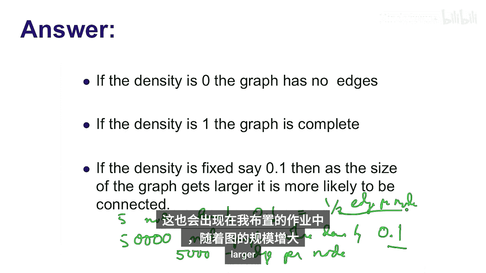

# 024：使用迪杰斯特拉算法

## 概述

在本节课中，我们将学习图论算法的基础知识，特别是迪杰斯特拉算法。课程将涵盖图的基本概念、图的计算机表示方法，以及如何生成随机图。我们还将探讨图的连通性，并介绍一个用于检测图是否为单一连通分量的算法。

---

## 图论基础



上一节我们介绍了本课程将涉及的图论算法背景。本节中，我们来看看图的基本构成。

图由**节点**（或称为顶点）和连接节点的**边**组成。在日常生活中，地图就是一个常见的图例子，其中城市是节点，道路是边。

以下是一个**不连通图**的示例，它包含七个节点。由于节点之间没有路径相连，我们无法从任一节点到达其他所有节点。


现在，我们来看一个**连通图**。在相同节点的基础上，我们添加了边（蓝色线条）。边代表节点之间的连接，例如城市之间的道路。




在这个连通图中，任意两个节点之间都存在一条路径。例如，从节点“旧金山”到节点“圣地亚哥”就存在一条路径。因此，整个图是连通的，并且构成一个单一的连通分量。




---

## 图的计算机表示与生成

上一节我们了解了图的可视化表示。本节中，我们来看看如何在计算机中表示和生成图。

用计算机绘制图的核心是使用一种内部数据结构来表示图。我们将使用一个二维数组（矩阵）来存储图的连接信息。

以下是生成随机图的关键步骤：

1.  **确定图的大小**：即节点的数量。
2.  **创建二维布尔数组**：数组的每个元素 `graph[i][j]` 表示节点 `i` 和节点 `j` 之间是否存在边。`true` 表示有边，`false` 表示无边。
3.  **根据密度插入边**：密度是一个介于0和1之间的概率值，表示任意两个节点之间存在边的可能性。

生成随机图的代码逻辑如下：





```cpp
// 假设 graph 是一个指向布尔类型二维数组的指针
// n 是节点数量
// density 是边存在的概率

for (int i = 0; i < n; ++i) {
    for (int j = 0; j < n; ++j) {
        if (i == j) {
            graph[i][j] = false; // 对角线表示自身到自身，设为 false
        } else {
            // 根据密度概率随机决定是否添加边
            graph[i][j] = (probability() < density);
            // 如果是无向图，还需设置对称位置
            graph[j][i] = graph[i][j];
        }
    }
}
```


---

## 密度对图连通性的影响



上一节我们介绍了如何用密度控制随机图的生成。本节中，我们来分析密度如何影响图的属性。

密度定义了图中边的稀疏程度。以下是几个关键问题：

*   **密度为 0**：意味着永远不会插入任何边。生成的图将**没有边**。
*   **密度为 1**：意味着总是插入所有可能的边。生成的图将成为**完全图**。
*   **固定密度，增加图的大小**：对于给定的密度（例如0.1），当图的节点数量增加时，图是连通的可能性会发生变化。

考虑以下情况：
*   对于一个只有 **5个节点**、密度为 **0.1** 的小图，每个节点平均只有0.5条边，图**极有可能是不连通**的。
*   对于一个有 **50000个节点**、密度仍为 **0.1** 的大图，每个节点平均有5000条边。图中存在大量路径，因此**几乎可以肯定是连通**的。


因此，在节点数量很大的图中，即使一个相对较小的密度值，也能以极高的概率保证图的连通性。这个直觉对于理解后续算法和完成作业非常重要。



---

## 总结


本节课中我们一起学习了图论算法的入门知识。我们首先了解了图的基本组成部分：节点和边，并区分了连通图与不连通图。接着，我们探讨了如何在计算机中使用二维布尔数组来表示图，并编写了根据给定密度生成随机图的逻辑。最后，我们分析了密度与图大小对图连通性的综合影响，认识到在大规模图中，较低的密度也足以保证高概率的连通性。这些概念是后续实现迪杰斯特拉算法等更复杂图算法的基础。