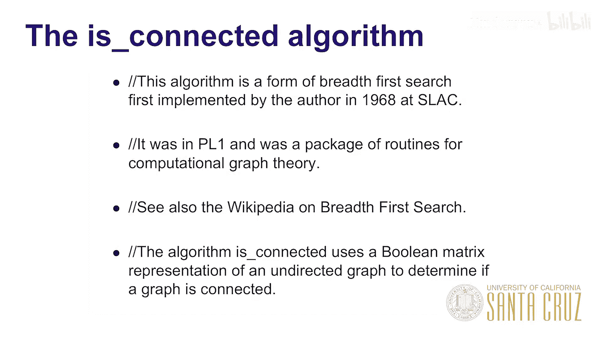
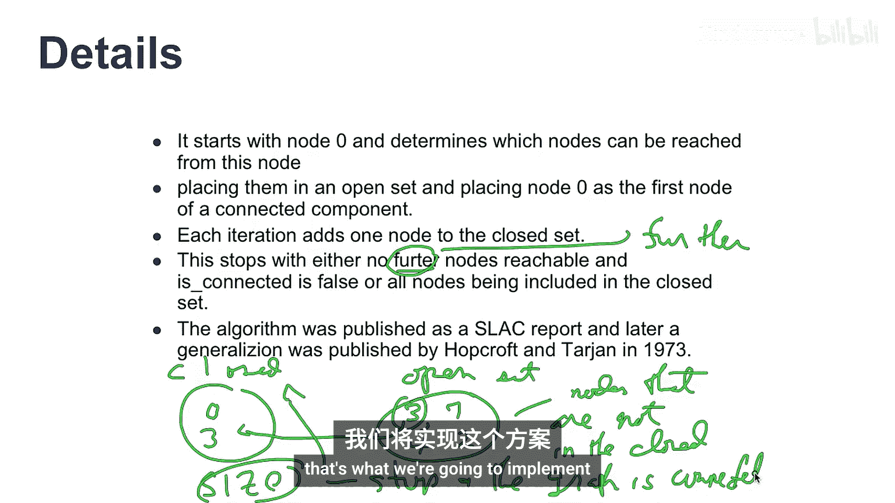
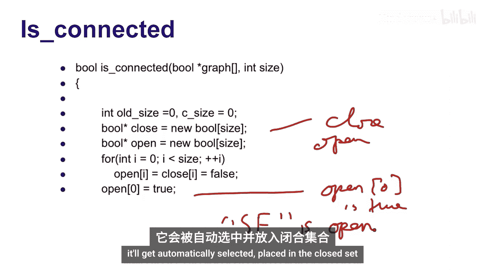
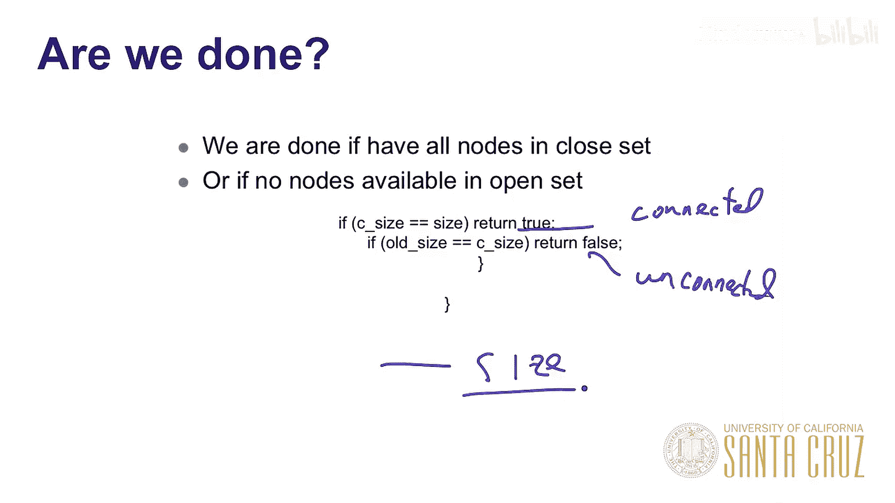

# 025：3-5 “is-connected”算法

在本节课中，我们将学习一个用于判断图（Graph）是否连通（connected）的算法。这个算法与著名的迪杰斯特拉（Dijkstra）最短路径算法有思想上的关联，但更为基础。我们将从算法的核心思想讲起，并探讨其实现方式。

## 算法背景与思想

上一节我们介绍了图的基本概念。本节中，我们来看看如何判断一个图是否连通。一个连通图意味着从任意一个节点出发，都存在路径可以到达图中的所有其他节点。

这个算法的思想可以追溯到广度优先搜索（Breadth-First Search）算法。其核心思路是：从一个起始节点开始，逐步探索所有可以到达的节点，并检查最终是否访问了图中的所有节点。



## 算法步骤详解

以下是判断图是否连通的核心算法步骤：

1.  **初始化**：选择任意一个节点作为起始点（例如节点0）。创建两个集合：
    *   **开放集（Open Set）**：存放**已发现但尚未探索**的节点。初始时，只包含起始节点。
    *   **闭合集（Closed Set）**：存放**已探索完毕**的节点。初始时为空。
2.  **迭代探索**：只要开放集不为空，就重复以下过程：
    a. 从开放集中取出一个节点（例如编号最小的节点）。
    b. 将该节点放入闭合集。
    c. 检查该节点的所有邻接节点。对于每一个邻接节点，如果它既不在闭合集中，也不在开放集中，则将其加入开放集。
3.  **终止条件**：算法在以下两种情况下终止：
    *   **成功（图连通）**：当闭合集中的节点数量等于图的总节点数时，说明所有节点都从起始点可达，图是连通的。
    *   **失败（图不连通）**：如果某次迭代后开放集为空，但闭合集中的节点数仍小于图的总节点数，说明存在无法从起始点到达的节点，图是不连通的。

## 基于邻接矩阵的实现

假设我们使用布尔型邻接矩阵 `graph[][]` 来表示图，`size` 表示图的节点总数。我们可以用布尔数组 `closed[]` 和 `open[]` 来分别表示闭合集和开放集。



算法的核心循环逻辑可以用以下伪代码描述：



```cpp
// 初始化
open[0] = true; // 起始节点（例如0）放入开放集
int closed_size = 0; // 闭合集当前大小

// 主循环，最多迭代 size 次
for (int iteration = 0; iteration < size; ++iteration) {
    // 1. 从开放集中找到一个节点 current（例如第一个为true的节点）
    int current = -1;
    for (int i = 0; i < size; ++i) {
        if (open[i]) {
            current = i;
            break;
        }
    }

    // 如果开放集已空，跳出循环
    if (current == -1) {
        break;
    }

    // 2. 将 current 移出开放集，加入闭合集
    open[current] = false;
    closed[current] = true;
    closed_size++;

    // 3. 将 current 的所有未访问邻接节点加入开放集
    for (int j = 0; j < size; ++j) {
        // 如果 current 到 j 有边，且 j 不在闭合集中
        if (graph[current][j] && !closed[j]) {
            open[j] = true; // 加入开放集（如果已在，则保持不变）
        }
    }

    // 4. 检查是否已访问所有节点
    if (closed_size == size) {
        // 图是连通的
        return true;
    }
}

// 循环结束但未访问所有节点，图不连通
return false;
```

## 总结



本节课中，我们一起学习了一个基础的图遍历算法，用于判断图的连通性。我们理解了**开放集（Open Set）**和**闭合集（Closed Set）**这两个核心概念，并掌握了算法从起始节点开始、逐步扩散探索直至覆盖所有可达节点或无法继续前进的过程。这个算法是许多更复杂图算法（如最短路径）的基础。在接下来的课程中，我们将更深入地探讨如何具体实现这个算法并完成相关的作业。