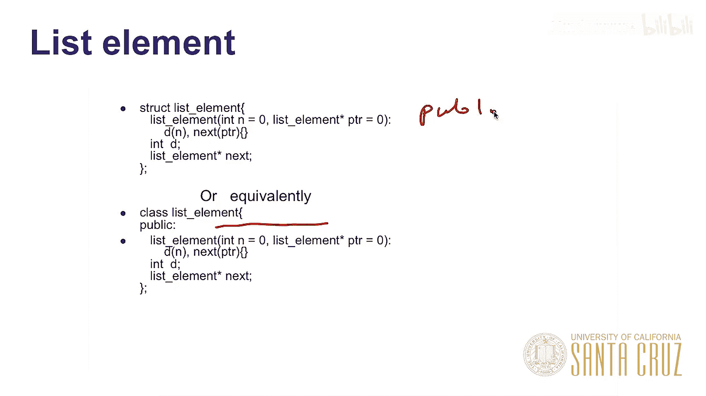
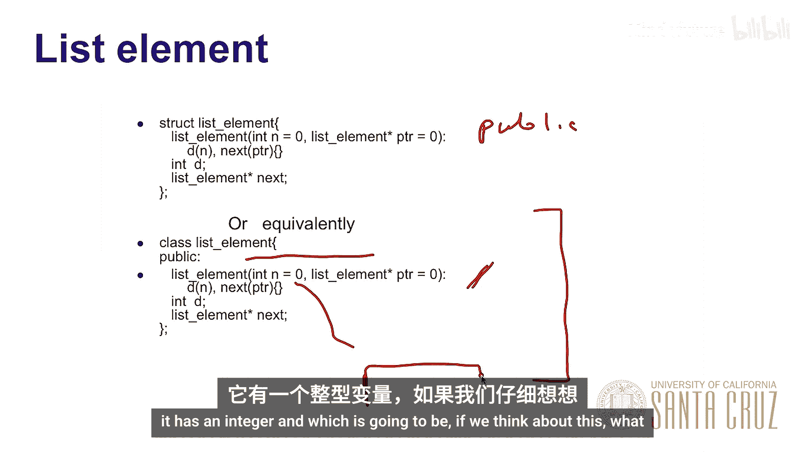
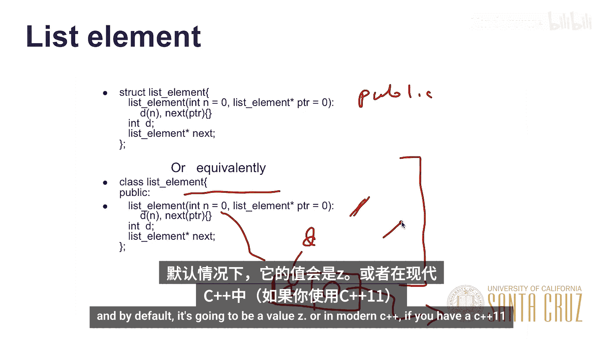
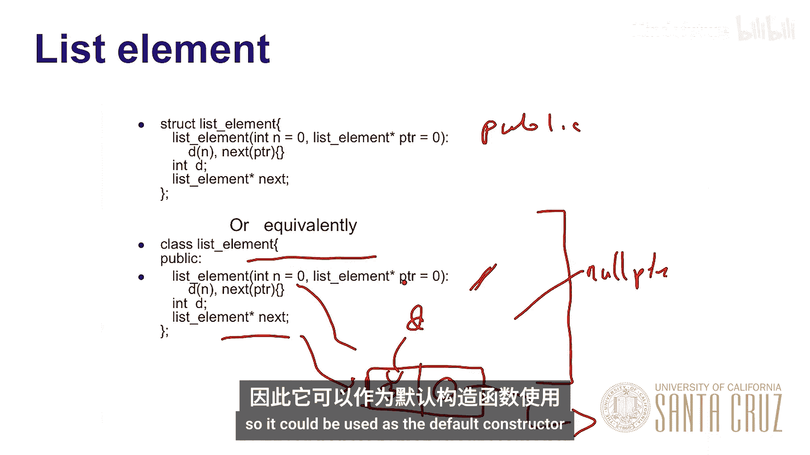
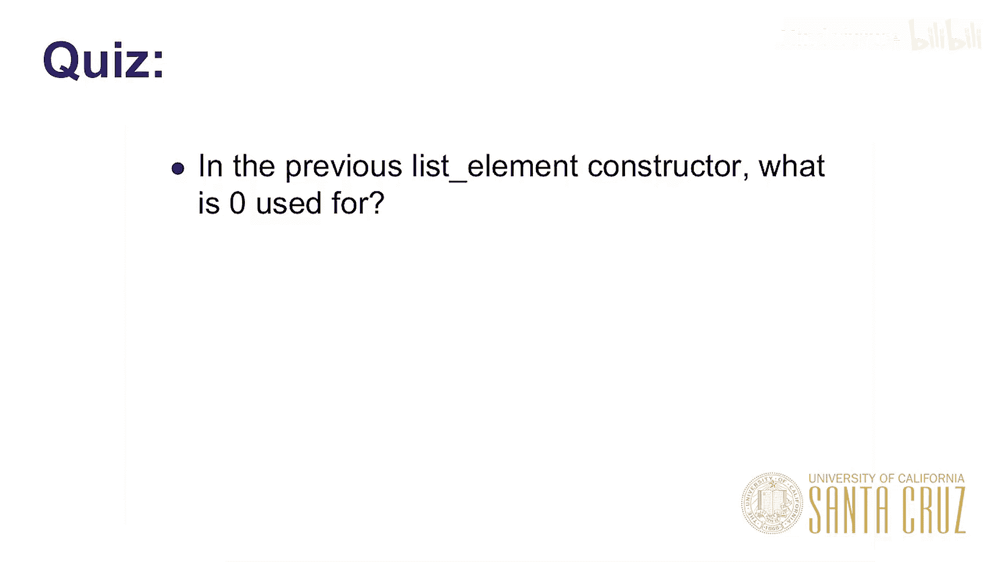
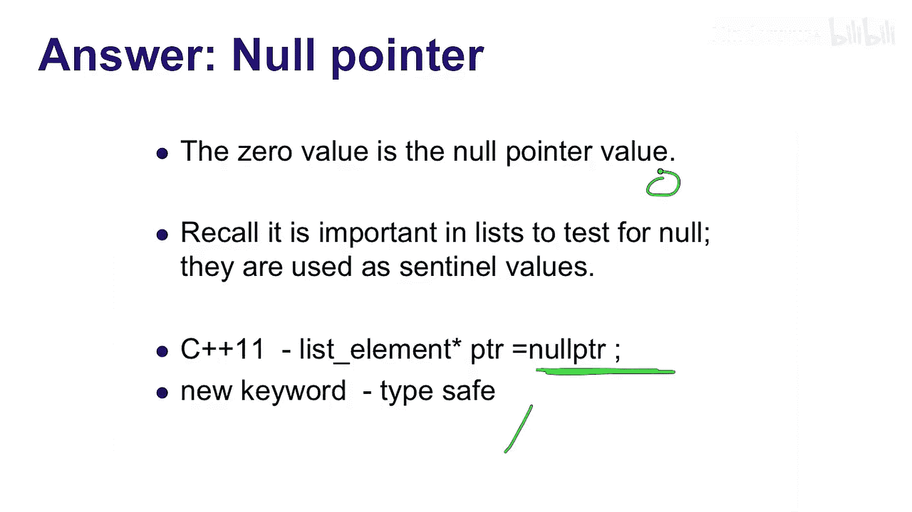

# 026：复杂聚合列表

## 概述

在本节课中，我们将学习复杂聚合类型，重点探讨列表数据结构。列表是一种自引用的数据结构，其定义中包含对自身的引用。这种结构在某种程度上是无界的，可以持续添加元素，因此需要动态内存管理。通过学习列表的实现，我们将深入理解构造函数、析构函数以及堆内存管理，这些是C++高级主题的核心基础。

---

## 列表数据结构简介

列表是一种标准的数据结构，我们有时称之为自引用数据结构。列表的定义包含列表头部和指向另一个列表的指针，因此在定义中使用了自身。这种结构更有趣，因为它本质上是无界的，可以不断添加元素，这就需要能够访问动态分配的内存。

这种内存称为堆内存，与普通变量使用的栈内存相对。学习列表有多个好处。首先，我们今天要看到的单指针列表在标准模板库中已经存在。虽然我们不需要自己创建，但为了理解这些基于库的复杂聚合是如何构建、使用以及其局限性，自己实现一个简化版本将非常有帮助。其次，我们将看到更复杂的构造函数，这些构造函数使用堆进行内存分配。由于正确管理资源、避免内存泄漏至关重要，我们还将学习如何使用析构函数来正确释放资源。因此，本节课是后续高级主题的核心和基础。

---

## 使用结构体定义列表元素

在C语言中，结构体是定义聚合类型的传统方式。当Bjarne Stroustrup扩展C语言创建C++时，结构体演变为类。结构体默认所有成员都是公有的，因此这里我们没有使用`public`关键字，它是隐式的。



```cpp
struct ListElement {
    int data;
    ListElement* next;
    ListElement(int d = 0, ListElement* n = 0) : data(d), next(n) {}
};
```

在上面的代码中，我们定义了一个`ListElement`结构体。它包含一个整数`data`用于存储数据，以及一个`ListElement*`类型的指针`next`，用于指向下一个元素。构造函数有两个默认参数：整数`d`默认为0，指针`n`默认为0。这个构造函数允许使用多种签名，甚至可以作为默认构造函数使用。



---

## 理解空指针



在之前的列表元素构造函数中，指针被初始化为0。这个0值代表空指针。在现代C++实践中，更推荐使用`nullptr`关键字来代替0或`NULL`宏。

`nullptr`是对普通0的改进。0本质上是一个整数值，虽然可以转换，但历史上它被视为整数。将其用作其他类型的基类型需要进行转换。此外，还有一个名为`NULL`的宏，也常见于传统代码中。`nullptr`是对这两种旧做法的改进。

```cpp
// 旧做法
ListElement* next = 0;
ListElement* next = NULL;



// 现代C++推荐做法
ListElement* next = nullptr;
```



使用`nullptr`可以提高类型安全性，避免一些潜在的转换错误。

---

## 总结



本节课我们一起学习了复杂聚合类型中的列表数据结构。我们介绍了列表的自引用特性，并使用结构体定义了一个简单的列表元素。我们重点讨论了构造函数中指针的初始化，并对比了使用`0`、`NULL`和`nullptr`表示空指针的区别，强调了现代C++中推荐使用`nullptr`的做法。理解这些基础概念是后续学习动态内存管理、标准模板库容器等高级主题的关键。