# 006：示例-扑克牌概率 🃏

在本节课中，我们将学习如何运用C++中的抽象数据类型和STL库来构建一个实用的示例：计算五张牌梭哈游戏中特定牌型（如顺子和同花）出现的概率。我们将通过蒙特卡洛模拟来近似这些概率，这对于初学者理解概率计算和C++编程实践非常有帮助。

---

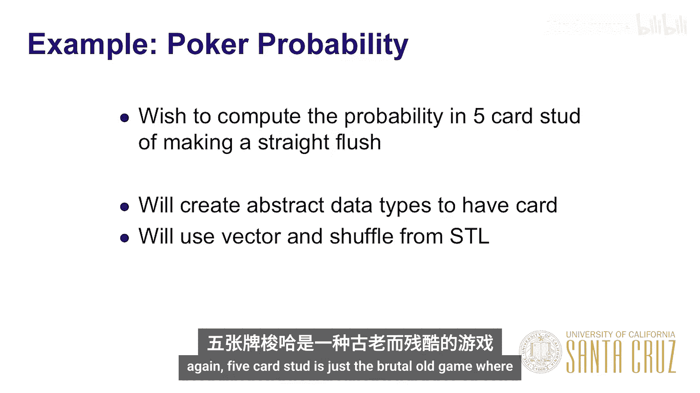

## 构建扑克牌抽象数据类型 🎴

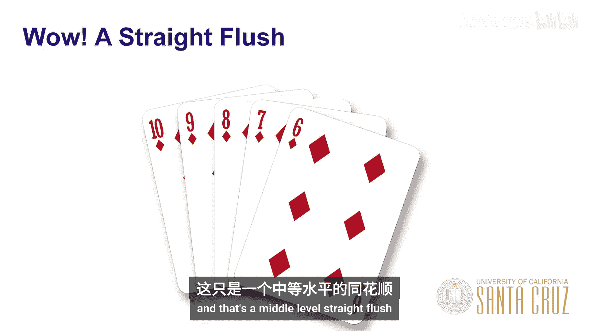

上一节我们介绍了课程背景，本节中我们来看看如何表示扑克牌。为了进行概率计算，我们首先需要创建代表扑克牌和扑克牌组的抽象数据类型。

一张扑克牌包含两个属性：**点数**和**花色**。点数可以是A、2-10、J、Q、K，花色则是黑桃、红心、方块、梅花。

我们使用C++11的枚举类来定义花色，这样可以指定底层数据类型以节省内存。

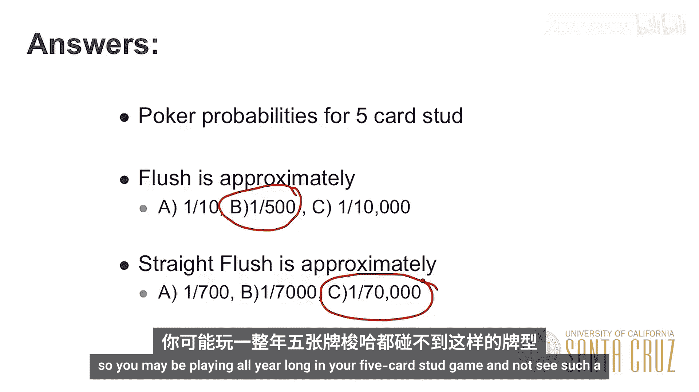

```cpp
enum class Suit : short { SPADE, HEART, DIAMOND, CLUB };
```

点数也类似定义，其中A为1，J为11，Q为12，K为13。

```cpp
enum class Pips : int {
    ACE = 1, TWO, THREE, FOUR, FIVE, SIX, SEVEN,
    EIGHT, NINE, TEN, JACK, QUEEN, KING
};
```

基于以上枚举，我们可以构建`Card`类。这个类包含一个构造函数和两个访问器函数来获取牌的花色和点数。

```cpp
class Card {
public:
    Card(Suit s, Pips v) : suit(s), pips(v) {}
    Suit getSuit() const { return suit; }
    Pips getPips() const { return pips; }
    // ... 其他成员函数，如重载输出运算符
private:
    Suit suit;
    Pips pips;
};
```

注意，访问器函数`getSuit`和`getPips`被声明为`const`，表明它们不会修改对象状态。同时，我们通常会为自定义类型重载输出运算符`<<`，以便于打印。

---

## 创建与操作牌组 🃏

有了单张牌的表示，接下来我们创建一副完整的牌组。一副标准扑克牌有52张牌，即13种点数与4种花色的所有组合。

以下是初始化牌组的代码思路：我们使用一个`std::vector<Card>`来存储牌组，并通过嵌套循环生成所有牌。

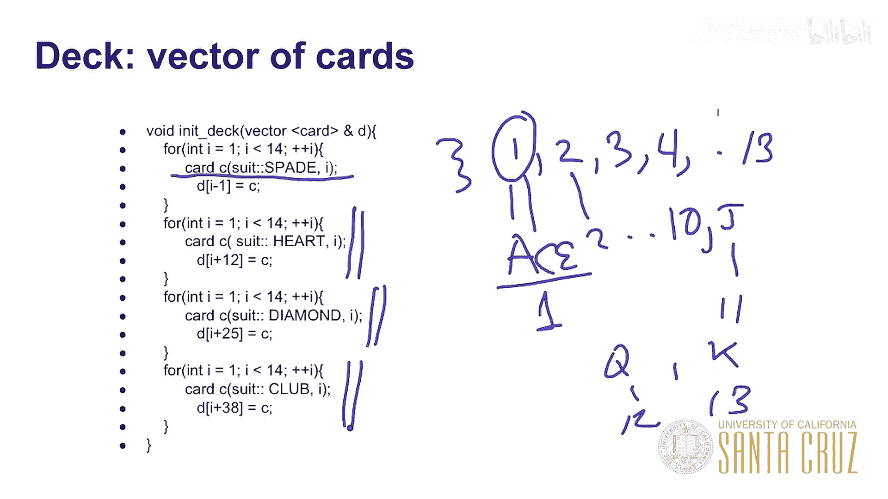

```cpp
std::vector<Card> deck;
for (int s = 0; s < 4; ++s) { // 遍历四种花色
    for (int v = 1; v <= 13; ++v) { // 遍历13种点数
        deck.emplace_back(static_cast<Suit>(s), static_cast<Pips>(v));
    }
}
```

为了进行模拟，我们需要洗牌。C++ STL提供了`std::shuffle`函数，配合随机数引擎可以轻松实现。

```cpp
std::random_device rd;
std::mt19937 g(rd());
std::shuffle(deck.begin(), deck.end(), g);
```

打印牌组时，我们可以使用C++11的**范围for循环**，让代码更简洁。

```cpp
for (const auto& card : deck) {
    std::cout << card << ' ';
}
```

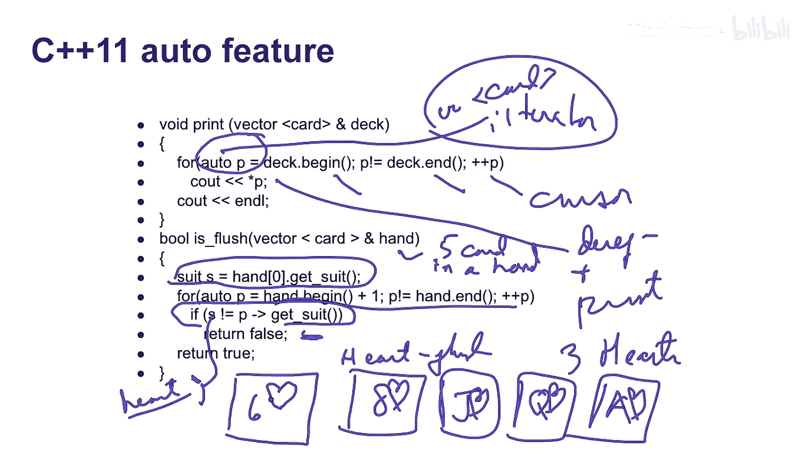

---

## 判断牌型：同花与顺子 🎯

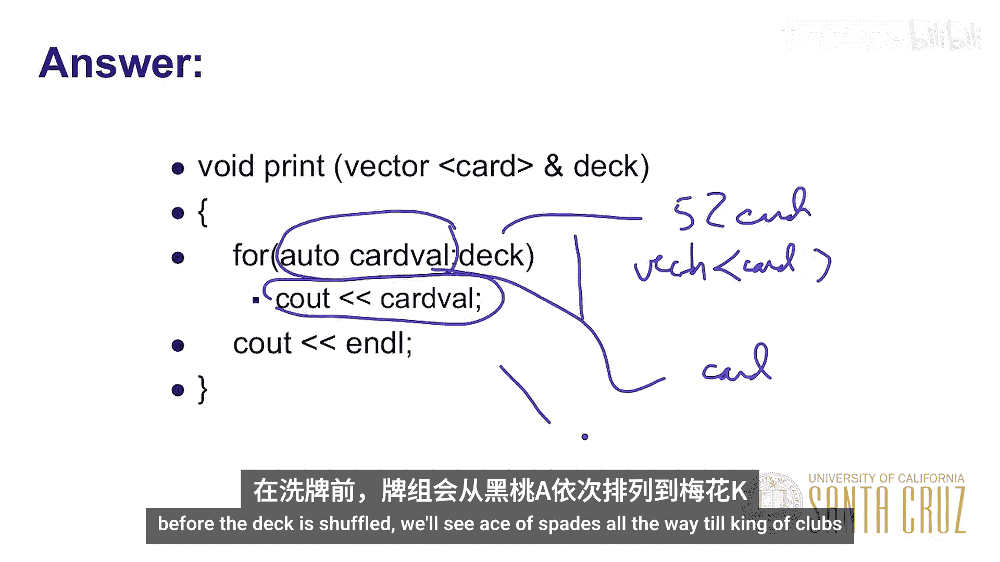

现在我们已经有了牌组，接下来需要编写函数来判断一手牌（5张牌）是否是特定的牌型。我们先从**同花**开始。

一手牌成为同花的条件是：五张牌的花色全部相同。判断逻辑是：获取第一张牌的花色，然后检查剩余四张牌的花色是否与之相同。

```cpp
bool isFlush(const std::vector<Card>& hand) {
    Suit firstSuit = hand[0].getSuit();
    for (size_t i = 1; i < hand.size(); ++i) {
        if (hand[i].getSuit() != firstSuit) {
            return false;
        }
    }
    return true;
}
```

接下来判断**顺子**。顺子的条件是：五张牌的点数连续。这里有一个复杂情况：A既可以作为高点（10-J-Q-K-A），也可以作为低点（A-2-3-4-5）。

判断逻辑是：首先将手牌按点数排序，然后检查排序后的点数是否连续递增（差值均为1）。同时需要单独处理A作为高点和低点的两种特殊情况。

```cpp
bool isStraight(std::vector<Card> hand) {
    // 1. 按点数排序
    std::sort(hand.begin(), hand.end(),
              [](const Card& a, const Card& b) { return a.getPips() < b.getPips(); });

    // 2. 检查普通连续情况 (如 4-5-6-7-8)
    bool normalStraight = true;
    for (size_t i = 1; i < hand.size(); ++i) {
        if (static_cast<int>(hand[i].getPips()) != static_cast<int>(hand[i-1].getPips()) + 1) {
            normalStraight = false;
            break;
        }
    }
    if (normalStraight) return true;

    // 3. 检查特殊顺子：A作为高点（10-J-Q-K-A）或低点（A-2-3-4-5）
    // ... (此处省略具体特殊逻辑代码)
}
```

有了判断同花和顺子的函数，判断**同花顺**就非常简单了：一手牌必须同时满足既是顺子又是同花。

```cpp
bool isStraightFlush(const std::vector<Card>& hand) {
    return isFlush(hand) && isStraight(hand);
}
```

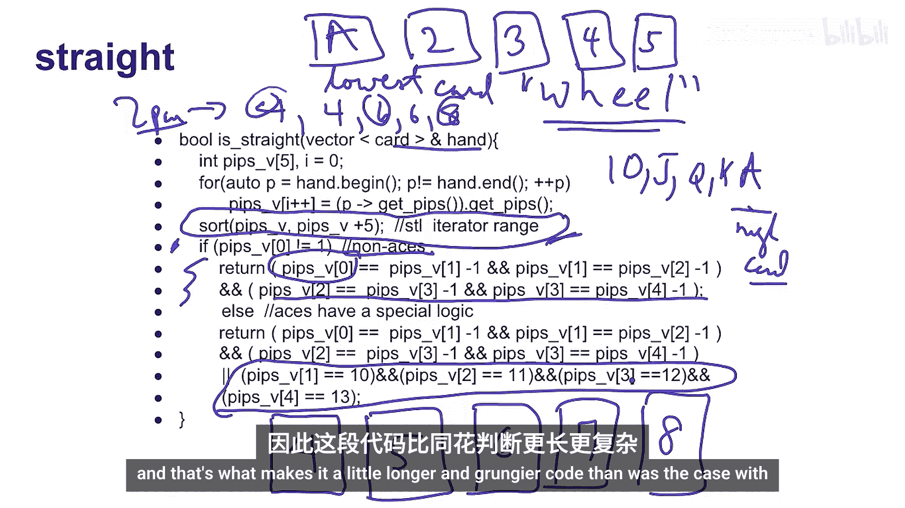

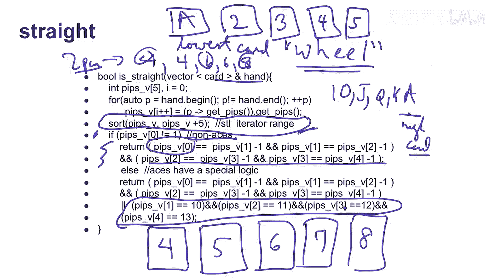

代码的复用性在这里得到了很好的体现。

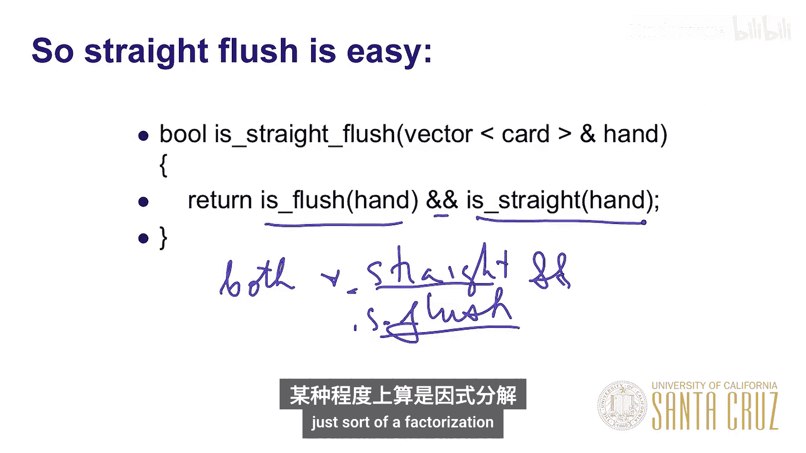

---

## 实施蒙特卡洛模拟 🔢

理论概率计算可能很复杂，但我们可以通过**蒙特卡洛模拟**来近似估算概率。其核心思想是：通过大量随机实验（这里指发牌），统计特定事件（如出现同花顺）发生的频率，以此作为概率的估计。

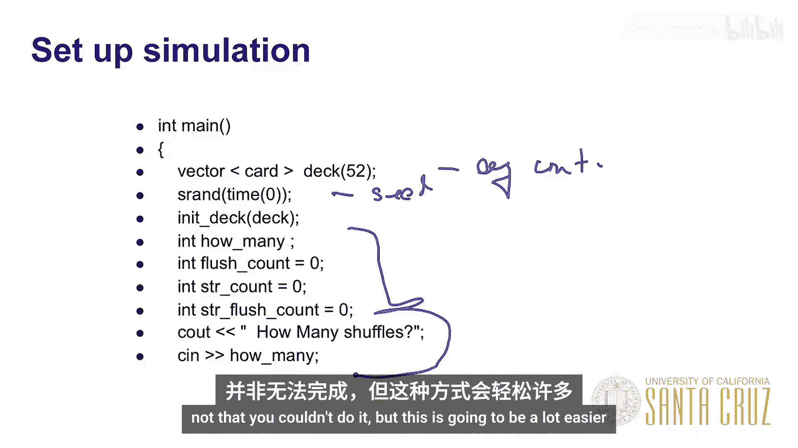

以下是模拟的核心步骤：
1.  初始化一副牌。
2.  询问用户希望模拟的次数（例如100万次）。
3.  循环执行以下操作：
    *   洗牌。
    *   从牌堆顶部抽取5张牌作为一手牌。
    *   使用`isFlush`、`isStraight`、`isStraightFlush`函数判断牌型，并相应增加计数器。
4.  循环结束后，用计数器除以总模拟次数，得到各牌型出现的近似概率。

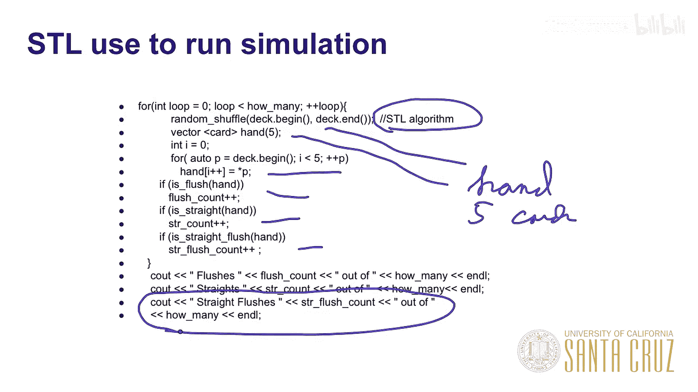

```cpp
int main() {
    // 初始化牌组
    std::vector<Card> deck = initializeDeck();

    long long numSimulations;
    std::cout << "输入模拟次数: ";
    std::cin >> numSimulations;

    int flushCount = 0, straightCount = 0, straightFlushCount = 0;

    std::random_device rd;
    std::mt19937 g(rd());

    for (long long i = 0; i < numSimulations; ++i) {
        std::shuffle(deck.begin(), deck.end(), g);
        // 取前5张牌作为一手牌
        std::vector<Card> hand(deck.begin(), deck.begin() + 5);

        if (isFlush(hand)) flushCount++;
        if (isStraight(hand)) straightCount++;
        if (isStraightFlush(hand)) straightFlushCount++;
    }

    // 输出概率结果
    std::cout << "同花概率: ~" << (double)flushCount / numSimulations << std::endl;
    std::cout << "顺子概率: ~" << (double)straightCount / numSimulations << std::endl;
    std::cout << "同花顺概率: ~" << (double)straightFlushCount / numSimulations << std::endl;

    return 0;
}
```

通过运行足够多次数的模拟（如100万次），我们可以得到与理论值接近的结果：
*   **同花**的概率大约为 **1/500**。
*   **同花顺**的概率大约为 **1/70,000**。

---

## 扩展练习 💡

为了加深理解，你可以尝试以下扩展练习：
*   **实现其他牌型判断**：例如，编写`isFourOfAKind`函数来判断一手牌是否为四条（四张相同点数的牌）。
*   **扩展到七张牌游戏**：在德州扑克等七张牌游戏中，玩家需要从7张牌中选出最好的5张牌组成最终手牌。修改你的模拟程序，计算在七张牌中形成同花顺的概率。这需要你从7张牌的所有5张牌组合中，找出可能的最佳牌型。

---

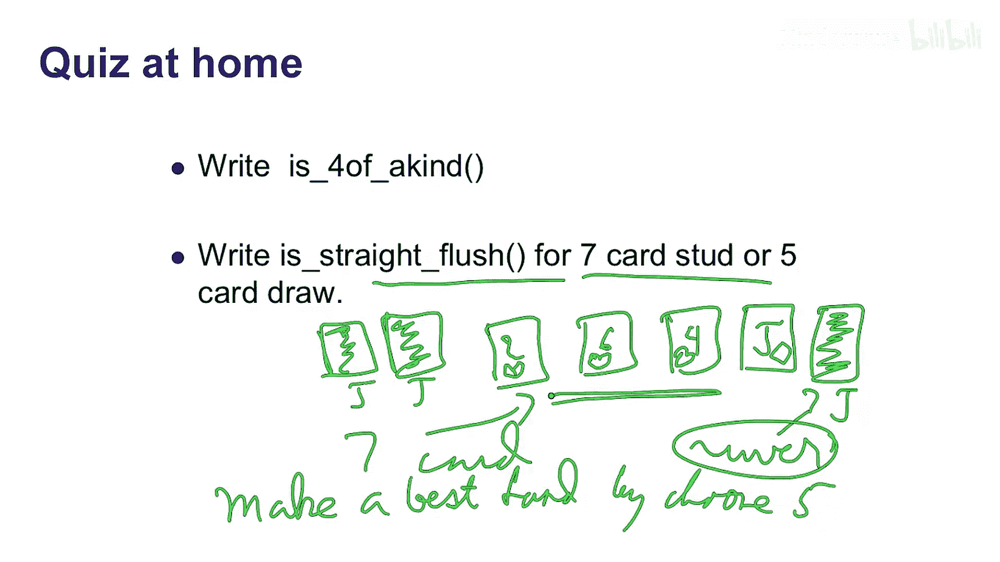

本节课中我们一起学习了如何利用C++的抽象数据类型和STL容器来构建一个扑克牌模拟程序。我们定义了`Card`类，实现了同花、顺子等牌型的判断逻辑，并最终通过蒙特卡洛模拟估算出了这些牌型在五张牌梭哈中出现的罕见概率。这个项目综合运用了类设计、算法逻辑和概率统计，是一个很好的编程实践。