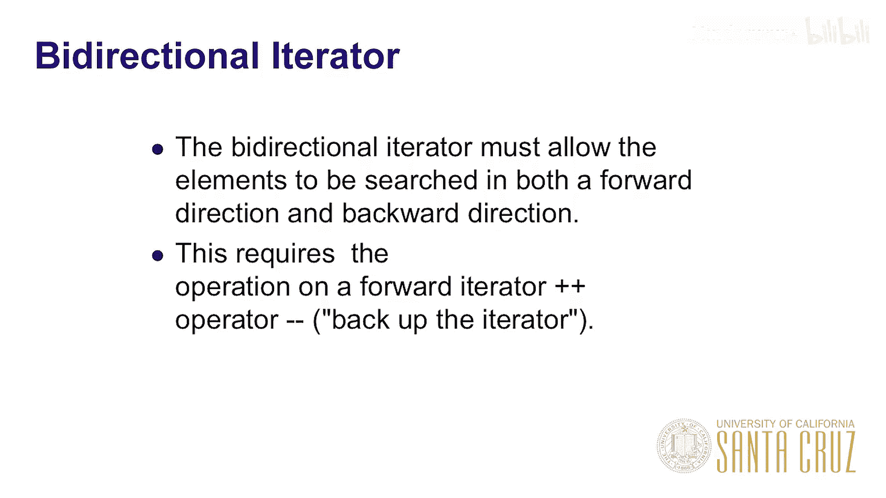
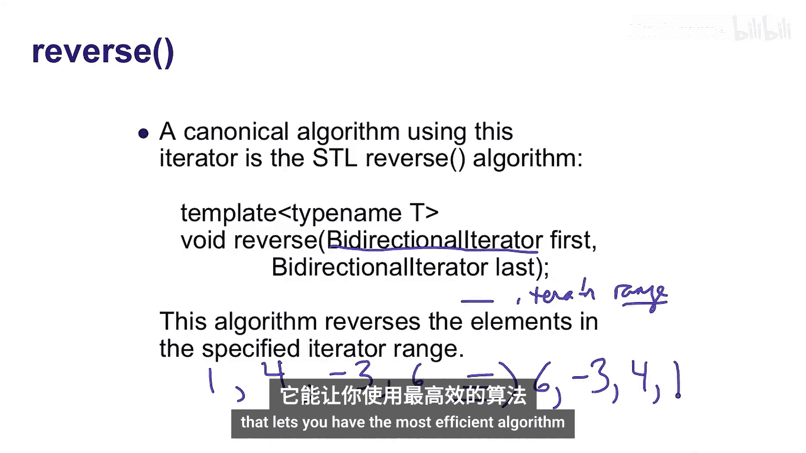
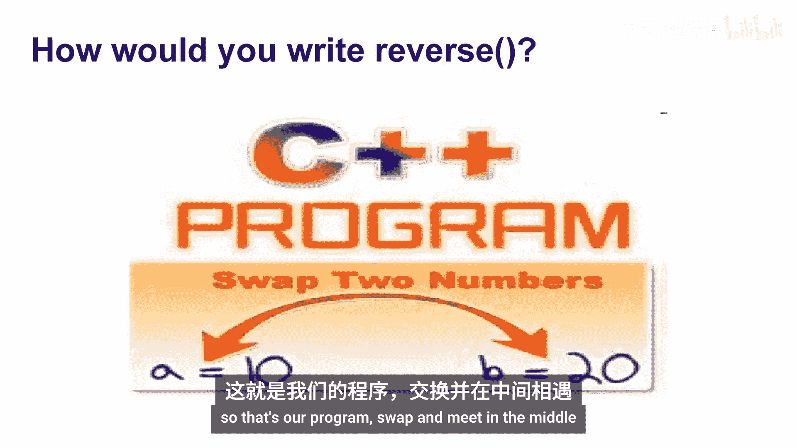
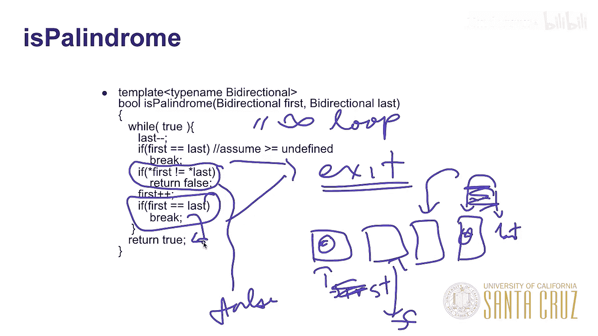
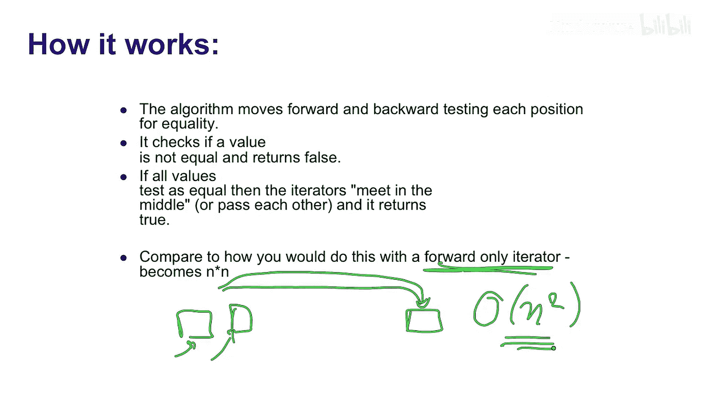

# 007：双向迭代器



在本节课中，我们将要学习一种更复杂、功能更强的迭代器类型——双向迭代器。我们将了解它的特性、一个需要用到它的标准库算法，以及如何利用它高效地解决问题。

## 双向迭代器的定义

上一节我们介绍了前向迭代器，本节中我们来看看双向迭代器。双向迭代器类型必须同时支持前向迭代器的操作（如 `++`）和反向迭代器的操作（如 `--`）。

**核心操作**：
*   `++`：向前移动迭代器。
*   `--`：向后移动迭代器。

## 需要双向迭代器的算法



接下来，我们研究一个标准库中的典型算法，它要求使用双向迭代器类型。在阅读库文档时，你会看到参数类型标注为 `bidirectional_iterator`，这表明它确实需要这种类型的迭代器。



这个算法就是 `std::reverse`。它接受一个迭代器范围 `[first, last)`（通常是 `begin()` 和 `end()`，也可以是范围的子部分）。`reverse` 是一个修改算法，它会反转指定范围内的元素顺序。

例如，如果我们有一个序列 `[1, 4, -3, 6]`，执行 `reverse` 后，序列将变为 `[6, -3, 4, 1]`。

## 算法效率与迭代器选择

STL 算法设计的一个核心逻辑是：**选择能满足算法最高效实现所需的最弱迭代器类型**。效率是首要考虑因素。

对于 `reverse` 算法，我们可以通过同时从两端向中间遍历并交换元素，在一次遍历内完成反转。这需要迭代器既能前进也能后退。

以下是该算法的思路：

我们同时维护两个“光标”：一个从前端（`first`）开始，一个从后端（`last`）开始。进行交换，然后前端光标前进，后端光标后退，继续交换，直到两者在中间相遇。

**算法步骤**：
1.  初始化 `front = first`，`back = last - 1`（因为 `last` 指向末尾之后）。
2.  当 `front < back` 时：
    *   交换 `*front` 和 `*back` 指向的元素。
    *   `front` 向前移动 (`++front`)。
    *   `back` 向后移动 (`--back`)。
3.  当 `front` 与 `back` 相遇或交错时，反转完成。

## 应用：判断回文

利用双向迭代器的特性，我们可以高效地编写一个判断序列是否为回文的算法。回文是指正读和反读都一样的序列，例如 “auto” 或 “Dalmatian na it am lad”。

以下是使用双向迭代器的 `is_palindrome` 算法实现思路：

```cpp
template <typename BidirectionalIterator>
bool is_palindrome(BidirectionalIterator first, BidirectionalIterator last) {
    if (first == last) return true; // 空序列是回文
    --last; // 将 last 移动到最后一个元素
    while (first != last) {
        if (*first != *last) {
            return false; // 不对称，不是回文
        }
        ++first;
        if (first == last) { // 在中间相遇，是回文
            break;
        }
        --last;
    }
    return true;
}
```

**算法逻辑**：
1.  算法从两端向中间移动，测试每个对称位置的值。
2.  如果发现任何一对对称值不相同，则立即返回 `false`。
3.  如果迭代器在中间相遇，说明所有对称值都相同，则返回 `true`。



## 为何选择双向迭代器？

你可能会想，是否能用更弱的前向迭代器实现这个算法？答案是肯定的，但效率会很低。

如果只使用前向迭代器，你需要多次遍历：先移动一个迭代器到末尾，进行比较，然后重置，再移动到第二个位置，再移动另一个迭代器到倒数第二个位置……这将导致时间复杂度变为 **O(n²)** 的计算。

我们也可以使用更强的随机访问迭代器来实现，但这属于“杀鸡用牛刀”，我们并不需要随机跳转的能力。

因此，再次体现了 STL 的设计原则：**为实现最高效的算法，选择所需功能最弱的迭代器**。对于回文判断和反转算法，双向迭代器就是那个“恰到好处”的选择。

## 总结



本节课中我们一起学习了双向迭代器。我们了解到它扩展了前向迭代器的能力，支持向前 (`++`) 和向后 (`--`) 移动。我们分析了需要双向迭代器的 `std::reverse` 算法，并学习了如何利用双向遍历的特性，高效地实现序列反转和回文判断算法。最重要的是，我们理解了 STL 算法设计中关于迭代器选择的核心原则：在保证算法最高效率的前提下，使用功能最弱的迭代器类型。