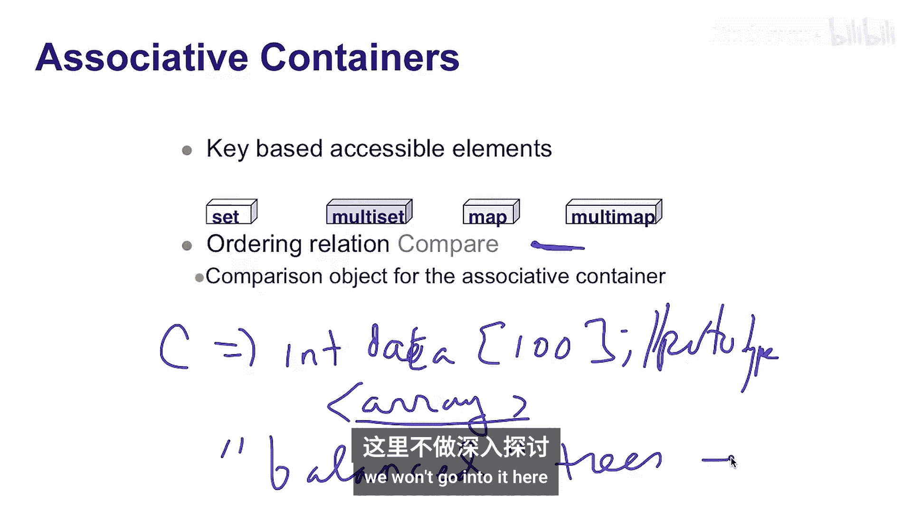
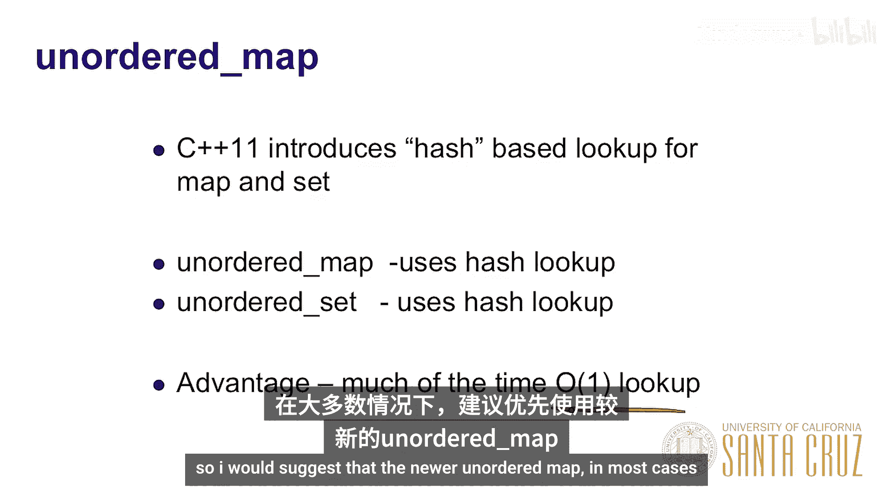
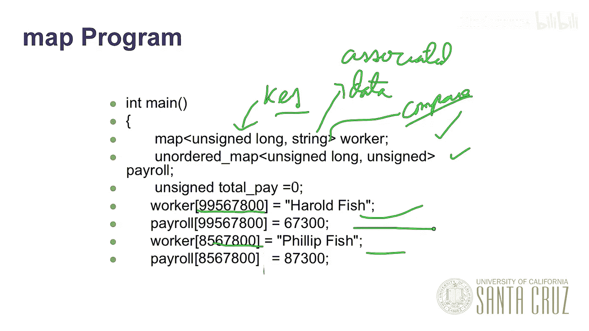
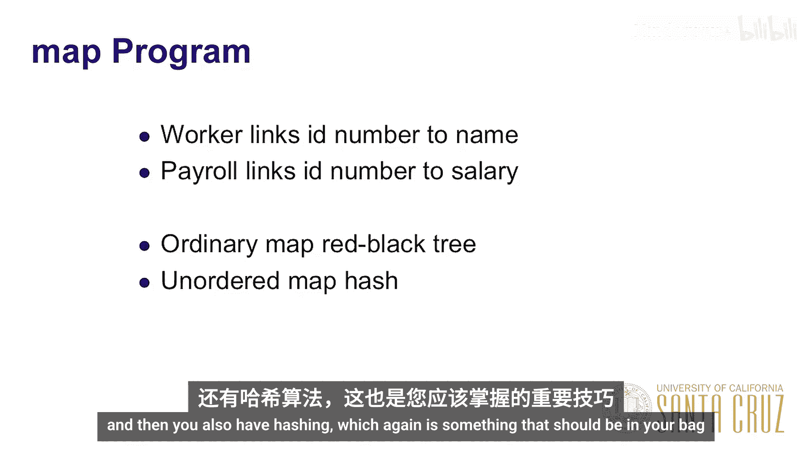
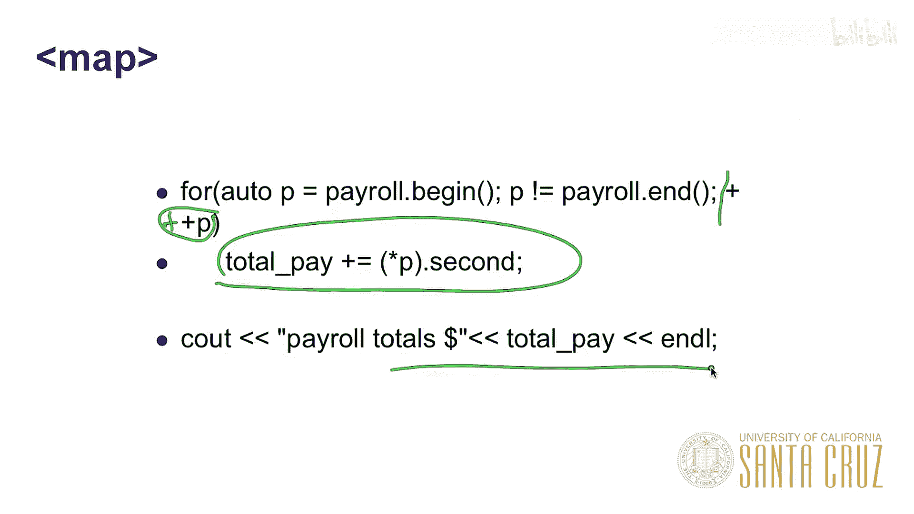

# 010：关联容器

在本节课中，我们将要学习C++标准模板库（STL）中的关联容器。我们将了解它们与序列容器的区别，并重点介绍两种关键的关联容器：`map`和`unordered_map`。我们将探讨它们背后的数据结构原理、性能特点以及基本使用方法。

## 序列容器回顾

上一节我们介绍了序列容器。序列容器的原型可以看作是数组。在C语言中，数组就是最基础的序列容器原型，功能有限但至今仍在广泛使用。

实际上，STL中现在有一个新的容器类，它比`vector`更直接地模拟了数组。这就是C++11引入的`array`类，它允许你指定固定的大小，并将这个大小直接绑定到类型上。

你可能会想，既然有了可以动态扩展的`vector`，为什么还需要固定大小的`array`？这是因为`vector`的动态扩展能力会带来一定的性能开销。而一个不允许扩展的`array`可以针对硬件架构进行更精细的优化，从而获得更高的效率。

## 关联容器简介

本节中我们来看看基于键值访问的关联容器，这是我们之前尚未深入探讨的内容。在基于键值的访问中，存在一种排序关系。

与序列容器按插入顺序排列不同，关联容器没有“第零个元素”、“第一个元素”的概念。相反，你提供了一种映射关系，例如：
*   姓名到社保号
*   姓名到电话号码
*   书籍到ISBN号

这种关系不一定总是数字，也可以是姓名到家庭住址。这是一种基于**键**来查找数据的映射关系。

在这种数据结构中，元素的位置内在地取决于某种比较操作，我们将在`set`和`map`中看到这一点。



## 底层数据结构与性能

为了实现高效操作，关联容器底层通常使用**平衡树**数据结构。这是一个非常有趣的计算机科学主题，我们在此不深入探讨。常见的平衡树类型包括红黑树和AVL树。

平衡树的特性使得插入和删除操作的时间复杂度为**O(log n)**，查找操作也因此是**O(log n)**。相比之下，如果使用不平衡的普通树，在最坏情况下，查找时间可能会大得多。平衡树强制所有主要操作都保持在**对数**级别，这是一个巨大的性能优势。

## 哈希与无序容器

C++11新增了基于哈希的`map`和`set`实现，它们被称为`unordered_map`和`unordered_set`。在许多情况下，这些无序容器将比普通的`map`和`set`更具优势。

当然，仍然存在需要使用普通`map`和`set`的场景。但在大多数情况下，无序容器有一个关键优势：**常数时间查找**。

哈希的基本思想是：将键转换为一个唯一的数字（哈希值），这个数字允许你进行随机访问，从而实现常数时间的查找。如果你有合理的哈希函数，这种方法几乎总是有效的。虽然有时会出现哈希冲突，并有相应的处理方案，但总的来说，对于大多数应用，使用哈希函数构建的关联容器能提供**O(1)**的查找效率。



因此，在大多数情况下，较新的`unordered_map`会比旧式的`map`更有用。这是C++11社区带来的一大优势。

## 代码示例：map与unordered_map

让我们通过一个程序来具体了解这些关联容器。我们将同时使用`map`和`unordered_map`两种类型。

以下是`map`的声明：
```cpp
std::map<int, std::string> worker;
```
以下是`unordered_map`的声明：
```cpp
std::unordered_map<int, std::string> worker;
```
这只是一个演示，我本可以都用`map`或都用`unordered_map`。但我想向你展示它们看起来多么相似。你可以自己尝试使用它们，事实上，如果你进行一些计时测试，应该能在自己的系统上发现，对于大量数据，`unordered_map`通常比基于平衡树的`map`更高效。

`map`和`unordered_map`都是模板。第一个模板参数是**键**的类型，第二个是与之关联的**数据**的类型。

我们还可以进一步指定比较关系，比如`std::less`，这是默认的比较器。对于`unordered_map`，我们同样有这两个参数，但不会有比较关系，因为我们使用的是哈希。

在哈希中，常数时间查找是基于将键转换为哈希值并直接定位，而不是比较树中的节点，因此不需要比较操作。

在这个例子中，我们可以将键视为工号，将其与姓名关联。另一个映射将工号与薪水关联。

在普通的`map`中，底层是红黑树。而在`unordered_map`中，底层是哈希表。



## 容器使用演示

现在让我们看看如何使用它们。再次回忆我们使用的`auto`关键字，这是C++11的结构，它能根据上下文推导类型。



这里的上下文是，它需要是一个迭代器类型。

我们遍历迭代器范围，从开始到结束。这是我们的惯用语法。

我们查看`worker`映射，获取姓名（`p.second`）和工号（`p.first`）。注意我们使用了两个成员：`second`和`first`。这些实际上是`pair`内部的成员。

关联数组信息的基本存储方式就是作为一个`pair`。要获取姓名，就是`pair`的第二个部分（`second`）；要获取我们用于查找的工号，就是`pair`的第一个部分（`first`）。我们解引用迭代器，查看`second`得到工人姓名，查看`first`得到工号。

在另一个循环中，我们计算总薪资。同样是使用迭代器的惯用语法。我们只是计算总薪资，然后将其打印出来。

## 总结



本节课中我们一起学习了C++ STL中的关联容器。我们回顾了序列容器与关联容器的区别，重点介绍了`map`和`unordered_map`。我们了解了`map`底层基于平衡树（如红黑树），提供**O(log n)**的操作复杂度；而`unordered_map`基于哈希表，在理想情况下能提供**O(1)**的常数时间查找，在多数情况下性能更优。我们还通过代码示例学习了如何声明、迭代和访问这两种容器中的数据。对于现代C++开发，`unordered_map`通常是关联容器的首选。