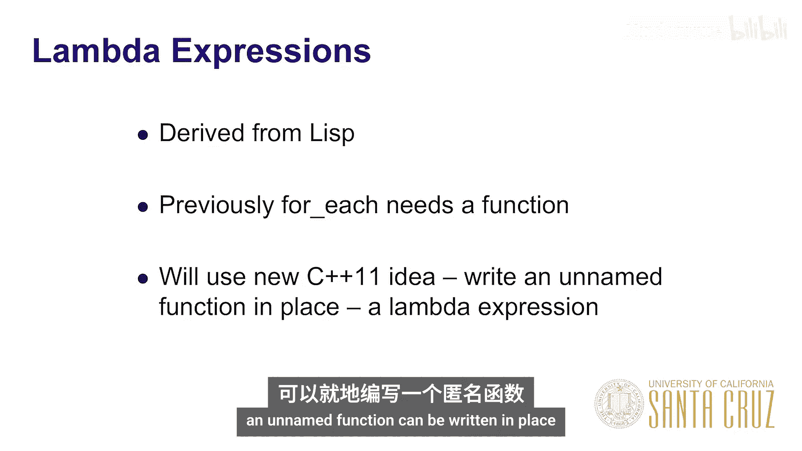
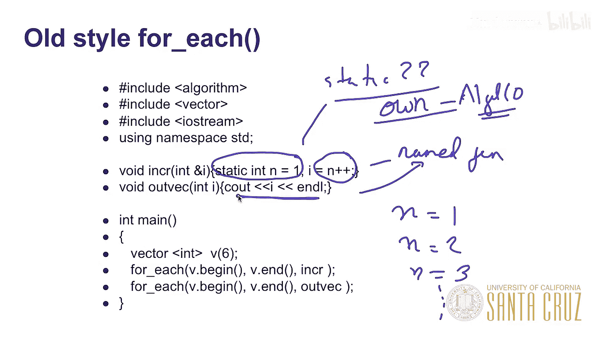
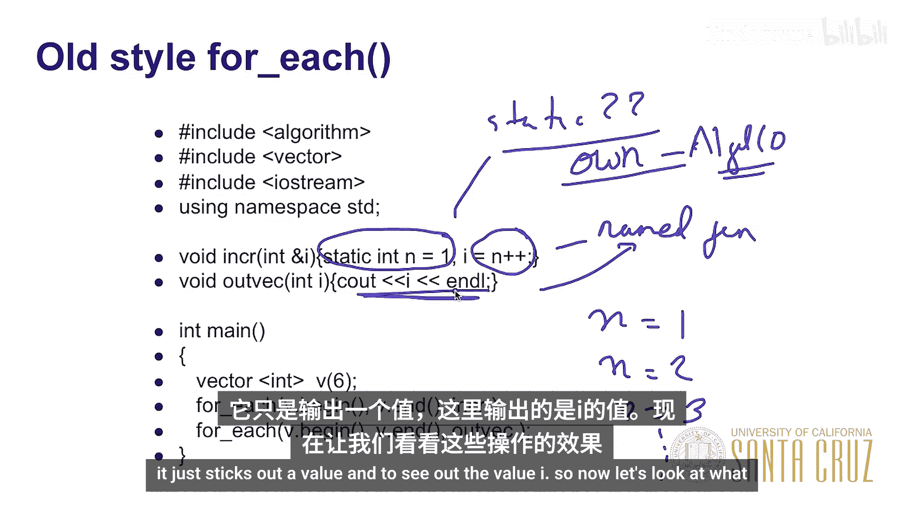
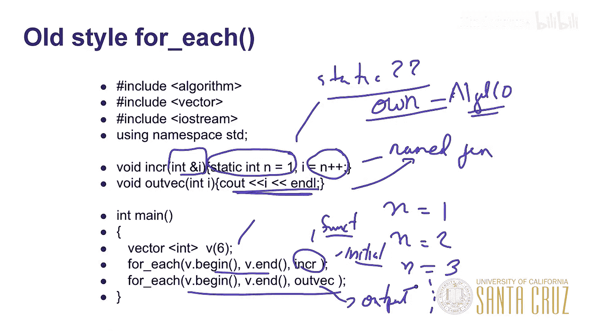
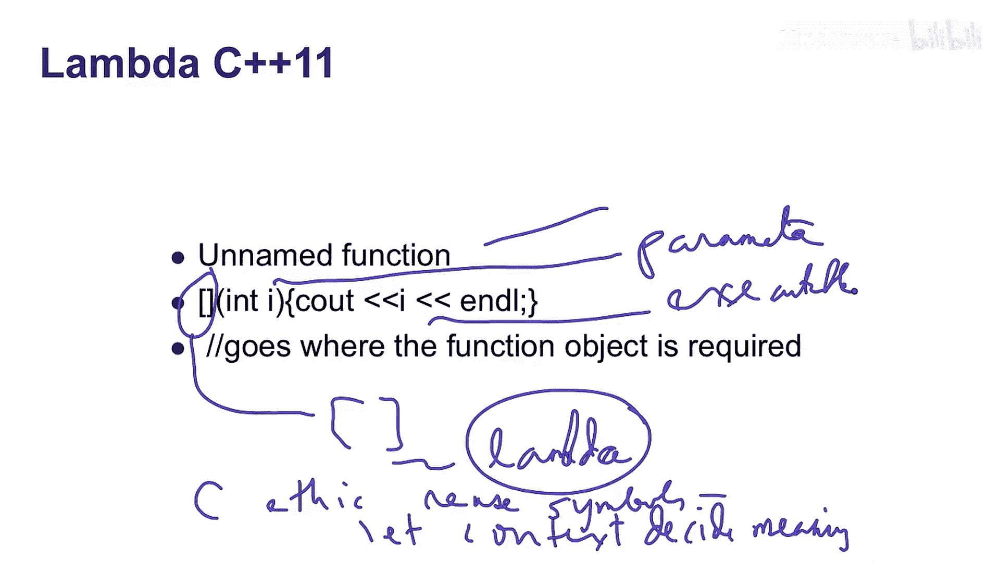
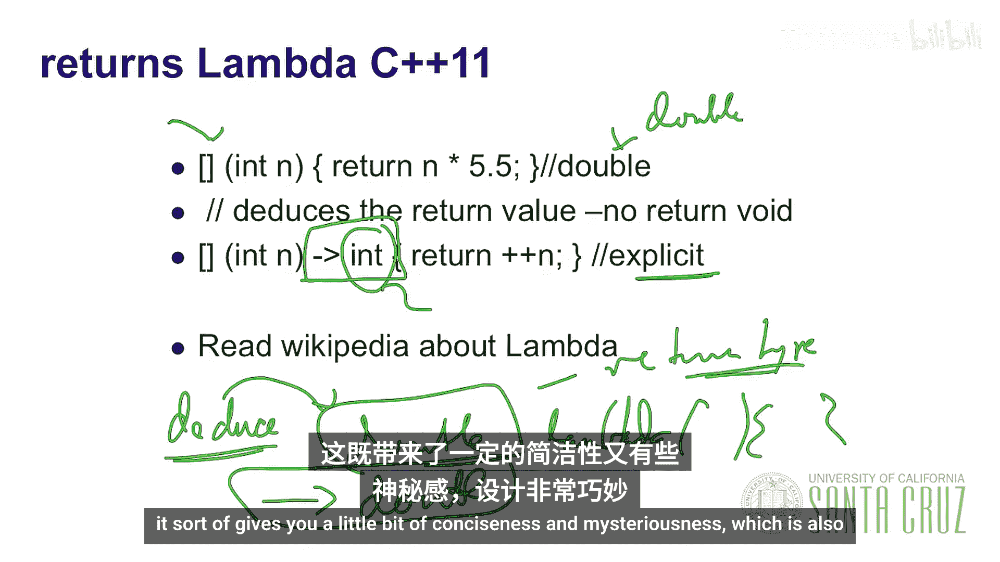
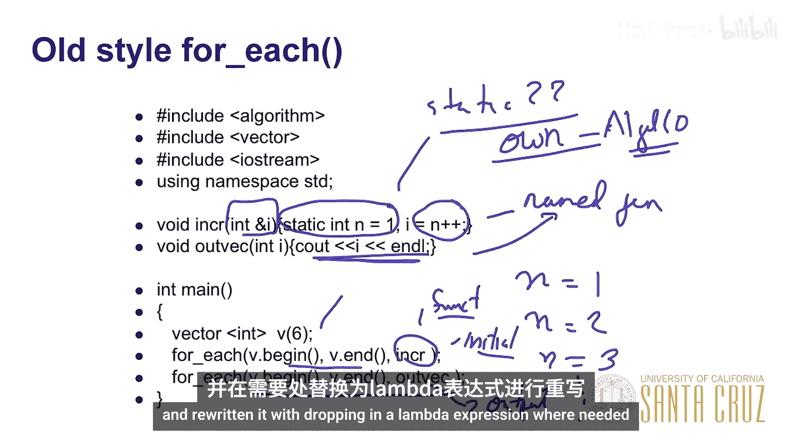
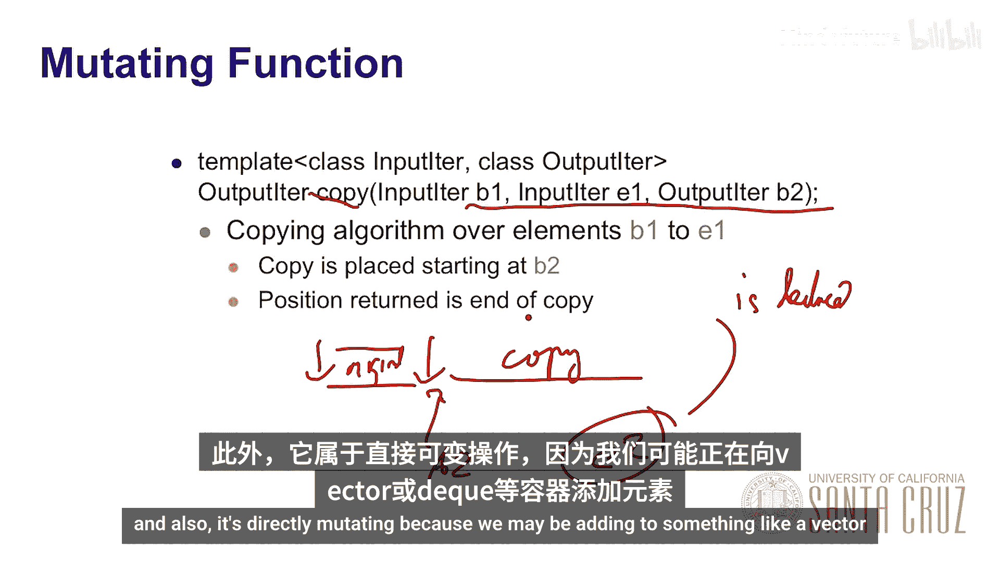
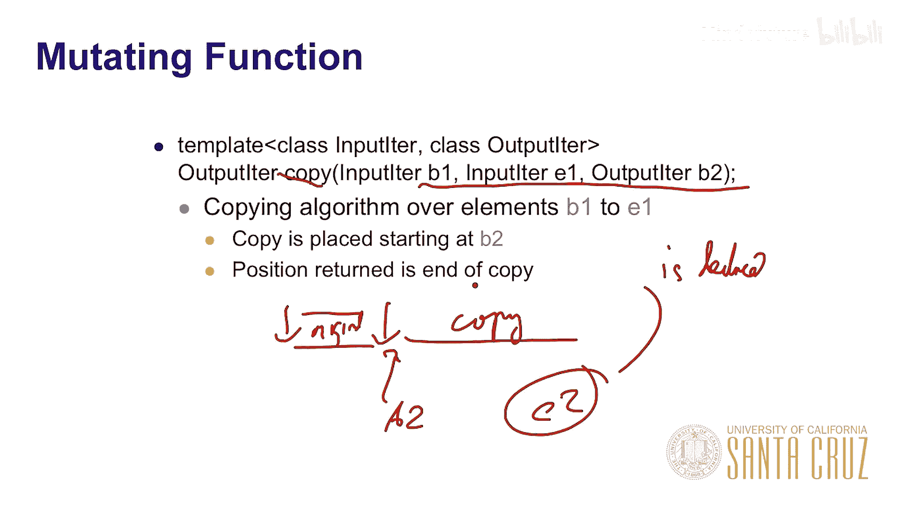

# 013：for_each函数的Lambda表达式

在本节课中，我们将要学习C++中一个非常强大且现代的特性：Lambda表达式。我们将从回顾非变异序列算法开始，探讨为何需要向这些算法传递函数或谓词作为参数，并最终学习如何使用Lambda表达式在调用处直接定义匿名函数，从而简化代码。

## 从命名函数到匿名函数

上一节我们介绍了如何使用`for_each`等非变异序列算法，并看到它们有时需要一个函数或谓词作为参数。本节中，我们来看看如何利用Lambda表达式，直接在算法调用处编写一个匿名的、临时的函数。

Lambda表达式是一个源自Lisp语言的概念。Lisp是一种基于丘奇λ演算的逻辑语言，其设计理念与追求效率和系统实现的C语言截然不同。因此，Lambda表达式被引入到现代C++标准中，是一个有趣且实用的融合。

回顾我们之前看到的`for_each`用法，它需要一个函数。Lambda表达式提供了一种在调用处直接编写无名函数的方法。

以下是使用传统命名函数的“旧式”风格示例：



```cpp
void increment(int& i) {
    static int n = 1;
    i = n++;
}

void print(int i) {
    std::cout << i << " ";
}

int main() {
    std::vector<int> vec(6);
    std::for_each(vec.begin(), vec.end(), increment);
    std::for_each(vec.begin(), vec.end(), print);
    // 输出：1 2 3 4 5 6
}
```

在这个例子中，`increment`函数通过静态变量`n`来记录状态，每次调用都会递增并赋值给容器元素。`print`函数则负责输出。`for_each`算法依次对容器中的每个元素应用这两个函数。

## Lambda表达式的语法与使用



现在，我们可以用Lambda表达式替代上述的命名函数。首先，需要了解如何编写一个Lambda表达式。



Lambda表达式的基本语法以方括号`[]`开始，这可以理解为“lambda”的象征。虽然这个语法可能初看有些晦涩，但它遵循了C/C++语言复用符号、由上下文决定含义的传统。

Lambda表达式的结构如下：
*   `[]`：捕获列表，用于指定Lambda函数体中使用的外部变量（本例为空）。
*   `()`：参数列表，与普通函数一致。
*   `{}`：函数体，包含要执行的代码。

编译器通常可以自动推导返回类型，无需显式声明，这带来了便利和类型安全。



以下是一些简单的Lambda表达式示例：

```cpp
// 自动推导返回类型为 double
auto f1 = [](int i, double d) { return i * d; };

// 显式指定返回类型为 double
auto f2 = [](int i) -> double { return i * 2.5; };
```

在第二个例子中，我们使用`-> double`来显式指明返回类型。这里的箭头`->`符号在C++中也被重用于此目的，体现了语言的简洁性。

## 在算法中应用Lambda表达式

了解了Lambda表达式的基本写法后，我们可以用它来重写之前的`for_each`示例。

以下是使用Lambda表达式实现相同功能的代码：



```cpp
int main() {
    std::vector<int> vec(6);
    int n = 1; // 状态变量移到外部

    // 使用Lambda表达式进行“递增”赋值
    std::for_each(vec.begin(), vec.end(), [&n](int& i) { i = n++; });

    // 使用Lambda表达式进行打印
    std::for_each(vec.begin(), vec.end(), [](int i) { std::cout << i << " "; });
    // 输出：1 2 3 4 5 6
}
```

在这个版本中，第一个Lambda表达式`[&n](int& i) { i = n++; }`通过捕获列表`[&n]`以引用方式捕获了外部变量`n`，从而在函数体内修改并保持其状态。第二个Lambda表达式`[](int i) { std::cout << i << " "; }`则简单地打印每个元素。代码变得更加紧凑和局部化。

## 过渡到变异序列算法

我们刚刚学习了如何在非变异算法`for_each`中使用Lambda表达式。接下来，让我们简要展望下一类算法。

变异序列算法会修改容器中的元素或容器本身。一个典型的原型是`copy`函数。

`copy`算法需要三个迭代器：
*   源序列的起始 (`begin1`) 和结束 (`end1`) 迭代器。
*   目标序列的起始 (`begin2`) 迭代器。



其功能是将源区间的元素复制到以`begin2`开始的目标区间。它返回指向目标区间中最后一个被复制元素之后位置的迭代器。由于它直接向目标容器（如`vector`或`deque`）写入数据，因此属于变异操作。



```cpp
std::vector<int> source = {1, 2, 3, 4, 5};
std::vector<int> destination(5); // 预分配空间

// 将source的全部内容复制到destination
std::copy(source.begin(), source.end(), destination.begin());
```

理解`copy`这类基础变异算法，有助于我们后续学习更复杂的、可以与Lambda表达式结合使用的变异算法（如`transform`、`replace_if`等）。


## 总结





本节课中我们一起学习了C++的Lambda表达式。我们从回顾`for_each`算法需要函数参数入手，引出了Lambda表达式作为定义匿名函数解决方案的概念。我们详细讲解了Lambda表达式`[](){}`的基本语法、自动类型推导以及显式返回类型的指定方法，并通过实例演示了如何用Lambda表达式替换传统的命名函数，使代码更简洁。最后，我们简要介绍了变异算法（如`copy`）作为后续内容的铺垫。Lambda表达式是现代C++编程中极其重要的工具，它能极大地提高代码的表达能力和灵活性。