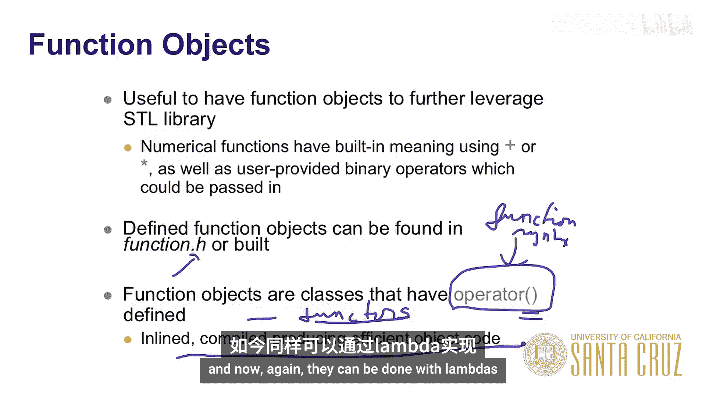
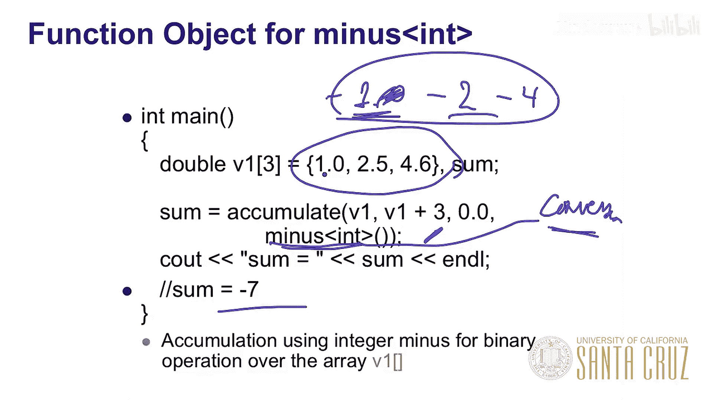
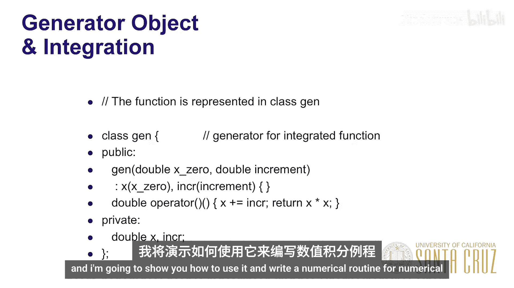
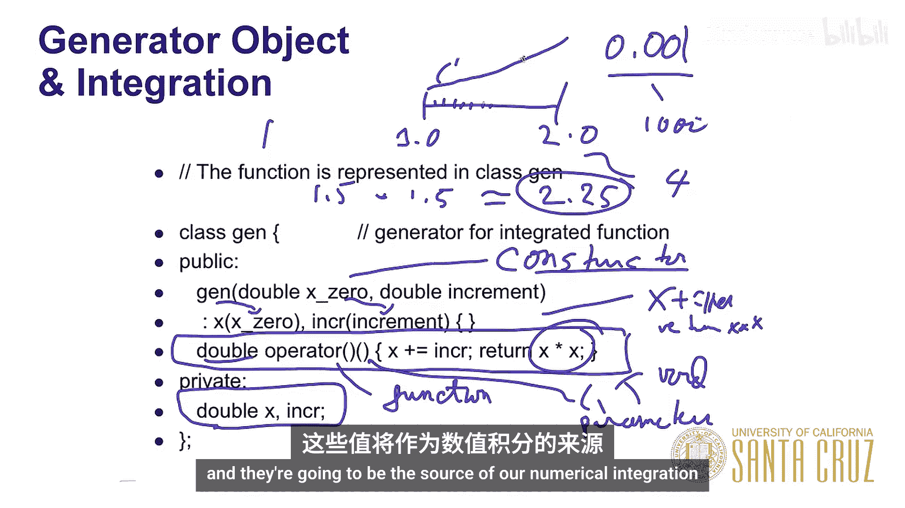
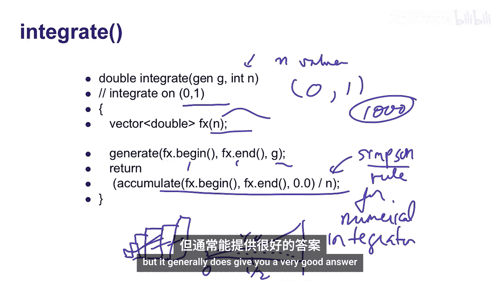
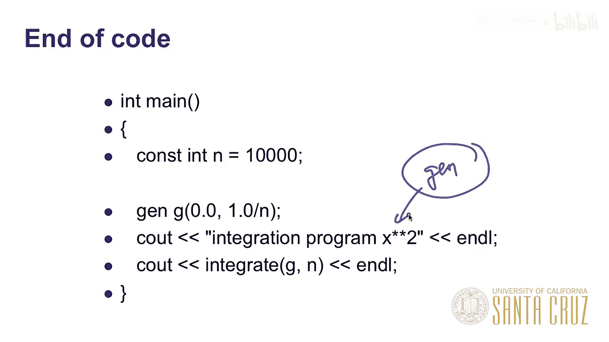

# 015：函数对象

## 概述
在本节课中，我们将要学习C++标准模板库（STL）中的函数对象。函数对象，有时也被称为仿函数，是一种行为类似函数的对象。我们将了解它们的基本概念、如何使用内置的函数对象，以及如何创建自定义的函数对象，并会通过一个数值积分的例子来展示其实际应用。

---



## 函数对象基础

传统的STL就已经具备了使用函数对象的能力，例如二元操作符。STL内置了一些函数对象。你可以直接使用诸如 `plus` 和 `minus` 这样的对象，它们都是STL模板库的一部分。在一些旧式的C++实现中，这些函数对象可能定义在名为 `functional` 或 `function.h` 的头文件中。

这些函数对象是通过类来定义的。这些类重载了 `operator()`。重载函数调用操作符 `operator()` 本质上是重载函数语法的一种方式。正是这种方式催生了函数对象，也就是我所说的仿函数。它是通过类的机制实现的，并且STL模板中预定义了一些可以直接包含使用的函数对象。



这些函数对象通常是内联的，能够生成非常高效的代码。如今，除了使用类，我们还可以使用 **Lambda表达式** 来创建函数对象。



以下是使用内置函数对象 `minus` 的一个例子。`minus` 是一个对整数进行减法操作的函数对象。我们使用 `accumulate` 算法，但这里不是使用普通的加法函数，而是使用减法操作。

```cpp
// 示例：使用 minus<int>() 函数对象进行累减
int result = accumulate(begin, end, initial_value, minus<int>());
```
在这个例子中，如果序列是 `{1, -2, -1, -2, -4}`，初始值为0，由于整数运算，最终结果会是 `-7`。

---

## 生成器函数对象

除了二元操作符，还有其他重要的函数对象类型，它们极大地扩展了STL的能力。其中一种就是生成器函数对象。

接下来，我将展示如何使用它来编写一个用于数值积分的程序。对于那些在微积分上遇到困难、总是算不对答案的同学，你可以用自己的程序来替代计算，让程序为你算出答案。

让我们具体来看一下。这里的关键是重载函数调用操作符 `operator()`。我们重载了一个参数列表为 `void` 的函数。在这个例子中，返回值类型是 `double`。



```cpp
class SquareGenerator {
private:
    double x;
    double increment;
public:
    SquareGenerator(double start, double inc) : x(start), increment(inc) {}
    double operator()() {
        double value = x * x;
        x += increment;
        return value;
    }
};
```
类中的 `x` 和 `increment` 是私有变量，通过构造函数进行初始化。例如，如果我们想从1.0积分到2.0，增量设为0.001，那么这个生成器就会计算从1.0开始，每次增加0.001，直到接近2.0的每个点的 `x` 的平方值。它会生成一系列数值，作为我们数值积分的来源。

---

## 数值积分示例

现在，我们来看积分程序。我们向 `integrate` 函数传入这个生成器对象。虽然它是一个类对象，但其真正的作用是产生一系列值。从本质上讲，它是一个生成序列的生成器。

```cpp
double integrate(SquareGenerator gen, int n) {
    vector<double> fx(n);
    generate(fx.begin(), fx.end(), gen);
    double sum = accumulate(fx.begin(), fx.end(), 0.0);
    return sum / n; // 近似于平均值乘以区间长度（此处为1）
}
```
这个函数会生成 `n` 个值（例如1000个），将它们存入向量 `fx` 中，然后累加这些值并求平均。这本质上是一种类似**辛普森法则**的数值积分方法。我们通过累加许多小矩形来近似计算积分，每个矩形的宽度是 `1/n`。

这是一种数值近似方法，虽然不一定超级精确，但对于平滑函数通常能给出很好的结果。我们可以实际调用这个函数来看看效果。

```cpp
int main() {
    SquareGenerator gen(1.0, 0.0001); // 从1.0开始，增量为0.0001
    double integral_approx = integrate(gen, 10000);
    cout << "Approximate integral of x^2 from 1.0 to 2.0: " << integral_approx << endl;
    return 0;
}
```
在这个例子中，我们使用10000个值来近似计算函数 `x^2` 从1.0到2.0的积分。如果你懂微积分，可以尝试心算或笔算来验证。如果你想对其他函数进行积分，只需要修改生成器类中 `operator()` 返回的计算逻辑即可。



---



## 总结
本节课中，我们一起学习了C++中的函数对象。我们首先了解了函数对象的基本概念，它是通过重载 `operator()` 使得类对象能像函数一样被调用。然后，我们看到了STL中内置的函数对象（如 `plus`, `minus`）以及如何使用它们。接着，我们深入探讨了生成器这种特殊的函数对象，并通过一个具体的**数值积分**实例，演示了如何创建和使用自定义的函数对象来解决实际问题。函数对象是STL算法强大和灵活性的重要组成部分，理解和掌握它们对编写高效的C++代码至关重要。