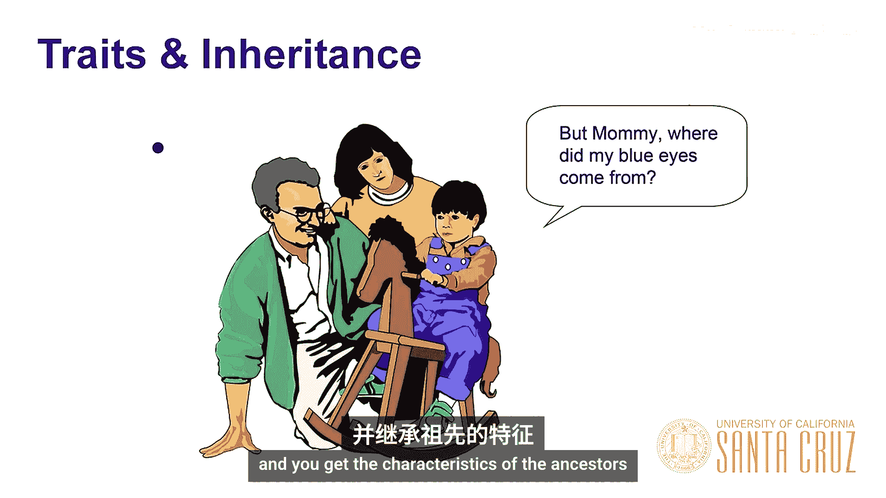
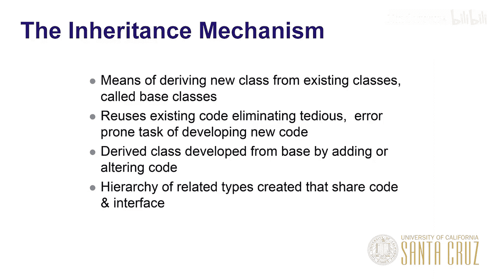
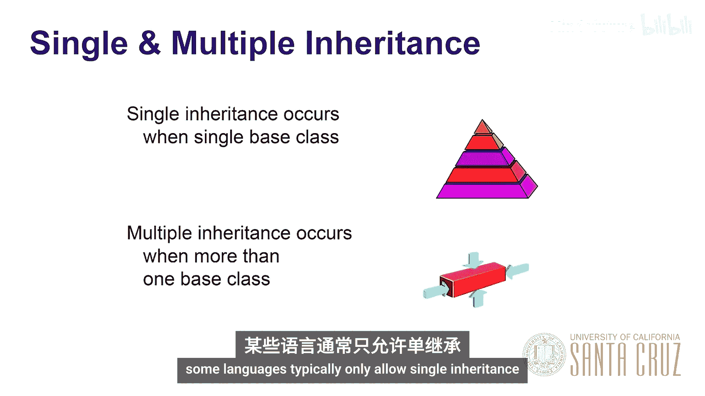
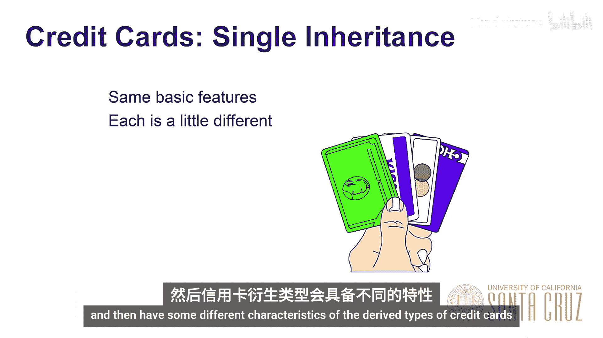
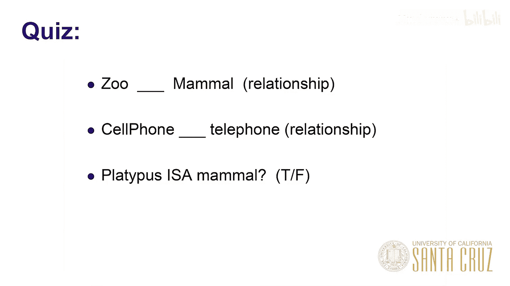
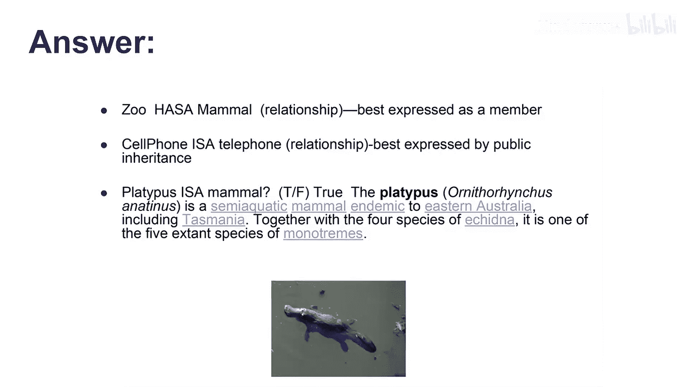

# 020：特质与继承

在本节课中，我们将要学习C++中一个核心概念——继承。继承是面向对象编程的基石，它允许我们基于已有的类创建新的类，从而实现代码的重用和扩展。

## 继承的概念与现实世界类比

上一节我们介绍了继承的基本思想，本节中我们来看看它与现实世界的联系。

我们知道现实世界中的继承关系：你有父母，你是后代，你有祖先。你从祖先那里继承了特征。

在编程中，继承机制是一种从现有类派生新类的手段。现有类被称为**基类**。它重用现有代码，从而消除了测试和开发新代码的需要，这是其重要性的原因之一。

通常，派生类会添加更多信息或修改行为。例如，通过从 `duo` 类派生 `point` 类，我们添加了长度计算功能。

这样创建的相关类型的层次结构可以共享代码和接口，从而可以开发越来越大的系统，同时保持代码相当紧凑。

## C++中的继承类型

C++允许两种继承方式：单继承和多继承。一些语言通常只允许单继承，但在C++中，一个派生类可以从多个基类派生。

以下是两种类型的简要说明：

*   **单继承**：假设我们有一个信用卡的概念，但存在不同种类的信用卡，每种卡可能有一些不同的功能。我们可以决定从某个原型信用卡派生，然后让派生出的信用卡类型拥有不同的方案和特征。
*   **多继承**：我们可能有两种独立的事物，例如邮件（具有邮件的特征）和电话（具有电话的特征）。那么新事物可能是电话邮件，因此我们得到一个派生类，它同时拥有邮件和电话的特征。两者都变得可用。

## 分类学与软件重用

所有这些都属于分类学范畴，这是科学上的重大突破之一。其核心在于理解事物可以被归入大的类别。

你在元素周期表中就能看到这一点。在没有元素周期表之前，化学是一门伪科学。一旦开始有了分类法，你就可以开始看到诸如惰性气体、碱金属等类别，这种分类法使化学成为一门科学。

生物学也是如此，一旦你开始有了脊椎动物/无脊椎动物、哺乳动物/爬行动物等分类概念，你就能开始看到共享的特征和原始概念，从而能够科学地理解非常大的群体，而不是将所有事物都视为独特的信息。

例如，我们有一个像“哺乳动物”这样的概念：温血、高等脊椎动物、用乳汁哺育幼崽。然后我们看到在哺乳动物内部，像啮齿动物和大象这样的生物共享许多特征。从表面上看，大象和蟾蜍看起来完全不同，然而大象实际上是老鼠的近亲，而不是蟾蜍的近亲。在现代DNA谱系中，这一点甚至更加明显。

老鼠是哺乳动物，大象是哺乳动物，这是一种获得特征描述的方式。特征描述允许共享。请记住，软件重用和共享，与分类学是同一回事。这就是我们以面向对象方式构建时所做的事情。当我们构建类型层次结构时，我们就是在构建让我们能够共享的东西。当我们想要构建一个大型系统时，这种共享将成为一项非常强大的资产。

在C++术语中，像 `elephant` 和 `mouse` 这样的类是从基类 `mammal` 派生而来的。

## “是一个”与“有一个”关系

这里有一些术语需要区分。

*   **“是一个”关系**：描述一种类型关系。例如，“大象**是**一种哺乳动物”。
*   **“有一个”关系**：描述一种组成部分关系。例如，“马戏团**有**大象”。马戏团对象可能拥有类型为 `elephant` 的成员。但马戏团不是一种大象，大象也不是一种马戏团。这是两种非常不同的关系。在 `circus` 类中，这是一种组成部分关系。

## 小测验

以下是一个小测验，看看你是否理解了这些基本术语。再次强调，阅读面向对象的基础知识是值得的，这也是学习本课程的先决条件。

问题如下：
1.  Zoo（动物园）与 Mammal（哺乳动物）是什么关系？
2.  Cell phone（手机）与 Telephone（电话）是什么关系？
3.  Platypus（鸭嘴兽）是一种哺乳动物，这是真的还是假的？

以下是答案和分析：

*   **Zoo has a mammal**：就像马戏团可能有大象一样。这最好表达为一种成员关系（“有一个”）。
*   **Cell phone is a telephone**：存在一种最好通过公有继承（“是一个”）来表达的关系。顺便说一下，如果你想构建一个手机模型，你可能会说大多数现代手机也有摄像头。所以突然间，如果你想用软件构建现代手机，你可以使用多继承，因为手机也是一个个人数字助理（PDA，管理你的日历）。因此，在许多情况下，今天的手机也是一台相当通用的计算机。所以，在重用方面，手机可以引发有效地使用多继承，尽管我们将避开多继承中的许多棘手问题。
*   **Platypus is a mammal**：这是真的。鸭嘴兽是一种半水生哺乳动物。鸭嘴兽给了我一个借口从维基百科上获取那张图片。

## 总结

本节课中我们一起学习了C++中继承的核心概念。我们了解了继承如何模拟现实世界的关系，以及它如何通过代码重用和构建类型层次结构来促进软件开发和维护。我们区分了“是一个”和“有一个”这两种重要的类关系，并通过小测验巩固了理解。掌握这些基础知识是进行更复杂的面向对象C++编程的关键。