# 022：C++11 final关键字 🚫

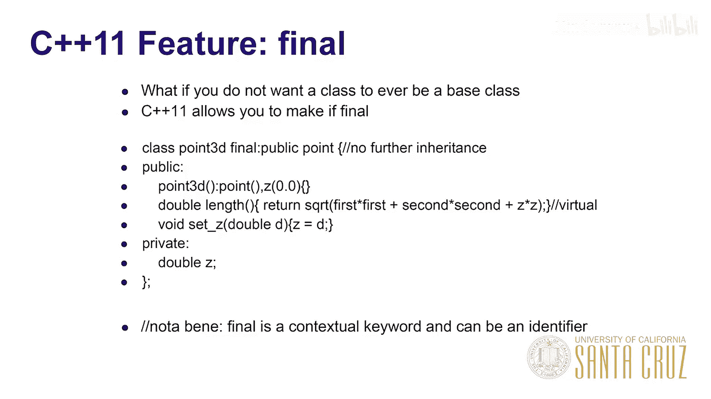

在本节课中，我们将要学习C++11标准引入的一个新特性：`final`关键字。这个关键字用于在继承体系中明确地阻止进一步的派生，是控制软件设计和提高编译器效率的有力工具。

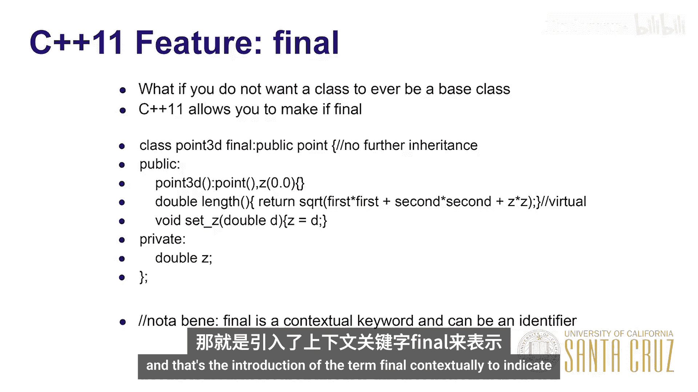

---

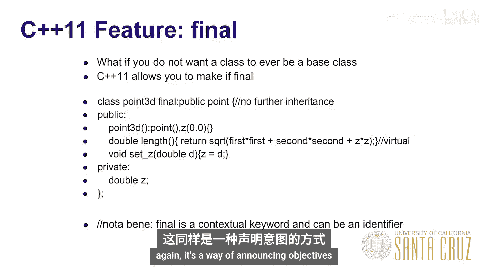

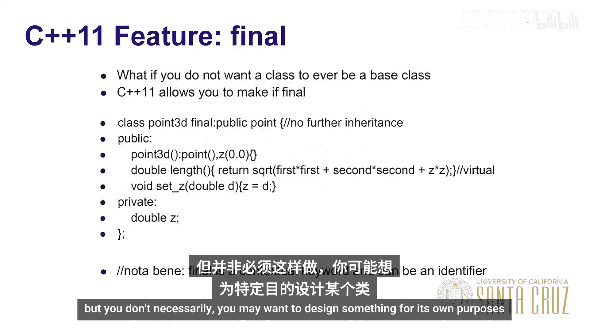

上一节我们介绍了继承和多态的基本概念，本节中我们来看看如何限制继承。

C++11引入了一个在特定上下文中使用的术语 `final`，用于表明你不希望某个类再被继承。这是一种声明设计意图、维持对软件控制权的方式。

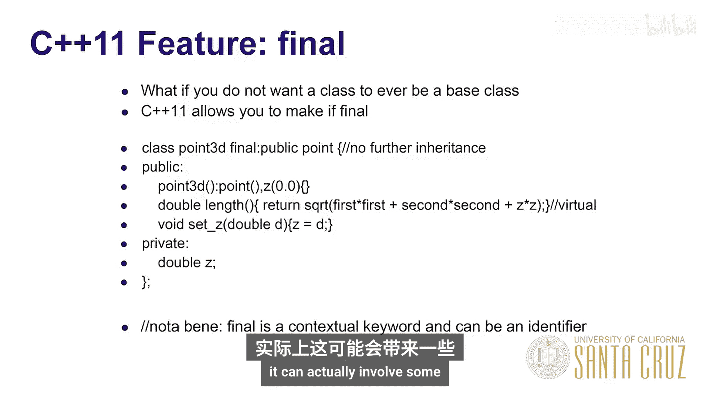

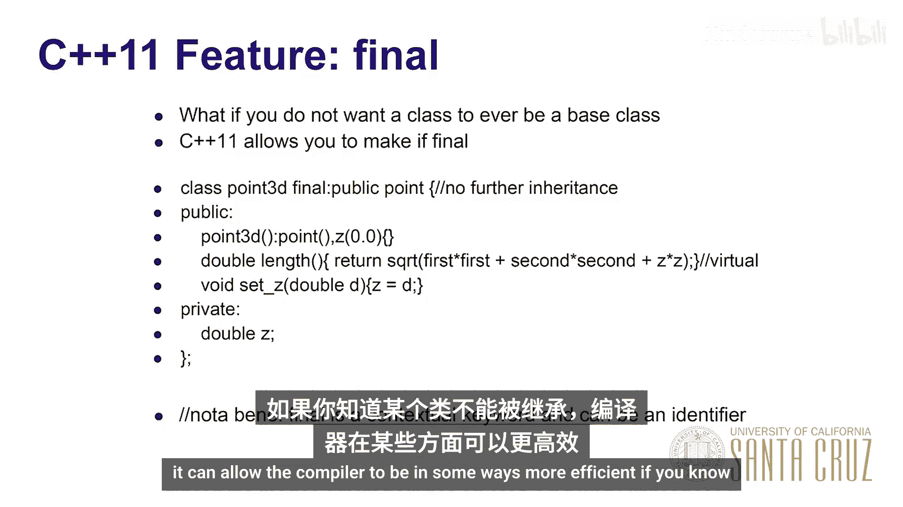

当然，你总是可以撤销这个决定。但在某些情况下，你可能希望设计一个类仅用于其自身目的，而不需要任何进一步的开发。明确禁止继承有时还能让编译器在某些方面进行更高效的优化，因为它知道这个类没有能力被继承。

以下是 `final` 关键字的语法展示：

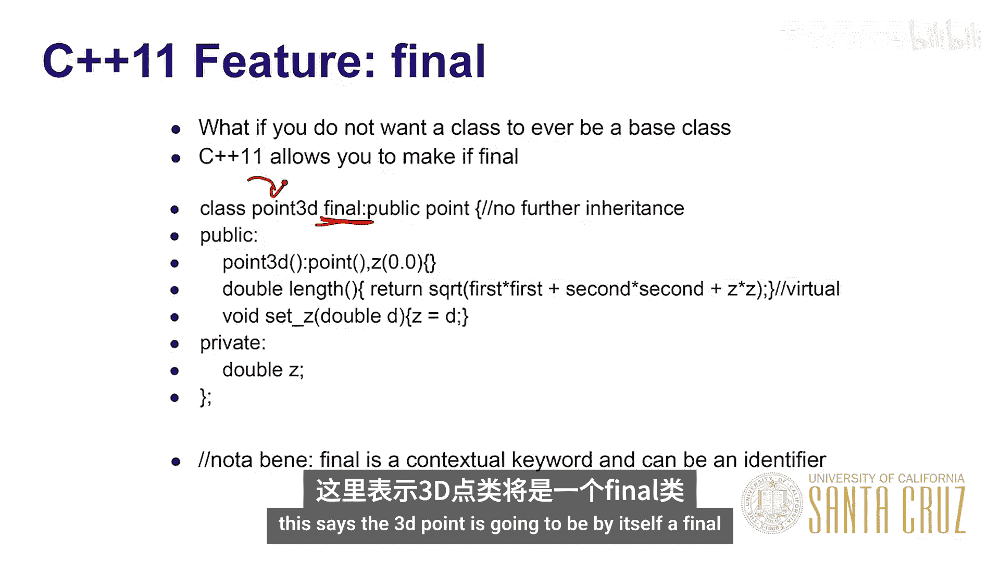

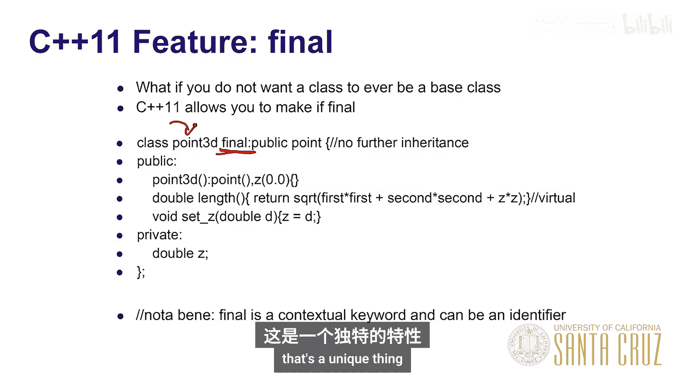

```cpp
class Point3D final : public Point {
    // ... 类成员定义 ...
};
```

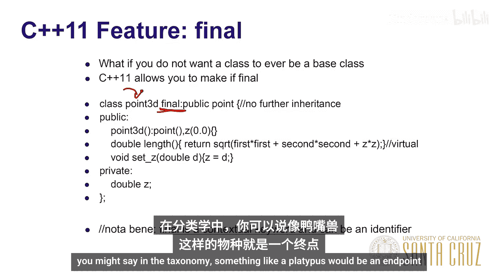

这段代码声明 `Point3D` 类本身是 `final` 的。这意味着没有任何类可以从 `Point3D` 派生。它是一个独立的终点。

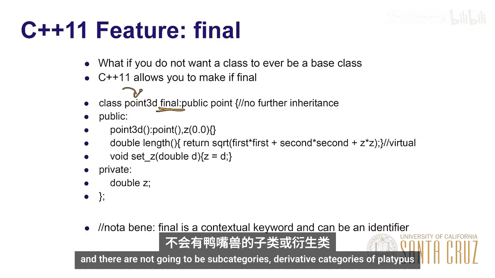

你可以将其类比于生物分类学中的“终点”物种。例如，鸭嘴兽（platypus）可以被视为一个终点分类，不存在鸭嘴兽的亚种或派生类别。

需要再次强调的是，`final` 是一个上下文关键字。这意味着，虽然可能不是好的编程实践，但在程序的其他地方，`final` 仍然可以被用作普通的标识符（如变量名）。不过，我们不推荐这样做。最好避免使用具有特殊含义的词汇作为普通标识符。

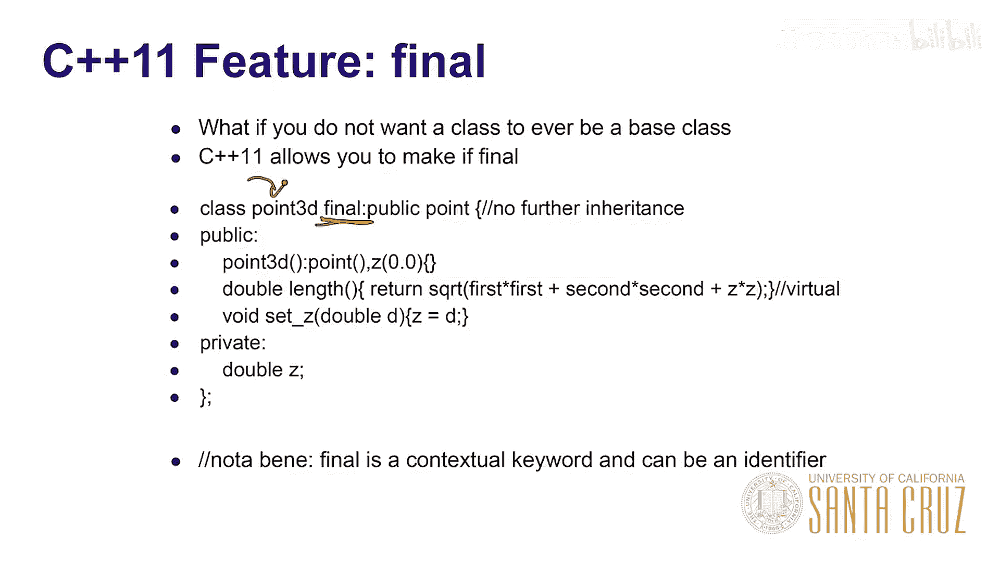

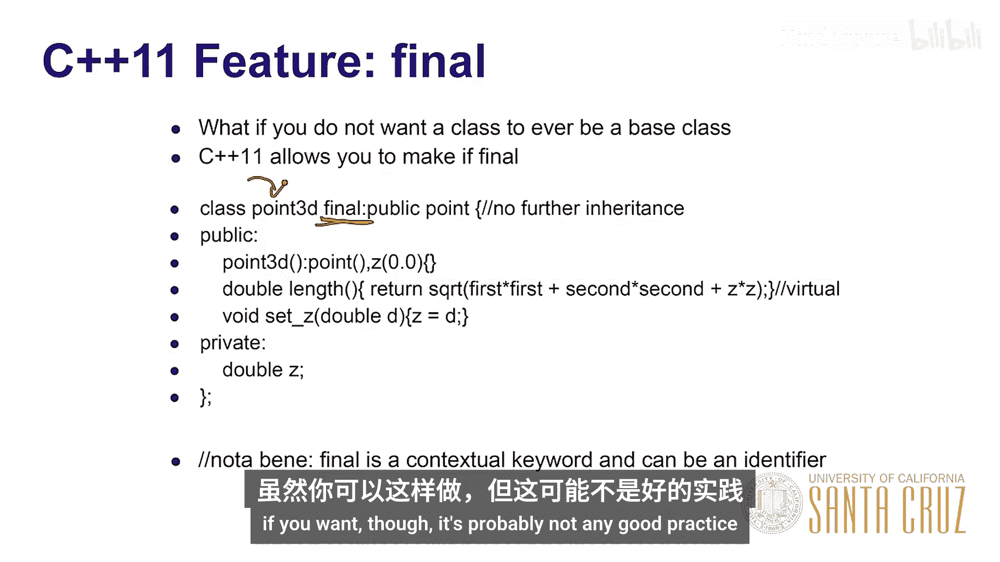

---

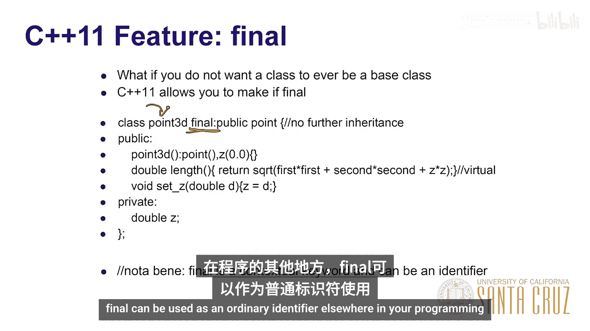

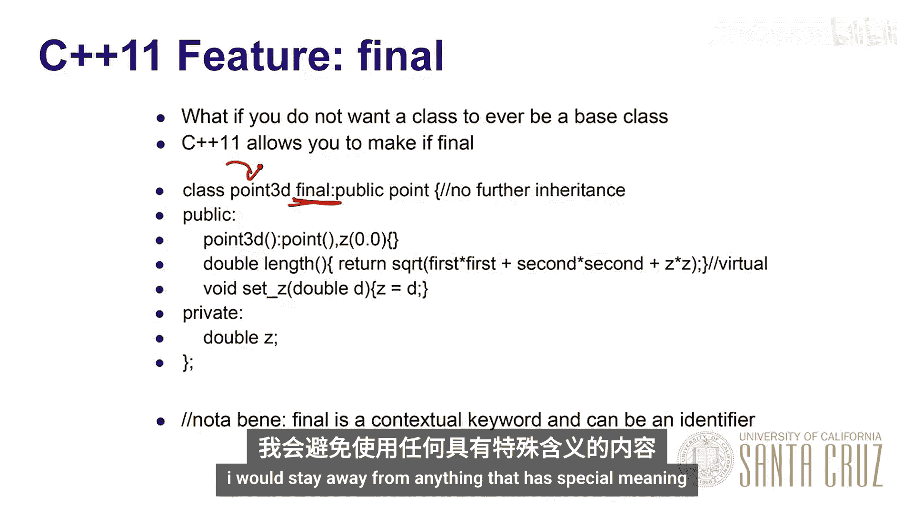

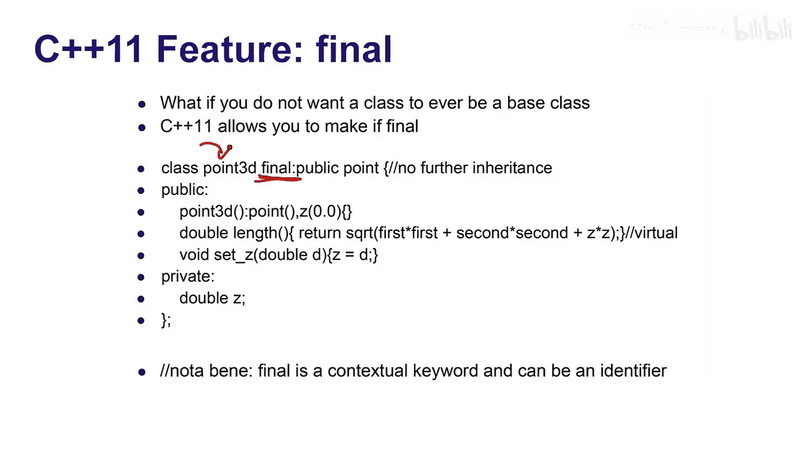

本节课中我们一起学习了C++11的 `final` 关键字。我们了解到，通过在类声明后添加 `final`，可以明确禁止该类被其他类继承。这有助于表达清晰的设计意图、增强对代码结构的控制，并可能为编译器优化提供机会。虽然 `final` 是上下文关键字，但为了代码清晰，应避免将其用于其他用途。