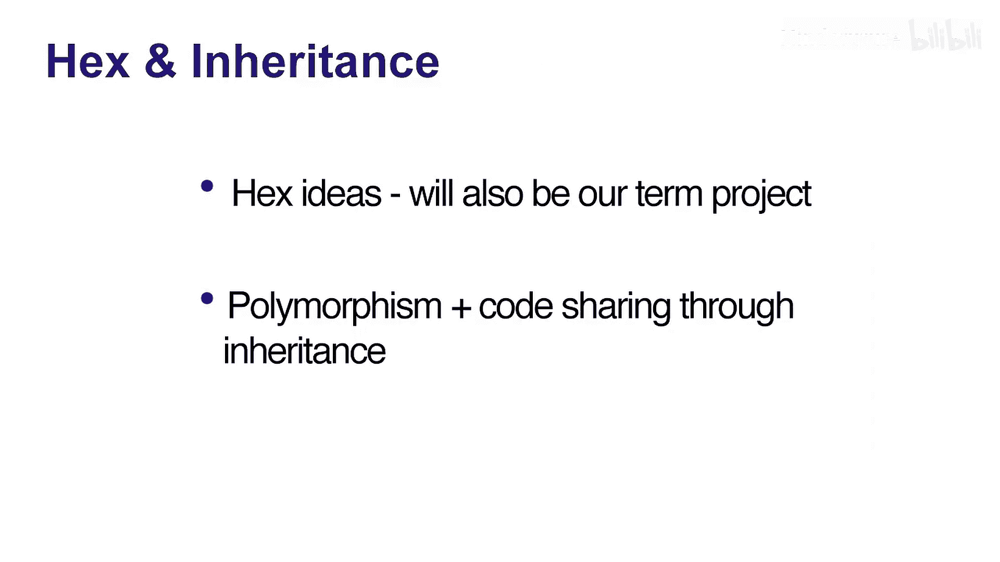
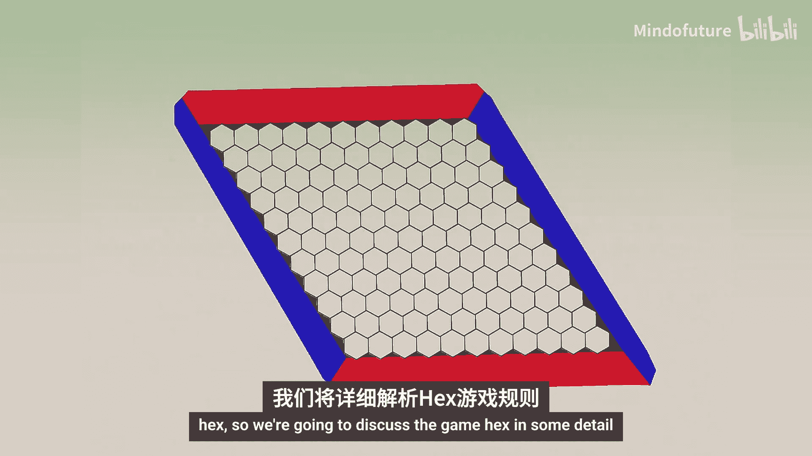
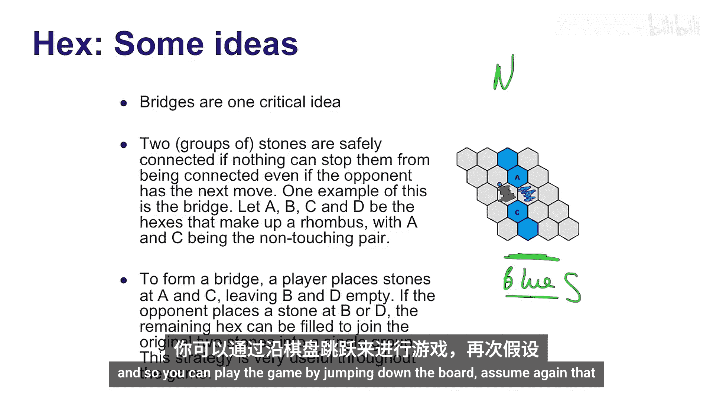
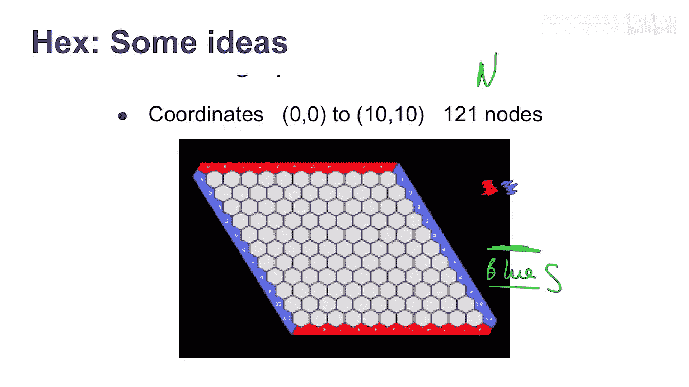
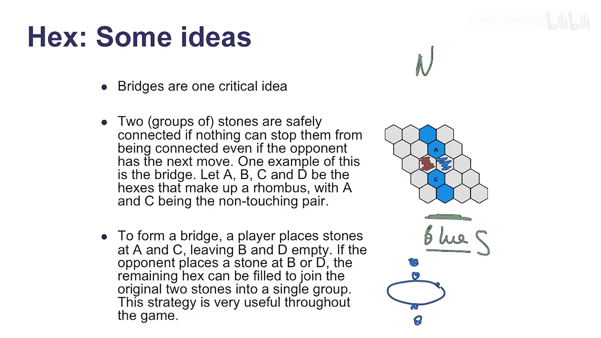
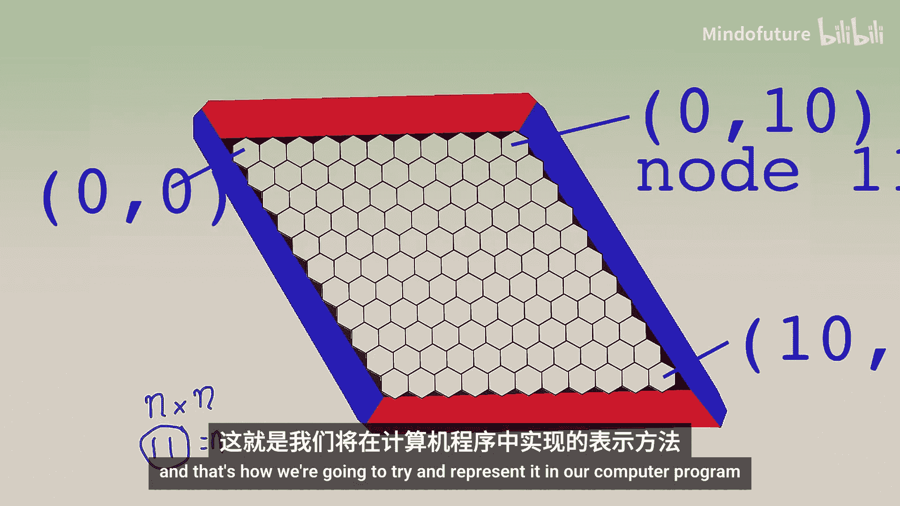
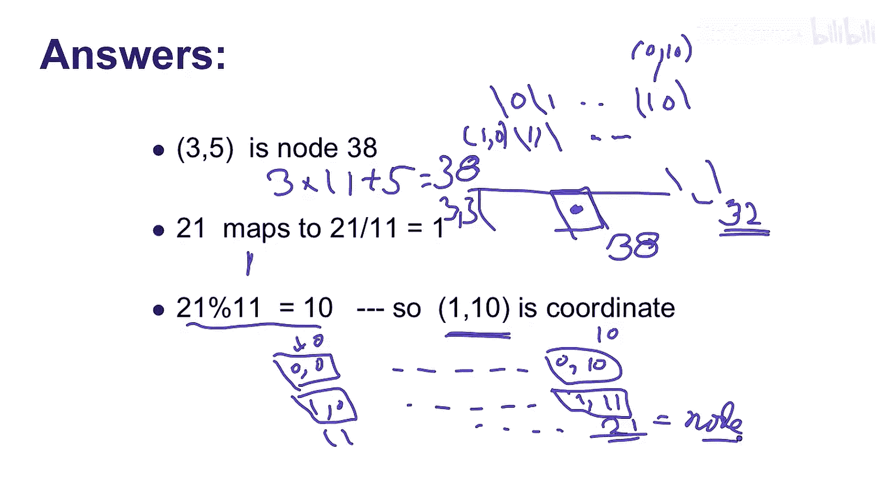

# 024：六边形棋项目概述与实现基础

在本节课中，我们将深入探讨本学期的课程项目：实现一款名为“六边形棋”的游戏，并运用AI技术来创造一个智能对手。我们将重点介绍在C++世界中实现这一目标所需的核心技术，特别是**继承**，这是面向对象编程的标志性特性。



## 项目目标与核心概念



上一节我们介绍了项目的总体目标，本节中我们来看看实现过程中的一些核心软件和方法论技术。在C++这类语言中，一个关键技术是**多态**和通过**继承**实现的代码共享。

**继承**的公式化描述如下：
```cpp
class BaseClass {
    // 基类成员...
};

class DerivedClass : public BaseClass {
    // 派生类成员，继承并可能扩展基类的功能...
};
```

## 六边形棋游戏简介

接下来，我们将详细讨论六边形棋游戏。

六边形棋是一个关于连接性的游戏，可以看作是井字棋的一个更复杂的变体。在连接性游戏中，玩家需要在地图上建立一条路径，同时阻止对手建立他们的路径。

## 第一阶段任务：实现合法游戏逻辑



在你们的第一个作业中，首要任务是编写一个能够进行合法六边形棋对弈的程序。这意味着程序需要能够：
*   检查玩家（包括对手）的落子是否合法。
*   能够自主做出合法的落子。
*   知道游戏如何判定胜负。





在代码的第一个版本中，你们可以先使用一些相当基础的策略。两个关键策略是：
1.  **进攻**：扩展自己的路径。
2.  **防守**：阻止对手建立路径。

因此，实现智能对弈的一个思路是，检测如何为自己建立更长的路径，以及如何阻断对手的更长路径。

以下是关于六边形棋的一些核心思路，网上有很多可以游玩或了解该游戏的网站，建议你们去体验一下。

## 关键策略：桥梁

在游戏中，一个非常值得融入程序的关键概念是“桥梁”。

桥梁是指棋盘上的两组棋子可以安全连接。例如，蓝色玩家（从北向南连接）可能会暂时跳过某一行。如果红色玩家试图通过在此处落子来阻挡，蓝色玩家可以在下一回合立即通过连接形成桥梁来应对。因此，蓝色玩家可以暂时跳过这一行，只在红色玩家试图阻挡时才做出回应。这种策略被称为“桥梁”，允许玩家在棋盘上跳跃式前进。

## 棋盘表示：图论方法



在编写程序时，一个自然的想法是利用我们在课程中学到的图论知识来表示六边形棋盘。

一个典型的11x11六边形棋棋盘可以表示为一个图。通常，锦标赛使用11x11或更大的棋盘。有趣的是，如果棋盘小于等于9x9，计算机目前可以做到完美对弈；但当棋盘足够大时，游戏的可能性组合会变得极其庞大，即使超级计算机也难以计算出最佳走法。

在我们的作业中，我们将用图来表示棋盘，因为我们需要大量探索路径，而之前学过的**迪杰斯特拉最短路径算法**正是智能探索棋盘移动的基础。

在六边形棋中，有两个玩家（例如红色和蓝色），蓝色玩家试图连接东西边界，红色玩家试图连接南北边界。游戏不可能出现平局，因为一方建立路径的同时必然会阻断另一方的路径。

对于一个11x11的棋盘，我们有121个节点。一个有用的表示方法是将其视为一个二维空间，其中左上角坐标为 (0,0)，右下角坐标为 (10,10)。我们遵循C语言的索引惯例，从0开始。

## 坐标与节点编号的映射

我们需要实现从二维坐标 (i, j) 到一维节点编号的映射，并且这个映射应该适用于任意 N x N 的棋盘。

实现这种二维映射的关键是使用**取余运算符**。这是一个二元整数算术运算符。例如，`3 % 10 = 3`，`35 % 10 = 5`（因为35除以10，整数部分是3，余数是5）。

对于一个节点编号，我们可以使用以下公式计算其坐标：
*   **行坐标 i** = 节点编号 / N （整数除法）
*   **列坐标 j** = 节点编号 % N （取余运算）

反之，对于坐标 (i, j)，其节点编号为：
*   **节点编号** = i * N + j

例如，在11x11的棋盘上：
*   坐标 (0,0) 对应节点 0。
*   坐标 (10,10) 对应节点 10*11 + 10 = 120。
*   坐标 (3,5) 对应节点 3*11 + 5 = 38。
*   节点 21 对应坐标 (21/11=1, 21%11=10)，即 (1,10)。

理解并实现这个映射非常重要。在程序中，你们可能需要用二维表示来绘制棋盘（因为需要显示棋子位置），同时用图（一维节点表示）来进行内部计算，比如运行路径查找算法。

## 总结



本节课中我们一起学习了六边形棋学期项目的概述。我们明确了第一阶段的目标是实现一个能进行合法对弈的程序，并引入了基础的进攻和防守策略，特别是“桥梁”概念。我们重点讨论了如何利用图论知识来表示棋盘，并详细讲解了二维坐标与一维节点编号之间相互转换的公式，这是后续实现游戏逻辑和AI算法的基础。接下来，你们将开始动手实现这个映射和基本的游戏框架。