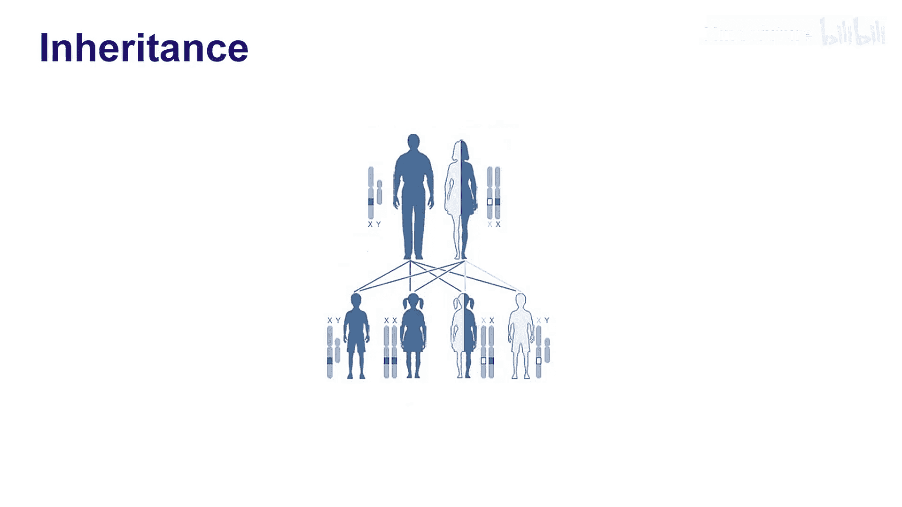
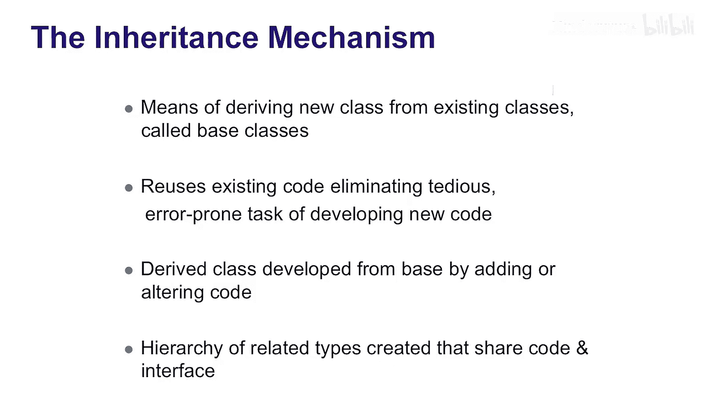
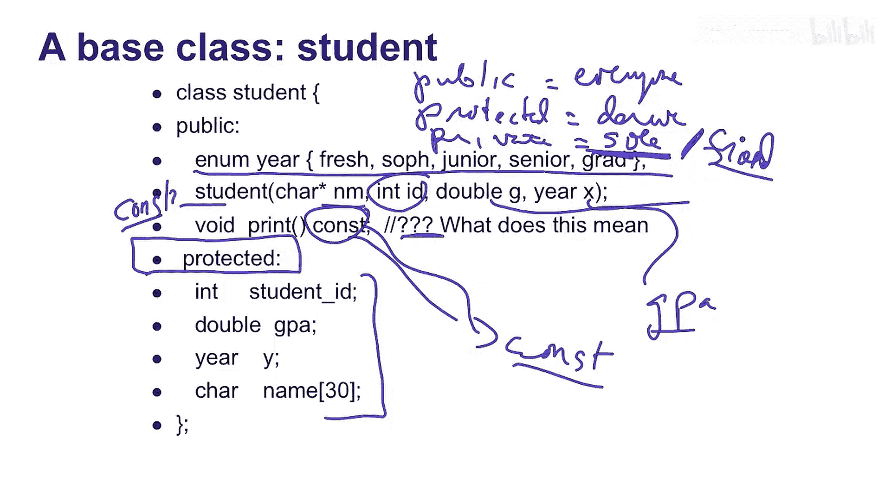
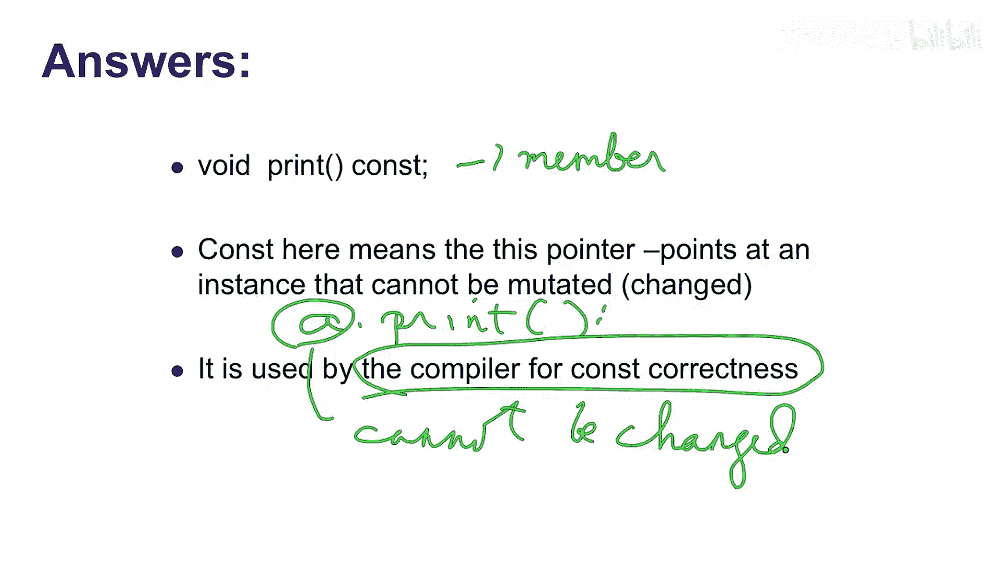

# 026：继承机制

## 概述



在本节课中，我们将要学习C++面向对象编程中的一个核心概念——**继承**。我们将探讨继承如何实现代码复用，如何创建类之间的层次关系，以及如何使用`protected`访问修饰符。

## 继承的概念

上一节我们介绍了面向对象编程的基本思想，本节中我们来看看**继承**。

继承是编程，特别是C++中的一个主要主题。我们都很熟悉“继承”这个概念。它是生物学的基本信条之一。我们都通过DNA、基因和父母进行遗传和复制。下图展示了某种疾病基因是如何传播及其传播的可能性。


理解生物学中的遗传至关重要，这个概念也出现在面向对象编程中。像Java、C++这类语言从80年代末开始成为主流的编程方式，正是因为继承提供了一种代码共享和实现**多态性**的方式。多态性能够根据底层对象的类型特征，动态地选择正确的方法来响应行为。如果你使用Smalltalk的术语，就是方法接收消息，并根据类型特征选择正确的方法。所有这些都属于面向对象编程中继承的一部分。

我期望你在学习本课程前已经了解了这些基本概念。

## 继承的作用

那么，继承能为我们带来什么？它提供了一种从现有类派生出新类的方法。在术语上，那些现有的类被称为**基类**。

这种派生是实现代码复用的方式。在软件世界中，代码复用是降低成本的“灵丹妙药”。如何降低软件开发成本？答案就是避免编写独特的代码。每当需要为下一个产品或实现编写独特代码时，都必须进行详尽的测试以确保其正确性。如果你有预先存在且经过仔细测试的代码，它就可以像乐高积木一样，成为构建更大系统的组件，从而极大地节省成本。开发新代码容易出错，因此代码复用是一项关键技术。

继承关系就像父母与后代。后代代码通常是父代码的扩展，在原有基础上增加了一些新内容。如果我们不需要任何新东西，就没有理由使用继承，直接使用旧类即可。因此，创建新类通常是因为需要修改某些代码、改变某些行为或增加一些新特性。在接下来的课程中，我们将通过示例来深入了解其工作原理。

当你完成这种数据结构的设计后，你会得到一个**继承树**。你可以回溯，就像在人类遗传结构中查看不同特征是如何从先辈那里继承下来的一样。这样就创建了一个共享代码和接口的相关类型的层次结构。




## 示例：大学人员系统

接下来我们将看到一个示例。我们将以一个`Student`（学生）类作为基类。我们可以从大学的角度来思考这个问题。大学校园里有各种类别的人，有普通学生，也有特殊类别的学生，比如研究生，甚至还可以进一步细分。可能还有像在线学生这样的特殊类别学生，他们具有不同的特征。

实际上，如果你在为大学构建一个大型数据库，你可能会从一个更基础的`Person`（人）类开始。这样，你不仅可以有`Student`，还可以有`Employee`（雇员）。在雇员中，又可以有不同的类别。这为你提供了一个开发模型，用于构建一个能够反映和模拟校园内所有人并实现相关功能的系统。例如，雇员中可能有学术人员（如终身制和非终身制教职员工）和行政人员（如专业职员、业务职员，甚至可能是警察和消防服务人员）。如果一个类别具有显著意义，它就需要自己的类，而这个类会从更基础的类继承而来。

以下是一个`Student`类的示例。学生的一个特征可能是年级：大一、大二、大三或研究生。学生会有姓名、学生ID（可能类似社保号）、GPA以及所在年级等信息。

这是一个构造函数。假设我们想打印一个学生实例的信息。顺便说一下，我在这里放了三个问号。你应该知道`const`在这个位置的含义，对吗？这意味着这个指针，也就是这个实例，不会被这个成员函数所改变。

```cpp
class Student {
public:
    // 构造函数和其他成员函数...
    void print() const; // const 成员函数，不修改对象状态
private:
    // 私有数据成员...
};
```

## Protected访问修饰符

当我们使用继承时，通常不再（或尽量避免）使用`private`，而是将原本私有的成员改为`protected`。

`protected`意味着，当你继承一个类时，这些成员对派生类是可见的。派生类的方法可以直接使用这些信息。

因此，C++中整体的数据隐私方案是：
*   **public**：对所有人可见。
*   **protected**：对派生类可见。
*   **private**：仅对自身类可见，这是限制最严格的。

当然，你也可以通过`friend`（友元）机制来访问私有部分。但在继承体系中，`protected`将在家族内部被大量使用。



## 回顾Const成员函数

回顾一下我刚刚提到的内容。`const`在那个位置（成员函数末尾）的作用是什么？

它的作用是表明这是一个**const成员函数**。记住，它通过类似`a.print()`的方式被调用。这意味着编译器可以检查`const`的正确性，即对象`a`的状态不会被这个函数改变。




## 总结


本节课中我们一起学习了C++继承机制的核心概念。我们了解到继承是实现代码复用和创建类层次结构的关键。通过`Student`类的例子，我们看到了如何从基类开始设计。我们还重点介绍了`protected`访问修饰符，它允许派生类访问基类的部分成员，这是在继承体系中实现数据共享的重要方式。最后，我们回顾了`const`成员函数如何保证对象状态不被修改。理解这些概念是掌握面向对象编程中多态性和大型系统构建的基础。