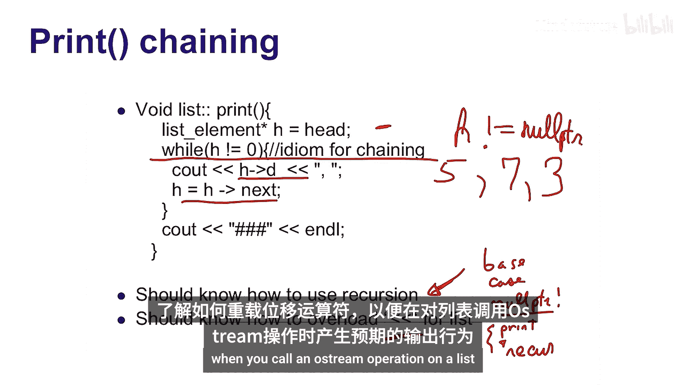
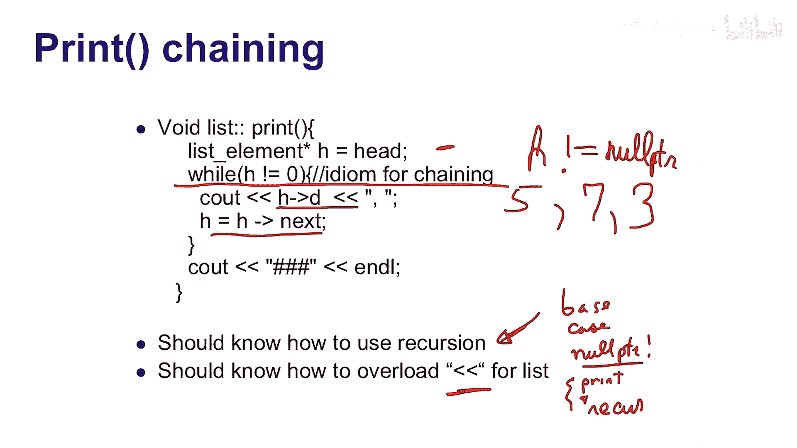
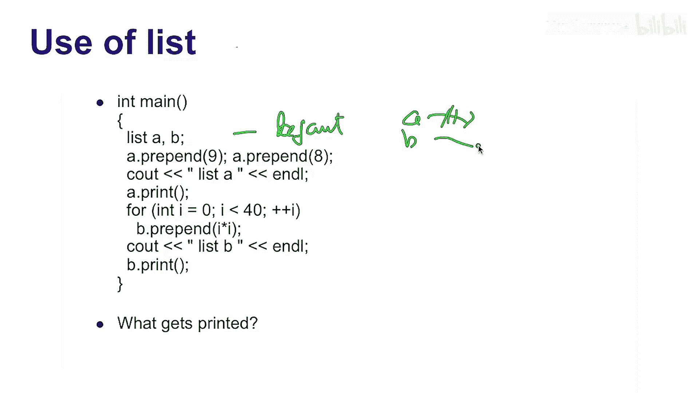
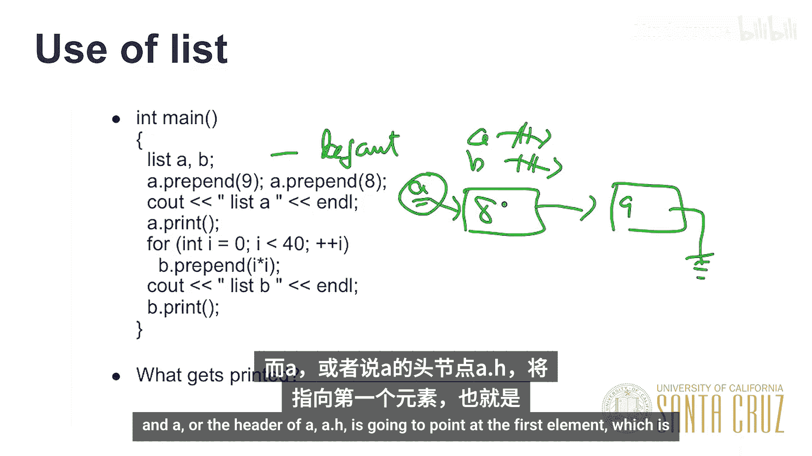
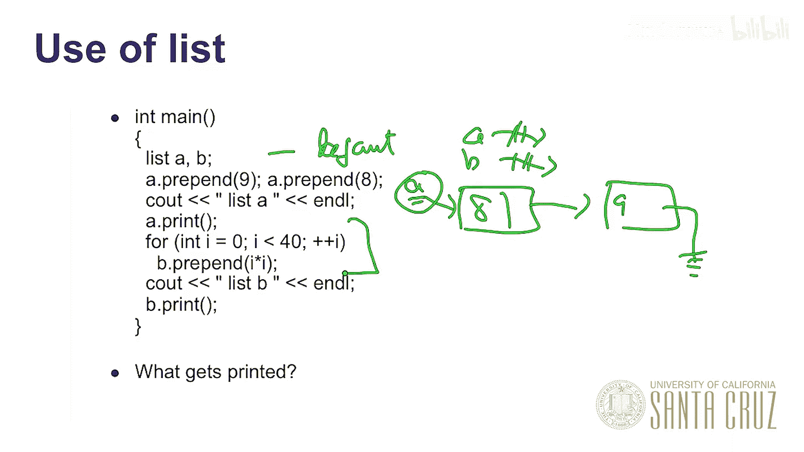
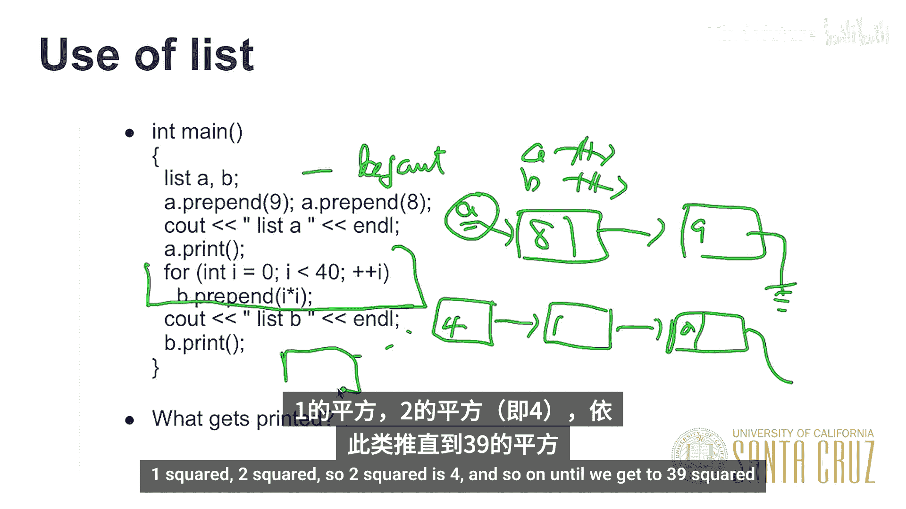
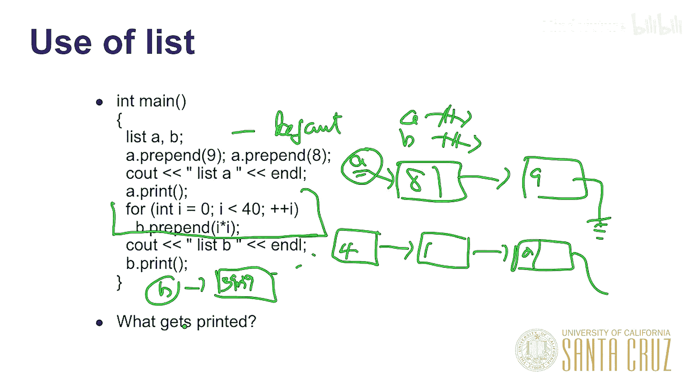
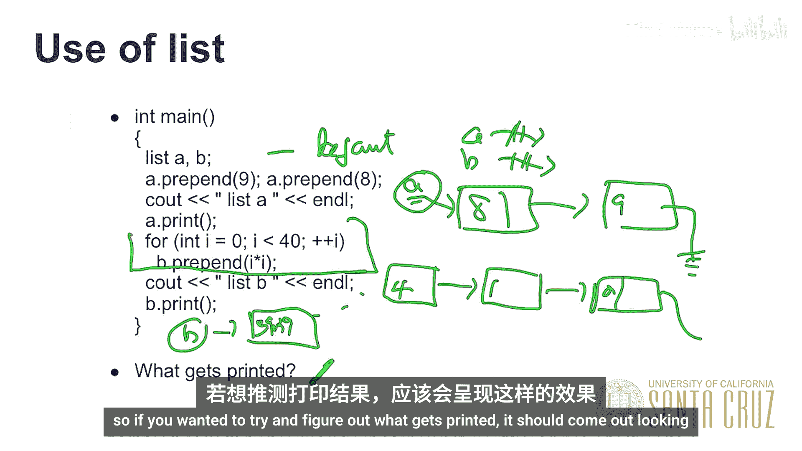
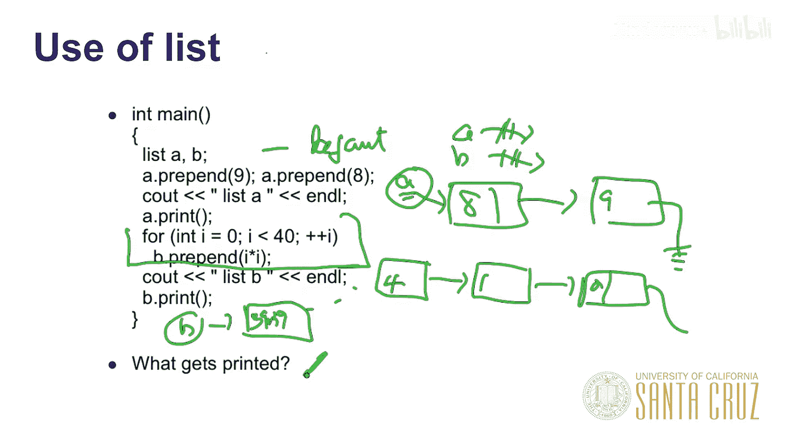
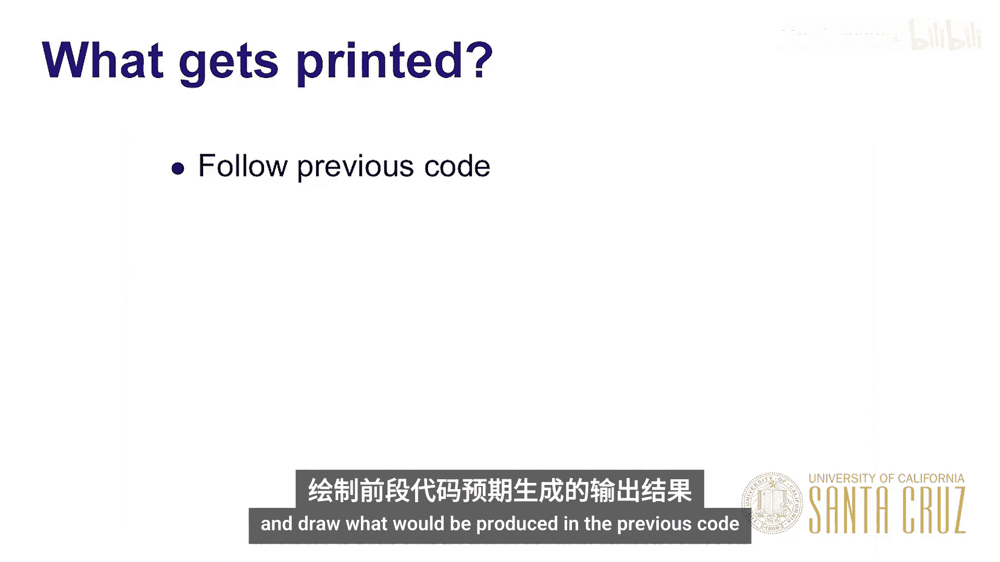

# 028：打印链式调用

## 概述
在本节课中，我们将学习如何在链表数据结构中实现“打印”操作。这是一种在链表处理中反复出现的惯用操作，其核心是遍历链表并输出每个节点的值。我们将重点介绍迭代遍历的方法，并简要提及递归实现和运算符重载的概念。

---

## 链表打印的迭代方法
上一节我们介绍了链表的基本结构，本节中我们来看看如何遍历并打印链表中的所有元素。

迭代方法的核心是使用一个循环，从链表的头节点开始，依次访问每个节点，直到遇到表示链表末尾的空指针（`nullptr`）为止。

以下是实现迭代打印的关键步骤：

1.  **初始化游标**：将当前指针设置为指向链表的头节点（`head`）。这标志着遍历的开始。
    ```cpp
    Node* current = head;
    ```

2.  **循环遍历**：使用 `while` 循环，条件是当前指针不为空。这是遍历链表的标准模式。
    ```cpp
    while (current != nullptr) {
        // 处理当前节点
        // ...
        // 移动到下一个节点
        current = current->next;
    }
    ```

3.  **处理与移动**：在循环体内，首先处理当前节点（例如打印其存储的值），然后将当前指针更新为指向下一个节点（`current->next`）。

通过这种设置，利用空指针作为结束信号，头指针作为起点，我们可以按顺序遍历整个链表容器。如果链表有 `n` 个元素，时间复杂度是 `O(n)`，这与遍历一个数组的效率相同。因此，当需要搜索整个链表或对其所有元素执行操作时，这种方法非常高效。

---

## 其他实现方式
现在我们已经掌握了迭代方法，接下来简要了解其他两种实现链表打印的思路。





*   **递归实现**：递归方法同样基于链表的结构。其基本情况是检查当前指针是否为空（`nullptr`），如果是则返回。一般情况则是：打印当前节点的值，然后对下一个节点递归调用打印函数。其核心思想是“打印并递归推进游标”。
*   **运算符重载**：在C++中，你还可以通过重载流插入运算符（`<<`），使得链表对象能像标准类型一样直接使用 `cout` 进行输出。例如 `cout << myList;`。这能提供更符合C++习惯的、直观的输出方式。



这两种方法可以作为练习，帮助你更深入地理解链表和C++特性。

---

## 代码示例与分析
为了巩固理解，让我们看一个简单的链表使用示例，并分析其输出。



首先，声明两个链表对象 `a` 和 `b`，并使用默认构造函数初始化。我们知道，默认构造函数会将链表的头指针（`head`）初始化为空指针。
```cpp
List a, b; // a.head 和 b.head 此时都是 nullptr
```



接着，我们向链表 `a` 的前端添加（`prepend`）两个值：9 和 8。根据 `prepend` 的逻辑，后添加的 8 会成为新的头节点。
```cpp
a.prepend(9);
a.prepend(8);
// 此时链表 a 的结构为：8 -> 9 -> nullptr
```
打印链表 `a`，我们将看到输出：`8, 9,`。

然后，我们通过一个循环向链表 `b` 的前端添加一系列值，这些值是 0 到 39 的平方。
```cpp
for (int i = 0; i < 40; ++i) {
    b.prepend(i * i);
}
```
由于是向前添加，最后添加的 `39*39` 会成为链表的头节点。因此，链表 `b` 最终包含从 `1521` (39²) 递减到 `0` (0²) 的所有平方数。



打印链表 `b`，输出将类似于：`1521, 1444, ..., 4, 1, 0,`。



你应该尝试运行或模拟这段代码，并绘制出链表 `a` 和 `b` 在每一步操作后的结构图，以确认你的理解。





---



## 总结
本节课中我们一起学习了链表的核心操作之一——打印遍历。我们详细介绍了使用 `while` 循环和空指针检查的迭代遍历方法，这是处理链表的基础惯用法。我们还简要探讨了递归实现和通过重载 `<<` 运算符来美化输出的可能性。最后，通过一个具体的代码示例，我们观察了 `prepend` 操作如何构建链表，并预测了其输出结果。掌握这些遍历技术是进行任何复杂链表操作的前提。