# 029：更精细的列表

在本节课中，我们将学习如何设计一个功能更完善的列表类。我们将探讨标准模板库（STL）中常见数据结构的特性，并了解如何为我们的列表类添加一系列构造函数、析构函数以及赋值操作符。这些功能是构建健壮且高效的数据结构的基础。

上一节我们介绍了简单列表的实现，本节中我们来看看如何为其添加更多标准库中常见的功能。

## 构造函数

在标准模板库中，数据结构通常会提供多种构造函数，以满足不同的初始化需求。以下是几种常见的构造函数类型。

### 默认构造函数

默认构造函数不接受任何参数，用于创建一个空列表或具有默认状态的列表。

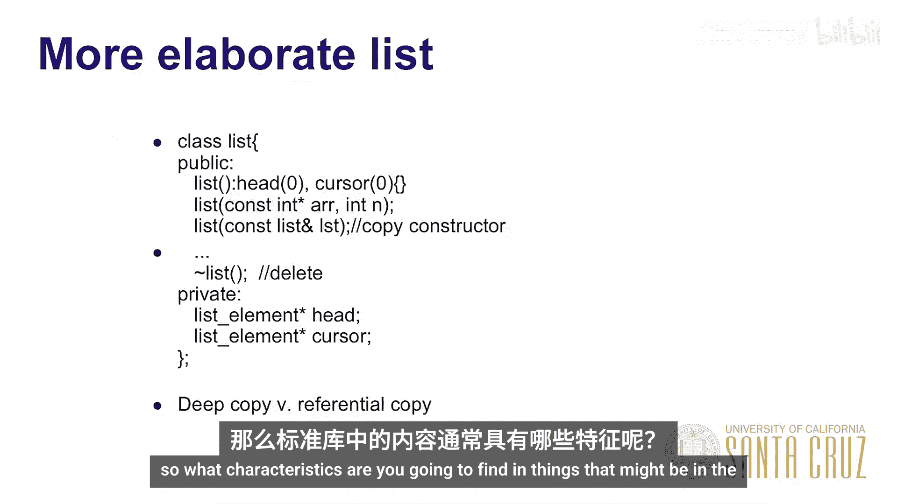

```cpp
class List {
public:
    List(); // 默认构造函数
};
```

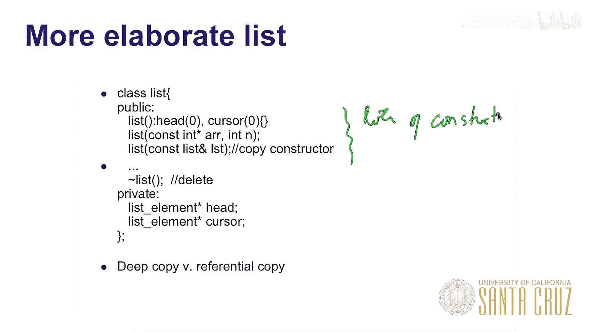

### 拷贝构造函数

拷贝构造函数接受一个同类型对象的常量引用，用于创建一个新对象作为原对象的副本。

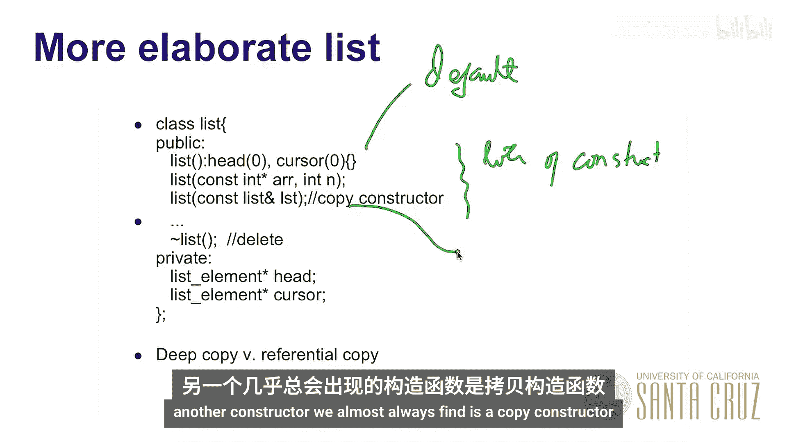

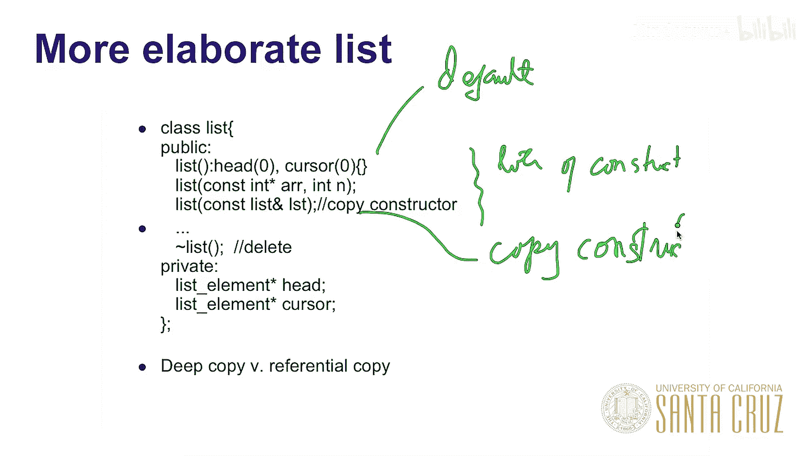

```cpp
class List {
public:
    List(const List& other); // 拷贝构造函数
};
```

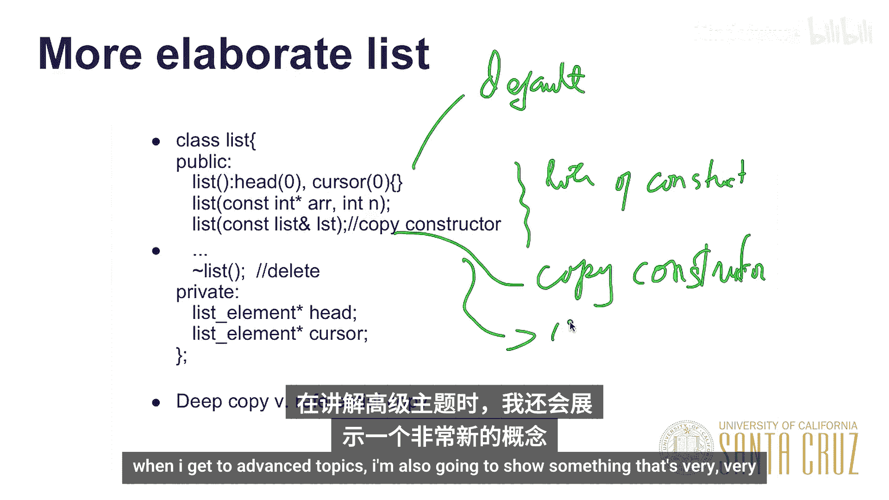

### 移动构造函数（高级话题）

移动构造函数是C++11引入的新特性，它通过“移动”资源（而非复制）来高效地初始化新对象。这对于基础编程并非必需，我们将在课程后期深入讨论。

```cpp
class List {
public:
    List(List&& other); // 移动构造函数
};
```

### 从其他容器构造的构造函数

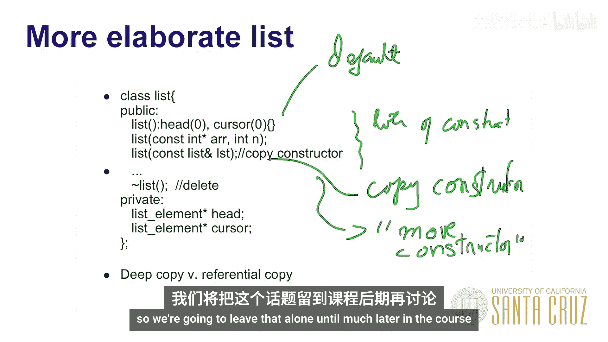

有时我们需要从其他容器（如数组）中转移数据来初始化列表。以下构造函数接受一个常量数组及其大小。

```cpp
class List {
public:
    List(const int* arr, size_t size); // 从数组构造
};
```
参数 `arr` 被声明为 `const` 是因为在此构造函数中，我们不会修改数组元素的值。

## 析构函数

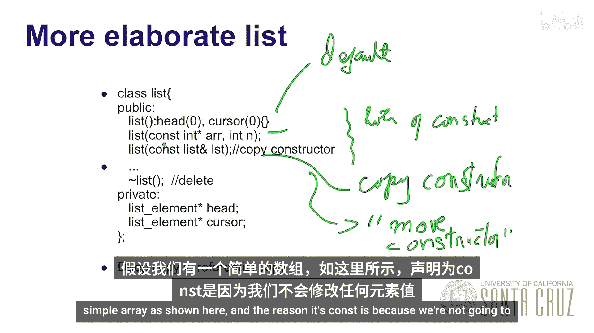

良好的编程实践要求我们为管理资源的类提供析构函数，以确保资源被正确释放。析构函数的名称是在类名前加上波浪号 `~`。

```cpp
class List {
public:
    ~List(); // 析构函数
};
```

## 赋值操作符

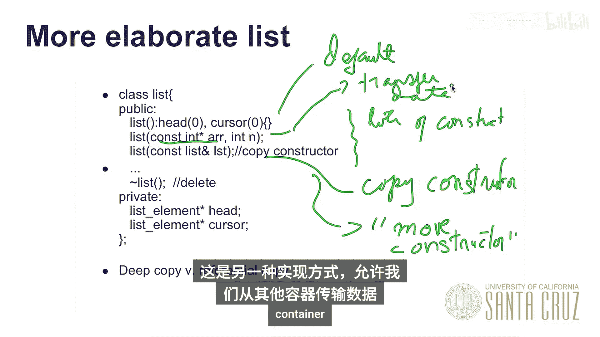

接下来，我们将讨论两种复制方式：拷贝赋值和移动赋值。这有助于我们理解在构建复杂聚合类型时，如何在健壮性和效率之间进行权衡。

### 拷贝赋值操作符

拷贝赋值操作符用于将一个对象的状态复制给另一个已存在的对象。

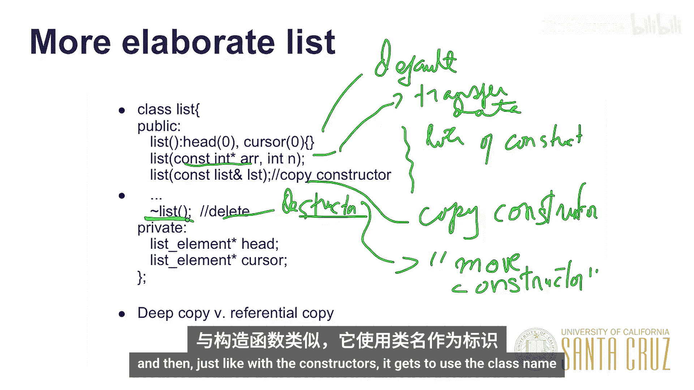

```cpp
class List {
public:
    List& operator=(const List& other); // 拷贝赋值操作符
};
```

### 移动赋值操作符（高级话题）

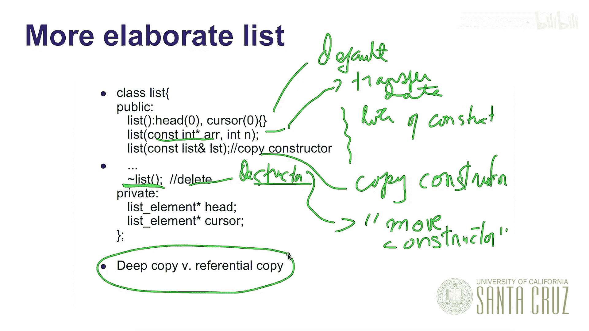

与移动构造函数类似，移动赋值操作符通过转移资源来实现高效赋值。

```cpp
class List {
public:
    List& operator=(List&& other); // 移动赋值操作符
};
```

关于深拷贝与浅拷贝的详细讨论，我们将在本讲座的下一部分重点展开。

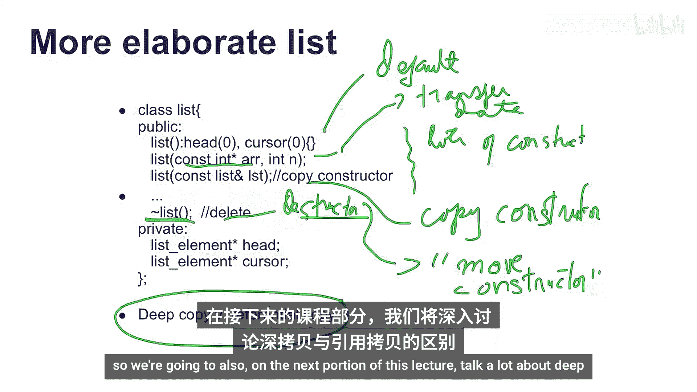

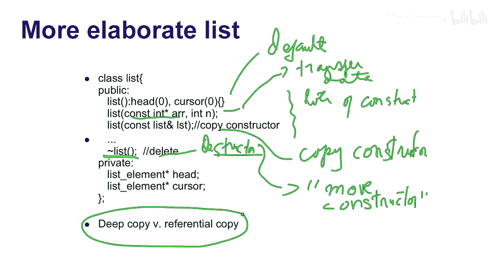

本节课中我们一起学习了如何为一个列表类设计更完善的接口，包括多种构造函数、析构函数以及赋值操作符。理解这些成员函数是使用和模仿标准模板库风格的关键第一步。