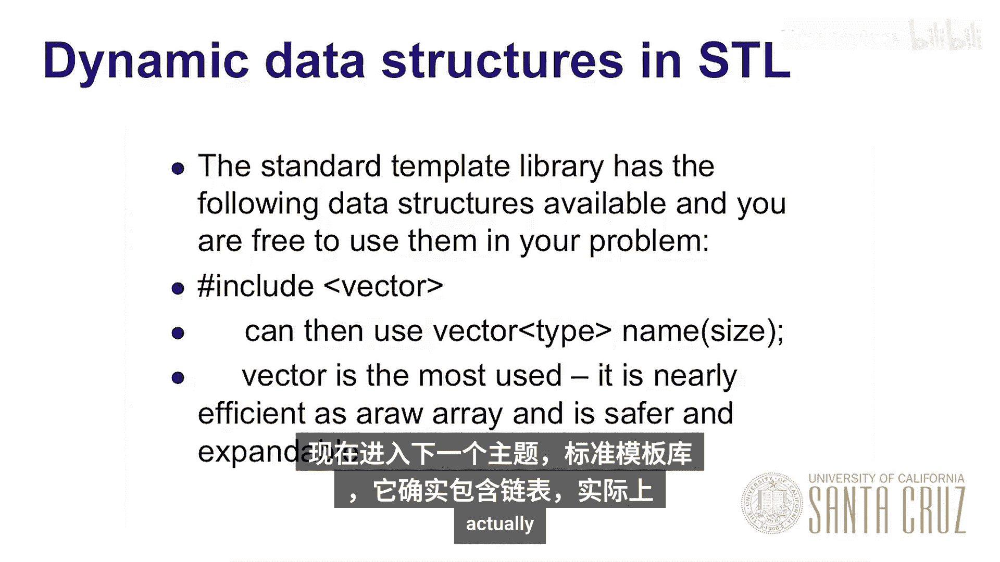
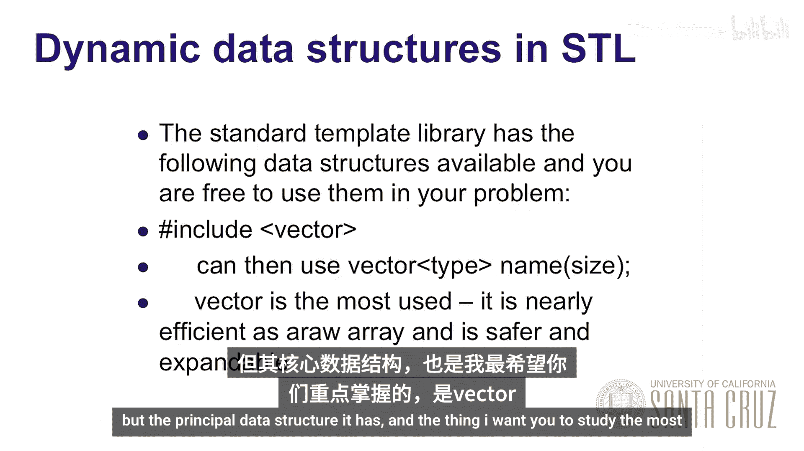
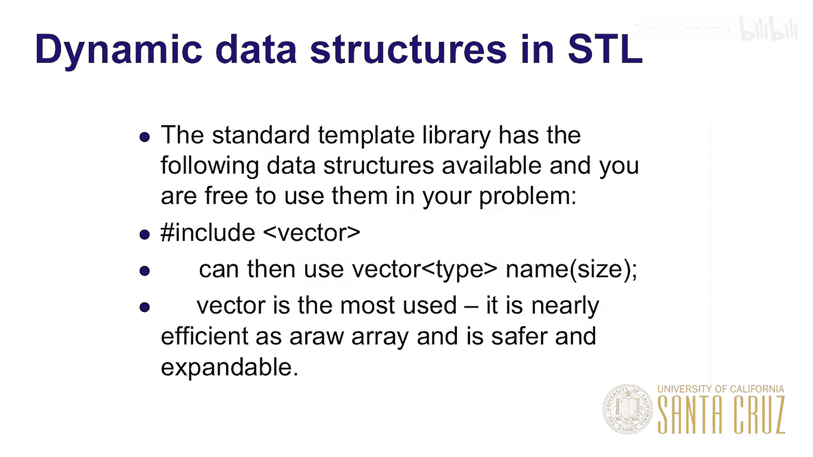
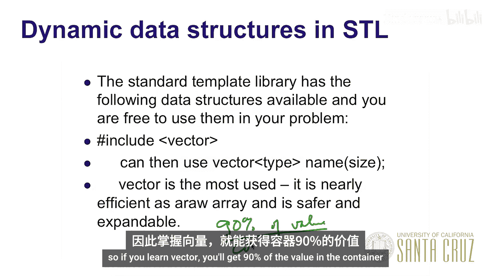
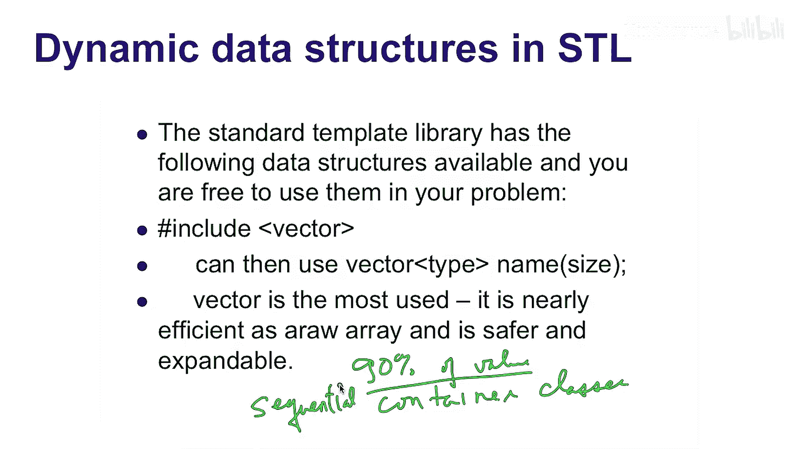
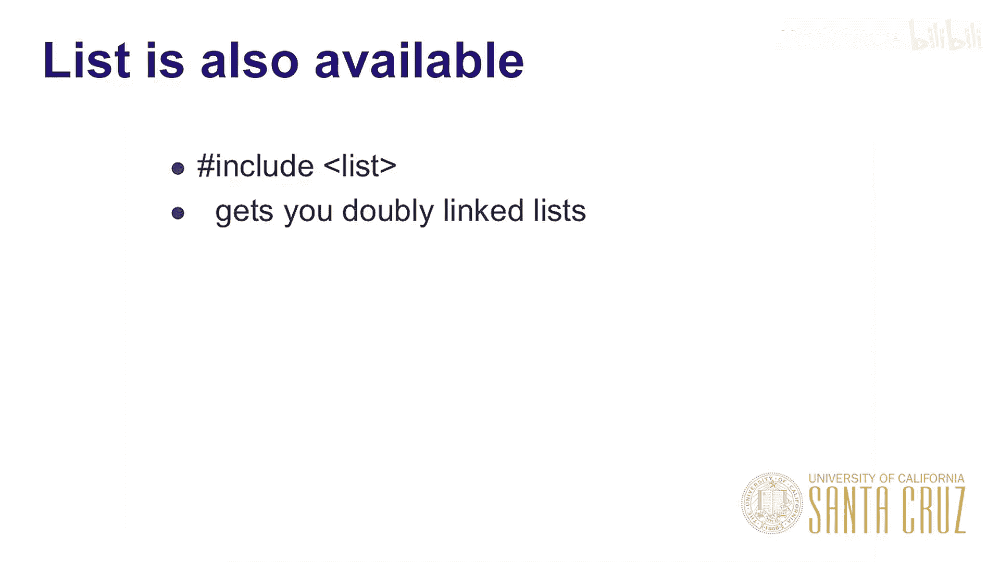
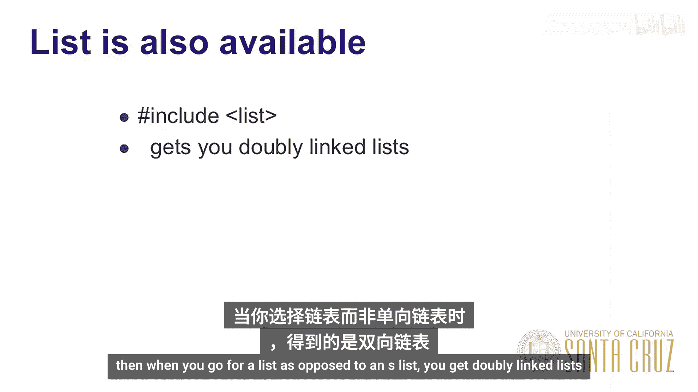
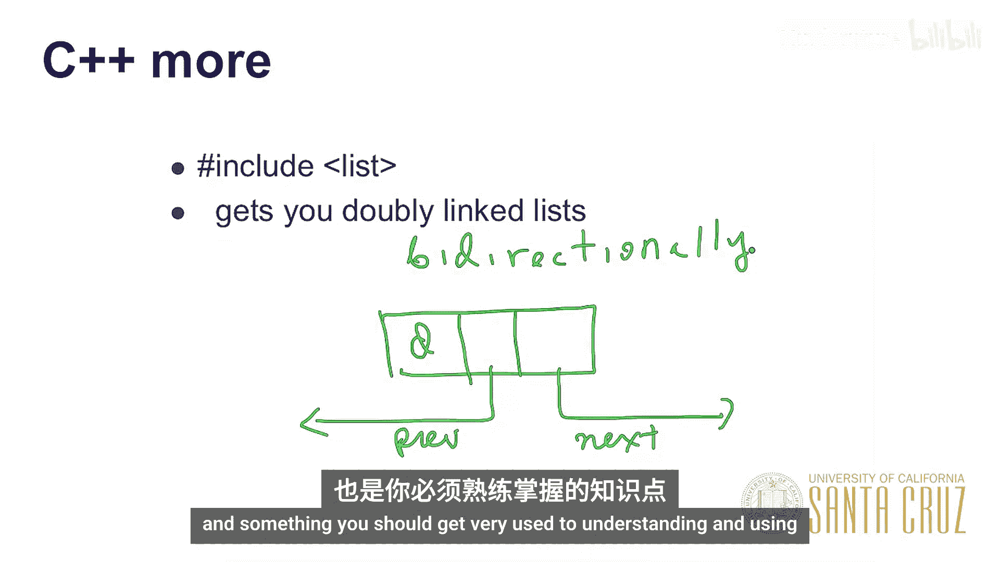
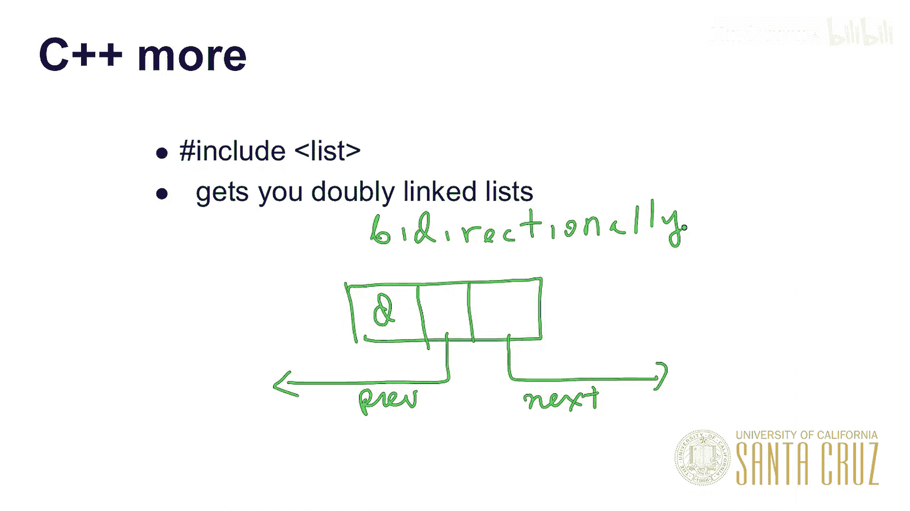
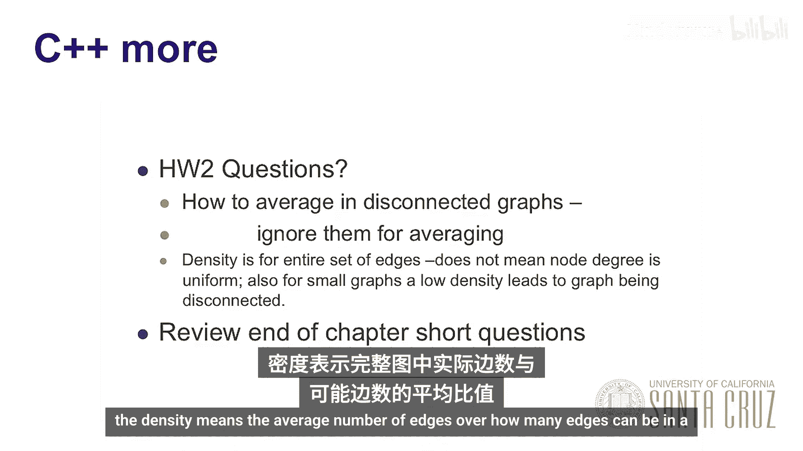

# 032：STL中的动态数据结构

在本节课中，我们将要学习C++标准模板库（STL）中的两种核心动态数据结构：`vector`和`list`。我们将探讨它们的工作原理、适用场景以及如何在实际编程中有效地使用它们。

## 理解和使用列表（List）

上一节我们介绍了链表的基本概念，本节中我们来看看如何实际操作一个列表结构。

你可以对一个列表结构进行多种操作。你需要真正理解它的工作原理，特别是要理解删除操作何时发生。

以下是操作列表的一些关键点：
*   你可以尝试在堆上动态创建列表。例如，使用 `new list`，然后原则上必须使用 `delete list` 来释放内存。
*   或者，当列表对象超出作用域时，其析构函数会被自动调用。
*   如果你希望，可以在析构函数中添加打印语句，以便实际观察其何时被调用。如果这个概念对你来说是全新的，这将非常有用。

我建议你对此进行大量练习。另一件非常有用的练习是，回忆我要求大家具备基础的计算机科学和数据结构知识。所有具备该背景的同学，都应该能够轻松地将之前提到的单链表转换为双链表。

## 标准模板库（STL）中的容器

现在，我们进入下一个主题：标准模板库。STL确实包含列表容器。实际上，在C++11及以后的版本中，它同时包含了单链表（`forward_list`）和双链表（`list`）。

但STL中最主要的数据结构，也是我希望大家重点学习的，是**向量（vector）**。

## 向量（Vector）：最常用的容器

从我的角度来看，**向量（vector）** 能为你提供90%的价值。所以，如果你学会了使用 `vector`，你就掌握了容器类（或者更准确地说，顺序容器类）90%的精髓。

在传统的C语言中，我们使用非常原始的原生数组来处理一切。原生数组非常基础。请记住，C语言是一种系统实现语言，并非用于大量数据处理，因此里奇（Ritchie）并未投入太多精力让数组变得易于使用。所以，数组本质上只是一个指针，指向一块分配好的内存。这块内存可以通过 `calloc` 或 `malloc` 从堆上分配，也可以通过基于栈的特定声明（在栈入口处已知一个整数常量大小的内存）来分配。这是一个非常简单的方案，因为作为系统实现语言，它不需要更复杂的功能，但对于进行非常复杂、数据密集的计算来说，这远远不够且容易出错。

因此，最早也是最成功的容器类型之一，就是对数组的一种抽象。在这种抽象中，你不仅拥有动态调整数组大小的能力，还拥有确保不会发生任何索引错误的方法，因为你可以知道向量的起始和结束位置。

所以，成为一个真正的C++程序员的建议是：放弃使用基础的C语言数组，并将所有相关的处理转换为使用 `vector`。

## 列表（List）与向量（Vector）的对比

STL中也有**列表（list）**，它是另一种顺序容器。当你选择 `list` 而不是 `forward_list` 时，你得到的是双链表。双链表看起来就像我们刚才查看的代码，区别在于每个节点会包含一个数据元素、一个指向前驱节点的指针（`previous pointer`）以及一个指向后继节点的指针（`next pointer`）。这使得可以双向遍历链表，让许多算法变得更加方便，因为有时你可能需要停止然后回退，而不希望总是必须从链表的开头重新开始。

因此，**列表（list）** 非常适合于插入和删除等操作。但是，当你需要获取链表中深处第N个元素时，它的效率就不高了，因为这是一个O(n)复杂度的计算。相比之下，**向量（vector）** 进行此类查找是O(1)复杂度，效率非常高。

所以，在一般的数据处理领域，**向量（vector）** 往往占据主导地位，因为它具有随机访问的能力。但是，**列表（list）** 在需要频繁进行插入和删除操作，并且数据集可能扩张也可能收缩的场景中，有着非常重要的用途。在这种情况下，效率的天平会从 `vector` 向 `list` 倾斜。实际上，更复杂的操作通常会同时使用这两种类型的容器类。这些在STL中都是可用的，你应该逐渐习惯使用它们。

## 关于课程项目的讨论

如果你在论坛上，可能想讨论一下我们如何完成作业二。记住，作业二是实现迪杰斯特拉（Dijkstra）最短路径算法，其中你需要随机生成图。这些图不仅是随机生成的，还具有一个“密度”参数。密度指的是平均边数占完全图可能边数的比例。

在一个大小为 `n` 的完全图中，从任何节点出发最多可以有 `n-1` 条边。如果你想要10%的密度，那么平均每个节点将拥有10%的边数。例如，如果你有101个节点，10%的密度意味着平均每个节点大约有10条边。这将作为我们用于测试迪杰斯特拉算法的图生成算法的一个输入参数。

## 总结

本节课中我们一起学习了C++ STL中的两种核心动态数据结构。我们了解了**向量（vector）** 作为动态数组的抽象，提供了高效的随机访问和动态大小调整，是大多数场景下的首选。我们也探讨了**列表（list）** 作为双链表的实现，在频繁插入和删除操作中表现出色。理解它们各自的优势和适用场景，并学会在编程实践中合理选择，是掌握C++高效数据处理的关键一步。