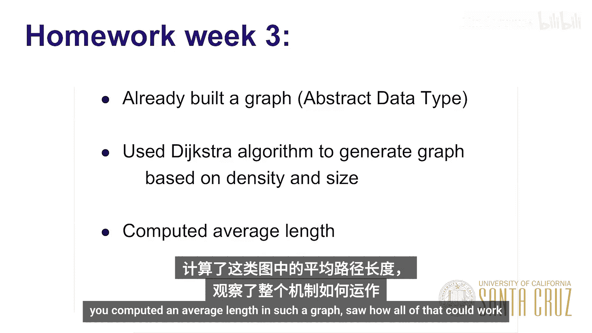
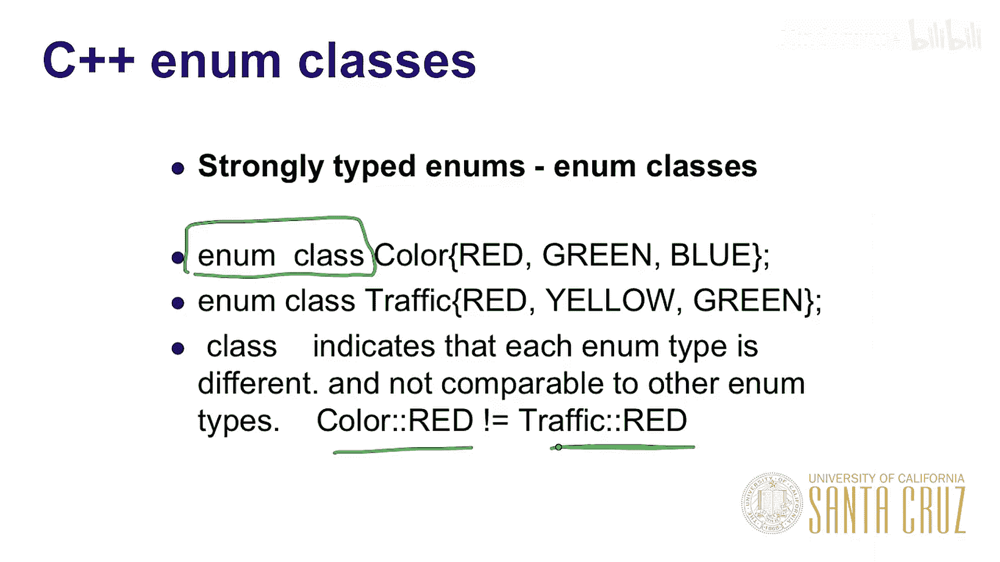

# 033：最小生成树（MST）


## 概述

在本节课中，我们将要学习**最小生成树**算法。这是继Dijkstra算法之后的下一个重要算法，也是第三次作业的基础。我们将继续使用图这一抽象数据类型，并在此基础上添加新的功能。同时，我们也会探讨C++中的面向对象编程，特别是如何通过自定义类型（如`class Point`）和枚举类型来增强代码的结构性和安全性。

上一节我们完成了Dijkstra算法的实现，对图的处理有了一定的熟悉度。本节中我们来看看如何构建一个连接图中所有节点的、总成本最小的树状结构。

## 最小生成树定义

首先，我们需要明确什么是生成树。一个生成树是图中一个边的子集，它满足两个条件：
1.  它连接了图中的**所有节点**。
2.  它不包含任何**环**。

对于一个有 **n** 个节点的图，其生成树恰好包含 **n-1** 条边。

在此基础上，**最小生成树** 是指在所有可能的生成树中，其所有边的**权重（或成本）之和最小**的那一棵。每条边都有一个正的成本值。



在本次作业中，我们还会为边添加一个额外的属性：**颜色**。一条边可以是红色、蓝色或绿色。这意味着问题将变为：寻找满足特定颜色要求（例如，所有边都是绿色，或包含红蓝两色）的最小生成树。这增加了问题的复杂性，也更能体现C++编程中类型处理的能力。

## 关于枚举类型的测验

为了处理边的颜色，我们需要使用C++的枚举类型。让我们先通过一个小测验来回顾相关知识。

假设我们有一个简单的枚举类型定义：
```cpp
enum Color {RED, BLUE, GREEN};
```

以下是几个问题：
1.  为什么枚举值（如`RED`）通常用大写字母？
2.  在这个定义中，`GREEN`的内部值是多少？
3.  如何重载输出操作符`<<`来打印`Color`类型的值（例如打印出“RED”）？

现在，我们来逐一解答。

首先，使用大写字母是编程社区的一种约定，用于标识常量。这继承了C语言的风格，有助于在代码中快速识别常量。

其次，枚举值默认从0开始顺序赋值。因此，`RED`是0，`BLUE`是1，`GREEN`是2。

最后，重载输出操作符`<<`有一个固定的惯用格式。我们需要返回一个`ostream&`的引用，以支持链式输出。

以下是重载`<<`操作符打印`Color`类型的示例代码：
```cpp
std::ostream& operator<<(std::ostream& os, const Color& c) {
    switch(c) {
        case RED: os << "RED"; break;
        case BLUE: os << "BLUE"; break;
        case GREEN: os << "GREEN"; break;
        default: os << "Unknown Color";
    }
    return os;
}
```

## C++11中的强类型枚举

在传统的C++枚举中，不同的枚举类型在底层都是整数，它们之间可能发生意外的比较和转换，这可能导致错误。

C++11引入了**枚举类**，它提供了更强的类型安全。使用`enum class`定义的枚举，其枚举值是独立的类型，不能隐式转换为整数，也不能与不同枚举类型的值进行比较。

以下是一个例子，展示了传统枚举与枚举类的区别：
```cpp
// 传统枚举 - 类型不安全
enum Color {RED, BLUE, GREEN};
enum TrafficLight {RED, YELLOW, GREEN}; // 错误！RED和GREEN重定义

// C++11 枚举类 - 类型安全
enum class Color {RED, BLUE, GREEN};
enum class TrafficLight {RED, YELLOW, GREEN}; // 正确，作用域不同

Color c = Color::RED;
TrafficLight t = TrafficLight::RED;
// if (c == t) ... // 错误！无法比较不同的枚举类类型
// int i = c; // 错误！不能隐式转换为int
int j = static_cast<int>(c); // 正确，需要显式转换
```

使用`enum class`可以避免命名冲突，并使代码的意图更清晰、更安全。在实现本次作业的颜色功能时，推荐使用枚举类。

## 总结

本节课中我们一起学习了最小生成树的基本概念，它是一棵连接图中所有节点且总边权最小的树。我们明确了生成树必须包含n-1条边且无环。本次作业的特别之处在于引入了边的颜色属性，这要求我们在寻找MST时考虑额外的约束条件。

为了处理颜色，我们回顾了C++中的枚举类型，并重点介绍了C++11提供的、更安全的`enum class`（枚举类）。枚举类能防止不同枚举类型之间的意外比较和转换，提升了代码的健壮性。我们还学习了如何为自定义枚举类型重载输出操作符`<<`，以便进行方便的打印。



这些知识将为完成第三次作业——实现一个考虑颜色约束的最小生成树算法——打下坚实的基础。接下来，你就可以开始构思如何将颜色作为边的一个属性，并修改经典的MST算法（如Prim或Kruskal算法）来满足新的要求了。