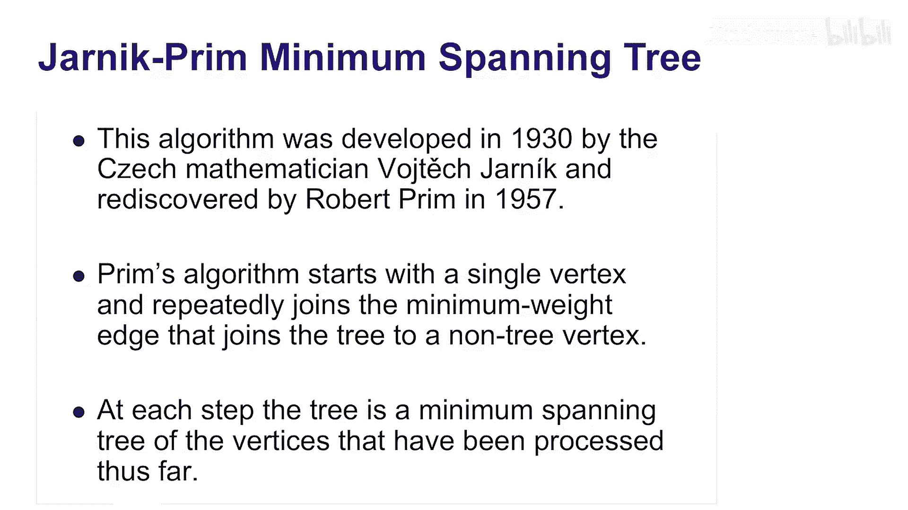
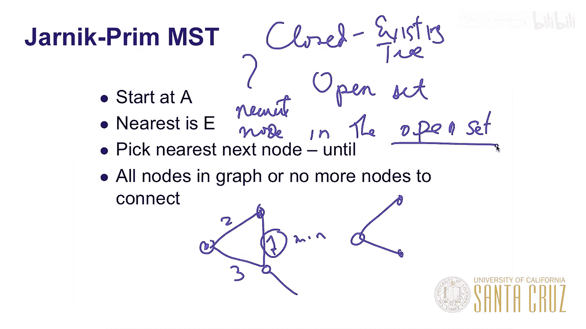
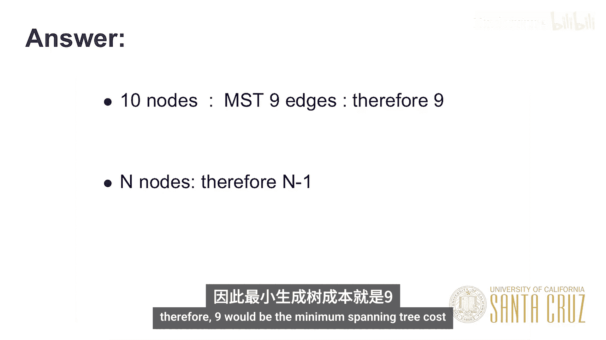
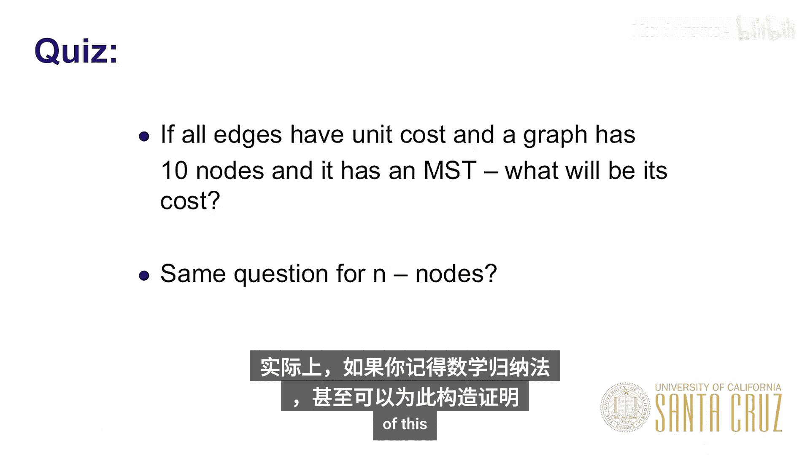

# 034：Jarnik-Prim算法详解

在本节课中，我们将详细讨论最小生成树算法。我们将重点介绍Jarnik-Prim算法，并将其与Kruskal算法进行比较，以便理解它们的工作原理和适用场景。

## 算法起源与背景

最小生成树算法最早由捷克数学家Jarnik在1930年的一篇论文中提出。然而，由于该论文在当时较为冷门，工程师和计算机科学家通常将首次应用此方法的算法归功于Prim，他在1957年重新发现并发表了该算法。

我们将把这个算法与另一个由离散数学家和计算机科学家Kruskal在大致同一时期发现的算法进行比较。虽然这两种算法都能给出正确的结果，但在某些情况下，其中一种可能比另一种更高效。它们各有优势，因此同时掌握两种算法的实现是有益的。

## Prim算法核心思想

Prim算法从一个**单个顶点**开始构建生成树。例如，你可以选择顶点A（或在C语言风格的表示中，顶点0）作为起点。

算法的核心步骤是：从当前已构建的树（称为“闭合集”）出发，寻找连接该树与外部顶点（“开放集”）的**权重最小的边**，并将该边及其连接的顶点加入树中。

**算法公式化描述**：
1.  初始化：选择任意顶点 `v` 加入树 `T`。
2.  循环，直到 `T` 包含所有顶点：
    *   在连接 `T` 内顶点与 `T` 外顶点的所有边中，找到权重最小的边 `e = (u, w)`，其中 `u` 在 `T` 内，`w` 在 `T` 外。
    *   将边 `e` 和顶点 `w` 加入树 `T`。
3.  最终，`T` 即为最小生成树。

**重要注意事项**：如果从起始顶点出发没有边（即图不连通），则图不存在最小生成树。在实现算法时，需要处理这种情况，例如通过返回一个特殊值（如极大整数、负数或NaN）来报告图是不连通的。

## 算法图解与步骤分析

上一节我们介绍了Prim算法的核心思想，本节中我们通过一个具体例子来一步步分析其执行过程。

假设我们有以下带权图，并选择顶点A作为起点：

以下是算法的执行步骤：

1.  **起点**：从顶点A开始。闭合集 = {A}。
2.  **第一步**：从A出发，可达的边有A-E（权重2）和A-F（权重2）。我们选择A-E（可任意打破平局）。闭合集更新为 {A, E}，累计成本 = 2。
3.  **第二步**：现在，连接闭合集{A, E}与外部顶点的边有：E-G（4）、E-D（6）、E-I（4）、A-F（2）。最小权重为2，选择边A-F。闭合集更新为 {A, E, F}，累计成本 = 2 + 2 = 4。
4.  **第三步**：连接闭合集{A, E, F}与外部顶点的边有：E-G（4）、E-D（6）、E-I（4）、F-I（5）。最小权重为4，选择边E-G（或E-I，可打破平局）。闭合集更新为 {A, E, F, G}，累计成本 = 4 + 4 = 8。
5.  **第四步**：连接闭合集{A, E, F, G}与外部顶点的边有：E-D（6）、E-I（4）、F-I（5）、G-H（3）。最小权重为3，选择边G-H。闭合集更新为 {A, E, F, G, H}，累计成本 = 8 + 3 = 11。
6.  **第五步**：连接闭合集{A, E, F, G, H}与外部顶点的边有：E-D（6）、E-I（4）、F-I（5）、H-D（5）、H-I（4）。最小权重为4，选择边H-I（或E-I）。闭合集更新为 {A, E, F, G, H, I}，累计成本 = 11 + 4 = 15。
7.  **第六步**：连接闭合集{A, E, F, G, H, I}与外部顶点的边有：E-D（6）、H-D（5）、I-D（4）。最小权重为4，选择边I-D。闭合集更新为 {A, E, F, G, H, I, D}，累计成本 = 15 + 4 = 19。

此时，我们得到了 **n-1 = 6 条边**，构成了一个完整的最小生成树，总成本为19。

## 算法特性总结

通过以上过程，我们可以总结Prim算法的几个关键特性：

*   **贪心策略**：算法每一步都选择当前看来最优的边（权重最小），这是一种典型的贪心算法，与Dijkstra最短路径算法类似。
*   **避免环路**：算法只考虑从已构建的树（闭合集）连接到外部顶点的边，永远不会回头连接树内部的顶点，因此自然避免了环路的产生。
*   **构建单一组件**：Prim算法从一个顶点开始，逐步扩展成一个单一的连通树。这与Kruskal算法不同，后者可能同时维护多个子树（森林），最后再合并。

## 理解测验

为了检验你对算法的理解，请思考以下问题：

> 如果一个具有10个顶点的连通图，其所有边的权重均为1，那么它的最小生成树的总成本是多少？

根据最小生成树的定义，一个包含n个顶点的树有 **n-1** 条边。因此，对于10个顶点的图，最小生成树需要9条边。由于每条边成本为1，总成本就是 **9**。

将其推广：对于一个具有 **N** 个顶点、边权均为1的连通图，其最小生成树的总成本为 **N-1**。

## 课程总结

本节课中我们一起学习了Jarnik-Prim最小生成树算法。我们了解了它的历史背景、核心思想以及逐步执行过程。关键点在于，Prim算法从一个顶点出发，以贪心的方式不断选择连接当前树与外部顶点的最小权重边，从而逐步构建出最小生成树。我们还通过一个具体例子和测验加深了对算法原理和结果的理解。在后续课程中，我们将学习另一种构建最小生成树的方法——Kruskal算法。