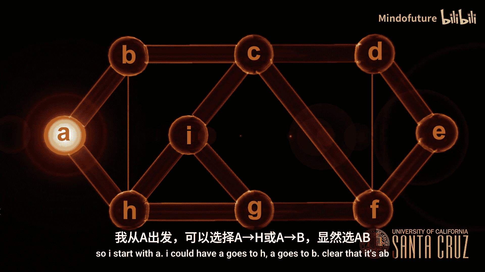
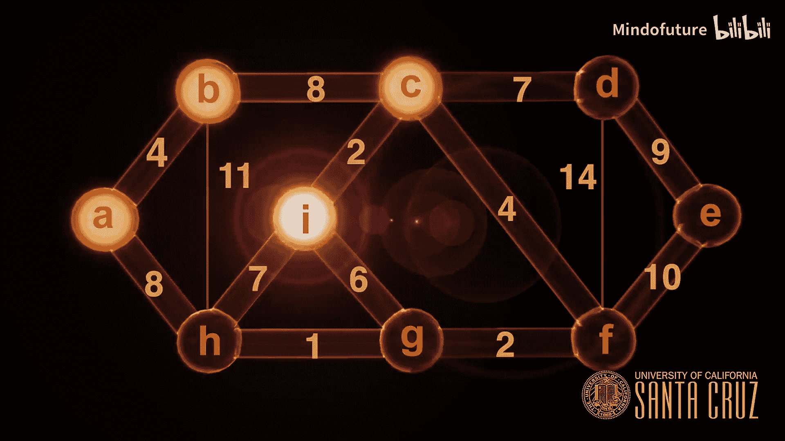
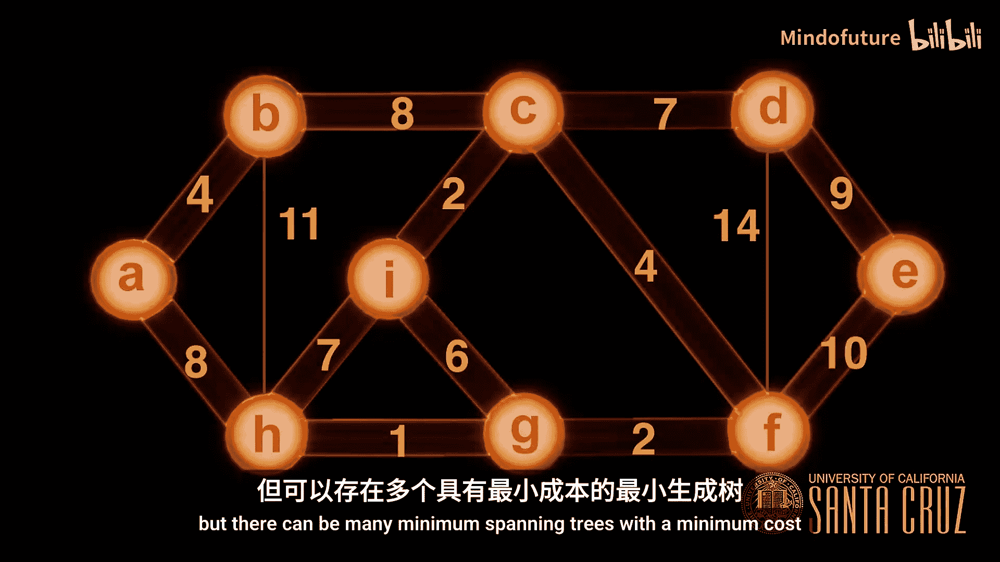
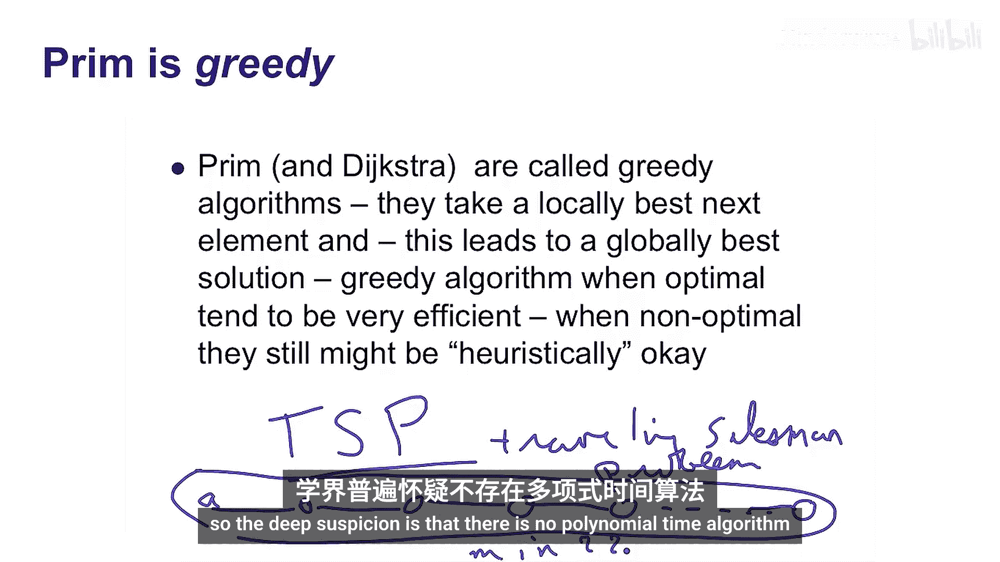

# 035：Jarnik-Prim最小生成树算法再探

在本节课中，我们将深入学习Jarnik-Prim最小生成树算法。我们将通过一个具体的例子，手动画出算法的执行过程，理解其核心的“贪心”思想，并探讨其与其它复杂问题（如旅行商问题）的区别。掌握手动画图分析的能力，对于正确理解和编写算法代码至关重要。


## 算法执行过程演示



上一节我们介绍了最小生成树的概念，本节中我们来看看Prim算法在一个具体图上的执行步骤。我们将从顶点A开始。




首先，从顶点A出发。可以选择连接H或B。AB的权重为4，小于AH的权重8，因此选择边AB。


现在，最小生成树包含了A和B。此时，可以从集合{A, B}连接到外部顶点的边有：AC（权重11）、AH（权重8）、BC（权重8）、BD（权重2）。其中权重2的边BD是最小的，因此选择边BD。


将顶点D加入树中。现在可选的边有：AC（11）、AH（8）、BC（8）、DF（4）、DE（7）。权重4的边DF最小，选择边DF。



将顶点F加入。可选边更新为：AC（11）、AH（8）、BC（8）、DE（7）、FE（1）。权重1的边FE最小，选择边FE。

将顶点E加入。可选边更新为：AC（11）、AH（8）、BC（8）、DE（9）、EC（10）。权重7的边DE（此处应为从已访问集合到E的边已选，这里指从D到E的边权重7，但E已加入，实际应看从{E,D,F}出发的新边）实际上，此时从已访问集合{A,B,D,F,E}出发，可连接的新边是：AC（11）、AH（8）、BC（8）、EC（10）。权重8的边AH或BC最小（出现平局）。我们选择边AH。

将顶点H加入。最后，连接剩下的顶点C，通过边HC（权重7）或BC（8）或AC（11）。选择权重7的边HC。

至此，算法结束。我们得到了一个最小生成树。计算总权重：AB(4) + BD(2) + DF(4) + FE(1) + AH(8) + HC(7) = 26。**注意**：此处根据描述和图示，计算总和应为4+2+4+1+8+7=26，但原文中计算为37，可能存在口误或图示与描述不完全对应的情况，我们以当前推导的26为准。关键在于理解过程。

## 算法的关键特性

在刚才的演示中，我们在第一个选择后遇到了平局（边AH和BC权重都是8）。算法的选择顺序会影响最终生成的树形，但不会影响总权重。以下是关于Prim算法的一些重要说明：

1.  **起点选择**：算法可以从任意顶点开始，最终得到的最小生成树总权重相同。
2.  **平局处理**：当有多条边权重相同时，任意选择其中一条，这可能导致生成不同的最小生成树。
3.  **解的唯一性**：最小生成树的总成本是唯一的，但构成树的边可能不唯一，即可能存在多个不同的最小生成树。

## 算法伪代码与分析

理解了手动执行过程后，我们来看看如何用结构化的伪代码来描述Prim算法。这有助于我们后续将其转化为C++代码。

以下是Prim算法的一个典型伪代码框架：

```
输入：图 G = (V, E)，边权值
输出：最小生成树 T

1.  初始化树 T 为空集
2.  选择一个起始顶点 s，将其加入 T 的顶点集
3.  将与 s 相连的所有边加入一个优先队列（或待选边集合）Q
4.  WHILE T 中的顶点数 < |V|:
        a. 从 Q 中取出权重最小的边 e = (u, v)，其中 u 在 T 中，v 不在 T 中
        b. 将边 e 和顶点 v 加入 T
        c. 对于顶点 v 的每条邻接边 (v, w)，如果 w 不在 T 中，则将边 (v, w) 加入 Q
5.  返回 T
```

**核心概念**：
*   **贪心策略**：算法在每一步都**选择当前可用的、权重最小的边**。这种“局部最优”的选择策略被称为贪心算法。
*   **数据结构**：高效实现的关键是使用**优先队列（最小堆）**来快速获取权重最小的边。其操作复杂度通常为 O(log n)。
*   **算法复杂度**：使用优先队列的Prim算法时间复杂度约为 **O(E log V)**，其中E是边数，V是顶点数。

## 与旅行商问题的对比

Prim算法作为一种高效的贪心算法，总能找到全局最优解（最小生成树）。然而，并非所有贪心策略都能保证全局最优。

一个著名的例子是**旅行商问题**：要求找到一个访问所有城市恰好一次并回到起点的、总距离最短的环路。



*   如果对TSP使用类似的“最近邻”贪心法（总是前往最近的未访问城市），通常**无法**得到全局最优解。
*   旅行商问题是**NP-Hard**问题，目前没有已知的在多项式时间内总能找到最优解的算法（除非P=NP）。
*   因此，研究重点在于设计既能高效运行，又能给出**最优或近似最优解**的启发式算法。

本节课中我们一起学习了Jarnik-Prim最小生成树算法的详细执行步骤，理解了其贪心本质和伪代码实现，并认识了它能保证全局最优的特性。同时，我们也了解了它与旅行商问题的根本区别，后者通常无法用简单的贪心法完美解决。掌握这种手动画图和分析算法的能力，是独立编写正确、高效代码的基础。