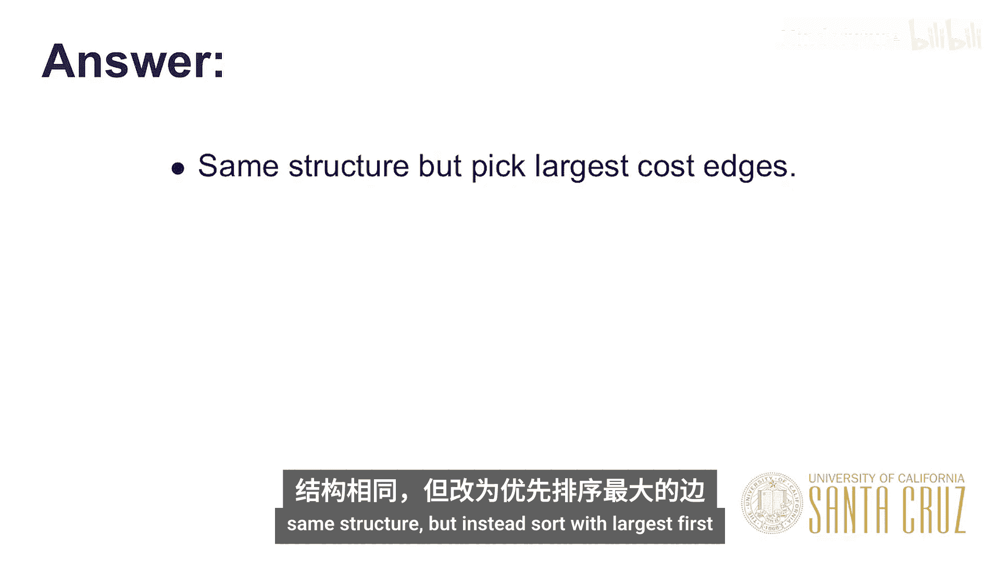

# 036：Kruskal算法 🧩

在本节课中，我们将要学习Kruskal算法。这是一种用于在加权连通图中寻找最小生成树的贪心算法。我们将了解它的工作原理、它与Prim算法的区别，并通过一个例子来演示其执行过程。

## 算法核心思想 🌲

上一节我们介绍了Prim算法，它从一个顶点开始逐步扩展生成树。本节中我们来看看Kruskal算法，它的思路有所不同。

Kruskal算法并不计算单一的连通分量。Prim算法是计算一个单一的连通分量，其贪心思想是选择连接当前生成树和外部顶点的最小权重边。Kruskal算法则构建一个森林，即一组树。初始时，每个顶点都被视为一个独立的单节点树，它们尚未连接。当你添加一条边时，你选择森林中的两棵树，并将它们合并成一个连通分量。

## 算法步骤 📝

以下是Kruskal算法的基本步骤：

1.  **初始化**：将图中的所有边按权重从小到大排序。
2.  **创建森林**：将每个顶点初始化为一个独立的树（即一个独立的集合）。
3.  **迭代添加边**：按顺序检查排序后的边列表。对于每条边，检查它连接的两个顶点是否属于森林中不同的树。
    *   如果属于不同的树，则添加这条边，将两棵树合并。
    *   如果属于同一棵树（即添加后会形成环路），则丢弃这条边。
4.  **终止条件**：当添加的边数达到 `顶点数 - 1` 时，算法结束，此时森林合并为一棵树，即最小生成树。

## 算法复杂度与关键点 ⚙️

Kruskal算法的核心操作是排序和检查环路。对 `E` 条边进行排序的时间复杂度为 **O(E log E)**。检查两个顶点是否属于同一棵树（即是否形成环路）通常使用**并查集**数据结构来实现，其单次操作的均摊时间复杂度接近常数。因此，算法的总时间复杂度主要由排序步骤决定。

为什么不能简单地选择排序后前 `n-1` 条最小的边来构成生成树？因为这些边可能会在已形成的连通分量内部形成环路，从而破坏树的结构。因此，算法必须包含检查环路的步骤。

## 实例演示 🎯

让我们通过一个具体的图来演示Kruskal算法的执行过程。假设我们有以下带权图，边已按权重排序：

*   AD (5)
*   CE (5)
*   DF (6)
*   AB (7)
*   BE (7)
*   EF (8)
*   BC (8)
*   BD (9)
*   EG (9)
*   FG (11)
*   DE (15)

**执行过程：**

1.  初始时，所有顶点都是独立的树。
2.  选择最小边 **AD (5)**。添加，森林中A和D合并。
3.  选择下一条边 **CE (5)**。添加，C和E合并（与AD所在的树无关）。
4.  选择下一条边 **DF (6)**。添加，D（已与A连接）和F合并。
5.  选择下一条边 **AB (7)**。添加，A（已与D、F连接）和B合并。
6.  选择下一条边 **BE (7)**。添加，B（已与A、D、F连接）和E（已与C连接）合并。**此时，森林中大部分顶点已连通。**
7.  选择下一条边 **EF (8)**。检查发现，E和F已经属于同一棵树（通过B-A-D-F路径连通）。添加此边会形成环路，因此**丢弃**。
8.  选择下一条边 **BC (8)**。检查发现，B和C已经属于同一棵树（通过B-E-C路径连通）。添加此边会形成环路，因此**丢弃**。
9.  选择下一条边 **BD (9)**。检查发现，B和D已经属于同一棵树。添加此边会形成环路，因此**丢弃**。
10. 选择下一条边 **EG (9)**。添加，E（已在树中）和G合并。
11. 此时，已添加的边数为 6（AD, CE, DF, AB, BE, EG），恰好等于顶点数7减1。算法结束。

最终得到的最小生成树总权重为 5 + 5 + 6 + 7 + 7 + 9 = **39**。

## 与Prim算法的对比 🔄

使用Prim算法从顶点A开始，最终也会得到总权重为39的生成树，但边的添加顺序不同。Prim的添加顺序可能是：AD(5), DF(6), AB(7), BE(7), CE(5), EG(9)。这体现了两种算法构建过程的差异：Prim是“由点及面”的扩展，而Kruskal是“由边及体”的合并。

## 算法的变体：最大生成树 ❓

如何修改Kruskal算法来寻找**最大生成树**（即权重和最大的生成树）？思路非常简单：只需在第一步排序时，将边按权重从大到小排序即可。算法的其余逻辑（检查环路、合并树）完全不变。这样，算法就会优先添加权重最大的有效边，最终得到最大生成树。

## 总结 📚

本节课中我们一起学习了Kruskal算法。我们了解到它是一种基于边的贪心算法，通过排序所有边并利用并查集高效检查环路，来构建最小生成树。它与Prim算法目标一致，但策略不同：Kruskal维护一个不断合并的森林，而Prim维护一个不断生长的单树。理解这两种经典算法，能帮助我们更深入地掌握图论中最小生成树问题的求解思路。