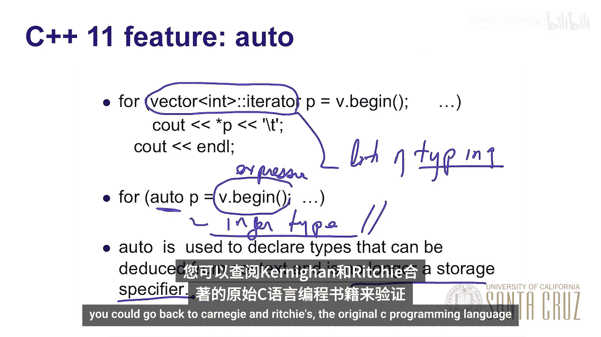
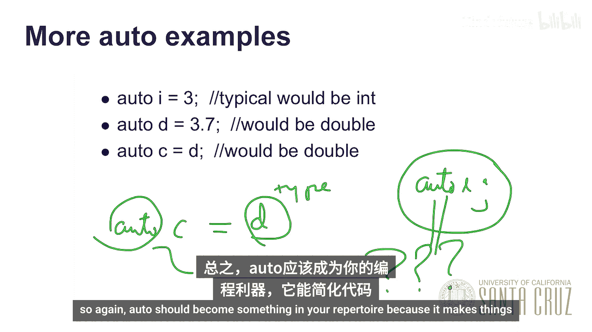
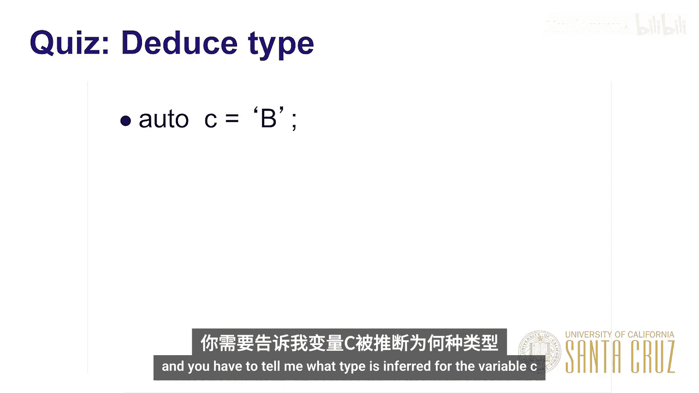
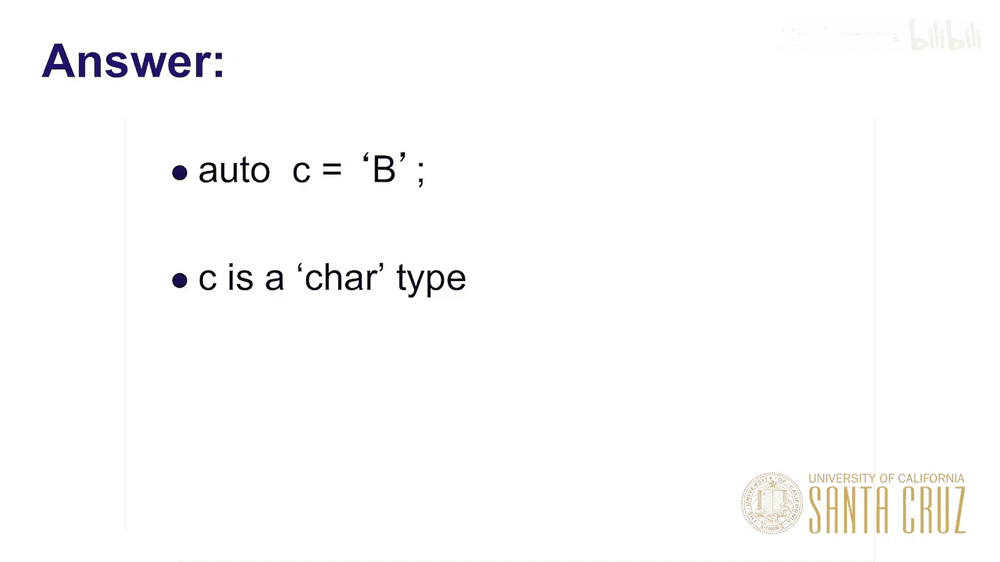
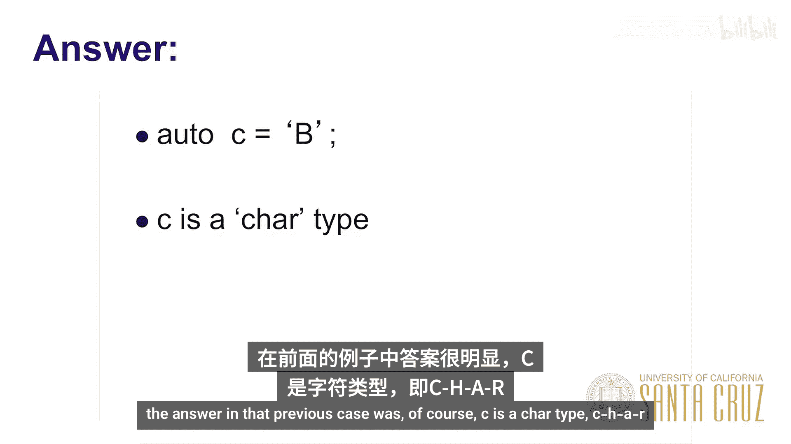
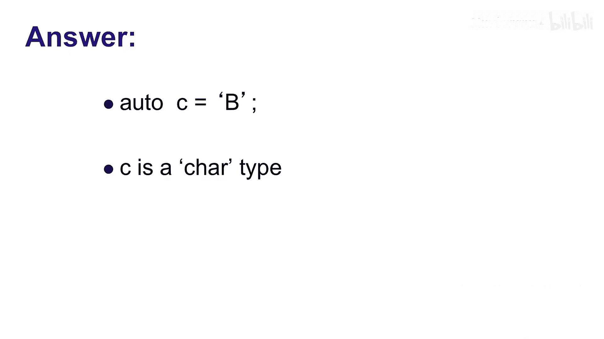

# 040：C++11 auto关键字 🚀

在本节课中，我们将要学习C++11标准引入的一个重要新特性：`auto`关键字。我们将了解它的作用、用法以及它如何简化我们的代码。

## 从C++11开始

现在，请注意，C++11标准带来了许多新特性，它允许我们以更便捷的方式改变编程习惯。我将开始向你展示这一点。在接下来的学习中，我们会看到新旧风格的结合。

你需要记住，在未来几年，我们将看到越来越多的编译器兼容新标准。你应该能够开始真正利用它。目前，GCC编译器的当前版本（我相信是4.8）已经开始广泛使用，并且它实现了新标准的大部分特性。

## 简化复杂声明

以下是`auto`如何简化一个相当繁琐、需要大量输入的声明。这里的“大量输入”不仅指击键次数，也指确保类型正确。在这种复杂的语法中，很容易出错或遗漏某些内容。

现在，`auto`关键字有了新的含义。它在原始C语言中的含义已被**弃用**（deprecated）。在编程语言标准委员会的术语中，“弃用”意味着不再被支持。

因此，`auto`的含义已被完全改变。现在，`auto`意味着**推断类型**。这意味着类型必须是可推断的，如果无法理解类型，`auto`将无法工作。但如果存在理解类型的方法，它就能工作。

例如，对于表达式 `vector<int>::iterator`，编译器知道这个表达式的类型。在编译器知道类型的地方，你无需明确指定它，只需说 `auto`。这方便得多，让编译器安全地完成这项工作。

## `auto`的历史与现在

在非常早期的C语言中，`auto`被称为**存储说明符**（storage specifier）。在C的早期，它表示“自动将此变量放在栈上”。实际上，在大多数情况下，没有人使用它，因为它是冗余的。你会直接写 `int i` 而不是 `auto int i`。

所以旧的用法从未被真正使用。你可以回溯到Kernighan和Ritchie的原始C语言编程书籍，尝试在书中找到`auto`的任何实际用例。据我所知，他们在定义该语言的原始书中没有在任何真实代码中包含`auto`。

## `auto`的使用示例

以下是一些关于`auto`如何使用的更多示例，它们相当直接。当然，还有更复杂的例子，你可以看到类型推断是如何工作的。

1.  **替代 `int i`**:
    ```cpp
    auto i = 42; // 推断为 int
    ```



2.  **替代 `double d`**:
    ```cpp
    auto d = 3.14; // 推断为 double
    ```

3.  **替代复杂类型声明**:
    ```cpp
    auto it = myVector.begin(); // 推断为 vector<int>::iterator
    ```

让我们更详细地看看第三个例子。通常，无论 `myVector.begin()` 返回什么，它都有一个类型。如果这个类型指定起来相当复杂（例如某种模板迭代器类型），那么使用 `auto` 就可以避免重新指定这个可能很复杂的类型。

当然，我们不能只说 `auto i;`。因为没有信息来进行类型推导，这会导致语法错误。

因此，`auto`应该成为你技能库的一部分，因为它能让事情对你来说更简单。

## 一个小测验

为了让你检验理解，这里有一个非常简单的`auto`使用示例。你需要告诉我变量`c`被推断为什么类型。



```cpp
auto c = 'A';
```

**答案**：在上面的例子中，`c`当然被推断为 `char` 类型。





---





本节课中我们一起学习了C++11的`auto`关键字。我们了解到它的核心作用是进行**类型推断**，从而简化变量声明，特别是对于复杂类型。它取代了C语言中已弃用的旧含义，成为了现代C++编程中提高代码简洁性和安全性的重要工具。记住，`auto`让编译器为我们工作，同时保持了类型安全。