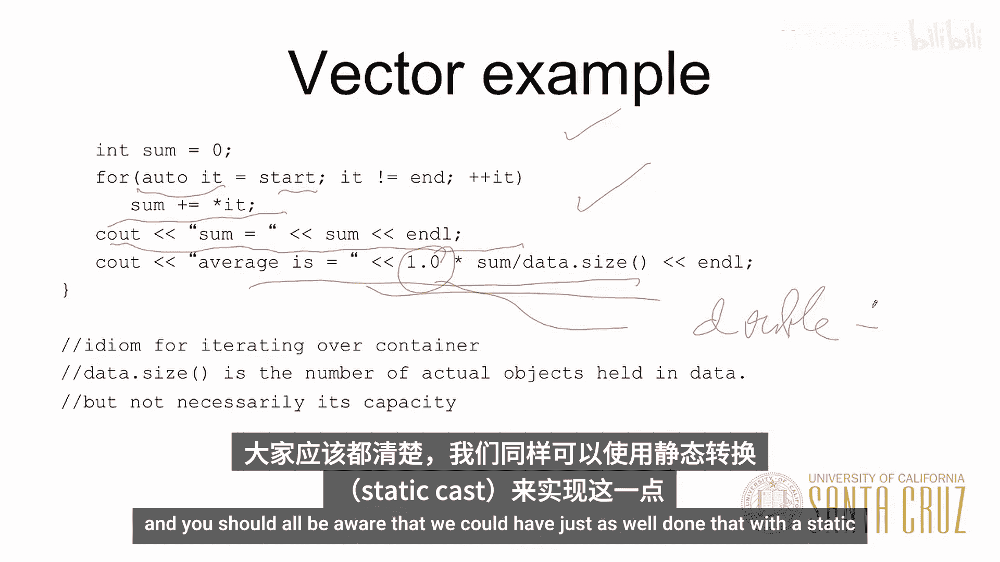

# 042：更多代码示例


在本节课中，我们将学习C++中`auto`关键字和迭代器（iterator）的用法，以及如何利用标准模板库（STL）安全高效地处理数据，例如从文件中读取数据并计算平均值。我们将重点关注如何避免常见的编程错误，如数组越界。

## `auto`关键字与类型推断 🔍

上一节我们介绍了迭代器的基本概念。本节中我们来看看如何简化迭代器的声明。

在C++11中，`auto`关键字被重新定义为一种类型推断机制。它允许编译器根据初始化表达式自动推断变量的类型。这与旧版C语言中`auto`作为存储类说明符的用途完全不同。

例如，在遍历一个存储整数的向量（`vector<int>`）时，我们可以这样声明迭代器：
```cpp
auto it = data.begin();
```
编译器会推断出`it`的正确类型是`std::vector<int>::iterator`。这样，程序员就无需手动写出冗长的类型声明，代码变得更加清晰和简洁。

## 迭代器模式与安全性 🛡️

使用迭代器模式遍历容器（如`vector`）是STL的核心思想之一。它能有效避免使用传统索引时可能出现的“差一错误”（off-by-one error）。

以下是使用迭代器遍历向量的安全方式：
```cpp
for (auto it = data.begin(); it != data.end(); ++it) {
    // 处理 *it
}
```
这种方法通过`begin()`和`end()`函数明确界定范围，完全消除了索引越界的可能性。相比之下，传统的C风格循环：
```cpp
for (int i = 0; i <= upper_bound; ++i) // 潜在错误：使用了 <=
```
如果错误地使用了`<=`，就会访问`upper_bound`之后的内存，导致运行时错误（如段错误）。

## 实战：从文件读取数据并计算平均值 📊

为了展示STL的强大功能，我们将结合文件流和迭代器，从一个文本文件中读取一系列整数（例如海豹体重数据），并计算它们的平均值。

以下是实现此功能的核心步骤：

首先，我们需要包含必要的头文件并打开数据文件：
```cpp
#include <fstream>
#include <vector>
#include <iterator>
// ...
std::ifstream data_file("data.txt");
```

接着，利用STL的强大特性，我们可以直接用文件流迭代器来初始化一个向量：
```cpp
std::vector<int> data((std::istream_iterator<int>(data_file)), std::istream_iterator<int>());
```
这行代码的精妙之处在于：`std::istream_iterator<int>(data_file)`指向文件的开头，而默认构造的`std::istream_iterator<int>()`则作为结束哨兵。STL会读取文件中的所有整数，并动态扩展`vector`来存储它们，我们无需预先知道数据的数量。

最后，我们使用迭代器安全地遍历向量并计算总和与平均值：
```cpp
double sum = 0.0;
for (auto it = data.begin(); it != data.end(); ++it) {
    sum += *it;
}
double average = sum / data.size();
```
注意，在计算平均值时，我们使用`1.0`或`static_cast<double>`来确保进行浮点数除法，从而得到精确的结果。

## 总结 🎯



本节课中我们一起学习了C++中两个重要的现代特性：`auto`关键字和迭代器。`auto`通过类型推断简化了复杂类型的声明。迭代器模式配合`begin()`和`end()`函数，提供了一种安全遍历容器的标准方法，能有效防止数组越界错误。最后，我们通过一个从文件读取数据并计算平均值的完整示例，见证了STL组件（如`vector`、`istream_iterator`）协同工作带来的简洁性与强大功能。掌握这些知识将帮助你写出更安全、更易维护的C++代码。