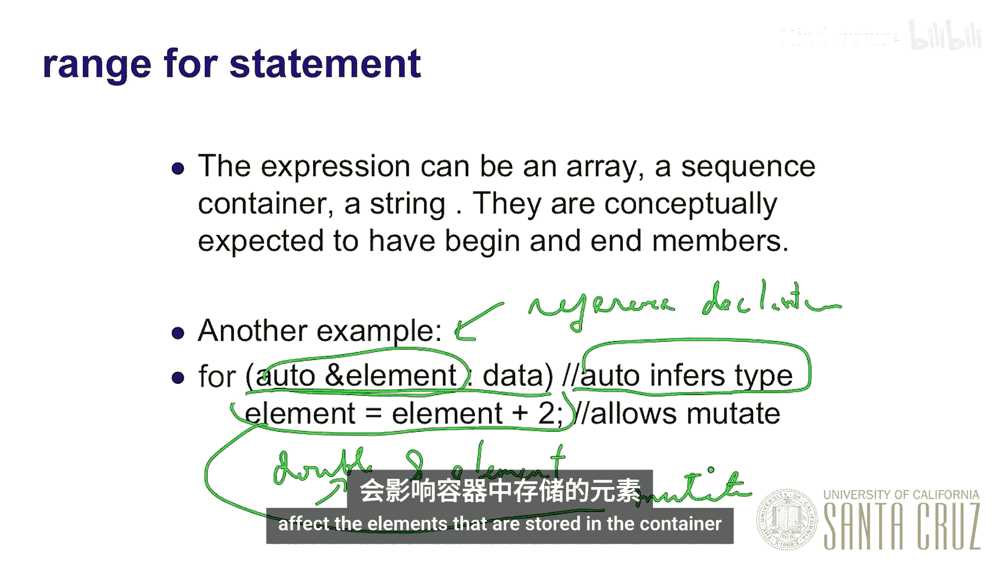

# 043：基于范围的for循环


## 概述
在本节课中，我们将要学习C++11标准引入的一个新特性：基于范围的for循环。这个特性旨在简化遍历数组、容器等聚合数据结构的代码编写，使其更直观、更易于使用。

## 新特性的引入
上一节我们介绍了C++11中的`auto`关键字。本节中我们来看看另一个能显著简化代码的C++11特性。

C++11标准声称，新版本的语言比旧版本更易于使用。这初看可能有些矛盾，因为新标准增加了约60%的内容，描述文档从约800页扩展到了约1300页。虽然新语言中确实包含一些复杂的部分，但也引入了许多像`auto`这样的特性，能让代码编写变得更自然、更直观。基于范围的for循环就是其中之一。

## 基于范围的for循环语法
以下是基于范围的for循环的基本语法结构：
```cpp
for (declaration : expression) statement
```
其中，`declaration`是循环内的一个声明。`expression`是某个表达式。`statement`是要执行的语句，当然，它可以是一个用花括号包裹的代码块，以实现复杂的逻辑。

## 简单示例：求和
让我们通过一个简单的例子来理解它的用法。

以下是一个使用基于范围的for循环对数组元素求和的示例：
```cpp
for (double d : data) sum += d;
```
在这个例子中，`double d`是一个声明，它定义了一个局部变量`d`。`data`是一个表达式，例如，它可以是一个`double`类型的数组。假设这个数组被声明为`double data[UPPER_BOUND];`，其中`UPPER_BOUND`是100，那么数组中就存放了100个`double`类型的数据。

这个for循环的作用是遍历数组`data`中的所有元素。变量`d`会依次被赋值为数组中的每个元素（可以想象成`d = data[i++]`，其中`i`是一个隐式的索引游标），然后将`d`的值累加到`sum`中。

## 与传统迭代方式的对比
这种写法甚至比使用`begin()`和`end()`迭代器更简单。`begin`和`end`是隐式调用的。它进一步简化了标准模板库的迭代惯用法。原本你需要写：
```cpp
for (auto p = data.begin(); p != data.end(); ++p) { ... }
```
而现在，你有了一个简洁得多的语句，甚至无需显式提及迭代过程。

## 适用范围
那么，哪些类型的表达式可以用于基于范围的for循环呢？

以下是适用于基于范围的for循环的数据结构类型：
*   数组
*   普通的序列容器（如`vector`, `list`）
*   字符串（`string`）。字符串本质上是一系列字符元素，是一种特殊的容器。

从概念上讲，这些数据结构都需要有`begin()`和`end()`成员函数（对于内置数组，编译器会进行特殊处理）。所有具备这些特性的序列容器、字符串或普通数组，都可以使用基于范围的for循环进行遍历。

## 进阶示例：修改元素
让我们看另一个例子，这次我们将修改容器中的元素。

以下示例演示了如何使用基于范围的for循环和引用声明来修改容器内的值：
```cpp
for (auto& x : data) x *= 2;
```
这里，声明部分`auto& x`是一个引用声明。请注意，我们再次使用了`auto`来自动推断类型，这结合了多个C++11的新思想。本质上，编译器会推断出`x`应该是`double&`类型。使用`auto`的好处在于，无论`data`容器中存储的是什么类型，这段代码都能正常工作。

与之前的求和例子不同，这里我们是在改变（mutating）容器中的值。正因为要修改元素，我们才需要使用引用声明`&`，这样`x`就是容器中元素的别名，对`x`的修改会直接作用到容器元素上。



## 总结
本节课中我们一起学习了C++11的基于范围的for循环。我们了解了它的基本语法`for (declaration : expression) statement`，并通过求和与修改元素两个例子看到了它如何简化对数组和容器的遍历操作。我们还讨论了它的适用范围，并对比了其与传统迭代器写法的区别。掌握这个特性将使你的C++代码更加简洁和易读。