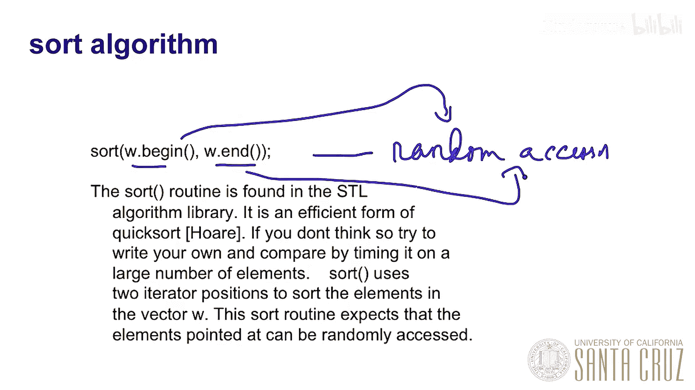

# 044：STL文件输入与排序示例


在本节课中，我们将学习如何使用C++标准模板库（STL）从文件中读取一系列单词，将其存储到向量中，并进行排序。通过这个具体的例子，我们将看到STL如何帮助我们以简洁、高效且不易出错的方式完成复杂的文本处理任务。

## 从示例中学习

上一节我们介绍了STL的基本概念。本节中，我们来看看一个具体的应用实例。通过实践和观察示例代码，我们能更好地理解和掌握编程技术。这个例子将展示如何读取文件、处理数据以及应用算法。

## 示例目标：分析文本词汇

假设你是一位人文学科的教授，需要验证一部戏剧是否由莎士比亚所著。一种常见的方法是分析词汇的使用模式和频率。每个作者都有其独特的用词风格，通过统计文本中的词汇，可以推断作者身份。类似的技术也用于分析《圣经》等文献，以判断是否存在多位作者。我们将演示如何使用STL高效地实现这类文本分析的基础部分。

## 所需的STL组件

为了实现目标，我们需要使用几个关键的STL库。以下是本示例将用到的组件：

*   **`<fstream>`**：用于文件输入输出操作。
*   **`<vector>`**：作为存储单词的动态数组容器。
*   **`<algorithm>`**：提供排序等通用算法。
*   **`<iterator>`**：提供迭代器，用于遍历容器和文件。

## 代码实现步骤解析

现在，我们逐步解析实现该功能的代码逻辑。

### 1. 打开文件并读取单词

首先，我们需要打开存储文本的文件（例如 `word.txt`），并将单词读入一个向量中。

```cpp
std::ifstream in_file("word.txt");
std::vector<std::string> words((std::istream_iterator<std::string>(in_file)),
                                std::istream_iterator<std::string>());
```

这段代码利用`std::istream_iterator`从文件中读取数据。迭代器会自动以空白字符（空格、换行等）为分隔符，将文件内容分割成独立的字符串（单词），并用它们来初始化`words`向量。`std::string`的动态特性使其能够容纳任意长度的单词。

### 2. 遍历并打印原始单词

为了查看读取的内容，我们使用基于范围的`for`循环来遍历向量。

```cpp
for (const auto& word : words) {
    std::cout << word << '\t';
}
```

`auto`关键字让编译器自动推断`word`的类型（此处为`std::string`）。这个循环会安全地遍历所有元素，并打印每个单词，用制表符分隔。如果文件内容是“The quick Brown Fox”，屏幕将原样输出这些单词。

### 3. 对单词进行排序

接下来，我们使用STL的`sort`算法对向量中的单词进行排序。

```cpp
std::sort(words.begin(), words.end());
```

`std::sort`函数接受两个迭代器参数，定义需要排序的范围（这里是整个向量）。它使用高效的排序算法（通常是快速排序的变体）。排序后，单词将按字典序排列。

### 4. 遍历并打印排序后的单词

排序完成后，我们再次使用基于范围的`for`循环来输出结果。

```cpp
for (const auto& word : words) {
    std::cout << word << '\t';
}
```

由于字典序基于ASCII值，大写字母排在小写字母之前。因此，“The quick Brown Fox”排序后可能输出为“Brown Fox The quick”。

## 核心概念与深入探讨

### 迭代器范围

STL算法普遍使用迭代器来操作数据范围。`std::sort(words.begin(), words.end())`中的`words.begin()`和`words.end()`定义了一个“前闭后开”的区间，这是STL中表示范围的典型方式。

### 算法要求

`std::sort`算法要求迭代器提供**随机访问**能力，这意味着它能像指针一样快速跳转到任意位置。`std::vector`的迭代器满足此要求，因此可以用于排序。

### 扩展练习建议

为了深化理解，你可以尝试以下练习：

*   **大小写归一化**：在排序前，先将所有单词转换为小写，使得排序不区分大小写。
*   **频率统计**：对排序后的单词进行计数，找出每个单词的出现频率。
*   **自定义排序**：尝试自己实现一个排序算法，并与`std::sort`在效率和正确性上进行比较。

## 总结



本节课中我们一起学习了如何利用C++ STL的强大功能来处理文本文件。我们通过一个具体的例子，演示了如何使用`ifstream`和`istream_iterator`读取文件，用`vector`存储数据，用基于范围的`for`循环进行遍历，以及用`algorithm`中的`sort`函数进行排序。STL通过提供经过充分测试的高效组件，让我们能够用简洁、清晰的代码完成复杂任务，显著提高了开发效率和代码可靠性。掌握这些工具是编写现代C++程序的关键。