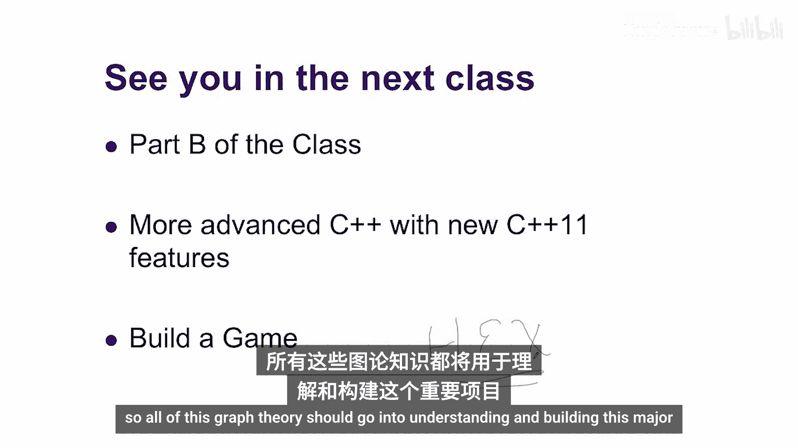

# 046：输出随机图


## 概述
在本节课中，我们将学习如何使用C++生成一个随机图。我们将探讨图密度的概念，并编写一个程序来生成具有指定密度、边成本和颜色的随机图。这个程序将使用矩阵来表示图，并演示如何将随机生成的数据输出到文件。

## 图密度与随机生成

上一节我们介绍了随机图生成的应用背景，本节中我们来看看其核心概念——图密度。

图密度是一个介于0和1之间的值，它粗略地表示每个节点平均拥有的边数。我们可以用以下公式来理解：

*   **密度 = 1**：表示完全图，即每对节点之间都存在边。
*   **密度 = 0**：表示完全不连通的图，只有节点，没有边。
*   **密度 = 0.5**：对于一个有100个节点的图，平均每个节点大约有50条边。

在实际应用中，例如网络设计或算法测试，获取真实世界的大规模图数据非常困难。因此，使用具有特定密度的随机图进行模拟是一种常用且有效的方法。

## 程序设计与实现

理解了图密度的概念后，我们现在来构建生成随机图的程序。我们将使用一个布尔矩阵来表示图，并为边添加成本和颜色属性。

以下是程序的核心步骤：

1.  **获取用户输入**：程序需要从用户那里获取两个参数：图的`size`（节点数量）和图的`density`（密度）。
2.  **初始化随机数生成器**：为了避免每次运行程序都得到相同的随机序列，我们需要用当前时间作为种子来初始化随机数生成器。
3.  **构建数据结构**：我们将创建三个矩阵来完整描述这个图：
    *   `graph`：一个布尔矩阵，`graph[i][j]`为`true`表示节点`i`和`j`之间存在边。
    *   `color`：一个整数矩阵，`color[i][j]`表示连接节点`i`和`j`的边的颜色（例如，0、1、2分别代表不同的道路类型）。
    *   `cost`：一个整数矩阵，`cost[i][j]`表示通过边`(i, j)`的成本（例如，距离或开销）。
4.  **生成边**：通过比较一个随机概率值与目标密度来决定是否在两个节点间创建边。其逻辑可以用以下代码描述：
    ```cpp
    if ( (rand() / (double)RAND_MAX) < density ) {
        // 创建边
    }
    ```
    这段代码生成一个0到1之间的随机数，如果它小于密度值`density`，则创建边。这确保了边被创建的概率与密度成正比。
5.  **为边分配属性**：如果边被创建，我们为它随机分配一个成本（例如，0到29之间的整数）和一个颜色（0、1或2）。
6.  **输出到文件**：最后，程序将生成的图信息（存在的边及其成本和颜色）写入一个输出文件，以便后续使用或分析。

## 关键代码解析

在生成边的过程中，有几个细节值得注意：

*   **随机概率生成**：表达式`rand() / (double)RAND_MAX`是关键。`rand()`返回一个整数，`RAND_MAX`是它能返回的最大值。通过将`rand()`强制转换为`double`类型再进行除法运算，我们得到了一个介于0.0到1.0之间的浮点数，模拟了一个均匀分布的概率。
*   **对称性处理**：由于我们生成的是无向图，因此边`(i, j)`和`(j, i)`是相同的。在实现时，我们通常只处理`i < j`的情况，或者确保矩阵是对称的。
*   **颜色与成本生成**：
    ```cpp
    color[i][j] = rand() % 3; // 生成0, 1, 2三种颜色
    cost[i][j] = rand() % 30; // 生成0到29之间的成本
    ```
    使用取模运算符`%`可以方便地将随机数限制在指定的范围内。



## 总结
本节课中我们一起学习了如何使用C++生成随机图。我们首先了解了图密度的定义及其在模拟中的重要性。然后，我们逐步构建了一个程序，该程序能够根据用户指定的节点数和密度，生成一个用矩阵表示的随机图，并为每条边随机分配成本和颜色。最后，我们将图的数据结构输出到文件中。这个练习综合运用了随机数生成、数组（矩阵）操作和文件I/O等C++核心概念，并为后续学习更复杂的图算法奠定了基础。