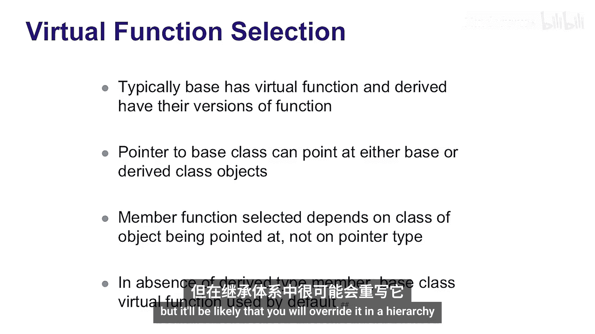
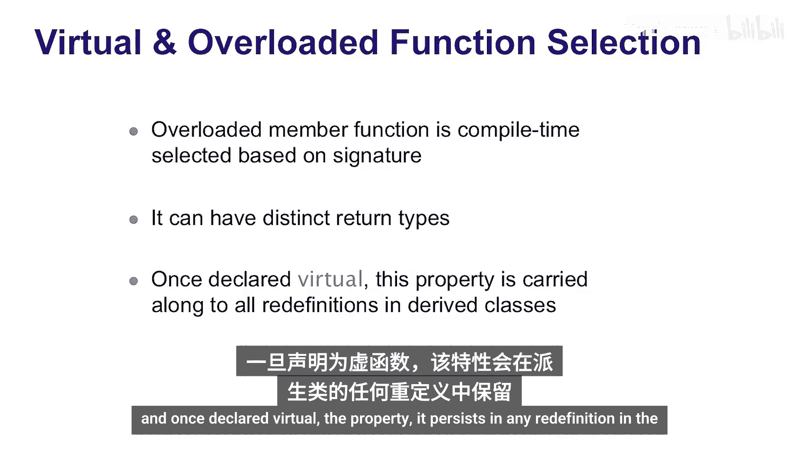
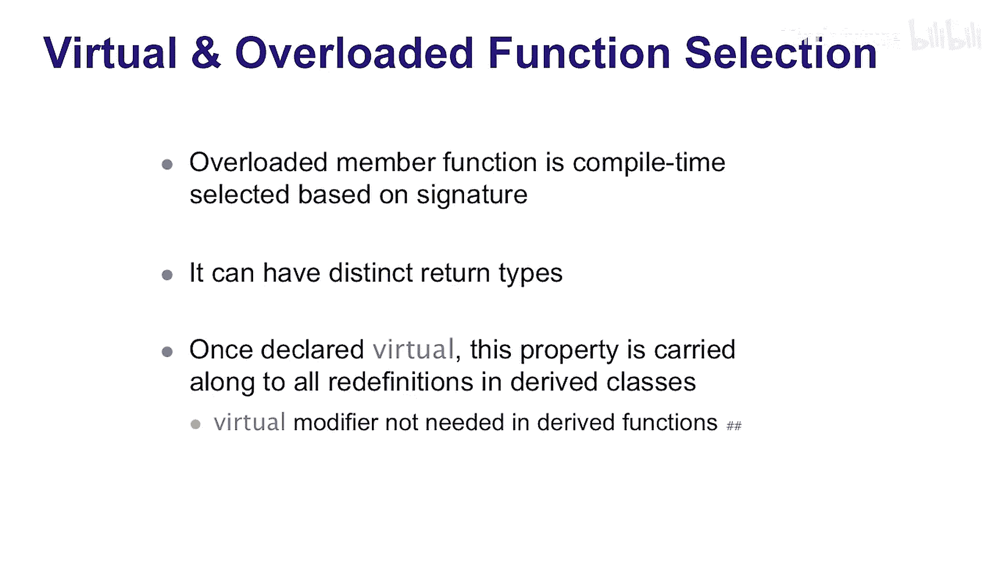
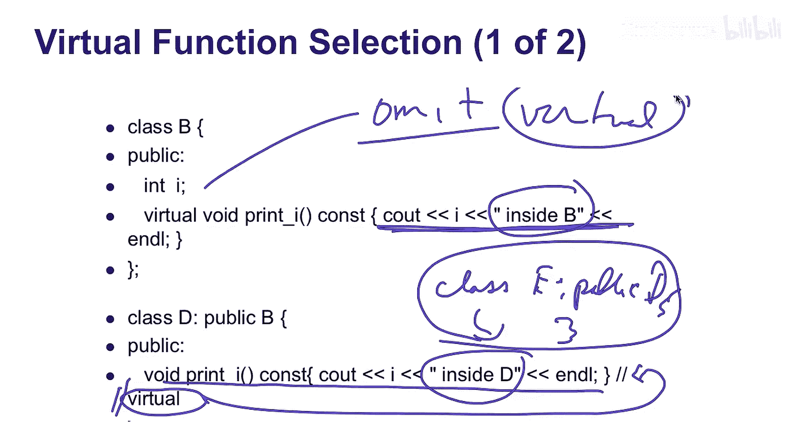
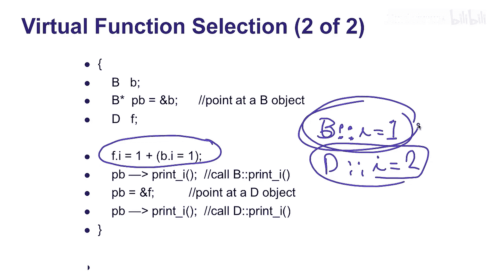
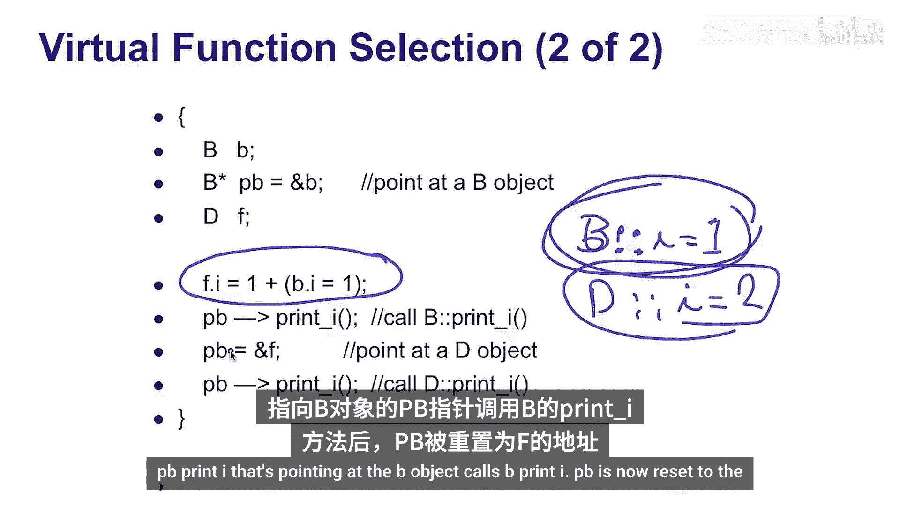
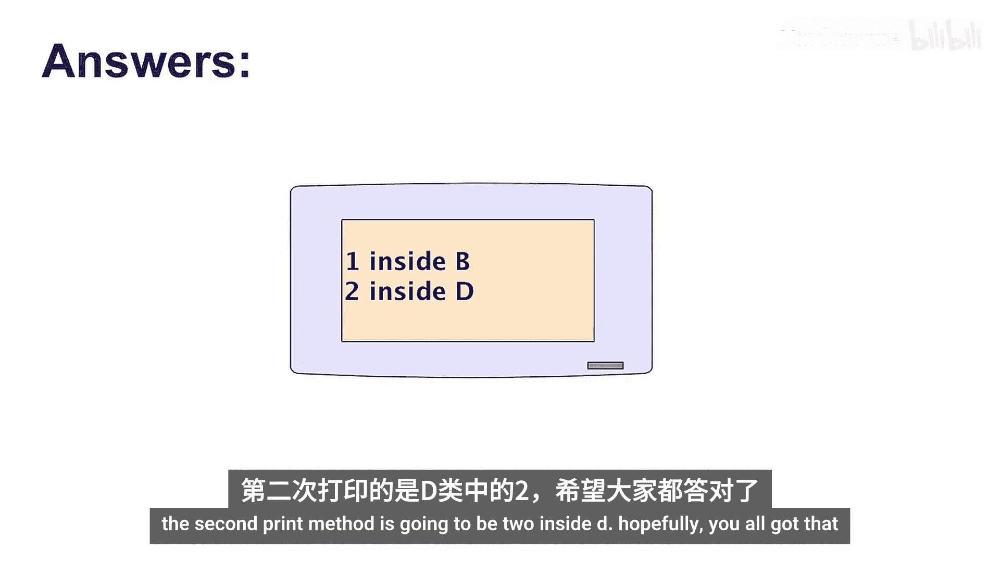
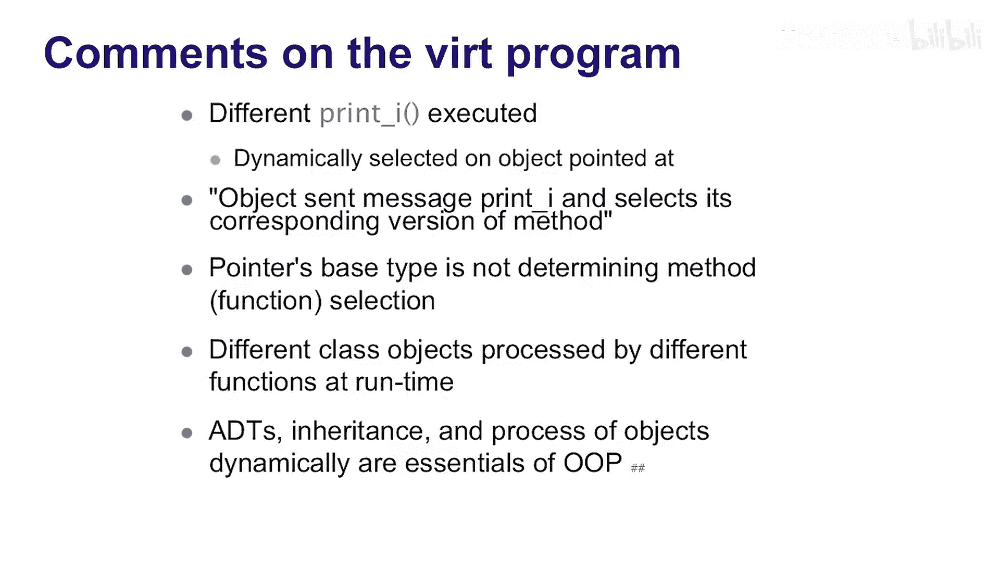

# 029：虚函数选择

在本节课中，我们将学习C++中虚函数的概念、工作原理及其在实现多态性中的关键作用。我们将通过对比非虚函数的行为，理解动态派发机制，并探讨其背后的实现原理与性能考量。

## 回顾上一节内容

上一节我们介绍了非虚函数`print`的行为。在那种情况下，被调用的重写函数是基于**指针的类型**，而不是指针所指向的**实例的实际类型**来选择的。

## 理解多态与动态派发

如果你熟悉Java等语言，你会习惯于多态响应，即由**实际实例**来决定调用哪个函数。这有时被称为动态派发。

在C++中，这一机制更为复杂和精密。一些其他面向对象语言默认就具有虚函数行为，因为根据“90%规则”，这几乎总是你期望发生的情况。因此，在C++中，你通常需要在基类中将函数声明为`virtual`，然后在派生类中重写这些虚函数。

这样，函数的选择将不再依赖于指针的类型，而是取决于指针所指向的实例。例如，一个指向`GraduateStudent`的指针将调用`GraduateStudent`的`print`函数，而不是`Student`的`print`函数。



指向基类的指针至关重要，因为它允许你以统一的方式访问类型层次结构中的任何对象。但成员函数将被动态选择。

## 动态派发的实现与效率

这里存在一个效率问题：如何实现动态派发？动态派发是通过在运行时查询一个表来实现的。这意味着函数调用需要额外的操作。换句话说，你无法在编译时直接选择正确的函数，必须推迟到运行时。

运行时系统会查看对象的类型（该类型信息必须与对象一起存储），然后访问**虚函数表**，并从中选取正确的重写函数。基类中的虚函数将作为默认实现，但你通常需要在派生类中重写它。

**核心机制**：当一个函数被声明为`virtual`后，其“虚”属性会在整个继承链中持续存在。在派生类中重写时，无需再次使用`virtual`关键字（但可以使用，以增加清晰度）。

## 区分重载与重写



重载与重写之间可能存在很多混淆：
*   **重载**：指在编译时根据函数签名选择成员函数。这也影响模板，模板同样是在编译时进行签名匹配。
*   **重写**：特指在继承关系中，派生类重新定义基类的虚函数。



模板、重载和重写这些概念混合在一起时，可能会变得相当复杂，容易令人困惑，也是测试中常见的难点。

## 虚函数的返回类型

虚函数可以拥有不同的返回类型。这通常是合理的，例如，你可能希望`Student`类的某个成员函数返回一个`Student`对象，而在`GraduateStudent`类中，则希望返回一个`GraduateStudent`对象。返回类型的差异通常与基类/派生类对象本身相关，而不是像`int`与`double`这样的基本类型差异。

## 代码示例：虚函数选择



以下是一个简单的实例，用于演示虚函数的选择行为。你可以运行此代码来观察其语义。



```cpp
class B {
public:
    int i = 1;
    virtual void printI() { std::cout << i << " inside B\n"; } // 声明为虚函数
};



class D : public B {
public:
    int i = 2;
    void printI() override { std::cout << i << " inside D\n"; } // 重写虚函数
};
```

以下是调用这些对象的代码：


```cpp
B b_obj;
D d_obj;
B* pb = &b_obj; // 指向基类对象的指针



pb->printI(); // 输出: 1 inside B
pb = &d_obj;  // 指针现在指向派生类对象
pb->printI(); // 因为printI是虚函数，输出: 2 inside D
```

在这个例子中，两次`printI`调用执行了不同的函数。它们是在运行时根据指针所指向的对象**动态选择**的。

用面向对象的术语来说，对象接收了`printI`消息，并选择了该方法的正确重写版本。基类指针的类型不再决定调用哪个方法。

你可以回到`GraduateStudent`和`Student`的例子，将`print`函数改为虚函数，观察行为的差异。根据运行时的决策，你将获得不同的行为，这也会导致虚函数调用产生轻微的性能开销。

## 总结



本节课我们一起学习了C++中虚函数的核心概念。我们了解到，通过将基类函数声明为`virtual`，并在派生类中进行重写，可以实现多态性，使得函数调用在运行时根据对象的实际类型动态决定。我们还探讨了动态派发通过虚函数表实现的机制，并区分了重载与重写的不同。抽象数据类型、继承以及对象实例的动态方法绑定，这些都是面向对象编程的基石。希望本节能帮助你巩固对C++多态性和面向对象编程的理解。