# 030：与重载的混淆 🔄

在本节课中，我们将探讨C++中函数重载与虚函数重写可能产生的混淆情况。我们将通过具体的代码示例，分析当基类中存在重载的虚函数，而派生类只重写其中一个时，编译器如何选择调用哪个函数。理解这一点对于设计清晰、可维护的类层次结构至关重要。

## 重载与重写的基础回顾 📚

上一节我们介绍了虚函数和动态绑定的概念。本节中我们来看看当虚函数与函数重载机制交织时会发生什么。

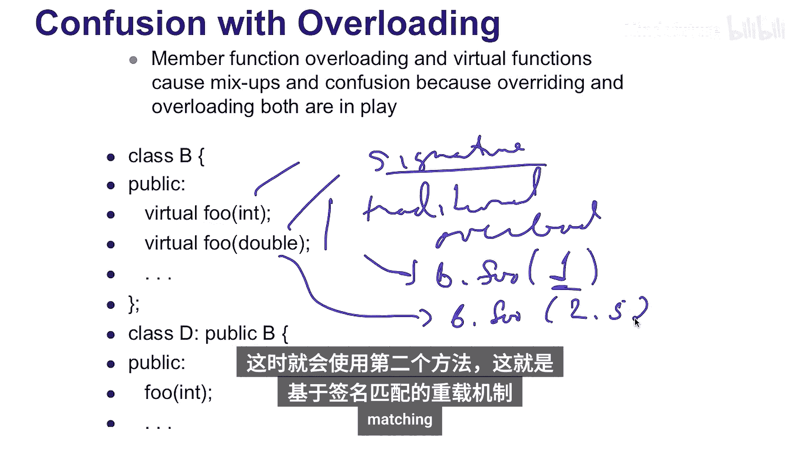

成员函数可以被重载。这意味着可以为同一个函数名定义多个具有不同参数列表（即不同签名）的版本。编译器在编译时根据调用时提供的参数类型来决定调用哪个版本。这是一个典型的函数重载示例：

```cpp
class B {
public:
    virtual void f(int);    // 签名: f(int)
    virtual void f(double); // 签名: f(double)
};
```

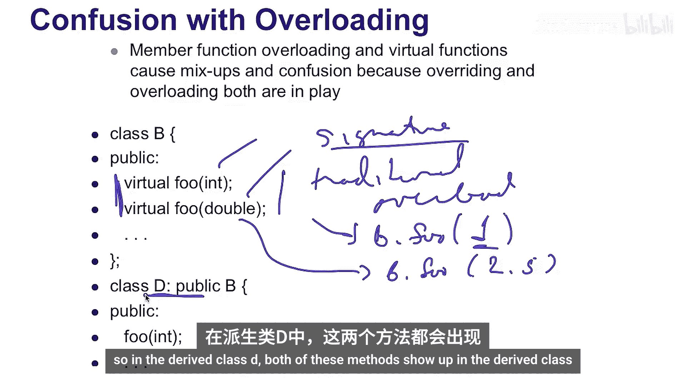

当调用 `obj.f(5)` 时，编译器会选择 `f(int)` 版本；当调用 `obj.f(2.5)` 时，则会选择 `f(double)` 版本。这种选择完全基于函数签名，在编译时完成。

## 重载与重写的混淆场景 ⚠️

现在，我们引入继承和虚函数重写。假设有一个派生类 `D` 继承自基类 `B`。

```cpp
class D : public B {
public:
    virtual void f(double); // 只重写了 f(double)
};
```

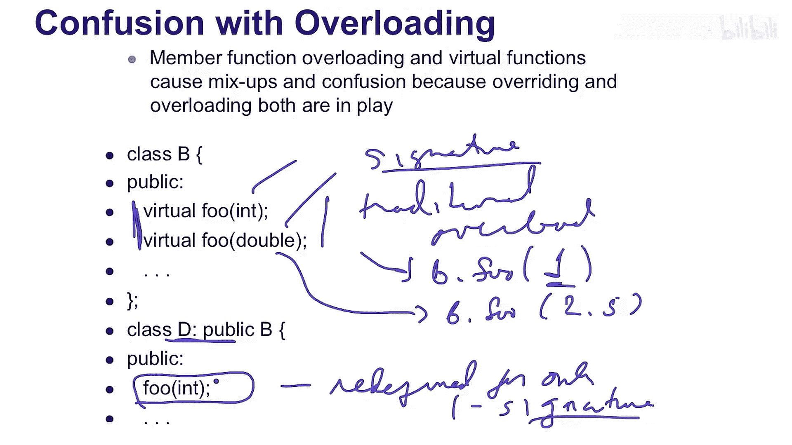

这里就产生了潜在的混淆。派生类 `D` 从基类 `B` 继承了**两个**虚函数：`f(int)` 和 `f(double)`。然而，`D` 只显式地重写了其中一个，即 `f(double)`。

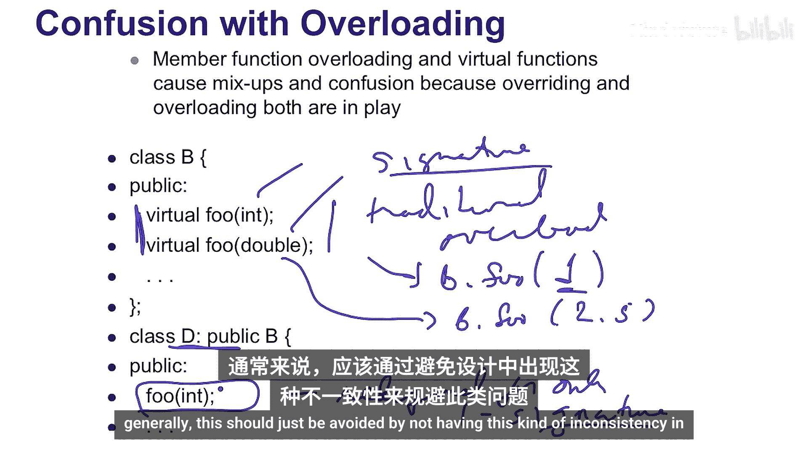

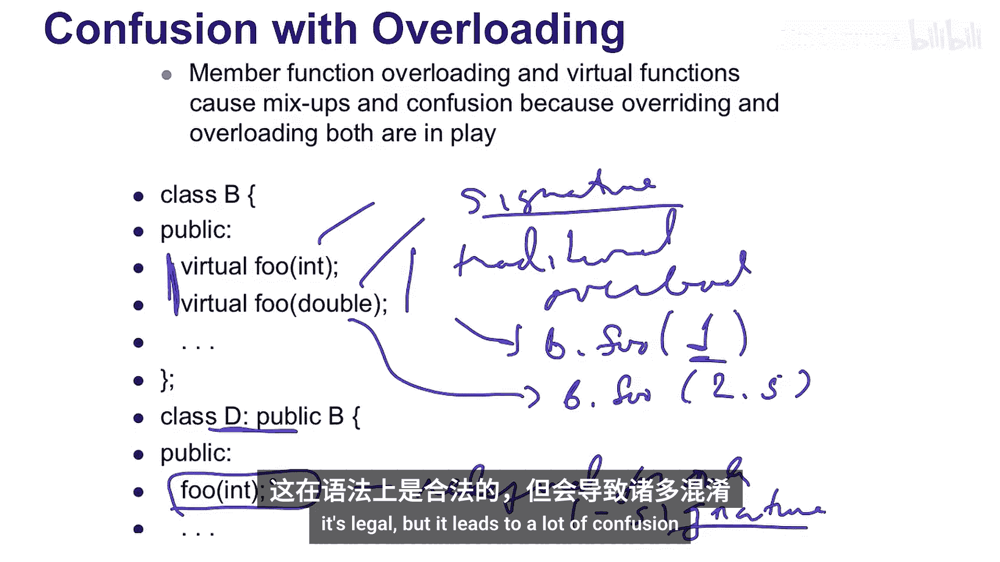

因此，在 `D` 的对象中：
*   对于 `f(double)`，使用的是派生类 `D` 中重写的新版本（覆盖/重写）。
*   对于 `f(int)`，使用的仍然是继承自基类 `B` 的原始版本（未被重写）。

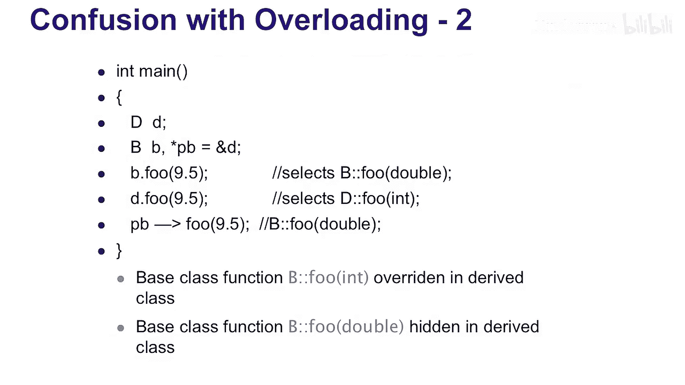

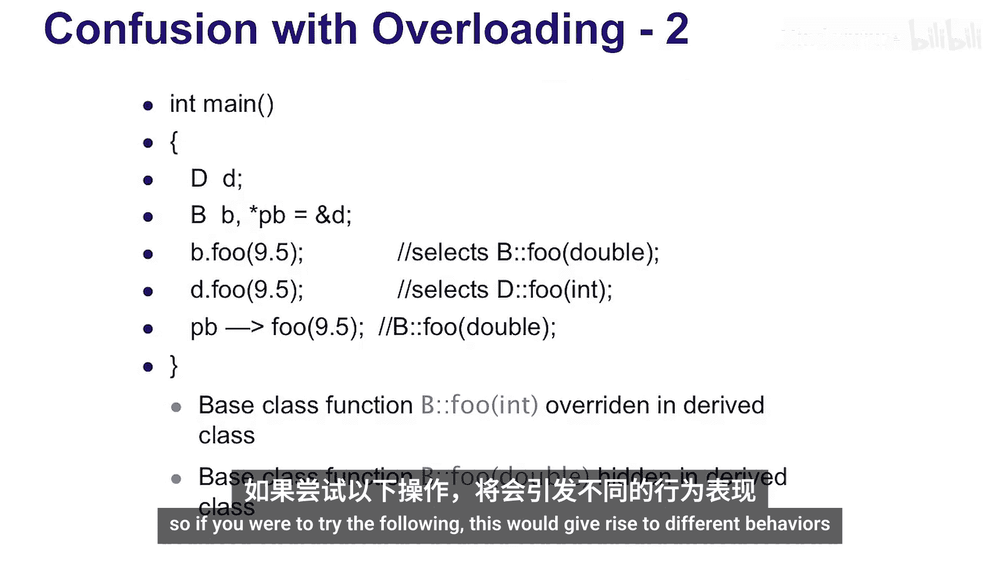

这种不一致性会导致代码行为难以预测，特别是当通过基类指针或引用来操作派生类对象时。

## 混淆行为示例与分析 🔍


让我们通过具体的指针类型来看看这种混淆如何导致不同的行为。

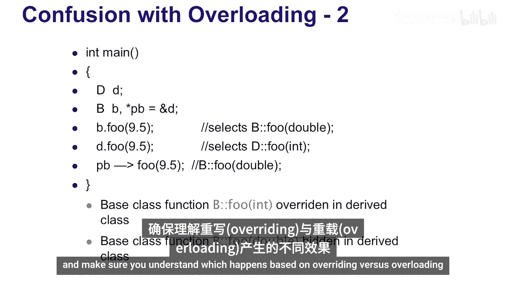

```cpp
B* bp = new D; // 基类指针指向派生类对象
D* dp = new D; // 派生类指针指向派生类对象


bp->f(1);   // 调用 B::f(int) （静态绑定？动态绑定？）
bp->f(1.0); // 调用 D::f(double) （动态绑定）
dp->f(1);   // 调用 B::f(int) （通过派生类指针访问继承的基类函数）
dp->f(1.0); // 调用 D::f(double)
```

以下是关键点分析：
*   `bp->f(1.0)` 会进行动态绑定，因为 `f(double)` 是虚函数。由于 `bp` 实际指向 `D` 对象，所以调用的是 `D::f(double)`。
*   `bp->f(1)` 的情况则有些微妙。虽然 `f(int)` 也是虚函数，但 `D` 类并没有提供自己的 `f(int)` 版本。因此，即使通过基类指针调用，最终执行的仍然是基类 `B::f(int)` 的实现。这里没有发生“重写”，但虚函数机制仍然存在。
*   通过 `dp` 直接调用 `f(1)`，会调用继承而来的 `B::f(int)`。

这种设计使得代码阅读者必须仔细追踪整个继承链中每个重载版本是否被重写，极易出错。

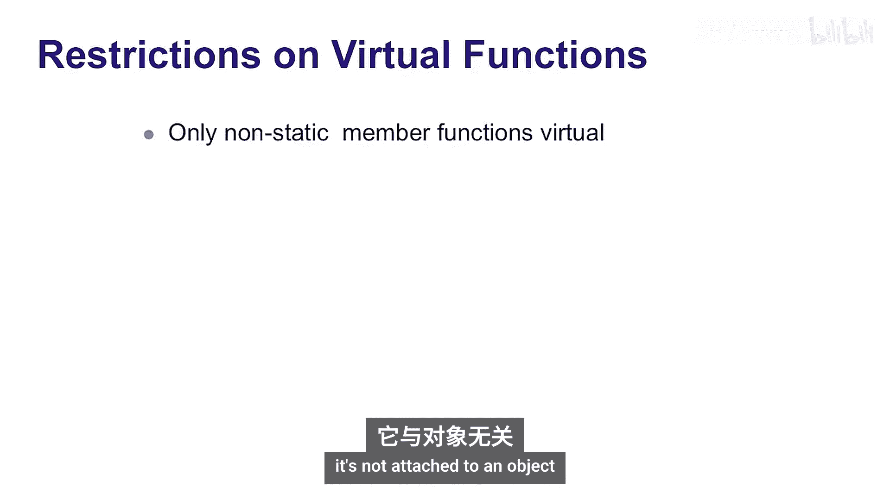

## 最佳实践与规避建议 ✅

为了避免这种混淆，建议遵循以下设计原则：

*   **保持重载集合的完整性**：如果一个派生类需要重写基类中一组重载函数里的任何一个，那么最好重写这一整组函数（即使只是简单地调用基类版本），以明确行为意图。
*   **使用 `override` 关键字 (C++11及以后)**：在现代C++中，使用 `override` 关键字可以让编译器帮助你检查是否成功重写了虚函数，如果签名不匹配会报错，这有助于提前发现此类问题。
*   **重新考虑设计**：如果出现只需要重写部分重载函数的情况，或许意味着类的接口设计可以改进，例如将不同功能的函数分开命名。

## 虚函数使用的其他限制 🚫

在讨论重载混淆之后，我们还需要了解虚函数机制本身的一些限制。

首先，**静态成员函数不能是虚函数**。静态函数属于类本身，而非类的某个特定对象实例。它没有隐藏的 `this` 指针参数。虚函数动态绑定的核心在于通过对象的 `this` 指针在运行时确定调用哪个版本，既然静态函数没有 `this` 指针，自然无法实现动态绑定。

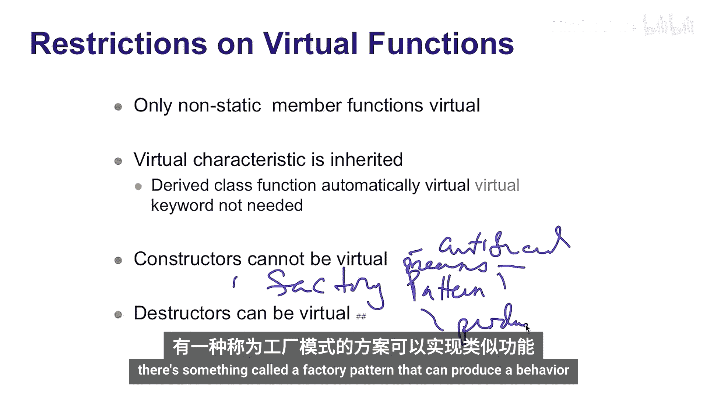

其次，**构造函数不能是虚函数**。创建对象时，必须明确知道要构造的确切类型，才能分配正确的内存空间和调用相应的构造函数。因此，从语义上讲，虚构造函数没有意义。对象的构造过程是从基类子对象到派生类子对象自下而上进行的，在构造函数执行期间，对象的动态类型正在逐步构建，此时使用虚函数机制是不安全且未定义的。

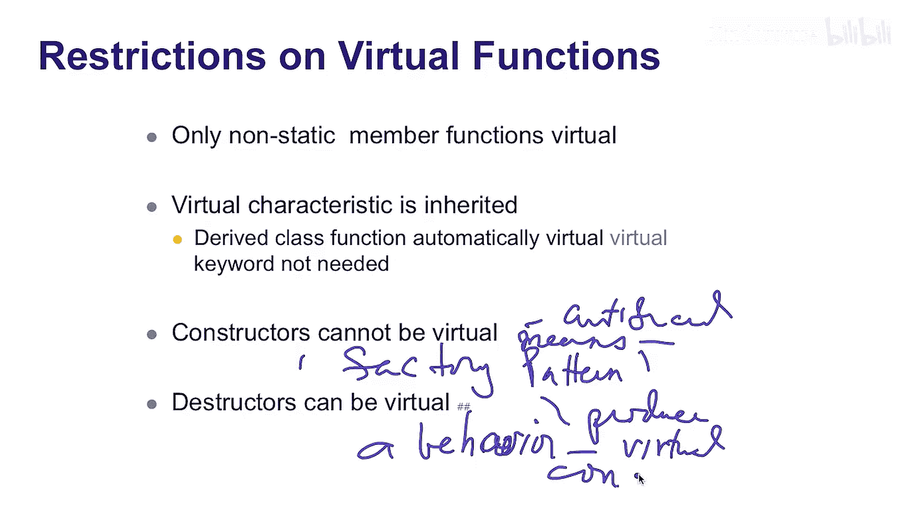

然而，**析构函数可以是且常常应该是虚函数**。当通过基类指针删除一个派生类对象时，如果基类析构函数不是虚函数，则只会调用基类的析构函数，导致派生类部分的资源无法正确释放，造成内存泄漏。将基类析构函数声明为虚函数可以确保通过基类指针删除对象时，能正确调用整个继承链上的析构函数。

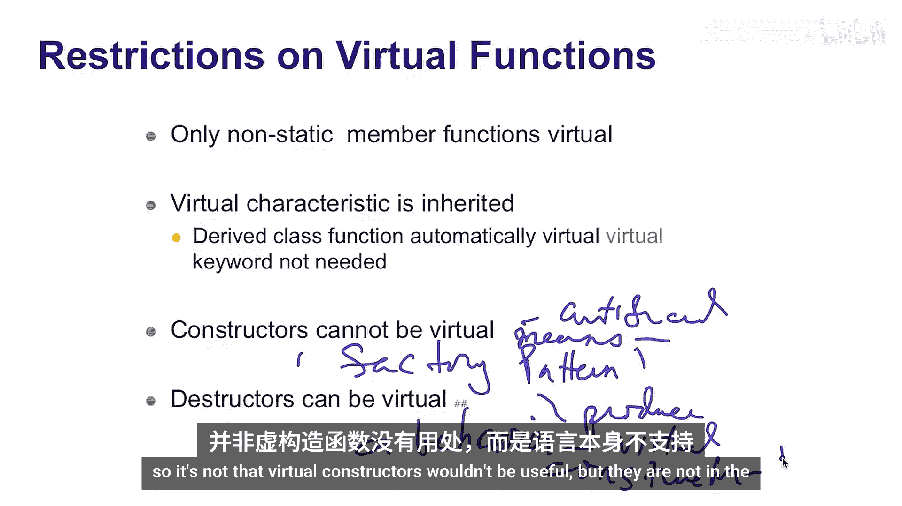

最后，虽然语言本身不支持虚构造函数，但有一种称为**工厂模式**的常见设计模式可以模拟“根据输入动态创建不同类型对象”的行为，这在一定程度上实现了虚构造函数的概念。我们将在课程后续部分介绍这个模式。


## 总结 📝

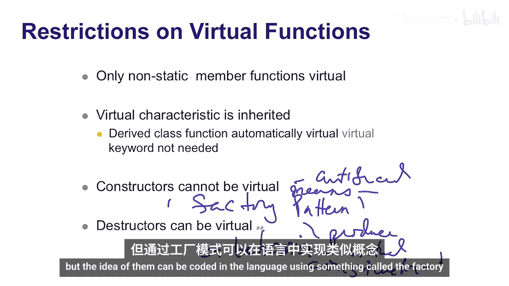

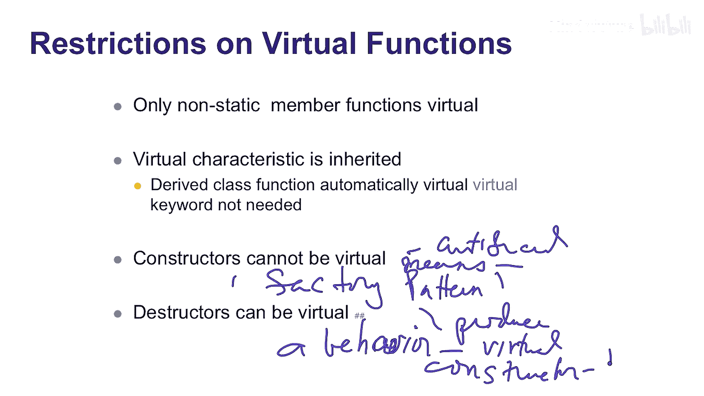

本节课中我们一起学习了C++中重载与重写可能带来的混淆。我们了解到，当派生类只重写基类中一组重载虚函数的部分时，会使得函数调用行为变得复杂且不直观，应尽量避免这种设计。我们还回顾了虚函数的关键限制：静态成员函数不能为虚，构造函数不能为虚，但析构函数通常应该为虚。理解这些细微差别，将帮助你编写出更健壮、更清晰的面向对象C++代码。