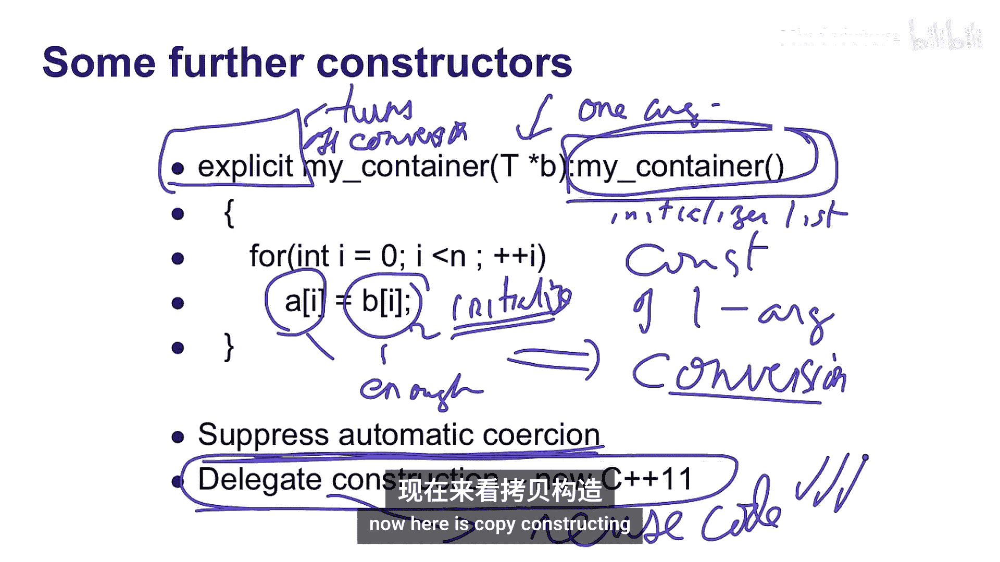
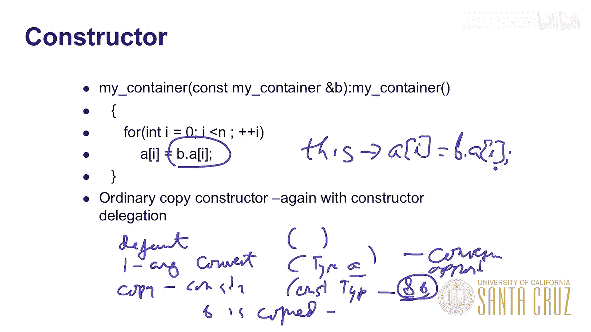
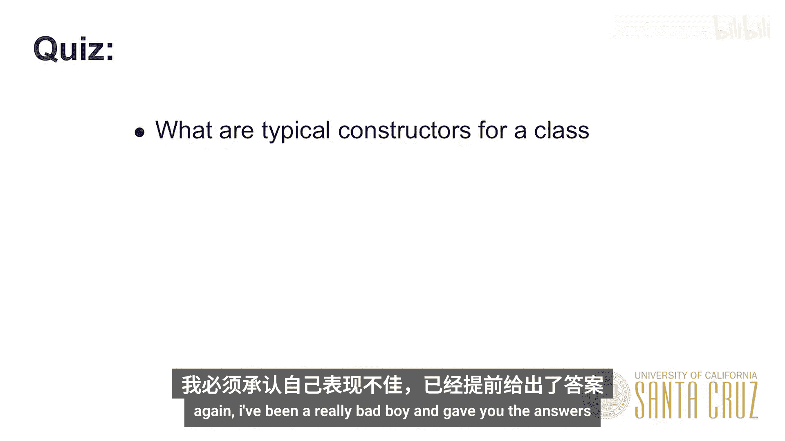
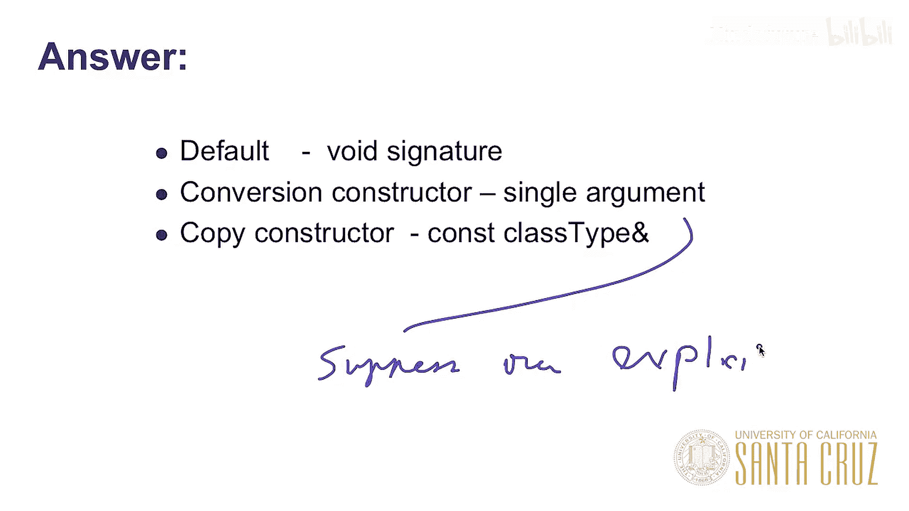

# 032：一些进一步的构造函数

在本节课中，我们将学习C++中构造函数的几个高级概念，包括如何抑制隐式转换、委托构造函数的使用以及传统的拷贝构造函数。这些知识对于编写健壮且高效的C++类至关重要。

## 抑制隐式转换的构造函数

上一节我们介绍了构造函数的基本概念，本节中我们来看看一个带有特殊关键字 `explicit` 的构造函数。

这是一个构造函数。这个构造函数的作用是什么？它展示了C++11中引入的几个新特性。

这是一个单参数构造函数。如果我们有一个单参数的构造函数，通常它会提供一个隐式转换的机会。使用 `explicit` 关键字可以关闭这种隐式转换。请记住，转换机会对C++语言非常重要，它们是C++语言多态性的重要组成部分。但我们不希望转换在任何地方静默地发生。

我们并不打算让一个任意的数组通过这种方式来初始化对象。这个构造函数的真正意图是从一个已存在的数组 `B` 来初始化一个 `my_container` 对象，其底层内容将由指针 `a` 指向。我们假设有足够的值，并且我们希望抑制自动转换。

以下是这个构造函数的关键点：
*   **`explicit` 关键字**：用于抑制单参数构造函数带来的隐式类型转换。
*   **构造意图**：该构造函数旨在从一个已存在的数组进行显式初始化。

## 委托构造函数

现在，这个构造函数另一个真正新颖的地方是使用了被称为“委托构造”的特性。这在旧的C++11之前的版本中是无法实现的。

这看起来像是基类派生类的概念。现在，这个旧的概念可以用于初始化列表中。这意味着，作为构造函数的一部分，我们可以利用该类已经定义的另一个构造函数，即构建类默认状态的构造函数。在默认构造函数中，我们使用 `new` 分配了 `int` 类型的元素数组。这样我们实现了代码重用，这是非常好的实践，实现了代码共享和代码重构。

所以，这就是委托构造的思想，它在C++11中是被允许的。

```cpp
// 示例：委托构造函数
MyContainer::MyContainer(int* B, int size) : MyContainer() // 委托给默认构造函数
{
    // ... 从数组B拷贝数据到a ...
}
```



## 拷贝构造函数

现在来看拷贝构造函数。这是一个普通的拷贝构造函数，回想一下，它应该是怎样的？

当我们构建类时，标准的构造函数有哪些？默认构造函数，其签名是空的。单参数构造函数，它可能提供转换。然后是拷贝构造函数，这就是这里展示的，其参数是 `const` 类型引用。

这个对象 `B` 被拷贝过来。这些通常是我们构建新类时需要考虑的通用事项。

其语义可能如下所示：我们获取已存在的 `B.a[i]`，并将其复制到 `this` 指针所指向的 `a[i]` 中。这就是我们进行拷贝的地方。所以，这是传统的拷贝构造函数。

```cpp
// 示例：拷贝构造函数
MyContainer::MyContainer(const MyContainer& other)
{
    // 分配内存并拷贝 other.a 的内容到 this->a
}
```

## 构造函数类型总结



一个类典型的构造函数有哪些？同样，我已经给出了答案。



如果你一直在认真听讲，现在只需要告诉我我们刚刚讨论了什么。

以下是典型的构造函数类型：
*   **默认构造函数**：签名中无参数。
*   **转换构造函数**：单参数构造函数。我们可以使用 `explicit` 关键字来抑制隐式转换。
*   **拷贝构造函数**：参数为 `const` 类型引用。



本节课中我们一起学习了C++中构造函数的三个重要进阶主题：使用 `explicit` 关键字防止意外的隐式转换，利用C++11的委托构造函数实现代码复用，以及传统拷贝构造函数的实现方式。理解这些概念有助于你设计出更安全、更清晰的类接口。