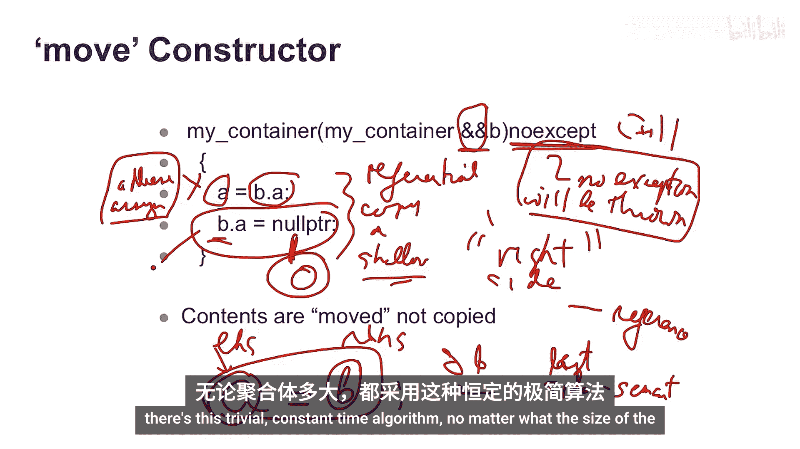
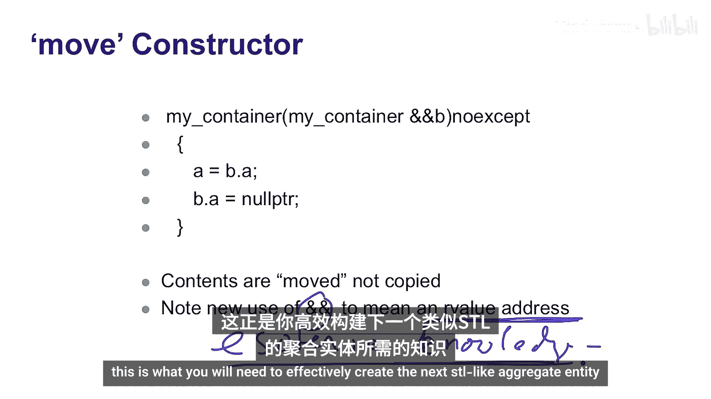
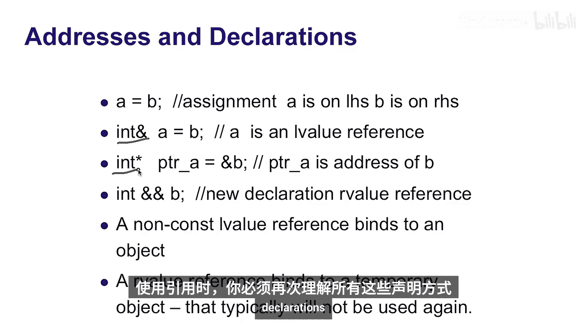
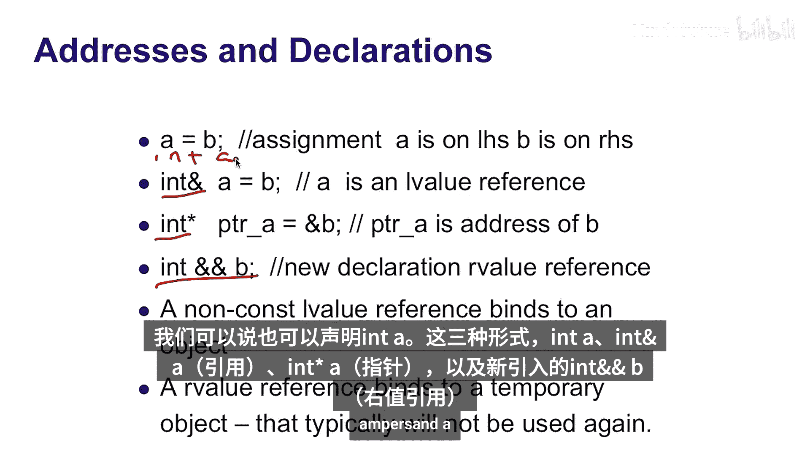
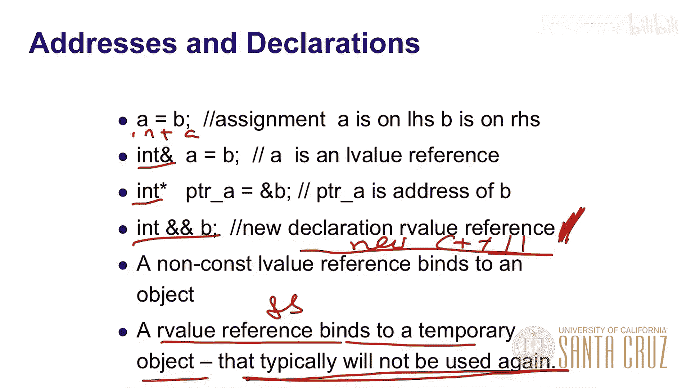
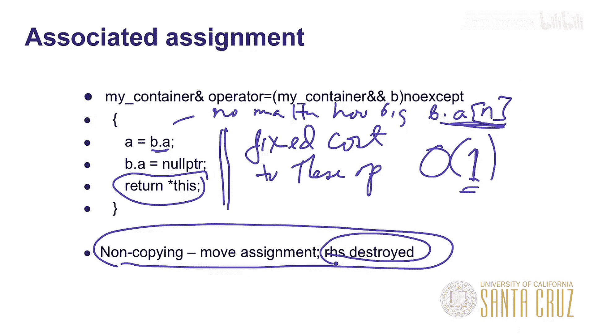
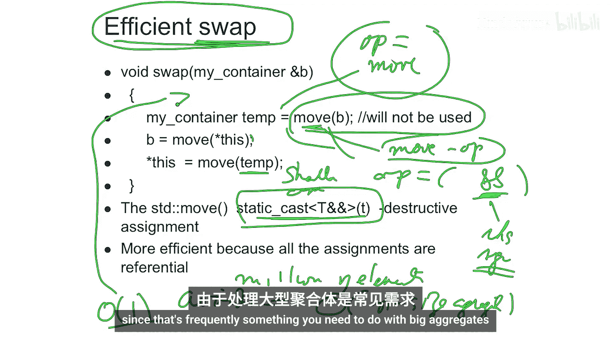
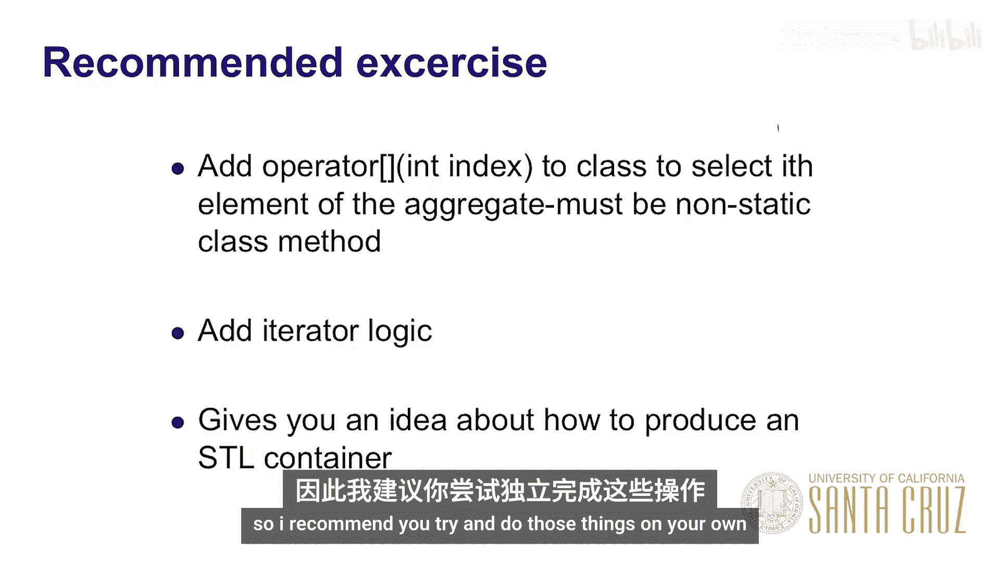

# 033：移动构造函数

## 概述
在本节课中，我们将要学习C++11引入的一个新概念——移动构造函数。我们将探讨其语法、工作原理、效率优势以及适用场景，帮助你理解如何利用移动语义来编写更高效的程序。

---

## 移动构造函数的基本概念
上一节我们介绍了传统的拷贝构造函数。本节中我们来看看移动构造函数，这是一种新的、能显著提升效率的构造方式。

C++11引入了一个被称为“移动构造函数”的新特性。它使用双与号 `&&` 作为语法标记。这个符号不再表示普通的引用，而是表示“右值引用”。

传统的单与号 `&` 用于“左值引用”语义。在表达式 `A = B` 中，`A` 是左值，`B` 是右值，它们具有不同的含义。移动构造函数与普通的拷贝构造函数不同，它旨在高效地“移动”资源，而非“复制”资源。

移动构造函数通常使用 `noexcept` 关键字进行修饰，承诺不会抛出异常。这是因为在移动过程中如果发生异常，资源清理会变得非常复杂。

以下是移动构造函数的核心操作逻辑：
```cpp
// 浅拷贝（或引用拷贝）
new_A.data_ptr = old_A.data_ptr; // 新对象指向旧对象的数据
old_A.data_ptr = nullptr;        // 旧对象的数据指针置空
```

通过这种“引用拷贝”，原本在对象B中的数据被“移动”到了对象A中，而对象B中的内容则消失了。这就是所谓的“浅拷贝”。对象B被置为空（`nullptr`），对象A则保留了信息。

## 移动语义的效率优势
这种移动操作的效率非常高。假设对象B中有一百万个元素，移动操作需要执行多少步骤呢？

它只执行了一个简单的地址赋值操作。因此，总共只有两个非常简单的赋值操作，在机器层面通常只需要几条存储指令，在几纳秒内即可完成。

这意味着，无论要移动的聚合体有多大，移动操作都只需要恒定的、极短的时间。其时间复杂度是常数阶 **O(1)**。



无论聚合体的大小如何，移动操作的成本都是固定的。相比之下，传统的拷贝构造函数中的 `for` 循环，其执行时间与聚合体的大小成正比。

因此，移动语义的效率是极高的。它是一种平凡的、常数时间的算法。你需要付出的代价是：必须清楚旧名称（被移动的对象）不再有效。这就像给一个东西起了新名字，是“移动”而非“克隆”。传统的拷贝构造函数是“克隆”，会保留旧数据。


理解“值语义”是掌握这一新知识的关键。如果你能真正理解这一点，对于想要开发类似STL库的公司来说，你将变得非常有价值。这是有效创建下一代STL风格聚合实体的必备知识。




## 理解声明与赋值
为了真正理解移动语义，我们需要回顾一些基础概念，特别是地址和声明。

在C或C++中，当你写 `A = B` 时，必须理解其含义：
*   左边的 `A` 实际上代表一个地址。
*   右边的 `B` 代表存储在该地址的值。
*   操作是将存储在 `B` 地址的值，赋值到 `A` 所指向的地址。

因此，在赋值操作中，`A` 和 `B` 是不对称的。这不是一个数学运算，而是计算机术语中的“副作用”操作，这也是此类语言难以调试的原因之一。



现在，我们需要理解各种声明方式。以下是三种重要的声明：




```cpp
int A;           // 整型变量
int* A;          // 指向整型的指针
int& A;          // 左值引用（传统引用）
int&& B;         // 右值引用（C++11新特性）
```




这个新的右值引用 `int&&`，可以将其理解为绑定到一个临时对象。这个对象即将消失，不会被再次使用。这正是我们希望使用移动语义的场景。否则，我们应继续使用C语言和早期C++世界中的传统语义。

## 移动赋值运算符
当我们为类实现了移动构造函数后，通常还需要重载赋值运算符，为其添加移动语义。


这是一个非拷贝的移动赋值操作，右侧操作数会被“销毁”。其操作逻辑与移动构造函数类似：
1.  将当前对象（`*this`）的数据指针指向右侧对象（`rhs`）的数据。
2.  将右侧对象的数据指针置为 `nullptr`。
3.  返回 `*this` 的引用以支持链式赋值。

同样，这些操作的成本是固定的。用技术术语说，其效率是常数阶 **O(1)**。无论 `D.data[n]` 有多大，我们只是赋值了一个基础指针值，然后通过置空指针来“清除”右侧对象。



**核心要点**：如果我为一个大型聚合体构建移动语义，那么移动构造和移动赋值在本质上提供了相同的高效率。但对于非聚合体（例如单个 `int`），使用移动语义没有意义，因为不会获得任何效率提升。


## 移动语义的应用：高效交换
让我们看看移动语义的高效性在何处发挥作用。一个经典案例是实现高效的交换操作。

交换是算法中的基础操作，例如快速排序中需要不断交换两个元素。通常，交换两个简单值（如 `int` 类型的 `a` 和 `b`）需要一个临时变量，成本是固定的：
1.  将第一个对象的值赋给临时变量。
2.  将第二个对象的值赋给第一个对象。
3.  将临时变量的值（即原第一个对象的值）赋给第二个对象。

但如果交换的是两个巨大的聚合体呢？移动语义在这里大显身手，因为它允许我们摆脱对临时“盒子”的依赖。我们知道放入临时“盒子”的数据没有最终用途，因此可以无成本地将其“移动”走。

以下是利用移动语义实现的高效交换：
```cpp
// 使用 std::move 触发移动语义
std::swap(a, b); // 内部可能利用移动语义实现
```

通过使用 `std::move`，`operator=` 将使用重载的移动赋值语义。对象 `b` 的内容被移动到临时位置（或直接与 `a` 交换），然后原 `a` 的内容再被移动到 `b`。所有操作都通过浅拷贝完成。

这意味着，对于包含数百万个元素的对象，交换操作避免了与聚合体大小 **N** 成正比的成本。交换中的每一步都是 **O(1)** 操作。

这是一个巨大的效率提升。`std::move` 本质上是一种类型转换，用于获得正确的右值引用类型。所有的赋值都是引用式的，时间复杂度都是 **O(1)**。这实现了一个 **O(1)** 的交换例程，对于需要频繁操作大型聚合体的STL库和大数据处理场景来说，这是极佳的优化。



## 练习建议
为了测试这些新颖的概念，我推荐你进行以下练习：

以下是你可以尝试的具体任务：
1.  **修改容器类**：拿一个你自己的容器类（例如 `my_container_array`），尝试修改其代码。
2.  **重载下标运算符**：尝试重载下标运算符 `[]`，以便能够选择容器中的元素。请注意，这必须重载为非静态类成员函数。
3.  **添加迭代器逻辑**：将迭代器逻辑集成到你的 `my_container` 类中。这将让你更好地理解如何构建一个STL风格的类。

我建议你独立尝试完成这些任务，以加深对移动语义和类设计的理解。




---


## 总结
本节课中我们一起学习了C++11的移动构造函数和移动语义。我们了解了其通过右值引用 `&&` 实现的独特语法，以及它如何通过浅拷贝和资源所有权的转移来替代深拷贝，从而实现常数时间 **O(1)** 的高效操作。我们还探讨了移动赋值运算符的必要性，以及移动语义在实现高效交换等算法中的关键作用。掌握移动语义对于编写高性能的现代C++代码至关重要。