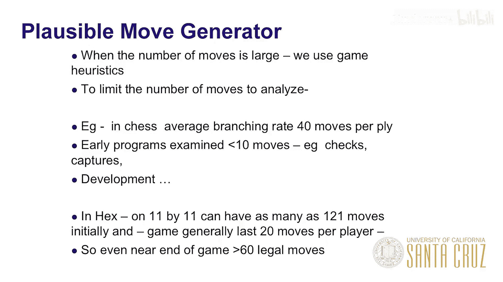
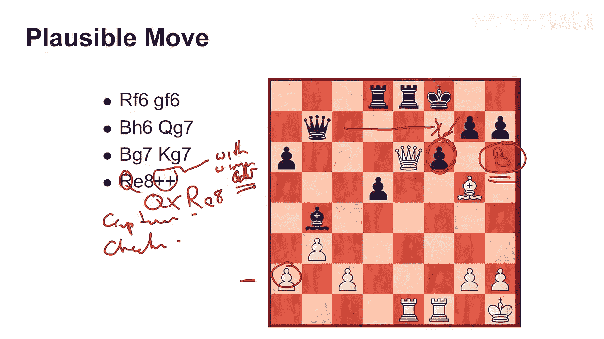
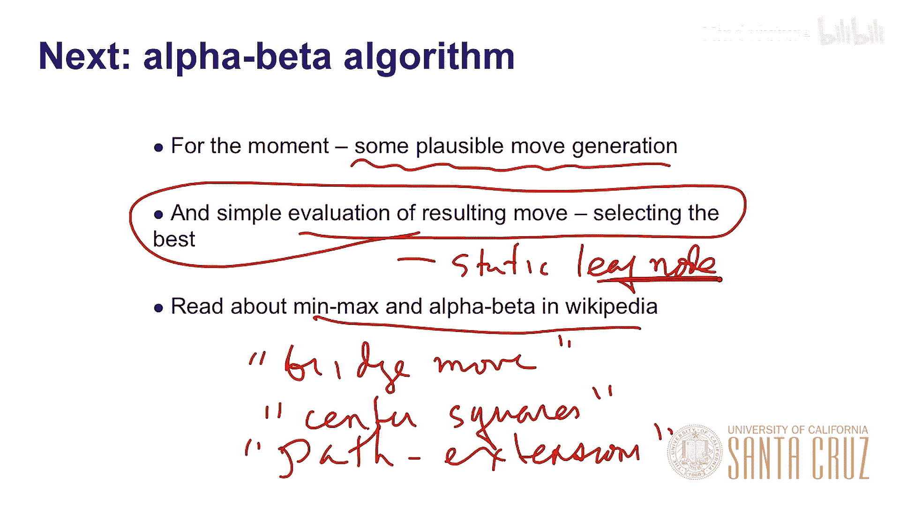

# 035：合理的移动生成器

在本节课中，我们将探讨如何为复杂的棋盘游戏（如国际象棋和六边形棋）设计一个“合理的移动生成器”。由于这类游戏的分支因子极大，我们无法穷举所有可能的走法，因此需要一种智能的方法来筛选出最值得考虑的几步棋。

## 游戏规模与挑战

上一节我们介绍了游戏树搜索的基本概念。本节中我们来看看实际应用中的挑战。六边形棋将是一个非常庞大的游戏。为什么这么说呢？

我们通常在11x11的棋盘上进行六边形棋比赛。一个11x11的棋盘有121个位置。

这意味着在游戏开始时，一位玩家有121步合法走法，并且这个数字会逐一减少。因此，在游戏的大部分时间里，你的分支率——即游戏中的合法分支率——都超过100步。

这意味着即使是相对较短的搜索深度，比如10层（即向前看10步），可能性也将达到10的100次方，这是一个极其庞大的数字。所以在大多数情况下，我们无法展开这样一棵完整的树，然后应用某种评估标准。即使是简单的评估标准，走法和可能性也太多了，因此我们必须限制它们。

通常，我们使用一种称为“合理的移动生成器”的方法来限制搜索范围。

## 合理的移动生成器：历史与理念

以下是早期国际象棋程序中的做法。

早期在计算机上编程的国际象棋游戏可以追溯到20世纪50年代，甚至更早。在50年代编写的程序会下国际象棋，但下得不是很好。甚至在冯·诺依曼、香农、图灵等一些最著名的计算机科学和信息科学家之前，就已经有了下国际象棋的纸上算法。所有这些创造性思想家——他们实际上是计算机科学的奠基人，如图灵——都深入思考过如何创造一个智能的国际象棋棋手。

国际象棋的平均分支率约为40步。早期国际象棋程序中，合理的移动生成器通常只考虑大约5到7步棋。

你如何决定挑选哪些走法呢？你会去查阅文献，做国际象棋棋手所做的事。荷兰大师兼认知理论家德格鲁特的一项著名研究发现，即使是国际象棋大师在评估局面时，可能也只考虑几百种走法。因此，他们通常在合理的走法上非常有选择性。

开局手册中提到的合理走法包括：
*   **吃子**：这在跳棋中也适用。所以你会检查吃子的可能性。
*   **将军**：国际象棋有句老话：“有机会将军，为什么不试试？”因此，即使是初学者偶尔也能通过使用这些非常简单的想法击败更好的棋手，因为人类下棋会犯很多错误，他们可能会忽略局面中存在将军的可能性。
*   **特殊规则**：在游戏的早期阶段，通常有特殊规则。例如，在开局阶段，特殊规则包括“将兵走到中心”。为什么？因为控制中心是国际象棋对弈的重要理论要素之一。当你把兵走到中心时，不仅获得了控制权，还为你的后方棋子提供了更多空间。

在游戏的不同阶段，可能有不同的规则来生成合理的走法。在游戏的后期，即残局阶段，会非常注重推进兵（称为“通路兵”）。因此，在那个阶段，如果你有一个受保护的通路兵，推进它可能是一步合理的走法，因为将兵升变到对面的底线格（称为“升变格”）将具有非常高的价值，并能改变游戏局势。

## 应用于六边形棋

对于六边形棋，你必须审视类似的事情。那么，在六边形棋中什么是有用的呢？这同样可以作为你作业的一部分来思考。互联网上已经有很多六边形棋程序。

如果你不了解这个游戏，可以尝试玩一下那些程序，感受一下程序是如何下棋的。其中一些程序非常厉害，可能会让你感到挫败，它们会轻松击败你，但也许你能从中获得一些关于它们在做什么的启发，并可以发展出你自己关于合理走法的想法。

类似于在扩展的井字棋游戏中，合理的走法是走向棋盘中心。在六边形棋盘的中心，让你有更多机会或更多方式来扩展路径并阻挡对手的路径。

## 实例分析：国际象棋局面

那么，让我们尝试研究一下合理的走法。这是2011年加里和霍尔之间的一盘棋，是我在网上随机找到的一个对局。这里的问题是：白方走棋。什么是好棋？

同样，如果你试图查看所有合法走法，数量会很多。例如，移动这个兵（走一格或两格），移动那个兵（走一格或两格），这已经是4步棋了。这里有两个兵，所以是8步兵着法。然后象有大约八步走法。接着，后有很多条斜线可走，大约有14步后的走法。车大约有5步走法，另一辆车大约有10步。所以，粗略地说，在这个局面下你大约有30到40步棋要看。

早期国际象棋风格的合理走法生成器会说：看吃子，看将军。如果你会下国际象棋，你会认出这是一个非常动态的局面。后正受到威胁（这不是好事），象也受到威胁，尽管对王有一个牵制。但白方有一些攻击形式。

因此，一个合理的尝试是：**吃子并将军**。

这步吃子并将军实现了几个目的。它实现了什么？首先，它是强制性的，这使得评估变得容易。一旦将军，王必须要么垫将，要么吃掉将军的棋子，要么移出将军。

如果我们看这步车吃兵将军：
*   王不能移开，因为后保护着王唯一可以移开的格子，这是这个组合的关键。
*   我们可以把对手的后放在这里垫将，但那样我们只需要后吃后，就将死了。所以我们不会那样做。
*   因此，明显的应对是**吃子**，因为这将导致立即被将死。

唯一的吃子机会是兵吃兵。这里，如果你是国际象棋棋手，会知道一个标准主题：一旦发生这个吃子，并且这样回吃，这个格子就对象开放了。象走到这里，再次对王形成将军。

所以，再次注意，**将军和吃子是非常有力的着法**。

此时，只有一种方法可以挽救对局，那就是把后移过来挡住那个格子。然后象可以吃后将军，并且仍然是将军。现在，唯一的走法是强制性的：王吃象。现在我们有一个相对简单的获胜过程，我们可以直接走后吃车。随着这个车被吃掉（这是对方唯一有分量的棋子），象在这里，然后车吃后，车吃车，现在这位棋手多一个车、一个象和一个健康的兵，所以游戏结束了。

因此，这是一个非常简单的动态局面，几乎任何从70年代中期开始的计算机程序都能正确应对。在此之前，早期程序是否会这样下可能更具变数。如果你回顾一些国际象棋程序的历史，它们在80年代达到了大师水平，在70年代早期达到了普通俱乐部棋手水平，然后在90年代通过IBM深蓝与卡斯帕罗夫那场著名的百万美元比赛，达到了世界冠军水平。

## 设计你的六边形棋AI

现在转向六边形棋。我将如何思考六边形棋？这是你的作业。你必须为六边形棋手制作这种人工智能。

以下是一些你可能会问的、用于生成合理走法的问题：
*   **制胜着法**：是否存在一步棋能让你完成一条路径（如果你是南北向玩家）？
*   **阻挡着法**：如果我没有制胜着法，但对手在下一回合有制胜着法，我需要走一步阻挡着法。
*   **扩展路径**：如果没有那么关键，那么我是否有办法扩展我最长的局部路径？
*   **阻挡对手路径**：同样，我能阻挡对手的最长路径吗？
*   **特殊着法（桥）**：如果你看过任何六边形棋文献，你会看到有一种称为“桥”位置的着法。你可能想尝试通过一步桥着来建立或扩展一条潜在路径。

因此，通过尝试生成这类走法，将是为你第一个版本的六边形棋程序构建一些人工智能的方法。

同样，在这类游戏中，另一个总体规则是：中心的着法比边缘的着法更有价值，因为它们能带来更多的可能性。

## 局面评估

关于评估，在某些游戏中，游戏相当简单。例如在井字棋中，你只需看谁赢了。所以，如果你能识别出游戏结束，那是一种评估方式，但并不总是可行，因为如果搜索树足够深，你可能无法到达这样一个终点，那么你可能需要一些其他的评估函数。

例如，在国际象棋中，一个典型的教给初学者的评估函数是累加子力价值。我最初学国际象棋时有一本著名的书叫《计点国际象棋》，书中教到：兵值1分，马或象值3分，车值5分，后值9分。你不能给王定价，因为失去王（即被将死）意味着游戏结束。所以，你只需累加你的棋子价值，减去对手的棋子价值。如果你子力平衡为零，那么根据这个经验法则，用象换马保持平衡，但如果我能用你的象换一个车，我就赚了2分，或者如果我能直接吃掉一个像后这样的棋子，我就赚了9分，这在几乎所有情况下都是获胜优势。

如果我们玩西洋双陆棋，西洋双陆棋是一种棋子绕棋盘赛跑并试图在棋盘一端移离的游戏。一个典型的衡量谁领先的方法是计算完成赛跑还需要多少格，在简单层面上，通常认为在赛跑中领先的一方正在赢得游戏。但这些都非常简单。当你进入更高级的西洋双陆棋或更高级的国际象棋时，会有其他因素起作用，比如在国际象棋中，有主动权因素、空间优势因素；在西洋双陆棋中，有棋盘上的阻挡局面因素。

所以，这些非常简单的想法虽然让你对如何下棋有一些了解，但如果你要创造越来越好的AI来玩这些游戏，就必须进行修改。

## 课程模型与后续内容

以下是通常的模型：你有新一代的走法生成，你有一种称为“前瞻搜索”的东西。这是我在本课程中要重点关注的。

我们已经看到了极小化极大算法。在下一节中，我将向你展示一种更精细、算法效率更高的方法，它实现了与极小化极大算法等效的功能，称为**Alpha-Beta剪枝**。Alpha-Beta剪枝就像排序，有几种方法可以得到相同的结果。Alpha-Beta是一种你可以执行极小化极大搜索，但效率高得多的方式。因此，它更受青睐。极小化极大算法理解起来稍微简单一些。

然后，我们将看一种截然不同的方法，称为**蒙特卡洛方法**。我们已经见过蒙特卡洛算法，这些算法中我们使用某种概率集来模拟情况。事实证明，我们可以在棋盘上使用蒙特卡洛模拟来获得评估，这实际上令人惊讶。当我们讲到蒙特卡洛方法时，会进一步讨论。

## 总结与作业

所以，通常的模型是，你必须有一些方法来评估静态局面。这当然取决于游戏，你可以从文献中获得。在六边形棋中，评估可能基于谁拥有跨越六边形棋盘的最长潜在路径？拥有更长路径的人可能领先，如果你无法阻挡那条路径，我就会赢。因此，更长的路径是评估六边形棋局面的关键方式。在跳棋或国际象棋中是子力计数，在西洋双陆棋中，我们刚刚讨论过，有某种关于谁在赛跑中领先的概念，或者更复杂的“据点”概念。

现在，在实现你第一个版本的六边形棋程序时，我希望你思考一些有效的方法来进行合理的移动生成。可以说，阅读关于极小化极大和Alpha-Beta剪枝的资料，获取更多关于如何进行评估、实现算法以及合理移动生成的信息。你也可以阅读关于六边形棋的资料，查看桥着法。因此，桥着法和中心格、路径扩展，所有这些都应该为你提供一些生成合理走法的方法。

然后，你需要对产生的静态节点（可称为叶节点）进行一些评估。在六边形棋中，这可能基于查看你与对手之间最长的潜在路径是什么。

本节课中我们一起学习了为何需要“合理的移动生成器”来应对复杂游戏庞大的分支因子，探讨了其在国际象棋中的历史应用和核心思想（如关注吃子、将军），并将其思路迁移到六边形棋的AI设计中。我们还分析了具体的国际象棋局面，并为你设计六边形棋程序提供了评估函数和走法生成的具体思路。

下一节我们将深入Alpha-Beta剪枝算法的细节，并展示如何实现一个比简单极小化极大算法更高效的算法。