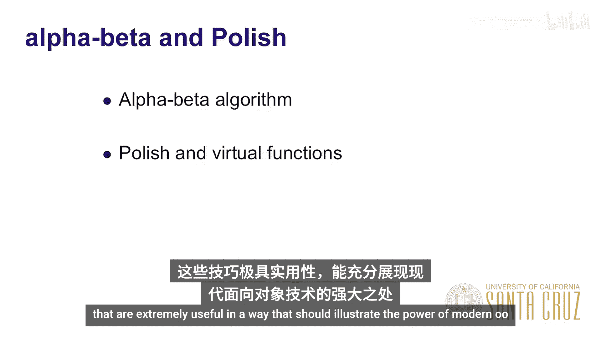
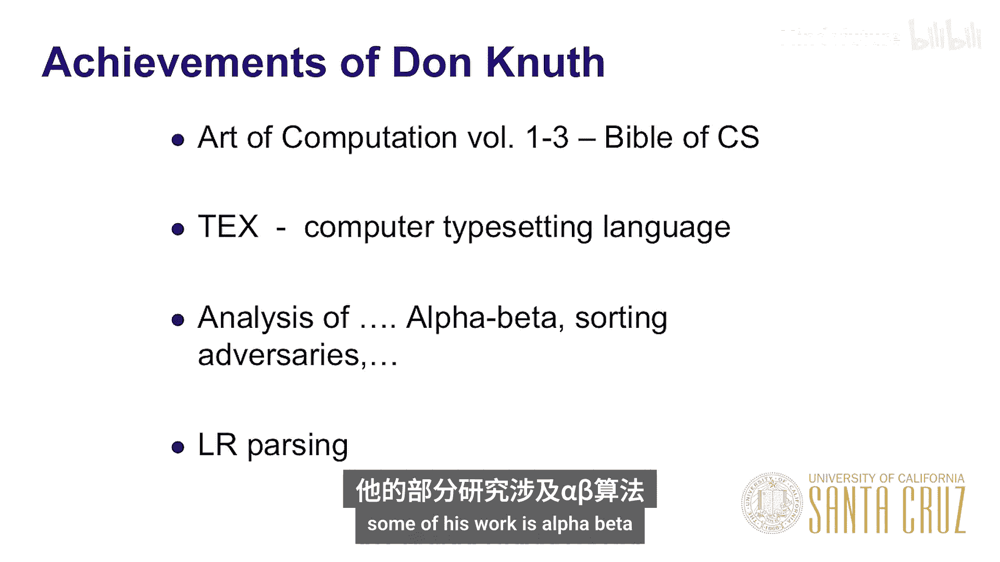

# 036：Alpha-Beta算法预览与C++多态性应用

在本节课中，我们将学习两个核心主题。首先，我们将介绍一种名为Alpha-Beta剪枝的计算效率更高的Minimax算法变体。其次，我们将深入探讨C++中的纯多态性，通过一个精彩的示例来展示如何利用继承和虚函数来评估波兰表达式。本节课旨在阐明现代面向对象技术的强大能力。

## Alpha-Beta剪枝算法简介

上一节我们讨论了基础的Minimax算法。本节中，我们来看看一种能显著提升其计算效率的优化版本——Alpha-Beta剪枝算法。

Alpha-Beta剪枝算法拥有悠久的历史，至少可以追溯到20世纪50年代。关于其发明者，存在多种说法，可能有三到五个不同的个人或团体。对于任何深入研究使用Minimax算法的游戏编程人员来说，这似乎是一种自然而然的发现。Minimax算法本身主要由冯·诺依曼和摩根斯坦为完全信息博弈而系统阐述。

当这些算法开始在跳棋、国际象棋等程序中实现时，一些早期的实践者，例如在IBM实现了著名跳棋程序的Arthur Samuel，也被认为是可能的发明者之一。可以说，许多人可能都独立发现了它，因为它本质上是一种计算上的捷径，而非某种基础性的理论突破。

然而，该算法在计算上的重要性及其所能带来的指数级性能提升，在数学上得到了我们当代最伟大的算法专家之一——斯坦福大学的Donald Knuth的详细论证。Knuth同时也是一位真正杰出的程序员。

## Donald Knuth的贡献

为了让您了解他的一些成就，以下是Donald Knuth的主要贡献领域：
*   他因《计算机程序设计艺术》系列丛书而闻名于世，这些书深入剖析了快速排序、随机数生成等诸多算法。
*   他发明了排版系统TeX。当时他因对自己著作的排版效果不满，从而创造了这一工具。如今，TeX及其衍生系统LaTeX已成为理论计算机科学和数学论文排版的行业标准。
*   他在语法分析领域贡献卓著，发明了称为LR分析的高效基础分析方法之一。
*   他对Alpha-Beta剪枝、排序算法等进行了大量最坏情况分析，并运用了对手论证等方法。

探索他的任何工作成果都极具价值，而Alpha-Beta剪枝算法正是其研究领域的一部分。

## 总结

本节课中，我们一起学习了Alpha-Beta剪枝算法的背景及其在提升Minimax算法效率方面的重要性。同时，我们也简要介绍了算法大师Donald Knuth的相关贡献，为后续深入理解算法细节奠定了基础。接下来，我们将转向C++多态性的实际应用部分。