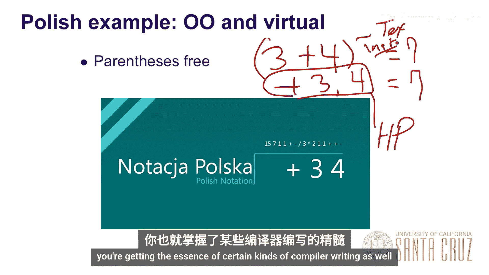
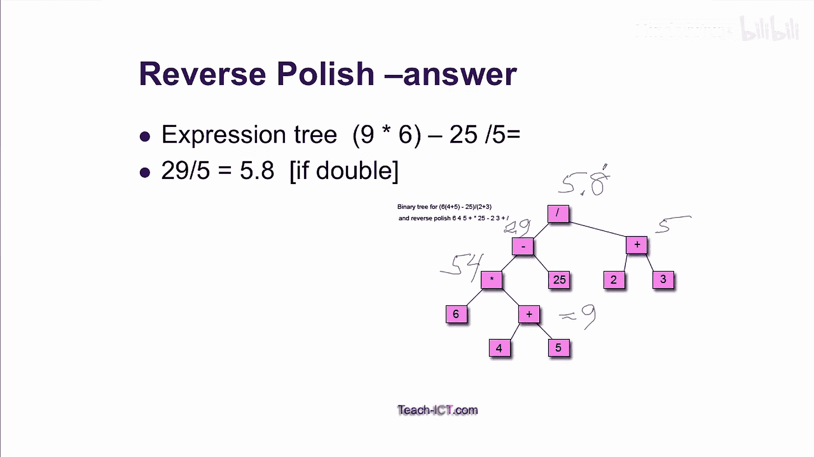

# 038：波兰表示法

## 概述

在本节课中，我们将学习如何评估波兰表达式。波兰表示法是一种无需括号即可明确运算顺序的数学表达式表示方法，它是某些计算器架构和编译器解析技术的基础。我们将通过一个具体的例子，理解其工作原理，并学习如何用C++相关的面向对象思想来解析和计算这类表达式。

## 波兰表示法简介

上一节我们介绍了表达式计算的基本概念，本节中我们来看看波兰表示法。我们通常使用的表达式格式称为“中缀表示法”，例如 `(A + B) * C`，它依赖括号来确定运算顺序。

波兰表示法则通过操作符和操作数的特定排列顺序来消除对括号的依赖。它分为前缀（波兰表示法）和后缀（逆波兰表示法）两种形式。本教程主要关注**逆波兰表示法**。

在逆波兰表示法中，操作符位于其操作数之后。例如，中缀表达式 `3 + 4` 在逆波兰表示法中写作 `3 4 +`。这意味着：对两个参数 `3` 和 `4` 应用二元加法运算符 `+`。两者计算结果都是 `7`。

## 逆波兰表示法如何工作

为了理解逆波兰表示法的计算过程，我们需要引入栈数据结构的概念。计算过程遵循一个简单的规则：从左到右扫描表达式，遇到操作数则压入栈；遇到操作符则从栈顶弹出所需数量的操作数进行计算，并将结果压回栈中。

以下是逆波兰表达式 `9 6 + 3 2 - *` 的计算步骤分解：



1.  遇到 `9`：压入栈。栈：`[9]`
2.  遇到 `6`：压入栈。栈：`[9, 6]`
3.  遇到 `+`：弹出栈顶两个元素 `6` 和 `9`，计算 `9 + 6 = 15`，将结果 `15` 压入栈。栈：`[15]`
4.  遇到 `3`：压入栈。栈：`[15, 3]`
5.  遇到 `2`：压入栈。栈：`[15, 3, 2]`
6.  遇到 `-`：弹出栈顶两个元素 `2` 和 `3`，计算 `3 - 2 = 1`，将结果 `1` 压入栈。栈：`[15, 1]`
7.  遇到 `*`：弹出栈顶两个元素 `1` 和 `15`，计算 `15 * 1 = 15`，将结果 `15` 压入栈。栈：`[15]`

表达式扫描完毕，栈中剩余的 `15` 即为最终结果。

## 表达式树

理解了计算流程后，我们来看看表达式在计算机内部的另一种表示形式——表达式树。表达式树是一种二叉树，它能直观地反映表达式的结构和运算优先级。

在表达式树中：
*   **叶子节点** 存放操作数（数值）。
*   **内部节点** 存放操作符。

计算表达式树的值，本质上就是按照树的结构，从叶子节点向上，在内部节点执行相应的运算。

例如，中缀表达式 `(6 * (4 + 5) - 25) / (2 + 3)` 对应的表达式树和逆波兰表示法如下：

**表达式树结构：**
```
        [/]
       /   \
     [-]   [+]
    /   \   / \
  [*]  25  2   3
 /   \
6    [+]
    /   \
   4     5
```
**计算步骤：**
1.  计算 `4 + 5 = 9`
2.  计算 `6 * 9 = 54`
3.  计算 `54 - 25 = 29`
4.  计算 `2 + 3 = 5`
5.  计算 `29 / 5 = 5.8`

**对应的逆波兰表达式：** `6 4 5 + * 25 - 2 3 + /`

可以看到，对表达式树进行**后序遍历**（左子树 -> 右子树 -> 根节点），得到的节点序列正好就是逆波兰表达式。这揭示了逆波兰表示法与表达式树遍历之间的深刻联系。

## 面向对象的表达式解析方法

本节我们将探讨一种优雅的、基于面向对象编程思想的表达式解析和求值方法。这个方法由C++领域的杰出贡献者**Andrew Koenig**提出，它巧妙地利用了**多态**和**虚函数**，展示了面向对象设计的强大能力。

Andrew Koenig是C++发展过程中仅次于Bjarne Stroustrup的重要贡献者，他的著作深入浅出，非常值得学习。

该方法的核心理念是：将表达式中的每个元素（无论是数字还是操作符）都视为一个对象，这些对象都属于一个共同的基类（例如 `Expr_Node`）。每个对象都有一个 `evaluate()` 虚函数。

*   对于**数字节点**，`evaluate()` 直接返回其存储的数值。
*   对于**操作符节点**，`evaluate()` 会调用其左右子节点（也是 `Expr_Node`）的 `evaluate()` 方法，获取它们的值，然后执行相应的运算并返回结果。

通过这种方式，整个表达式的求值过程可以通过从根节点开始，递归调用 `evaluate()` 来完成。这种方法干净地将表达式的**结构**与求值**逻辑**分离开，易于扩展新的操作符。

以下是该设计模式的简化代码框架描述：

```cpp
class Expr_Node {
public:
    virtual double evaluate() const = 0; // 纯虚函数
    virtual ~Expr_Node() {}
};

class Number_Node : public Expr_Node {
    double value;
public:
    Number_Node(double v) : value(v) {}
    double evaluate() const override { return value; }
};

class Addition_Node : public Expr_Node {
    Expr_Node* left;
    Expr_Node* right;
public:
    Addition_Node(Expr_Node* l, Expr_Node* r) : left(l), right(r) {}
    double evaluate() const override {
        return left->evaluate() + right->evaluate();
    }
};
// 类似地定义 Subtraction_Node, Multiplication_Node 等
```

## 总结



本节课中我们一起学习了波兰表示法，特别是逆波兰表示法。我们从其基本概念和手动计算步骤入手，理解了它如何利用栈来无歧义地求值表达式。接着，我们探讨了表达式树这一重要数据结构，并发现了逆波兰表达式与表达式树后序遍历之间的等价关系。最后，我们介绍了一种由Andrew Koenig提出的、基于多态和虚函数的面向对象表达式解析方法，这种方法结构清晰、扩展性强，体现了C++面向对象设计的精髓。掌握这些内容，不仅有助于理解某些计算器的工作原理，也为学习编译原理中的语法解析打下了坚实的基础。