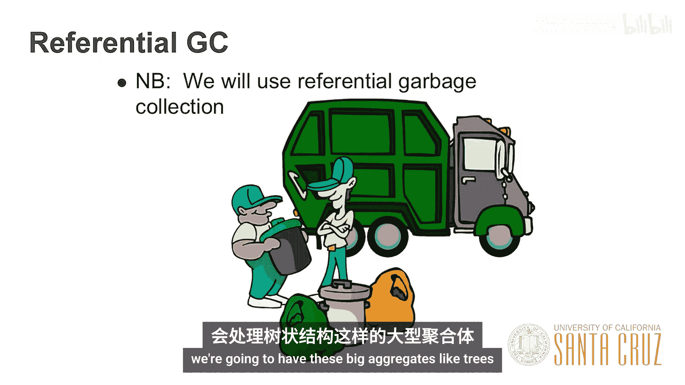
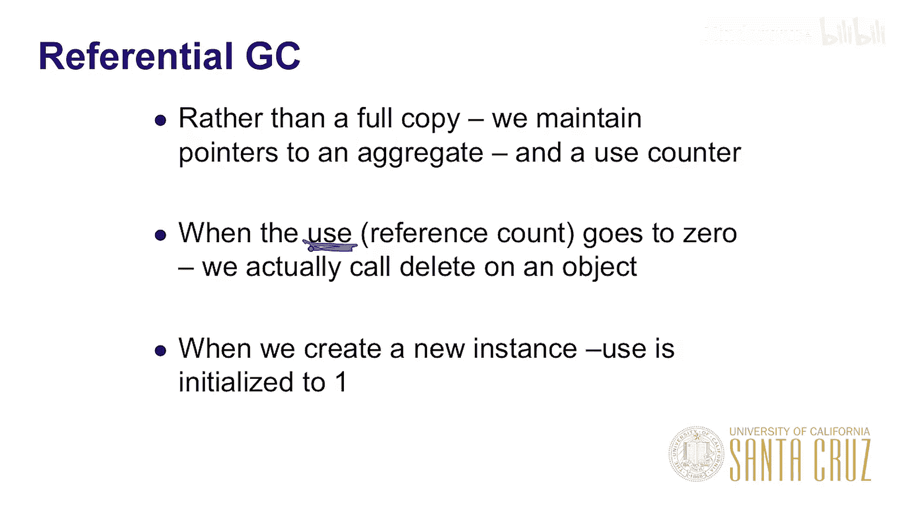
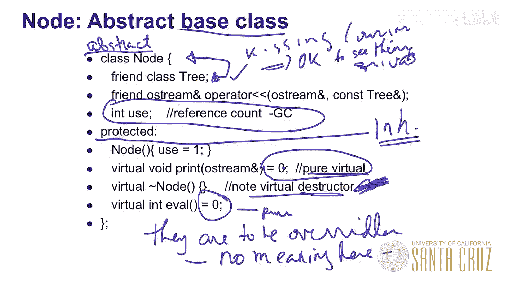
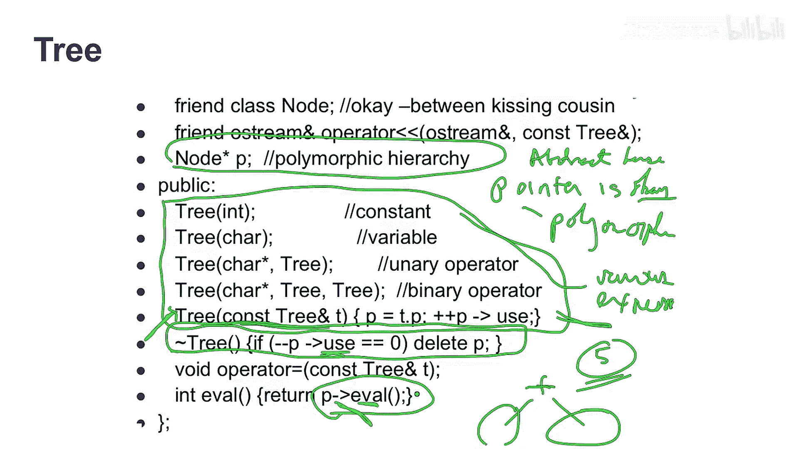
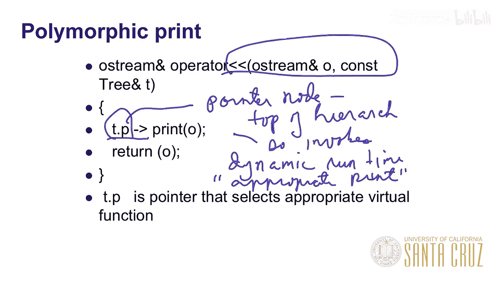

# 039：引用计数垃圾回收

## 概述



在本节课中，我们将学习如何编写一个能自动管理内存的程序。这个程序的核心是**引用计数垃圾回收**机制。我们将看到如何利用这个机制，以一种通用的、多态的方式来求值表达式。这个例子虽然简洁，但包含了多个强大的编程思想。

## 引用计数垃圾回收的核心思想

上一节我们介绍了表达式求值的概念，本节中我们来看看如何高效地管理表达式树这类大型聚合对象。

我们并不希望程序运行时无限制地复制整个表达式树。相反，我们需要一种高效的机制来表示多棵树。当出于某种目的需要克隆一棵树时，我们希望这种克隆是**浅拷贝**或**引用拷贝**。

在引用计数垃圾回收中，我们不进行完整的复制，而是复制指向聚合对象的指针。理解指针和解引用是精通C/C++编程的关键。在C中，你需要掌握`malloc`和`free`；在C++中，则是`new`和`delete`。

可以这样理解：假设你在图书馆需要使用《大英百科全书》。这本百科全书价格昂贵（例如1000美元），图书馆不会外借，通常也只有一份副本。但这唯一的一份副本可以服务许多人，因为书的内容不会被修改，每个人都可以指向他们需要使用的部分。同样地，在我们的程序中，当不需要制造一个新副本，而仅仅是指向一个现有副本时，我们就可以进行引用拷贝——只需建立一个新的指针指向聚合对象中的正确位置。

然而，我们可能会修改这些聚合对象。在修改时，可能需要丢弃一些对象。这就需要知道何时删除一个对象，这通常通过**使用计数**或**引用计数**来实现。

在每个聚合对象中，会有一个特殊的变量来记录“有多少指针指向我”。只要还有人在使用这个对象（引用计数大于0），我们就不能销毁它。只有当引用计数降为0时，我们才真正删除这个聚合对象。任何时候我们创建一个新的实例（例如修改一个旧实例时），我们会创建一个新实例并将其引用计数设为1。这就是引用计数垃圾回收的核心。

## 程序结构设计

现在，让我们看看这个程序的具体结构。我们将通过一个表达式求值的例子来展示这些思想。

### 抽象基类：Node



表达式树的基本元素是节点。节点将由一个我们称之为**抽象基类**的东西来表示。

以下是`Node`类的关键设计要点：
*   `Node`类将与`Tree`类紧密协作，它们需要互相访问对方的私有或保护成员以实现高效操作，这是一种紧密的“友元”关系。
*   为了实现多态行为，我们将使用一个继承层次结构，因此成员需要被声明为`protected`。
*   类中包含**虚函数**。特别需要注意的是，**析构函数被声明为虚函数**。通过本示例的学习，你需要理解为什么这必须是一个虚函数。
*   函数声明后的`= 0`表示这是一个**纯虚函数**。纯虚函数没有具体的实现，必须在派生类中重写。
*   包含纯虚函数的类称为**抽象基类**，这意味着不能创建该类的实例对象。这是因为如果存在实例，就可以调用这些没有意义的纯虚函数，这是不允许的。

以下是`Node`类的代码框架：

```cpp
class Node {
protected:
    // 引用计数器，记录有多少指针指向此节点
    int use;
public:
    Node() : use(1) {}
    // 虚析构函数至关重要
    virtual ~Node() {}
    // 纯虚函数，使Node成为抽象基类
    virtual int eval() const = 0;
    virtual void print(std::ostream& os) const = 0;
};
```

### 聚合类：Tree

回想之前我们通过遍历树来求值波兰表达式。这里的`Tree`类就代表这样一棵表达式树。

`Tree`类与`Node`类存在紧密的“友元”关系。注意，`Node`是一个抽象基类，因此不能有具体的`Node`实例，但可以有指向`Node`的**指针**。这个指针是基类类型，这使得它具有**多态性**。

这意味着，根据`Tree`中实际指向的节点类型（例如，后面会定义的执行二元加法的`BinaryNode`），通过这个基类指针调用求值函数时，多态机制（动态绑定）会自动调用类层次结构中正确的成员函数。正是这些精妙思想的相互作用，为我们提供了一个强大、简洁且易于扩展的解决方案。



`Tree`类包含多种构造函数，用于创建不同类型的树：
*   包含整数的树（如叶子节点5）。
*   包含变量（用简单字符表示）的树。
*   包含一元运算符的树。
*   包含二元运算符并作用于两棵子树的树。

此外，还有一个关键的**拷贝构造函数**，它实现了引用拷贝。析构函数和赋值运算符重载也都会利用`use`引用计数。求值函数`eval()`通过基类指针调用，由于`eval()`是虚函数，因此会进行多态调用。

以下是`Tree`类的代码框架：

```cpp
class Tree {
    // 多态指针，指向抽象的Node
    Node* p;
public:
    // 各种构造函数
    Tree(int); // 整数常量树
    Tree(char); // 变量树
    Tree(const std::string&, const Tree&); // 一元运算符树
    Tree(const std::string&, const Tree&, const Tree&); // 二元运算符树

    // 拷贝构造函数（实现引用拷贝）
    Tree(const Tree& t) : p(t.p) { ++p->use; }

    // 析构函数
    ~Tree() { if (--p->use == 0) delete p; }

    // 赋值运算符重载
    Tree& operator=(const Tree& t);

    // 求值函数（通过多态调用）
    int eval() const { return p->eval(); }
};
```

### 引用拷贝与删除的具体实现

让我们聚焦于上一张幻灯片中的两个关键元素，它们展示了引用拷贝和删除的具体工作方式。

**拷贝构造函数**：
如果已经存在一个《大英百科全书》（一个聚合对象），现在有另一个人也需要它，并且我们不打算修改它，那么我们只需给这个人一个新的指针，并**增加引用计数**。
如果原来有1个人在使用，拷贝后就有2个人在使用。引用计数可以持续增加。
注意，拷贝的**时间复杂度是常数O(1)**。因为无论聚合对象（百科全书或树）有多大，我们只需要增加引用计数和进行一次指针赋值。

**析构函数**：
如果图书馆中的某个人要离开了，不再需要访问《大英百科全书》，那么这个人对应的对象就被销毁。我们会调用析构函数，它执行以下操作：**减少引用计数**，并检查引用计数**是否变为0**。只有当引用计数变为0时，我们才执行真正的、具体的删除操作。
这保护了我们，直到确实不再需要这个聚合对象时才将其删除。



### 多态打印例程

程序中还有一个**多态的打印例程**。同样，我们将基于指针进行操作。`p`是指向`Node`的指针，它是节点层次结构的顶层。因此，它在运行时动态地调用适当的`print`函数。然后我们重载输出操作符`<<`，使得打印操作能够在整个树中多态地进行。

以下是打印功能的代码示例：

```cpp
std::ostream& operator<<(std::ostream& os, const Tree& t) {
    t.p->print(os); // 多态调用print
    return os;
}
```

## 总结

本节课中，我们一起学习了**引用计数垃圾回收**机制在C++表达式求值程序中的应用。我们深入探讨了以下核心概念：
1.  **引用计数**：通过`use`计数器跟踪对象被引用的次数，仅在计数为0时删除对象，实现了高效的浅拷贝（引用拷贝）。
2.  **抽象基类与纯虚函数**：使用包含纯虚函数（如`eval() = 0`）的`Node`类作为抽象基类，强制派生类实现特定接口，并使得类本身无法实例化。
3.  **多态与虚函数**：利用基类指针（`Node*`）和虚函数（特别是**虚析构函数**），在运行时动态调用正确的派生类方法，实现了优雅的表达式求值。
4.  **程序结构**：设计了`Tree`类与`Node`类层次结构协同工作，通过友元关系实现高效访问，并通过多态机制使解决方案简洁且易于扩展。



这个例子综合展示了如何通过结合这些高级C++特性，构建出内存高效、行为正确且易于维护的程序。