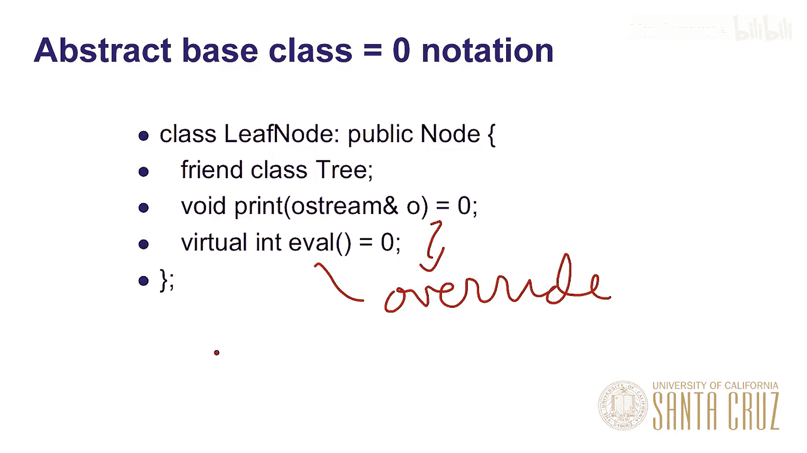
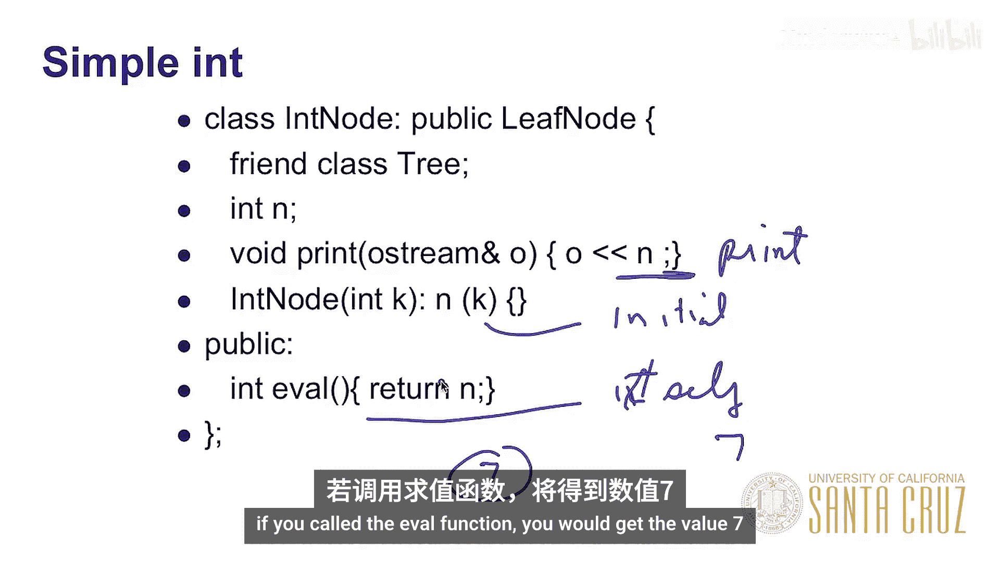
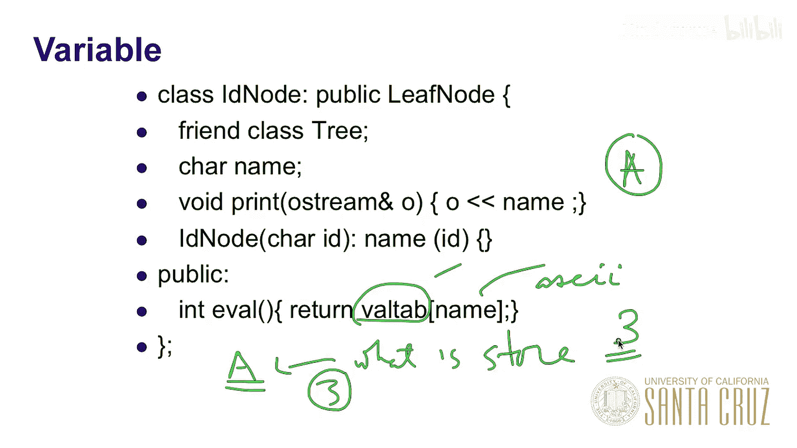
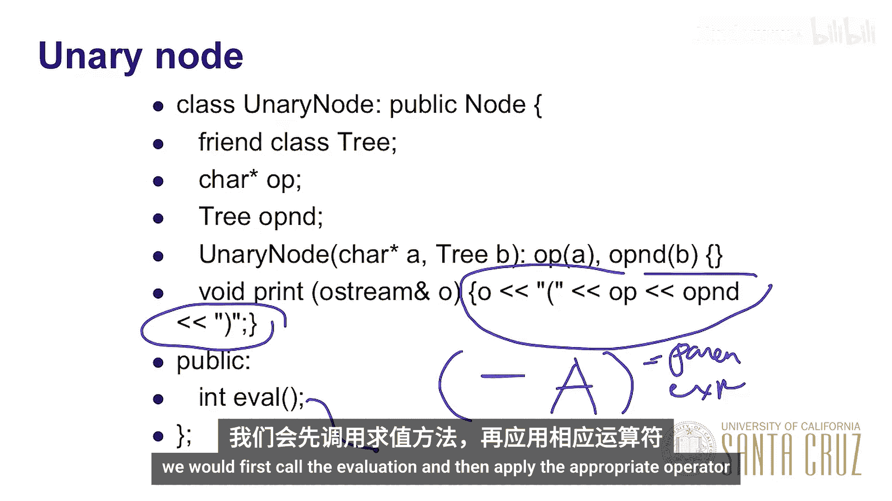
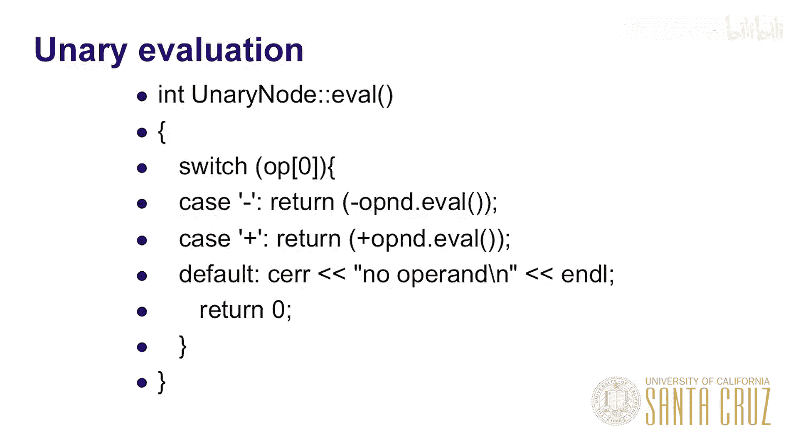
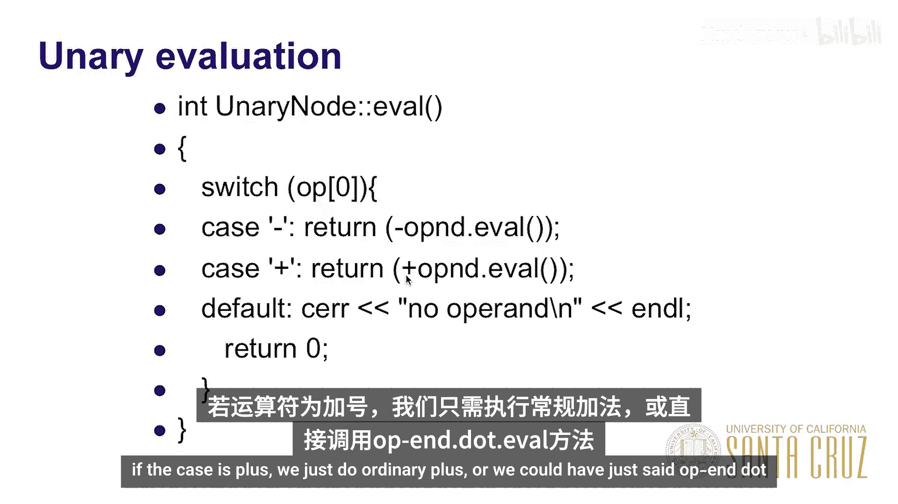
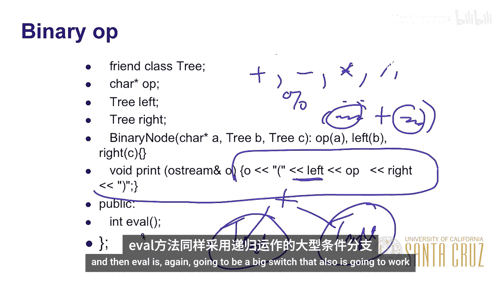
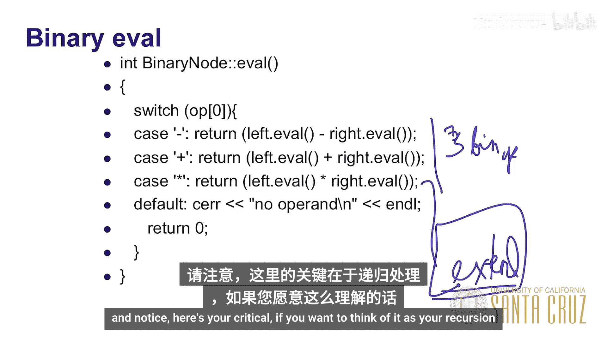
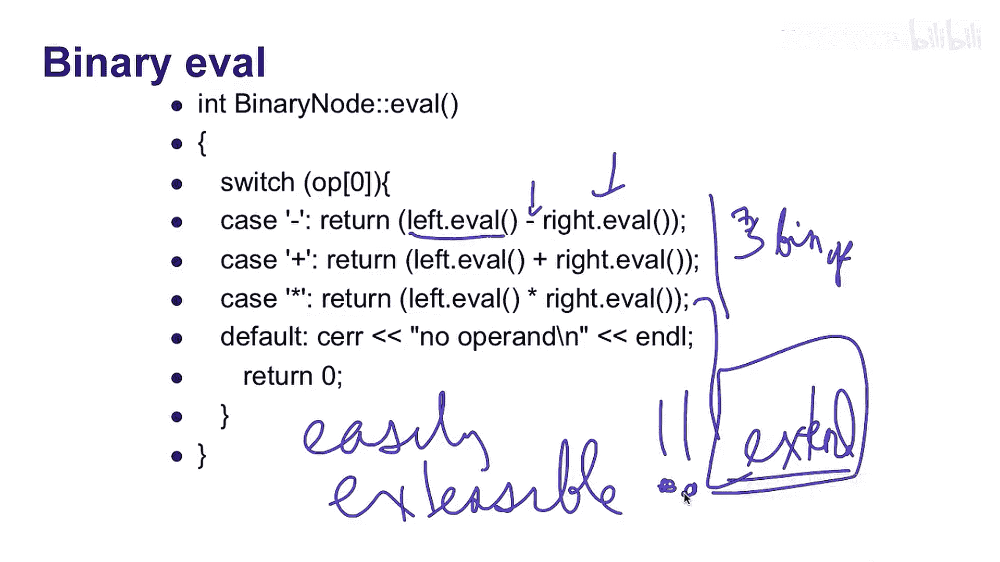

# 040：抽象基类与表达式树

在本节课中，我们将学习如何利用抽象基类来构建一个表达式树。我们将看到如何定义抽象的节点类，并从中派生出具体的节点类型，如常量、变量和运算符节点，最终实现一个可以求值和打印的表达式系统。

---

## 抽象基类：`LeafNode`



上一节我们介绍了抽象基类的概念，本节中我们来看看一个具体的抽象基类 `LeafNode`。它继承自另一个抽象基类 `Node`，这展示了抽象类可以从另一个抽象类派生。

`LeafNode` 之所以是抽象的，是因为它的 `print` 和 `evaluation` 函数仍然没有具体的实现定义。

```cpp
class LeafNode : public Node {
public:
    virtual void print() = 0; // 纯虚函数
    virtual int eval() = 0;   // 纯虚函数
};
```

具体的叶节点类型（如常量节点、变量节点）需要从 `LeafNode` 派生，并重写这些函数以提供实际的功能。



---

## 具体叶节点类型

以下是几种具体的叶节点类型，它们都继承自 `LeafNode` 并实现了具体的功能。

### 常量节点 (`IntNode`)

常量节点是最简单的情况。它代表一个固定的整数值，例如数字 `6`。该表达式的值就是它本身。



```cpp
class IntNode : public LeafNode {
private:
    int value;
public:
    IntNode(int v) : value(v) {} // 构造函数
    void print() override { std::cout << value; }
    int eval() override { return value; }
};
```

对于值为 `7` 的节点，调用 `print()` 会输出 `7`，调用 `eval()` 会返回值 `7`。

### 变量节点 (`VarNode`)

变量节点代表一个变量，例如字母 `a`。我们采用一个简化的模型：变量名是一个 ASCII 字符，其值存储在一个数组中。

```cpp
class VarNode : public LeafNode {
private:
    char name;
public:
    VarNode(char n) : name(n) {} // 构造函数
    void print() override { std::cout << name; }
    int eval() override { return lookupValue(name); } // 假设有一个查找函数
};
```

对于名为 `a` 的节点，`print()` 会输出 `a`，而 `eval()` 会返回存储在 `a` 中的当前值（例如 `3`）。

---





## 一元运算符节点 (`UnaryNode`)

现在，我们来看看更复杂的节点类型。一元运算符节点，例如一元负号 `-`，它作用于一个操作数。



```cpp
class UnaryNode : public Node {
private:
    char op;
    Node* operand;
public:
    UnaryNode(char o, Node* opnd) : op(o), operand(opnd) {}
    void print() override {
        std::cout << "(" << op << " ";
        operand->print();
        std::cout << ")";
    }
    int eval() override {
        int val = operand->eval();
        switch(op) {
            case '-': return -val;
            case '+': return val; // 一元正号，值不变
            default: return 0; // 错误处理
        }
    }
};
```

对于表达式 `-a`，`print()` 会输出 `(- a)`，`eval()` 会先计算 `a` 的值，然后取其相反数。

---

## 二元运算符节点 (`BinaryNode`)

最有趣的情况是二元运算符节点，例如加法 `+`、减法 `-`、乘法 `*`。它包含左子树和右子树两个操作数。

```cpp
class BinaryNode : public Node {
private:
    char op;
    Node* left;
    Node* right;
public:
    BinaryNode(char o, Node* l, Node* r) : op(o), left(l), right(r) {}
    void print() override {
        std::cout << "(";
        left->print();
        std::cout << " " << op << " ";
        right->print();
        std::cout << ")";
    }
    int eval() override {
        int lval = left->eval();
        int rval = right->eval();
        switch(op) {
            case '+': return lval + rval;
            case '-': return lval - rval;
            case '*': return lval * rval;
            default: return 0; // 错误处理
        }
    }
};
```

这个设计的关键在于递归和多态。`print()` 和 `eval()` 函数会递归地遍历整个表达式树。`eval()` 会先计算左子树的值，再计算右子树的值，最后根据运算符组合它们。



---



## 系统的可扩展性

这个表达式求值方案很容易扩展。如果你有兴趣，可以轻松地添加更多运算符（如除法 `/`、取模 `%`）或更复杂的功能。

整个系统通过多态和递归无缝协作。求值过程最终会递归到叶节点（常量或变量），从而获取基础值。

---



本节课中我们一起学习了如何用抽象基类构建一个表达式树。我们定义了抽象的 `Node` 和 `LeafNode` 类，并从中派生了具体的常量节点、变量节点、一元和二元运算符节点。通过重写虚函数和利用递归，我们实现了一个可以打印和求值任意复杂算术表达式的灵活系统。这个模式是 C++ 中利用多态处理树形结构的经典范例。