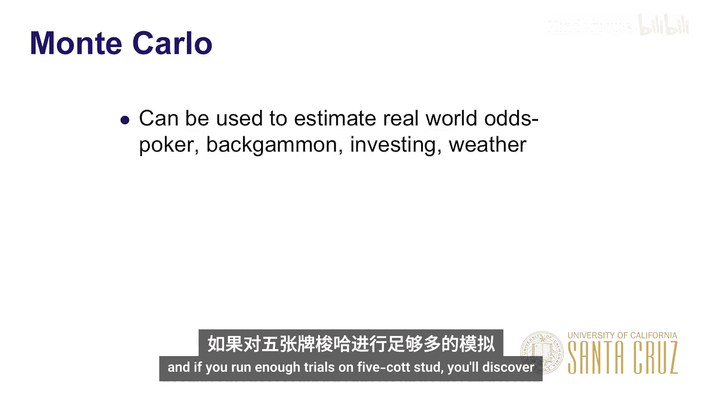
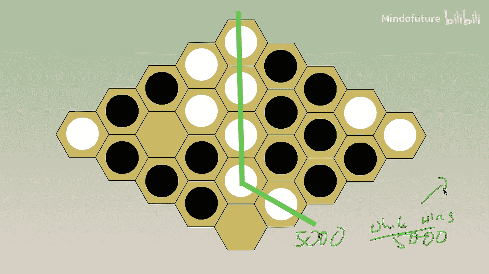
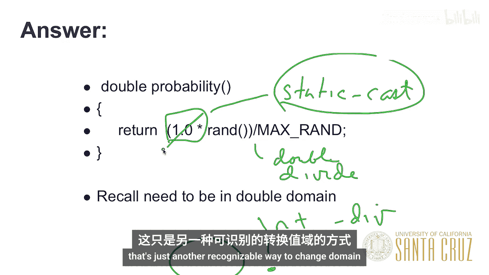

# 043：蒙特卡洛方法在Hex游戏中的应用

在本节课中，我们将学习蒙特卡洛方法的核心概念，并探讨如何将其应用于评估Hex游戏中的棋盘位置。我们将通过模拟大量随机对局来评估每一步棋的优劣，而无需依赖复杂的静态评估函数或深度搜索。

蒙特卡洛方法是一种基于大量随机试验的模拟技术。它通过生成大量伪随机数来模拟事件，从而预测未来结果或评估概率。这种方法特别适用于那些难以用常规数学方法直接求解的复杂问题。

## 蒙特卡洛方法的核心价值

上一节我们介绍了蒙特卡洛方法的基本概念，本节中我们来看看它的核心价值和应用场景。

蒙特卡洛方法是一种模拟技术，它大量依赖于生成合理的伪随机数的能力。显然，这些随机数并非真正随机，但足以支撑大量试验的进行。



这些大量的试验是预测未来事件的基础。例如，你可以使用蒙特卡洛方法来预测未来一百年内小行星撞击地球的概率。你需要知道一些概率数据，以及太阳系的一些事实和数字，然后才能做出估计。人们也使用蒙特卡洛方法进行风险管理，例如计算百年一遇的洪水或十年一遇的飓风的概率。我们现在发现这些事件发生的可能性越来越大，因为我们对气候变化的了解越来越深入。

概率性试验让我们能够触及那些普通数学方法无法处理的问题。因此，它可以用来测量现实世界的事件，也可以用来预测赔率。我们早期曾尝试用蒙特卡洛试验来预测扑克游戏中同花顺的几率。如果你在五张牌梭哈游戏中运行足够多的试验，你会发现同花顺的概率大约是七万分之一。


如果你问大多数扑克玩家这个数字是多少，他们可能并不熟悉。我实际上非正式地尝试过，他们的猜测千差万别。当然，你可以查表或计算，这在数学上并不难。但只需很少的计算经验，你不需要了解概率知识，就能轻松估算各种事情。因此，你可以将其大量应用于投资领域。这是一种非常有用的技术。

## 蒙特卡洛方法与Hex游戏

上一节我们了解了蒙特卡洛方法的通用价值，本节中我们来看看它如何具体应用于Hex游戏。

这是我们的Hex棋盘。我们展示的是一个5x5的棋盘，这是一个相对较小的棋盘。实际上，当你开始编写代码时，希望我已经说过这一点：不要一开始就使用更大的棋盘。使用一个小棋盘。确保所有功能在小棋盘上都能正常工作。小棋盘在调试代码时会容易得多。

棋盘的大小应该是一个参数。因此，扩展棋盘大小并不困难，但用小棋盘来调查走棋质量以及程序中所有功能是否正常会容易得多。这是一个5x5的棋盘。

我们想要研究，在5x5棋盘上，什么是好棋？因此，我们在那个5x5棋盘上尝试所有可能的走法。本质上，我们有25个位置可以落子。

我们假设白棋是先手玩家。我们有25个位置需要评估。我们不会只评估看似合理的走法，而是评估所有走法。所以，如果是11x11的棋盘，你需要评估121个位置。当然，你可以更巧妙一些，假设其中一些走法彼此非常相似。因此，一个角部走法与另一个角部走法相比应该没有优势，在棋盘北侧上部走棋与在南侧下部走棋相比也应该没有优势。所以你可以限制一些走法。这种优化可能是有价值的。但目前，让我们先忘记优化，因为一旦棋盘上有了棋子，所有方格相对于棋盘上已有的棋子来说都变得独一无二。实际上，只有在第一步棋时，你才能利用对称性的数学特性来说明这一步棋和那一步棋是相同的。

我们尝试所有这些走法。现在，这里有一个出乎意料的发现，源于那些研究围棋的人。棋盘上剩余的走法将由随机生成。没有看似合理的走法，没有Alpha-Beta剪枝检查，什么都没有。我们将通过抛硬币来决定接下来的24步棋。所以黑棋下一步，黑棋在棋盘上随机走一步。白棋在棋盘上随机走一步。我们填满棋盘的剩余部分。在填满棋盘剩余部分后，我们就知道谁赢了这局游戏。这里有一条获胜路径。在这局游戏的最后，这条白棋路径，白棋在这里获胜。我们本可以更早停止，比如这里显示还有一些空位可以落子时。但今天我要解释为什么不值得费心在每一步都停下来检查是否有人赢了。我现在就解释，以后还会重复：事实证明，你不如直接填满棋盘，因为一旦有人赢了，就没有办法改变那个结果。填满棋盘的其余部分无关紧要。为什么？因为一旦有人从他们的一边到另一边形成了一条路径，他们也同时形成了一个阻挡。所以另一方不可能再形成一条路径。这就是Hex游戏的特点。因此，随机填满棋盘是一个非常简单的计算，而决定谁赢了则不是一个简单的计算。为什么决定谁赢不是简单的计算？因为这本质上涉及一个类似Dijkstra的算法，我们之前讨论过。这是一个复杂的计算，用于在每一步判断谁赢了。所以在这里，你有一个非常基础的操作：只需几步操作来填满棋盘，然后通过执行一次且仅一次Dijkstra算法（那个大计算）来得到结果。因此，你不如直接进行到棋盘结束，判断谁赢了。然后你重复这个过程。

对于这个位置，假设你重复了5000次。有时白棋会赢，有时黑棋会赢。这是你所期望的。你会得到一个比率：白棋获胜次数除以5000次试验。这个比率现在将成为对该位置的一种评估，也就是你评估该棋盘的方式。你不需要知道其他任何东西，你不需要在叶节点上进行静态评估（比如检查最长路径是什么），你将非常简单地完成：你的评估函数仅仅是运行尽可能多次的蒙特卡洛模拟，这取决于你编写算法的效率以及计算机硬件的速度。

这将是对你C++编程技巧的一个考验，因为你确实希望获得最高的效率。然后，如果你得到一个相对较高的数字，你基本上可以说：哦，从这个走法开始，两个傻瓜对弈，其中一个傻瓜似乎比另一个傻瓜表现好得多，也许这隐含地意味着这是一个更可取的走法。



这就是洞见所在。洞见在于，你不需要两个象棋大师或两个精通复杂桥梁策略、检查策略的Hex大师，或者精通围棋地域特殊模式的围棋大师。相反，棋盘位置的特性将通过让两个傻瓜从该位置开始对弈来揭示，而获胜次数更多的一方，本质上是从一个更好的位置开始对弈的。这就是洞见。

## 随机数的生成与使用

上一节我们探讨了蒙特卡洛模拟的流程，本节中我们来看看如何具体生成和使用随机数来驱动模拟。

好的，花点时间，让我们再思考一下使用随机数。`rand()`函数给你一个整数伪随机数，这是基础库中`rand()`函数为你做的。

你如何将这个整数转化为一个概率？这应该是复习内容。

以下是实现方法。我们通过调用`double probability()`函数来生成一个概率。实际上你也可以从标准库中直接获取概率值。你只需要返回`rand()`除以最大范围`RAND_MAX`，这是一个库定义的最大随机数。在本例中，我使用了`1.0`这个双精度数，这会将这个表达式转换为双精度类型。我必须注意，为什么我必须记得为什么需要在双精度域中？我必须在双精度域中是因为我希望这个结果是双精度除法。这是整数除法。

所以如果我漏掉了这个，概率将总是返回0。这不是你想要的。另一种方法是使用静态类型转换。所以如果我们进行静态转换，我们可以做到。这只是另一种可识别的改变数据类型域的方法。




以下是生成0到1之间（包含0，不包含1）随机概率的代码示例：

```cpp
double probability() {
    return rand() / (RAND_MAX + 1.0);
}
```

或者使用静态类型转换：

```cpp
double probability() {
    return static_cast<double>(rand()) / RAND_MAX;
}
```

## 总结


本节课中我们一起学习了蒙特卡洛方法在Hex游戏AI中的应用。我们了解到，蒙特卡洛方法通过大量随机模拟来评估棋盘位置的优势，其核心洞见在于：即使由“两个傻瓜”进行随机对弈，从更好位置出发的一方也会赢得更多对局。这种方法避免了对复杂静态评估函数或深度搜索的依赖。我们还回顾了如何在C++中生成用于模拟的随机概率。在实现时，关键是要编写高效的代码以运行尽可能多的模拟试验，从而获得可靠的评估结果。