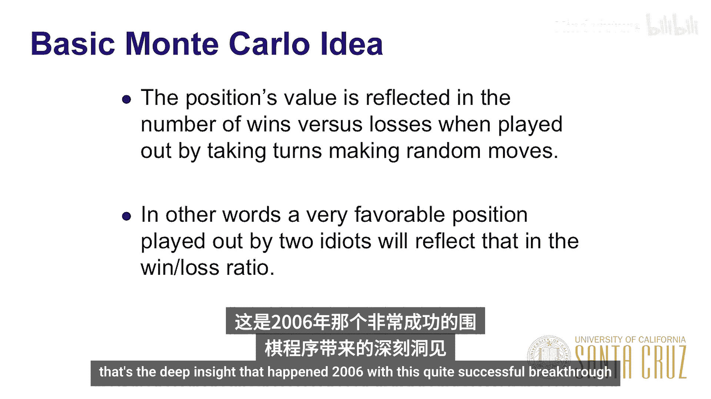
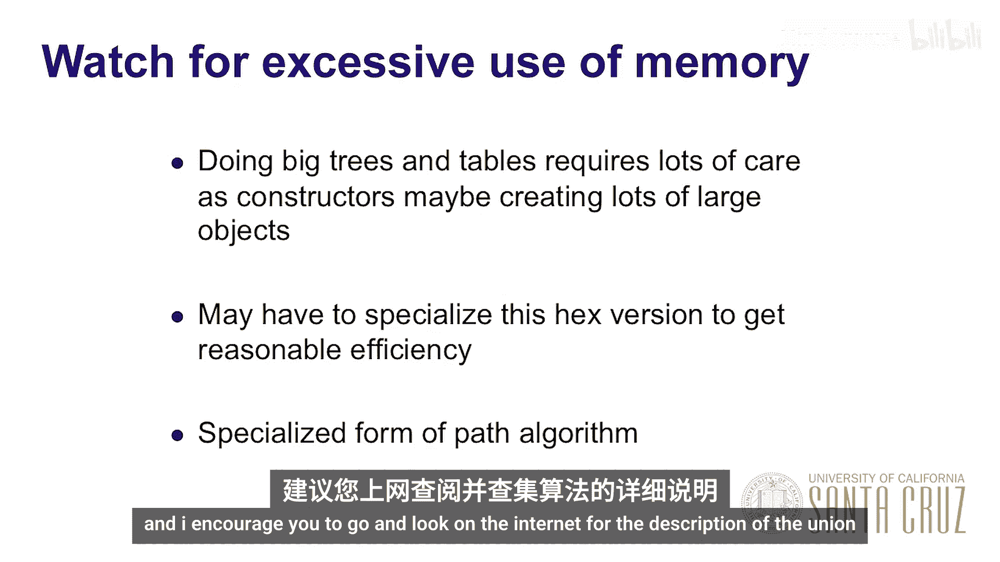

# 044：蒙特卡洛基本思想

在本节课中，我们将要学习蒙特卡洛方法在游戏AI（特别是围棋程序）中的核心思想。我们将探讨如何通过随机模拟来评估棋步，并理解这种现代AI方法与传统专家系统方法的区别。同时，我们也会讨论在C++中实现此类算法时需要注意的性能和数据结构问题。

## 核心思想：随机模拟与胜率评估

上一节我们介绍了游戏AI的背景，本节中我们来看看蒙特卡洛方法的关键洞察。

这个非凡的洞察力在于：仅仅通过在棋盘上进行随机走子，然后计算“玩家”与“随机走子者”的胜率比值，就能准确评估走出某一步棋的价值。这是2006年一个取得重大突破的围棋程序中体现出的深刻思想，并且它构成了许多现代AI思考的基础。

## 传统AI与现代AI的范式转变

在传统AI中，核心思想是模仿人类专家的行为模式。例如，在卡内基梅隆大学纽厄尔和西蒙的时代，人们认为可以通过获取人类专家的规则来构建强大的系统。

相比之下，现代的谷歌和亚马逊等公司则依赖海量信息（大数据），进行大量随机尝试，然后通过海量试验和巨大计算量发现同样深刻的关系。因此，AI领域经历了一次巨大的转变。

旧的认知建模策略并未被完全抛弃，但在许多情况下，当问题过于复杂或我们尚不清楚如何正确建模人类思维过程时，我们仍然可以通过计算机模型（处理海量信息甚至使用随机试验）来达到或超越人类水平的结果。

## 编程实现中的关键考量

现在，我们来看看在编程实现中需要牢记的要点。你将需要处理庞大的树结构和数据表。请记住，你有一个11x11的棋盘，但潜在的可能是一个NxN的棋盘，人们经常使用更大的棋盘进行游戏。因此，你的程序应该能够支持大到围棋棋盘尺寸的棋盘。

这可能需要大量的分析和庞大的树与表结构。如果你打算完全用C++实现，你需要确保不会创建大量额外的对象。如果你在基于图的数据结构中完成所有操作，你的构造函数可能会进行大量工作。你可能需要专门优化图结构，以利用六边形图这种非常特殊的图所带来的效率优势。

## 路径查找算法的优化

对于Dijkstra算法也是如此。没有理由使用通用的、任意权重的Dijkstra算法，因为我们在六边形图中寻找的是从棋盘一侧到另一侧的最短路径。这意味着我们需要判断某一方是否已经连通，即找到一条从一侧到另一侧的路径。

如果你有一个大小为11的棋盘，这条路径至少需要跨越10条边才能从一侧到达另一侧。但实际上可能需要更多边，因为路径可以在棋盘上蜿蜒。探索在游戏中可能的最长路径是一个有趣的练习。

高效查找路径的方法要么是专门优化Dijkstra算法，要么是使用经典的**并查集**算法。我鼓励你到互联网上查找并查集算法的描述。

## 性能优化的重要性

因此，你希望进行大量的试验，同时又不希望因为实现低效而陷入困境。从这个项目中你学到的另一点是：在处理大规模聚合数据时要非常小心。

内存不是无限的资源。编写一个正确但低效的程序非常容易，然后你会困惑为什么程序运行得如此之慢。别人如何能做到每步棋进行10万次模拟？他们有120步棋要走，现在你谈论的是1200万次试验和评估。如果你的实现效率低下，在你的计算机上可能需要数小时才能完成一次评估。

---

本节课中我们一起学习了蒙特卡洛方法在游戏AI中的基本思想，即通过大量随机模拟来评估棋步价值。我们对比了传统基于规则的AI与现代基于数据和随机试验的AI范式。最后，我们重点讨论了在C++中实现此类算法时，关于数据结构选择（如专用图结构）、算法优化（如并查集替代通用Dijkstra）以及程序性能（避免内存浪费和低效计算）的关键考量，这对于处理大规模模拟至关重要。