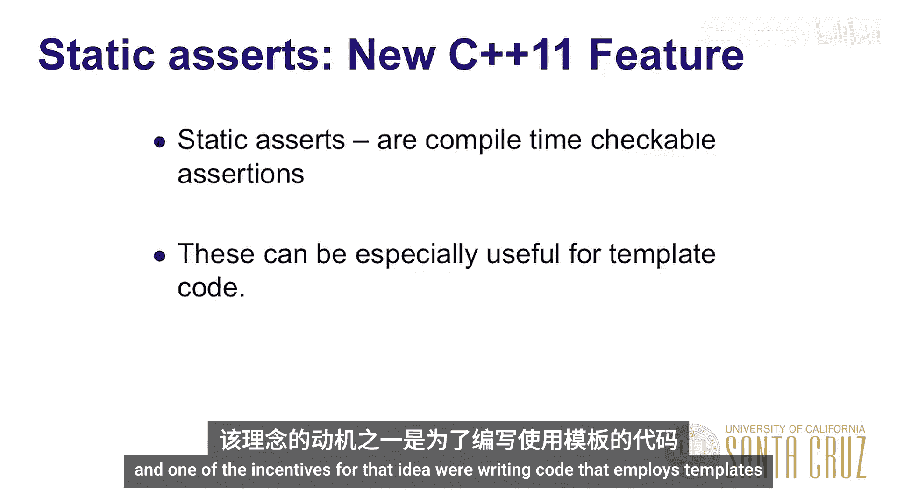
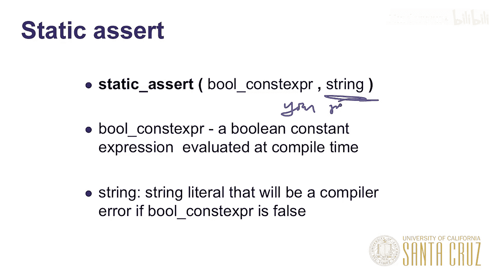
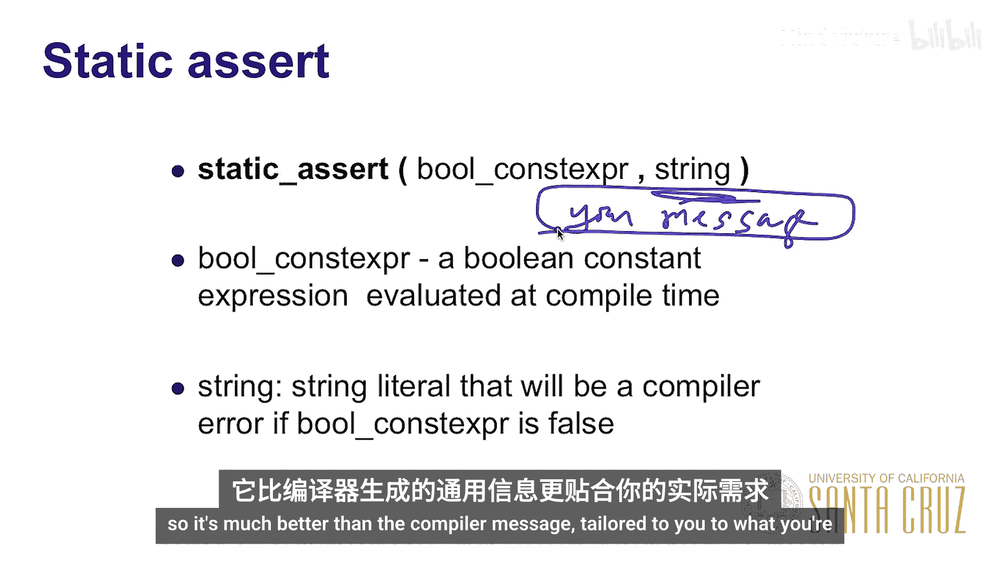
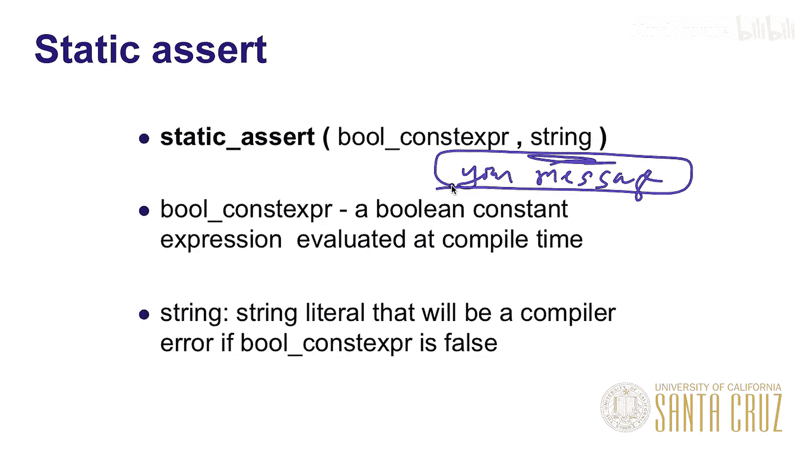
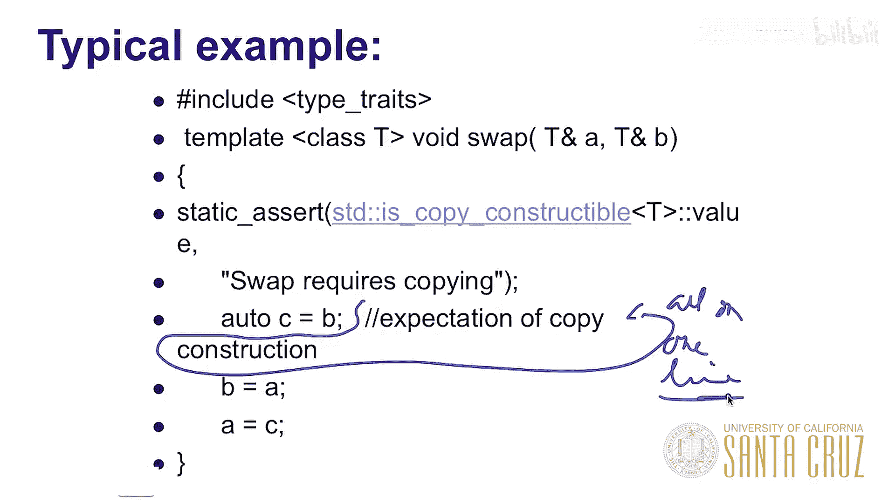
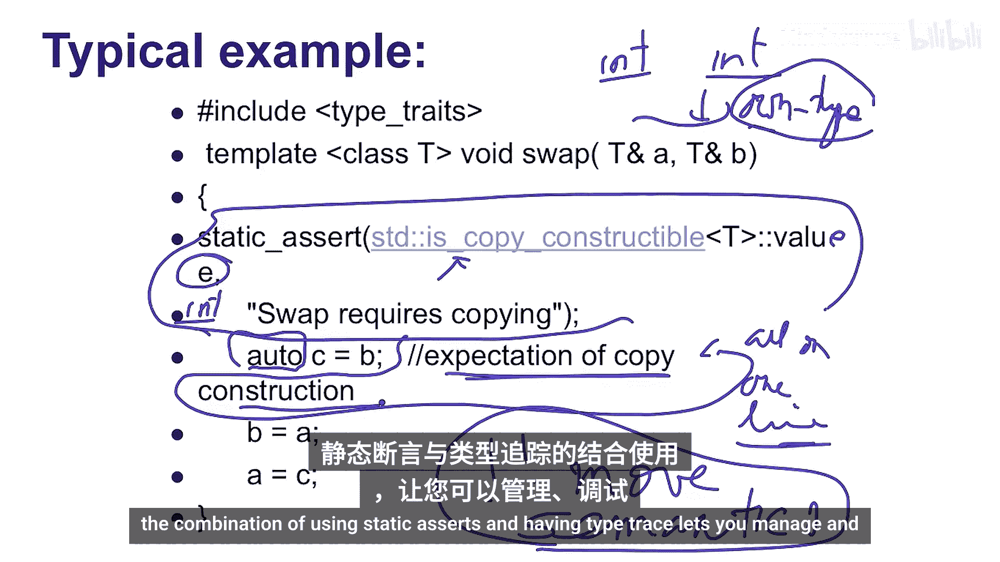
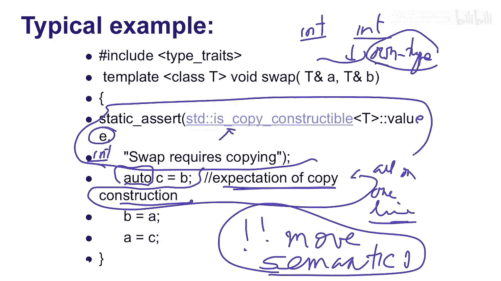

# 048：静态断言（C++11新特性）



在本节课中，我们将学习C++11引入的一个非常巧妙的新特性——静态断言。这是一种在编译时进行检查的断言机制，尤其在与模板编程结合时，能极大地提升代码的健壮性和错误信息的清晰度。

## 静态断言的概念与动机

上一节我们介绍了C++11的一些新特性，本节中我们来看看静态断言。静态断言是一个经过多年测试的特性，其思想最初来源于Boost库，许多C++新标准中的想法都在那里进行了测试。

静态断言是一种在编译时可检查的断言。这个想法非常巧妙，其主要的动机来源于编写模板代码。

模板代码与普通代码不同，它被设计为通用的、与类型无关的代码。当你编写一个模板时，你希望这段代码可以复用，因为它可能适用于整型、双精度浮点型、复数类型、字符串类型，甚至是用户自定义的类。

然而，这样的代码不太可能适用于所有可以想象的类型。一个简单的例子是标准模板库中的数值算法 `accumulate`。当你对一个标准容器进行累加时，你需要将容器中的每个元素相加求和。这段模板代码允许你对 `short`、`long`、`long long`、复数等类型进行操作，前提是这些类型必须有一个“零值”并且支持加法运算。

换句话说，模板代码预设它只会被实例化在一种可称为“可求和”的类型上。但在旧式C++中，无法直接检查这一点。你只能在模板参数中使用一个能暗示所需特性的标识符，例如 `class Summable`。

## 静态断言的作用与语法

在C++11中，标准库引入了“类型特征”的概念。结合静态断言，你可以让编译器检查类型是否具备所需的特性。这非常有用，主要有两个原因：

1.  **提供清晰的错误信息**：如果你编译的模板代码因为类型不支持某些操作（例如，不支持加法）而失败，你会得到一个编译时错误。但C++编译器产生的模板错误信息通常非常晦涩难懂。使用静态断言，你可以输出一个自定义的、针对该模板代码的清晰错误信息，例如“此类型不可求和”。
2.  **防止运行时错误**：更糟糕的情况是，代码可以编译并运行，但类型并不具备你期望的特性，只是碰巧有某种含义。这会导致更隐蔽的错误，代码会运行并产生某种不正确的行为，你只能在调试时发现它。静态断言可以在编译时就捕获这类问题。







静态断言的语法如下：
```cpp
static_assert(布尔常量表达式, “错误信息字符串”);
```
你提供一个在编译时可求值的布尔常量表达式，并设计当断言失败时显示的错误信息。这比编译器生成的通用错误信息要清晰得多。



以下是静态断言的一个典型示例：

```cpp
template <typename T>
void swap(T& a, T& b) {
    auto c = b; // C++11的auto，类型从b推断
    b = a;
    a = c;
    static_assert(std::is_copy_constructible<T>::value,
                  “Swap requires copying”);
}
```
在这个交换模板函数中，我们使用了一个静态断言。它利用标准库 `<type_traits>` 头文件中的 `std::is_copy_constructible` 来检查类型 `T` 是否可复制构造。

让我们思考一个典型情况。如果我们用 `int` 来实例化这个模板，`auto c = b;` 中的 `auto` 会被推断为 `int`，代码就是简单的赋值和交换，没有问题。

但是，如果你尝试用一个禁用了复制构造的自定义类型来实例化这个模板，那么执行 `auto c = b;` 这行代码就是非法的，因为它期望进行复制构造。此时，静态断言会触发，并显示你自定义的错误信息：“Swap requires copying”。这对开发者来说非常清晰。

## 总结





本节课中我们一起学习了C++11的静态断言特性。静态断言结合类型特征库，是一个非常巧妙的想法。它允许你在编译时对模板代码施加规则并进行检查，从而管理潜在的bug，并强制编译器为你执行类型约束。这是一个非常强大且实用的工具，能显著提升模板代码的安全性和可维护性。