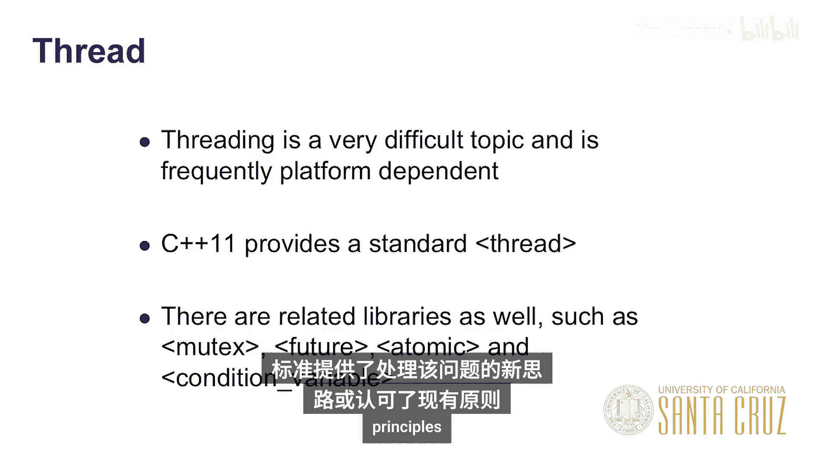
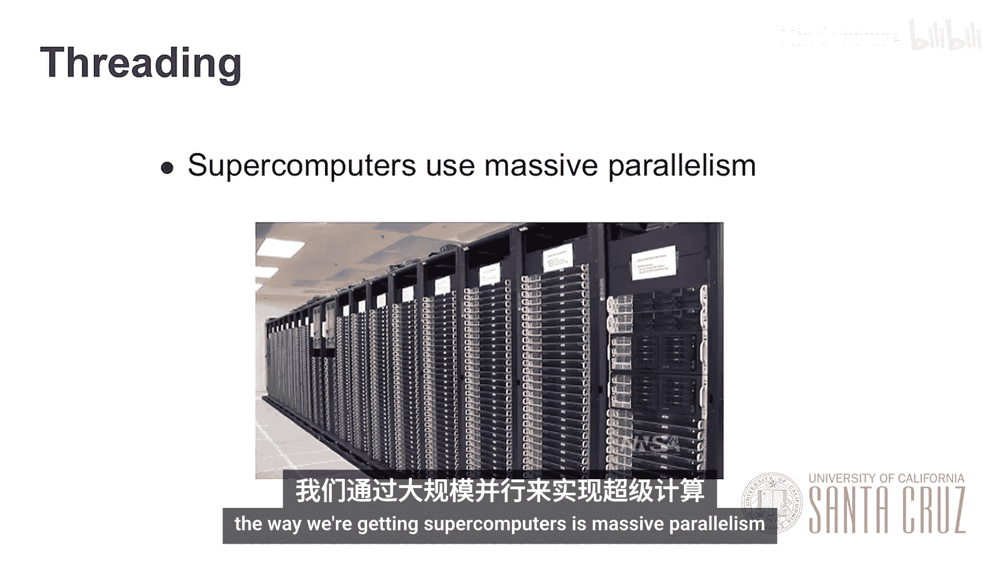
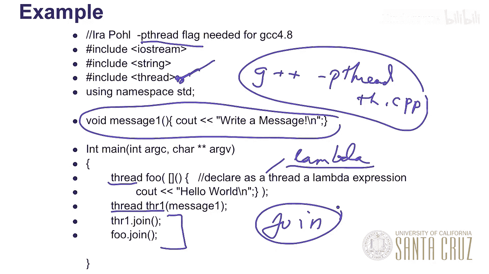
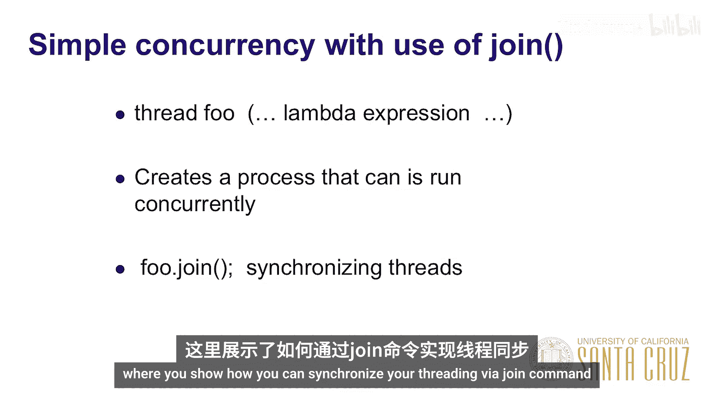

# 052：线程基础与并发编程

在本节课中，我们将要学习C++中的线程与并发编程。这是一个非常重要但同时也非常复杂的主题。我们将探讨其基本概念、挑战以及C++11标准如何提供支持。

## 线程与并发：一个复杂但重要的主题

线程与并发编程是一个困难的课题。即使在大学本科阶段，也少有课程完全专注于并发编程。通常，课程中只会提及一些并发概念，但很难达成足够的共识。这可能是因为并发编程本身仍存在许多不同的方法，并且常常依赖于特定的平台。

正因为其复杂性和平台依赖性，线程支持在很长一段时间内未被纳入C++标准。然而，C++11标准最终引入了对线程的原生支持，并提供了相关的库。

## C++11中的并发支持库

C++11标准库提供了一系列工具来支持并发编程：

*   **互斥量库**：提供了互斥锁等机制，其思想可追溯到Dijkstra等人关于互斥与信号量的讨论。
*   **Future库**：允许你等待一个计算完成并获取其结果。
*   **原子操作库**：提供了进一步的同步原语。
*   **条件变量库**：用于管理并发进程间的内存交互。

这些工具之所以必要，是因为并发编程的核心挑战在于：我们很难确定哪些任务可以并行运行，而哪些任务必须等待其他任务完成后才能执行。

## 理解并发：现实世界的类比

为了更好地理解并发，我们可以考虑一个现实世界的例子：在厨房做饭。

*   你可以一边切沙拉，一边烧开水准备煮玉米。**这是可以并发执行的任务**。
*   但是，你**不能**在给玉米去壳之前就把它扔进锅里。**这是必须顺序执行的任务**。

在现实世界中，我们通常能直观地看到这些约束。然而，在计算机世界中，我们会遇到**竞态条件**等问题。



## 计算机世界中的挑战：竞态条件



当多个线程试图使用一个共享变量，且彼此没有协调时，就可能发生竞态条件。两个线程可能同时修改同一个变量，导致该变量的最终值变得不确定，取决于修改发生的具体时机。

为了解决这个问题，我们需要一种机制，让不同的进程能够对变量“上锁”，以确保结果的可预测性。这非常复杂，因此不建议普通用户轻易尝试。但随着多核处理器的普及，并发编程正变得越来越重要。

## 为什么并发编程日益重要？

并发编程的重要性与日俱增，原因如下：

1.  **硬件发展趋势**：未来的计算机，甚至现在的计算机，都朝着大规模并行的方向发展。超级计算机通过将大量廉价设备组合在一起来获得每秒千万亿次甚至百亿亿次的运算能力。
2.  **典型应用场景**：模拟星系形成、天气预报等复杂计算任务，都可以通过将计算分解成许多可以并发执行的部分来加速。
3.  **本地计算设备**：即使在你本地的电脑店购买的PC或Mac，现在也至少配备了四核CPU。甚至在新的智能手机中，也有多线程程序在运行。

## 一个简单的C++线程示例

下面是一个非常基础的C++多线程程序示例。要使用GCC 4.8（支持C++11标准）编译此示例，你需要在编译命令中加入 `-pthread` 标志。

```cpp
#include <iostream>
#include <thread>

// 一个经典的函数
void classic_function() {
    std::cout << "这是一个经典函数线程。\n";
}

int main() {
    // 创建一个线程，执行经典函数
    std::thread t1(classic_function);

    // 创建一个线程，执行一个lambda表达式（C++11中的无名函数）
    std::thread t2([](){
        std::cout << "这是一个lambda表达式线程。\n";
    });

    // 使用join()等待线程结束，实现同步
    t1.join();
    t2.join();

    std::cout << "主线程结束。\n";
    return 0;
}
```

以下是代码的关键点解析：



*   `std::thread t1(classic_function);`：声明一个线程 `t1`，并将其与一个经典函数关联。
*   `std::thread t2([](){...});`：声明一个线程 `t2`，并将其与一个lambda表达式关联。这是C++11中创建匿名函数的常见方式。
*   `t1.join();` 和 `t2.join();`：`join()` 命令用于确保主线程等待 `t1` 和 `t2` 这两个并发执行流完成后再继续。这是实现线程同步的基本方法，其思想可以追溯到Dijkstra等人的工作。

## 总结



本节课中我们一起学习了C++并发编程的基础。我们了解到这是一个复杂但至关重要的领域，C++11通过标准库提供了原生支持。我们探讨了并发的概念、面临的挑战（如竞态条件），以及如何使用 `std::thread` 和 `join()` 来创建和管理简单的多线程程序。随着硬件全面进入多核时代，掌握并发编程的基本思想将变得越来越重要。